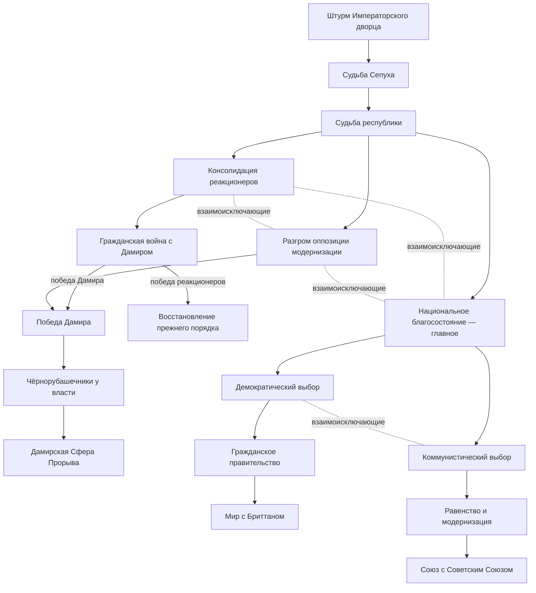
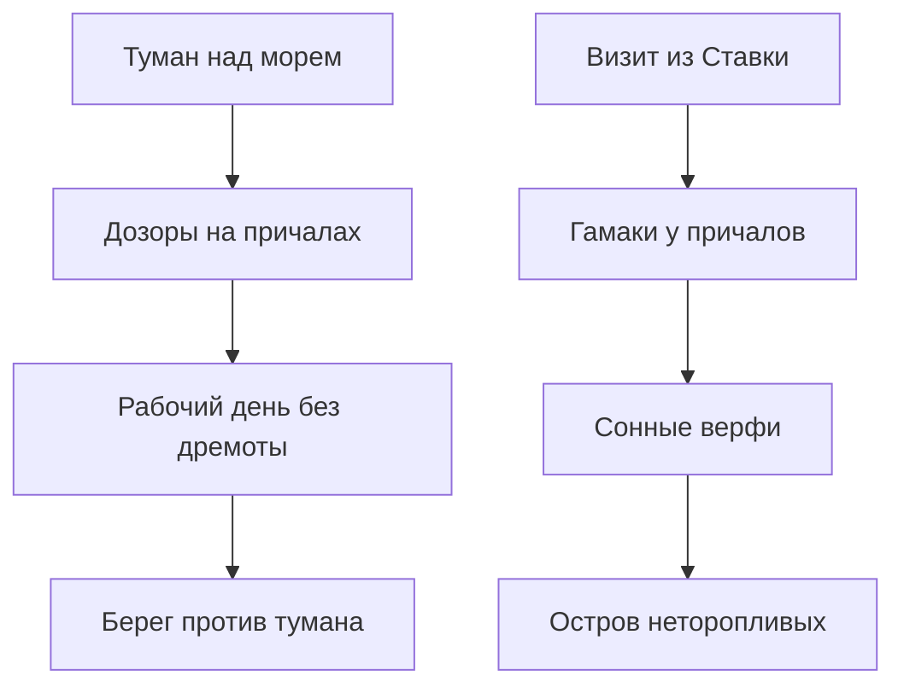
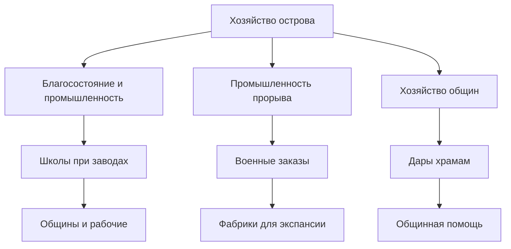
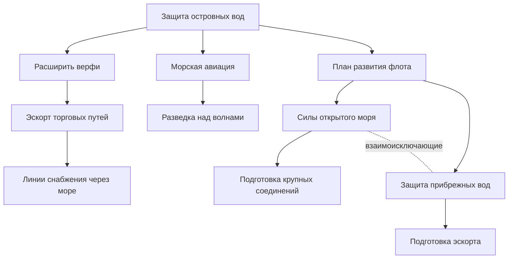
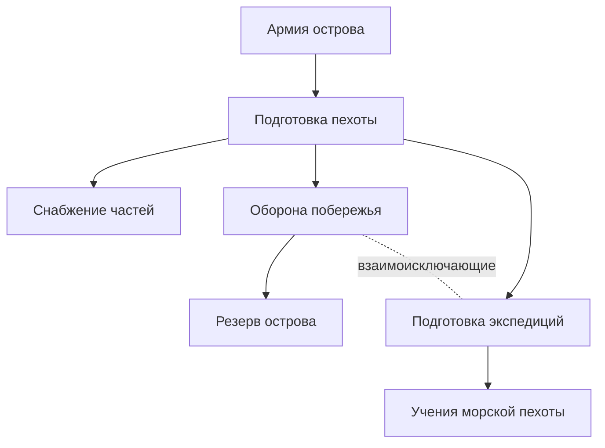

# Чёрная республика: дерево фокусов

**Статус:** проект, не реализован в игре. Направления и лидеры — решения автора; названия, художественные описания, длительность и численные эффекты ниже придуманы и требуют подтверждения. Основные правила борьбы: `mechanics/Black-Kingdom.md`.

## Структура

Судьба Сепуха выбирается событием после фокуса: казнь или жизнь. После общего этапа игрок выбирает один из трёх взаимоисключающих фокусов лагерей; соответствующий лагерь получает +15 поддержки. Решения позволяют достичь порога 70, после чего принимается завершающее решение лагеря. Сторонники благосостояния **после своей победы** выбирают демократию либо коммунизм двумя взаимоисключающими фокусами. Правящая идеология меняется лишь при её популярности не ниже 50 %; до порога действуют предлагаемые агитационные решения. При победе Дамира в гражданской войне загружается его закрытая фашистская ветка с узла «Победа Дамира», как после победы в политической борьбе; остальные закрытые курсы недоступны. Способ загрузки и сохранения дерева [uncertain], проверить при переносе в игру.

| Фокус | Дни | Описание | Предлагаемый эффект | Условие |
|---|---:|---|---|---|
| Штурм Императорского дворца | 35 | Солдаты Дамира идут к дворцу, и старая власть теряет контроль над столицей. | Переворот; Чёрная республика; дух «Нестабильное правительство». | Начало игры; обязателен. |
| Судьба Сепуха | 35 | Новая власть решает судьбу свергнутого правителя. | Событие: казнить или оставить в живых; +25 политической власти. | Штурм дворца. |
| Судьба республики | 35 | Площадь перед дворцом опустела, но спор о будущем только начался. | Категория борьбы; +25 политической власти. | Судьба Сепуха. |
| Консолидация реакционеров | 35 | Сторонники трона объединяются против республики. | Реакционеры +15 поддержки; открывает гражданскую войну при пороге. | Судьба республики; исключает два других лагеря. |
| Разгром оппозиции модернизации | 35 | Дамир объявляет противников модернизации угрозой для страны. | Поддержка военных +15; открывает второй марш при пороге. | Судьба республики; исключает два других лагеря. |
| Национальное благосостояние — главное | 35 | Сторонники перемен требуют, чтобы развитие служило людям. | Поддержка благосостояния +15; открывает победу лагеря при пороге. | Судьба республики; исключает два других лагеря. |
| Победа Дамира | 35 | Дамир закрепляет власть после борьбы за будущее страны. | +5 % поддержки войны; открывает фашистское продолжение. | Победа военных в борьбе или гражданской войне. |
| Чёрнорубашечники у власти | 70 | Новая власть проводит марш и обещает стране силу. | +5 % стабильности; после выполнения условий фашизм 100 %; открывает полугодовые парады. | Победа Дамира; фашизм не ниже 50 %. |
| Дамирская Сфера Прорыва | 70 | Токомэ предлагает соседям объединение под своим руководством. | Открывает создание неравноправного альянса; +50 политической власти. | Чёрнорубашечники у власти. |
| Демократический выбор | 35 | Сторонники выборного правительства добиваются мирной передачи власти. | +10 % популярности демократии; открывает демократическую ветку. | Победа сторонников благосостояния; исключает коммунистический выбор. |
| Гражданское правительство | 70 | Президент Мидзуки Хирано собирает кабинет и обещает открытые выборы. | +5 % стабильности; после достижения 50 % демократии — переход власти к президенту. | Демократический выбор. |
| Мир с Бриттаном | 70 | Дипломаты в Токомэ предлагают Большому Джону открыть новую страницу отношений. | +40 отношений с Бриттаном; открывает переговоры о его орбите влияния. | Гражданское правительство; Бриттан существует. |
| Коммунистический выбор | 35 | Движение за равенство выдвигает собственную программу модернизации. | +10 % популярности коммунизма; открывает коммунистическую ветку. | Победа сторонников благосостояния; исключает демократический выбор. |
| Равенство и модернизация | 70 | Данька Куро обещает рабочим новую республику и быстро составляет списки сторонников. | +5 % скорости строительства; после достижения 50 % коммунизма — переход власти к Даньке Куро. | Коммунистический выбор. |
| Союз с Советским Союзом | 70 | Токомэ направляет в Ваньград предложение о сотрудничестве. | +40 отношений с Советским Союзом; событие с предложением союза, другая сторона может отказать. | Равенство и модернизация; СССР существует. |

Предложенные величины популярности должны распределяться по стандартным правилам игры; достижение 50 % не предполагается автоматически. Фокусы не лишают ИИ или игрока права отказаться от дипломатического предложения. Гражданская война и победа реакционеров на схеме — события, не отдельные фокусы; их награды будут описаны при разработке теологической ветки.

## Казуальность и противодействие

Две самостоятельные ветки, **не взаимоисключающие навсегда**: антиказуальная доступна, пока страна не марионетка Казуалии; казуальная показывается и доступна **только** её текущей марионетке. При потере статуса незавершённые казуальные фокусы недоступны; уже полученные постоянные эффекты сохраняются, а дух «Сонный остров» снимается. Если страна позже вновь станет марионеткой Казуалии, оставшиеся фокусы снова доступны; завершённые повторно не выполняются. Антиказуальная ветка после освобождения снова доступна. Переход на шкале 100 и образование марионеток работают по `global_mechanics/Casuality-Mechanic.md`; фокусы не отменяют и не обходят их. Реакцию сюзерена и техническую проверку недоступности [uncertain] проверить при реализации.

| Фокус | Дни | Описание | Эффект (предложение) | Условие |
|---|---:|---|---|---|
| Туман над морем | 35 | С моря пришёл туман, и на острове обсуждают, что он несёт вместе с собой. | Шкала Казуальности −5. | Не марионетка Казуалии. |
| Дозоры на причалах | 70 | Портовые дозорные проверяют грузы и не дают смене уснуть у ворот. | Шкала −5; поддержка войны +3 %. | Туман над морем; не марионетка Казуалии. |
| Рабочий день без дремоты | 70 | На верфях возвращают расписания, забытые где-то между завтраком и отдыхом. | Шкала −10; стабильность +3 %. | Дозоры на причалах; не марионетка Казуалии. |
| Берег против тумана | 70 | Общины и портовые рабочие договорились будить друг друга вовремя. | Шкала −10; +5 % скорости строительства. | Рабочий день без дремоты; не марионетка Казуалии. |
| Визит из Ставки | 35 | Посланники Казуалии добрались до острова и первым делом попросили отдохнуть. | Стабильность +3 %. | Страна — марионетка Казуалии. |
| Гамаки у причалов | 70 | У каждого причала появился гамак; разгрузка теперь начинается после отдыха. | +50 политической власти. | Визит из Ставки; марионетка Казуалии. |
| Сонные верфи | 70 | Корабли строят неторопливо: рабочие уверены, что море подождёт. | +1 верфь в своём прибрежном штате при наличии ячейки. | Гамаки у причалов; марионетка Казуалии. |
| Остров неторопливых | 70 | В портах привыкли сверять расписание с погодой и настроением. | Дух «Сонный остров»: стабильность +5 %, скорость строительства −5 %; снимается при потере статуса марионетки Казуалии. | Сонные верфи; марионетка Казуалии. |

## Экономика: три политических курса

Одна общая подготовка и три части: демократия/коммунизм, фашизм, теология. Выбор определяется **текущей правящей идеологией** после завершения политического кризиса, а не случайной популярностью; демократию и коммунизм объединяет одна часть. При смене идеологии будущие фокусы старого курса закрываются, соответствующие им духи снимаются, завершённые фокусы и построенные объекты сохраняются; открывается часть нового курса, если выполнен общий корень. Бонусы разных курсов не должны складываться через смену режима; духи заменяются, а не дублируются. Казуальная марионетка может пройти общий корень, но политические части доступны лишь при соответствующей правящей идеологии. Постройки требуют места и строятся в своём контролируемом штате; при отсутствии места выдача отложена до появления подходящего штата [uncertain: реализация]. Существующий промышленный план из `mechanics/Black-Kingdom.md` остаётся отдельной категорией решений, без повторной выдачи фокусных наград.

| Фокус | Дни | Описание | Эффект (предложение) | Условие |
|---|---:|---|---|---|
| Хозяйство острова | 35 | Правительство пересчитывает склады, дороги и возможности островной промышленности. | +50 политической власти. | Политический кризис завершён. |
| Благосостояние и промышленность | 70 | Заводские планы должны учитывать и тех, кто работает у станков. | Дух «Промышленность для людей»: скорость строительства +5 %. | Хозяйство острова; демократия или коммунизм. |
| Школы при заводах | 70 | На вечерних занятиях рабочие учатся читать чертежи и считать детали. | +1 гражданская фабрика; +5 тыс. собственных специалистов образования. | Благосостояние и промышленность; демократия или коммунизм. |
| Общины и рабочие | 70 | Общины и рабочие советы спорят о плане, пока не приходят к общему решению. | Стабильность +5 %. | Школы при заводах; демократия или коммунизм. |
| Промышленность прорыва | 70 | Военное руководство требует от промышленников ускорить выполнение заказов. | Дух «Промышленность прорыва»: производство военных заводов +5 %. | Хозяйство острова; фашизм. |
| Военные заказы | 70 | Заводы получают долгосрочные заказы и список сроков без права опоздания. | +1 военная фабрика. | Промышленность прорыва; фашизм. |
| Фабрики для экспансии | 70 | Новые цеха снабжают армию для походов за пределы острова. | +1 военная фабрика; поддержка войны +3 %. | Военные заказы; фашизм. |
| Хозяйство общин | 70 | Храмовые общины организуют склады и помощь семьям прихожан. | Дух «Общинное хозяйство»: стабильность +5 %. | Хозяйство острова; теология. |
| Дары храмам | 70 | Пожертвования идут на общие запасы, а священнослужители ведут их учёт. | Вера Чёрной республики +10; +25 политической власти. | Хозяйство общин; теология. |
| Общинная помощь | 70 | Приходы распределяют запасы и укрепляют доверие к духовной власти. | Вера +20; стабильность +3 %. | Дары храмам; теология. |

Вера — отдельная шкала Чёрной республики, её старт, порог и решение описаны в `mechanics/Black-Kingdom.md`; это не вера Казуалии. Числа и названия духов придуманы. Точный способ выдачи специалистов, доступных ячеек и снятия духов проверить при реализации [uncertain].

## Военно-морской флот

Общая ветка для всех политических путей, в том числе марионетки Казуалии. Она усиливает существующий флот и не создаёт корабли без шаблонов. Фокусы исследования дают одноразовый бонус 50 % к следующему соответствующему исследованию; если применимых технологий нет, бонус сохраняется до подходящего исследования [uncertain: поведение]. Верфи строятся в своём контролируемом прибрежном штате при наличии ячейки; при отсутствии подходящего штата награда отложена [uncertain].

| Фокус | Дни | Описание | Эффект (предложение) | Условие |
|---|---:|---|---|---|
| Защита островных вод | 35 | На острове знают: снабжение и безопасность начинаются у причала. | +25 морского опыта. | Начало игры. |
| Расширить верфи | 70 | Верфи получают новые стапели и заказы на ремонт. | +2 верфи. | Защита островных вод. |
| Эскорт торговых путей | 70 | Командиры учатся сопровождать конвои через дальние воды. | Один бонус 50 % к исследованию эсминцев. | Расширить верфи. |
| Линии снабжения через море | 70 | Капитаны и портовые службы согласовывают маршруты конвоев. | +50 конвоев. | Эскорт торговых путей. |
| Морская авиация | 70 | Лётчики учатся искать корабли над морем, где нет ориентиров. | Один бонус 50 % к исследованию морских бомбардировщиков. | Защита островных вод. |
| Разведка над волнами | 70 | Патрули докладывают о движении судов до возвращения в порт. | +25 воздушного опыта. | Морская авиация. |
| План развития флота | 35 | Морское ведомство выбирает, какие силы строить в первую очередь. | +25 морского опыта. | Защита островных вод. |
| Силы открытого моря | 70 | Адмиралы готовят соединения для действий вдали от острова. | Один бонус 50 % к исследованию крейсеров. | План развития флота; исключает «Защиту прибрежных вод». |
| Подготовка крупных соединений | 70 | Штабы учатся координировать корабли и авиагруппы в дальнем походе. | +50 морского опыта. | Силы открытого моря. |
| Защита прибрежных вод | 70 | Флот сосредоточится на обороне острова и сопровождении конвоев. | Один бонус 50 % к исследованию эсминцев. | План развития флота; исключает «Силы открытого моря». |
| Подготовка эскорта | 70 | Экипажи отрабатывают поиск подлодок и охрану торговых судов. | +50 морского опыта. | Защита прибрежных вод. |

## Армия

Общая для всех курсов ветка без принудительного участия в войнах сюзерена. Развилка обороны и наступления — выбор военной доктрины; он не закрывает политические и морские ветки. Предлагаемые временные бонусы исследования действуют на одно исследование соответствующей категории [uncertain: реализация].

| Фокус | Дни | Описание | Эффект (предложение) | Условие |
|---|---:|---|---|---|
| Армия острова | 35 | Командование проверяет численность частей и запасы снаряжения. | +25 армейского опыта. | Начало игры. |
| Подготовка пехоты | 70 | Инструкторы учат новобранцев действовать вместе в горах и на равнинах. | Один бонус 50 % к исследованию пехотного оружия. | Армия острова. |
| Снабжение частей | 70 | Армейские склады согласовывают поставки с железными дорогами и портами. | Дух «Армейские склады»: расход снабжения армии −5 %. | Подготовка пехоты. |
| Оборона побережья | 70 | Гарнизоны готовят позиции на вероятных направлениях высадки. | +1 уровень береговых укреплений в столичном прибрежном штате [uncertain: расположение]. | Подготовка пехоты; исключает «Подготовку экспедиций». |
| Резерв острова | 70 | Резервисты регулярно возвращаются на учения, чтобы знать свои позиции. | +2 % военнообязанного населения. | Оборона побережья. |
| Подготовка экспедиций | 70 | Командиры разрабатывают планы переброски войск за море. | +25 армейского опыта; поддержка войны +3 %. | Подготовка пехоты; исключает «Оборону побережья». |
| Учения морской пехоты | 70 | Части учатся высаживаться с кораблей и закрепляться на берегу. | Один бонус 50 % к исследованию морской пехоты. | Подготовка экспедиций. |

Точки строительства береговых укреплений, действие исследования при другой версии игры и баланс резерва нужно уточнить до переноса в игру; не выдавать бонус или здание, пока не проверены допустимые игровые условия [uncertain].
