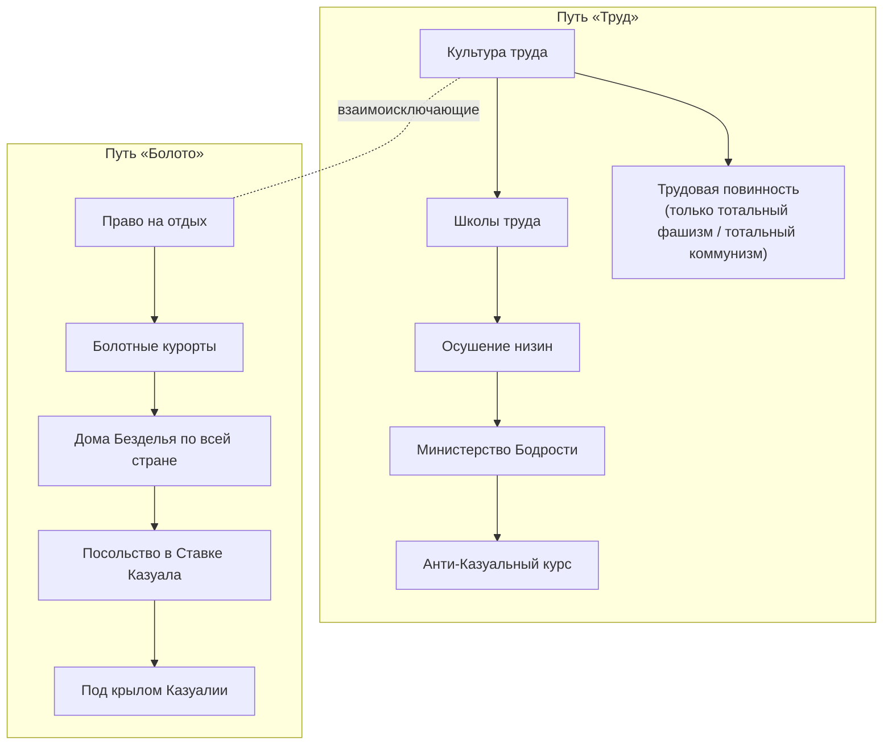

# Стандартное древо фокусов

Общее древо для стран без своего древа. **Статус:** реализовано [uncertain: в игре не проверено]. Скрипт `tools/make_focuses.py` (шаг `focuses` в `post_export.py`, после `casuality`); заметки о реализации — в конце файла.

Механика, на которую опираются фокусы, описана в `global_mechanics/Casuality-Mechanic.md`. Всё в этом файле придумано (см. `lore/Invented-Lore.md`). Длительность фокуса — в столбце «Дни». «Шкала» здесь означает шкалу Казуальности.

## Ветка «Казуальность»

Есть только у стран со стандартным древом фокусов (пока это все страны); у страны со своим древом этой ветки нет (правило автора). Недоступна Казуалии и странам, уже перешедшим в Казуальность. Ветка не зависит от идеологии (исключение — побочный фокус для радикальных режимов). Общего стартового фокуса нет: ветка начинается сразу с выбора одного из двух взаимоисключающих путей:
- **«Труд»** — против Казуальности;
- **«Болото»** — к Казуальности. Только после фокуса «Право на отдых» становятся доступны решения, поднимающие шкалу (решения борьбы доступны всегда).

### Путь «Труд» (против Казуальности)
| Фокус | Дни | Описание | Эффект | Условие |
|---|---|---|---|---|
| Культура труда | 70 | Газеты, радио и школы начинают говорить о труде как о достоинстве. Работать снова становится принято. | Шкала −10; +50 ПВ | — |
| Школы труда | 70 | В школах вместо послеобеденного сна — уроки труда и дисциплины. | Образование +1 уровень (не выше 5); множитель роста шкалы ×0,9 | Культура труда |
| Осушение низин | 105 | Государственная программа превращает топи в поля. Болото отступает. | Шкала −20; рост шкалы от соседства с Казуалией −1 в месяц | Школы труда |
| Министерство Бодрости | 70 | Ведомство, которое следит, чтобы никто не засыпал на рабочем месте. | Дух «Министерство Бодрости»: стабильность +5 %, рост шкалы от событий вдвое меньше | Осушение низин; шкала < 50 |
| Анти-Казуальный курс | 70 | Страна открыто объявляет Казуальность главной угрозой. Готовится основа будущей Анти-Казуальной Лиги. | Шкала −10; ИИ всегда на курсе «Борьба»; задел под Анти-Казуальную Лигу (механика позже) | Министерство Бодрости |

**Побочный фокус (радикальные режимы):**

| Фокус | Дни | Описание | Эффект | Условие |
|---|---|---|---|---|
| Трудовая повинность | 35 | Каждый гражданин обязан отработать на благо страны. Лень объявлена пережитком, прогульщиков отправляют в трудовые лагеря. | Шкала −15; решения борьбы дешевле на 10 % (дух «Трудовая повинность»); стабильность −5 % | Культура труда; правящая идеология — тотальный фашизм или тотальный коммунизм |

### Путь «Болото» (к Казуальности)
| Фокус | Дни | Описание | Эффект | Условие |
|---|---|---|---|---|
| Право на отдых | 70 | Конституцию дополняет статья: «Никто не обязан стараться». | Шкала +10; популярность Казуальности +5 %; **открывает решения поддержки Казуальности** | — |
| Болотные курорты | 70 | В топях открываются санатории, туда едут целыми семьями. | Стабильность +5 %; шкала +5; популярность Казуальности +5 % | Право на отдых |
| Дома Безделья по всей стране | 70 | Сеть клубов «ничего-не-делания» покрывает каждый город. | Решение «Дома Безделья» без перезарядки на 180 дней; популярность Казуальности +10 % | Болотные курорты |
| Посольство в Ставке Казуала | 35 | В Ставку Казуала отправляется посольство с дарами и просьбой о покровительстве. | Отношения с Казуалией улучшаются; шкала +10 | Дома Безделья…; Казуалия существует |
| Под крылом Казуалии | 105 | Правительство готово добровольно стать частью болотного мира. | Шкала +20; при переходе в Казуальность страна сохраняет промышленность (без распада на части) | Посольство…; шкала ≥ 75 |

## Реализация (`tools/make_focuses.py`) [uncertain: в игре не проверено]

- **Где живёт.** Блок из 11 фокусов вставляется в `common/national_focus/generic.txt` мода (дерево `generic_focus`, `default = yes`, им пользуются все страны без своего древа) между маркерами `KTITS_CASUALITY_BRANCH_BEGIN/END`. RandomParadox переписывает этот файл при каждом экспорте, поэтому шаг вырезает старый блок и вставляет заново (идемпотентно). Позиции абсолютные и свободны в ванильном дереве (его фокусы занимают x ≤ 22): путь «Труд» в колонке x = 24 (y 0–4), побочный фокус x = 26, y = 1; путь «Болото» в колонке x = 30 (y 0–4).
- **Идентификаторы.** Труд: `ktits_cas_culture`, `_schools`, `_drain`, `_ministry`, `_anticas`, побочный `_service`; Болото: `ktits_cas_rest`, `_resorts`, `_houses`, `_embassy`, `_wing`. `cost` в неделях = дни / 7 (10, 10, 15, 10, 10, 5 и 10, 10, 10, 5, 15).
- **Исключение путей.** `mutually_exclusive` в «Культура труда» и «Право на отдых» (с обеих сторон); остальные фокусы зависят от них через `prerequisite`. Корни имеют `allow_branch` (не Казуалия, нет флага падения `ktits_casuality_fallen`) [uncertain: скрывается ли вся ветка потомков].
- **«Трудовая повинность».** `available`: `has_country_leader_ideology = total_fascism` или `total_communism` (триггер есть в ваниле, подтипы — из `ideologies_data.py`); фокус виден всем, но недоступен при другой идеологии лидера.
- **Хуки механики (флаги страны `ktits_cas_f_*`, читаются в `make_casuality.py`).** `schools`: образование +1 (хидден-эффект, `ktits_edu_N` → N+1, не выше 5) и множитель роста ×0,9 перед округлением; `drain`: −1 к «соседской» части роста (не ниже 0); `ministry`: дух `ktits_cas_sp_ministry` (стабильность +5 %) и половина (с округлением вниз) положительного изменения шкалы в вариантах всех событий (дельта 1 не используется); `anticas`: снимает и блокирует флаг курса «Сближение» (ИИ всегда «Борьба»); `labour`: дух `ktits_cas_sp_labour` (стабильность −5 %) и цена решений борьбы ×0,9 (в `ktits_casuality_costs`); `houses`: флаг на 180 дней; `wing`: флаг выставляется до изменения шкалы, при падении `ktits_split_on_fall` пропускается (возврат захваченных земель `ktits_return_lands` остаётся).
- **«Дома Безделья» без перезарядки.** `days_re_enable` нельзя сделать условным, поэтому решение продублировано: `ktits_cas_support_6_free` (без `days_re_enable`) видно, пока жив флаг `ktits_cas_f_houses`; обычное решение видно, пока флага нет.
- **Решения поддержки.** В `available` всех семи решений поддержки добавлено `has_completed_focus = ktits_cas_rest`; решения борьбы без этого условия. Страна, у которой в игре есть свой фокус-древо без этой ветки, решения поддержки не откроет (по правилу автора).
- **«Посольство в Ставке Казуала».** `available`: Казуалия существует; Казуалия получает `add_opinion_modifier` в отношении страны с модификатором `ktits_cas_embassy` (новый, `common/opinion_modifiers/ktits_opinion_modifiers.txt`, +40, 24 месяца — значение придумано); шкала +10.
- **ИИ.** `ai_will_do`: фокусы «Труда» имеют вес 0 при флаге `ktits_cas_ai_rapprochement`, фокусы «Болота» — вес 0 без флага (вес 5; у побочного 1).
- **Шкала.** Все изменения идут через `add_to_variable` + `clamp_variable` + `ktits_casuality_update` с подсказкой `custom_effect_tooltip = ktits_cas_tt_*` («Казуальность: ±N»).
- **Иконки** — ванильные `GFX_goal_generic_*` (проверены по `generic.txt`): production, army_doctrines, construct_infrastructure, national_unity, defence, construct_mil_factory, neutrality_focus, construct_civ_factory, propaganda, political_pressure, military_sphere. Подбор значков придуман.
- **Отступления.** «+50 ПВ» понято как 50 политической власти; «Министерство Бодрости» уменьшает только положительные дельты событий (в т. ч. уведомлений), показанная в подсказке дельта — полная.
