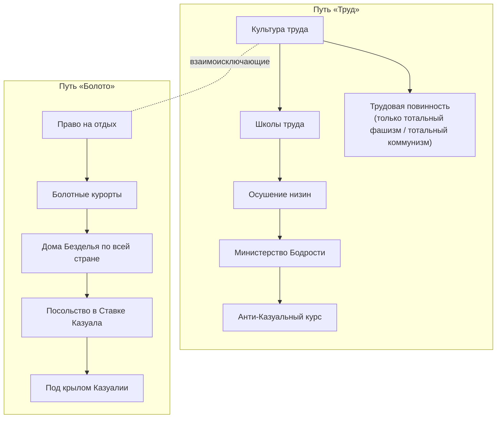
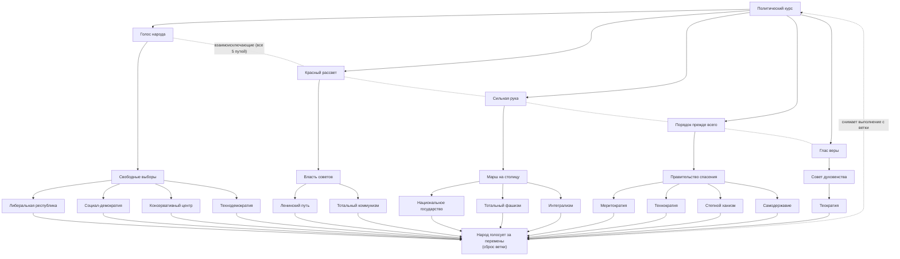
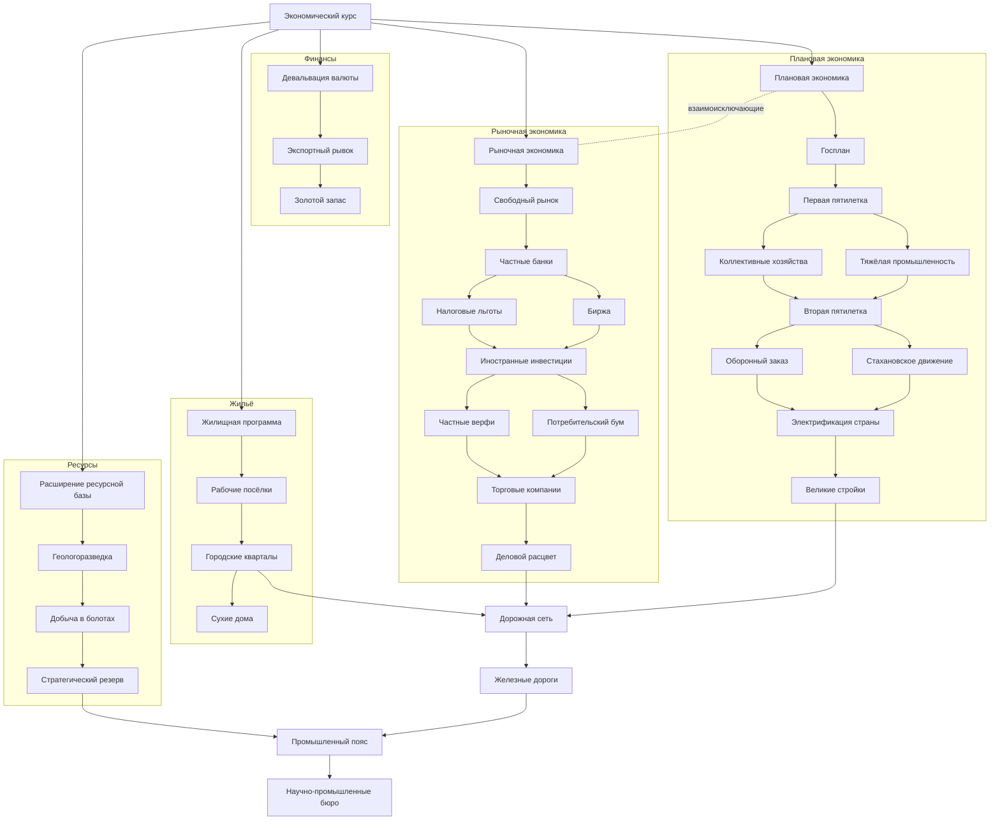
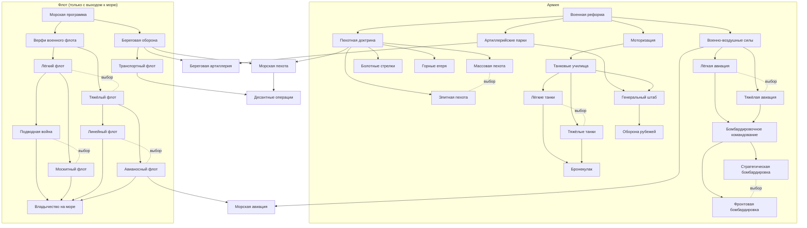
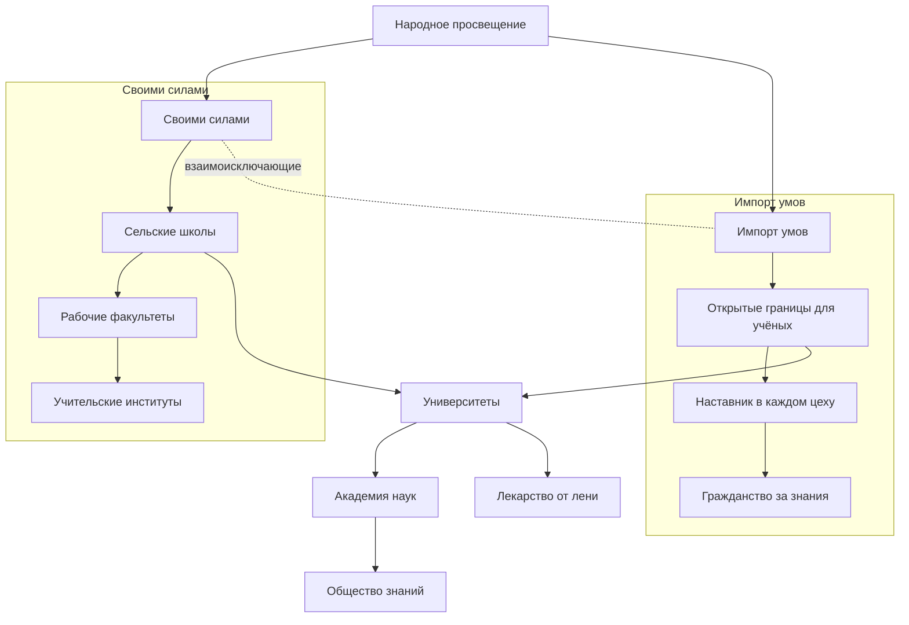

# Стандартное древо фокусов

Общее древо для стран без своего древа. **Статус:** ветка «Казуальность» реализована [uncertain: в игре не проверено]; ветка «Политический курс» реализована [uncertain: в игре не проверено]. Скрипт `tools/make_focuses.py` (шаг `focuses` в `post_export.py`, после `casuality`); заметки о реализации — в конце файла.

Механика, на которую опираются фокусы, описана в `global_mechanics/Casuality-Mechanic.md`. Всё в этом файле придумано (см. `lore/Invented-Lore.md`). Длительность фокуса — в столбце «Дни». «Шкала» здесь означает шкалу Казуальности.

## Ветка «Казуальность»

Есть только у стран со стандартным древом фокусов (пока это все страны); у страны со своим древом этой ветки нет (правило автора). Недоступна Казуалии и странам, уже перешедшим в Казуальность. Ветка не зависит от идеологии (исключение — побочный фокус для радикальных режимов). Общего стартового фокуса нет: ветка начинается сразу с выбора одного из двух взаимоисключающих путей:
- **«Труд»** — против Казуальности;
- **«Болото»** — к Казуальности. Только после фокуса «Право на отдых» становятся доступны решения, поднимающие шкалу (решения борьбы доступны всегда).

### Путь «Труд» (против Казуальности)
| Фокус | Дни | Описание | Эффект | Условие |
|---|---|---|---|---|
| Культура труда | 70 | Газеты, радио и школы начинают говорить о труде как о достоинстве. Работать снова становится принято. | Шкала −10; +50 ПВ | — |
| Школы труда | 70 | В школах вместо послеобеденного сна — уроки труда и дисциплины. | Наших специалистов +30; множитель роста шкалы ×0,9 | Культура труда |
| Осушение низин | 105 | Государственная программа превращает топи в поля. Болото отступает. | Шкала −20; рост шкалы от соседства с Казуалией −1 в месяц | Школы труда |
| Министерство Бодрости | 70 | Ведомство, которое следит, чтобы никто не засыпал на рабочем месте. | Дух «Министерство Бодрости»: стабильность +5 %, рост шкалы от событий вдвое меньше | Осушение низин; шкала < 50 |
| Анти-Казуальный курс | 70 | Страна открыто объявляет Казуальность главной угрозой. Готовится основа будущей Анти-Казуальной Лиги. | Шкала −10; ИИ всегда на курсе «Борьба»; задел под Анти-Казуальную Лигу (механика позже) | Министерство Бодрости |

**Побочный фокус (радикальные режимы):**

| Фокус | Дни | Описание | Эффект | Условие |
|---|---|---|---|---|
| Трудовая повинность | 35 | Каждый гражданин обязан отработать на благо страны. Лень объявлена пережитком, прогульщиков отправляют в трудовые лагеря. | Шкала −15; решения борьбы дешевле на 10 % (дух «Трудовая повинность»); стабильность −5 % | Культура труда; правящая идеология — тотальный фашизм или тотальный коммунизм |

### Путь «Болото» (к Казуальности)
| Фокус | Дни | Описание | Эффект | Условие |
|---|---|---|---|---|
| Право на отдых | 70 | Конституцию дополняет статья: «Никто не обязан стараться». | Шкала +10; популярность Казуальности +5 %; **открывает решения поддержки Казуальности** | — |
| Болотные курорты | 70 | В топях открываются санатории, туда едут целыми семьями. | Стабильность +5 %; шкала +5; популярность Казуальности +5 % | Право на отдых |
| Дома Безделья по всей стране | 70 | Сеть клубов «ничего-не-делания» покрывает каждый город. | Решение «Дома Безделья» без перезарядки на 180 дней; популярность Казуальности +10 % | Болотные курорты |
| Посольство в Ставке Казуала | 35 | В Ставку Казуала отправляется посольство с дарами и просьбой о покровительстве. | Отношения с Казуалией улучшаются; шкала +10 | Дома Безделья…; Казуалия существует |
| Под крылом Казуалии | 105 | Правительство готово добровольно стать частью болотного мира. | Шкала +20; при переходе в Казуальность страна сохраняет промышленность (без распада на части) | Посольство…; шкала ≥ 75 |

## Ветка «Политический курс»

Есть только у стран со стандартным древом фокусов (пока это все). Недоступна Казуалии и странам, перешедшим в Казуальность. Путь к Казуальности идёт через ветку «Казуальность», а не здесь. **Статус:** реализовано [uncertain: в игре не проверено]. Идеологии и их подтипы — `lore/Lore-Overview.md`, раздел 3. Всё в файле придумано (см. `lore/Invented-Lore.md`).

### Устройство
- Общий фокус «Политический курс», затем выбор **одного из пяти** взаимоисключающих путей: Демократия, Коммунизм, Фашизм, Порядок (нейтральные режимы), Теология.
- Каждый путь: рост популярности → приход идеологии к власти → **выбор подтипа**. Подтипы внутри пути взаимоисключающие; в каждом пути есть все подтипы группы, которые есть в моде.
- Если идеология уже правит, фокус прихода к власти выполняется без смены власти (стабильность +10 %).
- «Тотальный коммунизм» и «Тотальный фашизм» открывают побочный фокус «Трудовая повинность» в ветке «Казуальность».

Подтипы под одним фокусом прихода к власти взаимоисключающие (на схеме не соединены пунктиром, чтобы не загромождать).

### Общий фокус
| Фокус | Дни | Описание | Эффект | Условие |
|---|---|---|---|---|
| Политический курс | 70 | Страна устала от неопределённости: пора решить, по какому пути она пойдёт. | +75 ПВ | — |

### Демократия (`democratic`)
| Фокус | Дни | Описание | Эффект | Условие |
|---|---|---|---|---|
| Голос народа | 70 | Разрешены партии, газеты и собрания. | Популярность демократии +15 % | Политический курс |
| Свободные выборы | 70 | Страна идёт на честные выборы. | Правящая партия — демократы; если уже правят — стабильность +10 % | Голос народа; популярность демократии ≥ 40 % |
| Либеральная республика | 70 | Свобода рынка и слова прежде всего. | Подтип `liberalism`; товары народного потребления −5 % | Свободные выборы |
| Социал-демократия | 70 | Сильное государство заботится о каждом. | Подтип `socialism`; стабильность +10 % | Свободные выборы |
| Консервативный центр | 70 | Традиции и осторожные реформы. | Подтип `conservatism`; поддержка войны +5 %, стабильность +5 % | Свободные выборы |
| Технодемократия | 70 | Голосование через машины, решения по расчётам. | Подтип `technodemocracy`; скорость исследований +5 % | Свободные выборы |

### Коммунизм (`communism`)
| Фокус | Дни | Описание | Эффект | Условие |
|---|---|---|---|---|
| Красный рассвет | 70 | Рабочие кружки выходят из подполья. | Популярность коммунизма +15 % | Политический курс |
| Власть советов | 70 | Советы рабочих берут власть в столице. | Правящая партия — коммунисты; если уже правят — стабильность +10 % | Красный рассвет; популярность коммунизма ≥ 40 % |
| Ленинский путь | 70 | Умеренный путь: власть советов без чисток. | Подтип `leninism`; стабильность +10 %, фабрики +5 % | Власть советов |
| Тотальный коммунизм | 70 | Всё во имя партии, ничего вне партии. | Подтип `total_communism`; поддержка войны +10 %, стабильность −5 %; открывает «Трудовую повинность» | Власть советов |

### Фашизм (`fascism`)
| Фокус | Дни | Описание | Эффект | Условие |
|---|---|---|---|---|
| Сильная рука | 70 | Ветераны и националисты требуют порядка. | Популярность фашизма +15 % | Политический курс |
| Марш на столицу | 70 | Колонны сторонников входят в столицу, правительство уходит в отставку. | Правящая партия — фашисты; если уже правят — стабильность +10 % | Сильная рука; популярность фашизма ≥ 40 % |
| Национальное государство | 70 | Нация превыше всего, но без тотального контроля. | Подтип `fascism_ideology`; стабильность +10 %, военные фабрики +5 % | Марш на столицу |
| Тотальный фашизм | 70 | Государство контролирует каждую сторону жизни. | Подтип `total_fascism`; поддержка войны +15 %, стабильность −5 %; открывает «Трудовую повинность» | Марш на столицу |
| Интегрализм | 70 | Нация, вера и традиция как единое целое. | Подтип `integralism`; стабильность +5 %, поддержка войны +5 % | Марш на столицу |

### Порядок (`neutrality`)
| Фокус | Дни | Описание | Эффект | Условие |
|---|---|---|---|---|
| Порядок прежде всего | 70 | Страна устала от партий и лозунгов. | Популярность нейтральных +15 % | Политический курс |
| Правительство спасения | 70 | Власть переходит к беспартийному кабинету. | Правящая партия — нейтральные; если уже правят — стабильность +10 % | Порядок прежде всего; популярность нейтральных ≥ 40 % |
| Меритократия | 70 | Должности получают лучшие по экзаменам. | Подтип `meritocracy`; скорость исследований +5 % | Правительство спасения |
| Технократия | 70 | Страной управляют инженеры и учёные. | Подтип `technocracy`; строительство +5 % | Правительство спасения |
| Степной ханизм | 70 | Власть хана, совет родов и кочевая конница. | Подтип `steppe_khanate`; пополнение +5 % | Правительство спасения |
| Самодержавие | 70 | Вся власть в руках одного правителя. | Подтип `despotism`; стабильность +10 %, политическая власть −5 % | Правительство спасения |

### Теология (`theology`)
| Фокус | Дни | Описание | Эффект | Условие |
|---|---|---|---|---|
| Глас веры | 70 | Проповедники собирают площади. | Популярность теологии +15 % | Политический курс |
| Совет духовенства | 70 | Совет духовенства становится высшей властью. | Правящая партия — теология; если уже правит — стабильность +10 % | Глас веры; популярность теологии ≥ 40 % |
| Теократия | 70 | Закон и вера становятся одним. | Подтип `theology`; стабильность +15 %, шкала Казуальности −10 (вера против безделья) | Совет духовенства |

У теологии в моде один подтип, поэтому выбора нет.

### Смена курса
Выбор пути и подтипа можно пересмотреть: фокус «Народ голосует за перемены» сбрасывает только ветку «Политический курс». Ветка «Казуальность» и другие ветки не меняются. Правило смены курса — автора; фокус, числа и ограничения придуманы.

| Фокус | Дни | Описание | Эффект | Условие |
|---|---|---|---|---|
| Народ голосует за перемены | 70 | Улицы требуют другого будущего. Правительство объявляет, что прежний курс исчерпан, и страна снова выбирает путь. | ПВ −100; стабильность −10 %; **снимает выполнение со всей ветки «Политический курс»**, её можно пройти заново; смена курса закрыта на 365 дней | любой фокус выбора подтипа; страна не воюет; прошло 365 дней с прошлой смены курса |

Как работает:
- Эффект `uncomplete_national_focus = { focus = <корень «Политический курс»> uncomplete_children = yes }` (есть в 1.19: `documentation/effects_documentation.md`; ваниль так откатывает ветки Италии в `common/scripted_effects/ITA_scripted_effects.txt`). Снимается корень и все фокусы ниже, включая сам «Народ голосует за перемены»; взаимоисключения снова открыты [uncertain: в игре не проверено].
- Эффекты выполненных фокусов сами не откатываются. У фокусов выбора подтипа есть блок `on_uncomplete`: он снимает их духи и бонусы. Правящая партия и подтип остаются до тех пор, пока их не сменит новый фокус.
- Ограничитель: флаг на 365 дней после смены курса (фокус недоступен), фокус нельзя брать во время войны.
- ИИ берёт смену курса редко: вес 1, только при стабильности ниже 40 % [придумано].

### Связь с другими ветками
- «Тотальный коммунизм» и «Тотальный фашизм» — условие побочного фокуса «Трудовая повинность» (ветка «Казуальность»).
- Казуальность здесь не выбирается: к ней ведёт путь «Болото».

## Ветка «Экономика»

**Статус:** реализовано [uncertain: в игре не проверено], см. «Реализация ветки «Экономика»» ниже (там же отличия от описания: 36 фокусов вместо 35 и замены ключей).

Есть только у стран со стандартным древом фокусов (пока это все). Ветка не зависит от идеологии. Выбор «Плановая экономика» или «Рыночная экономика» — правило автора, как и фокусы девальвации, жилья и ресурсной базы. Всё остальное придумано (см. `lore/Invented-Lore.md`). «Шкала» здесь означает шкалу Казуальности. Фабрики: «гражд.» — гражданские, «воен.» — военные.

### Устройство
- Корень «Экономический курс» открывает четыре направления.
  - **Финансы:** девальвация и экспорт.
  - **Жильё:** строительство жилья.
  - **Ресурсы:** расширение ресурсной базы.
  - **Выбор модели:** плановая или рыночная экономика; взаимоисключающие.
- У каждой модели свой путь из 9 фокусов.
- Общий финал «Промышленный пояс» доступен после любой модели и после жилья и ресурсов.
- Всего 36 фокусов (в первоначальном описании было 35: сумма таблиц даёт 36).

### Корень
| Фокус | Дни | Описание | Эффект | Условие |
|---|---|---|---|---|
| Экономический курс | 70 | Министры спорят, как поднимать хозяйство страны, и садятся писать программу. | +50 ПВ; товары народного потребления −2 % | — |

### Финансы
| Фокус | Дни | Описание | Эффект | Условие |
|---|---|---|---|---|
| Девальвация валюты | 35 | Национальная валюта резко дешевеет. Товары страны дешевле для соседей, а сбережения граждан тают. | Стабильность −5 % на 180 дней; торговля: экспорт ресурсов выгоднее (гражд. фабрик за ресурсы +20 %); товары нар. потребления −3 % | Экономический курс |
| Экспортный рывок | 70 | Дешёвая валюта превращается в заказы из-за границы. | 1 гражд. фабрика; скорость строительства +5 % | Девальвация валюты |
| Золотой запас | 70 | Выручку от экспорта переплавляют в слитки и прячут в подвалы Центробанка. | +100 ПВ; стабильность +5 % (снимает штраф девальвации) | Экспортный рывок |

### Жильё
| Фокус | Дни | Описание | Эффект | Условие |
|---|---|---|---|---|
| Жилищная программа | 70 | Государство обещает каждой семье крышу над головой. | Стабильность +5 %; +1 слот строительства в 2 штатах | Экономический курс |
| Рабочие посёлки | 70 | Рядом с заводами вырастают посёлки из одинаковых домов. | 1 гражд. фабрика; набор рекрутов +2 % | Жилищная программа |
| Городские кварталы | 70 | Старые трущобы сносят, на их месте строят кварталы с водопроводом. | +2 слота строительства в столице; стабильность +5 % | Рабочие посёлки |
| Сухие дома | 70 | Новые дома ставят на сваях и подсыпке: болотная сырость больше не проникает в жильё. | Шкала −5; рост шкалы от популярности Казуальности −1 в месяц | Городские кварталы |

### Ресурсы
| Фокус | Дни | Описание | Эффект | Условие |
|---|---|---|---|---|
| Расширение ресурсной базы | 70 | Страна составляет опись всего, что лежит в её недрах. | Добыча ресурсов +5 % | Экономический курс |
| Геологоразведка | 70 | Экспедиции геологов уходят в горы и пустоши. | +4 стали и +2 алюминия в штатах с горами (по выбору ИИ/скрипта) | Расширение ресурсной базы |
| Добыча в болотах | 70 | Торф, болотная руда и газ: топи тоже могут кормить страну. | +4 нефти в болотных штатах; шкала +5 (люди работают у болота) | Геологоразведка |
| Стратегический резерв | 70 | Склады ресурсов на случай войны или кризиса. | Добыча ресурсов +5 %; дух «Стратегический резерв» (снабжение +5 %) | Добыча в болотах |

### Плановая экономика
| Фокус | Дни | Описание | Эффект | Условие |
|---|---|---|---|---|
| Плановая экономика | 70 | Государство само решает, что, где и сколько производить. | Дух «Плановая экономика»: скорость строительства +10 %, товары нар. потребления +5 % | Экономический курс |
| Госплан | 70 | Комитет плановиков расписывает выпуск каждой фабрики на годы вперёд. | +50 ПВ; эффективность производства (рост) +5 % | Плановая экономика |
| Первая пятилетка | 105 | План на пять лет: заводы, электростанции, каналы. | 2 гражд. фабрики | Госплан |
| Тяжёлая промышленность | 70 | Сталь и станки важнее одежды и мебели. | 2 воен. фабрики; товары нар. потребления +2 % | Первая пятилетка |
| Коллективные хозяйства | 70 | Крестьян объединяют в хозяйства с общими тракторами. | Набор рекрутов +3 %; стабильность −5 % | Первая пятилетка |
| Вторая пятилетка | 105 | Новый план ещё больше прежнего. | 2 гражд. фабрики; скорость строительства +5 % | Тяжёлая промышленность или Коллективные хозяйства |
| Стахановское движение | 70 | Передовиков, перевыполняющих норму, ставят в пример всей стране. | Шкала −10; эффективность производства (предел) +5 % | Вторая пятилетка |
| Оборонный заказ | 70 | Часть плана отдаётся армии. | 2 воен. фабрики | Вторая пятилетка |
| Электрификация страны | 70 | Провода тянут в каждую деревню. | +1 слот строительства в 3 штатах; скорость исследований +3 % | Стахановское движение или Оборонный заказ |
| Великие стройки | 105 | Каналы, плотины и города в пустых местах. | 3 гражд. фабрики; стабильность −5 % | Электрификация страны |

### Рыночная экономика
| Фокус | Дни | Описание | Эффект | Условие |
|---|---|---|---|---|
| Рыночная экономика | 70 | Цены и выпуск решает рынок, государство только следит за правилами. | Дух «Рыночная экономика»: товары нар. потребления −5 %, скорость строительства +5 % | Экономический курс |
| Свободный рынок | 70 | Отменены ценовые ограничения, лавки и мастерские открываются без разрешений. | 1 гражд. фабрика; стабильность +3 % | Рыночная экономика |
| Частные банки | 70 | Банки дают ссуды всем, у кого есть идея и залог. | +50 ПВ; скорость строительства +5 % | Свободный рынок |
| Биржа | 70 | В столице открывается фондовая биржа. | 2 гражд. фабрики | Частные банки |
| Налоговые льготы | 70 | Новым предприятиям — несколько лет без налогов. | Товары нар. потребления −3 % | Частные банки |
| Иностранные инвестиции | 105 | Иностранные компании строят заводы в стране. | 2 гражд. фабрики; отношения с соседями +10 | Биржа или Налоговые льготы |
| Потребительский бум | 70 | Магазины полны, люди покупают в кредит. | Стабильность +5 %; товары нар. потребления +2 % | Иностранные инвестиции |
| Частные верфи | 70 | Судостроение отдают частным владельцам. | +2 верфи | Иностранные инвестиции |
| Торговые компании | 70 | Крупные компании возят товары по всему материку. | Гражд. фабрик за ресурсы +20 %; +50 ПВ | Потребительский бум или Частные верфи |
| Деловой расцвет | 105 | Страна — один из деловых центров материка. | 3 гражд. фабрики; шкала −5 (работать снова выгодно) | Торговые компании |

### Общий финал
| Фокус | Дни | Описание | Эффект | Условие |
|---|---|---|---|---|
| Дорожная сеть | 70 | Шоссе связывают все крупные города. | Инфраструктура +1 в 4 штатах | Великие стройки, Деловой расцвет или Городские кварталы |
| Железные дороги | 70 | Новые линии и вокзалы. | Инфраструктура +1 в 4 штатах; снабжение +5 % | Дорожная сеть |
| Промышленный пояс | 105 | Вдоль железных дорог вырастает пояс заводов. | 2 гражд. фабрики, 2 воен. фабрики | Железные дороги и Стратегический резерв |
| Научно-промышленные бюро | 70 | Учёные работают прямо при заводах. | +1 слот исследований | Промышленный пояс |

### Связь с другими ветками
- Казуальность: «Сухие дома», «Стахановское движение», «Деловой расцвет» снижают шкалу; «Добыча в болотах» поднимает.
- Идеология не важна: плановую экономику может выбрать демократия, рыночную — коммунисты.

## Ветки «Армия» и «Флот»

**Статус:** только описание, в моде нет. Всё придумано (см. `lore/Invented-Lore.md`), кроме правил автора: две ветки со связями между собой; морские фокусы доступны только при выходе к морю; в авиации, флоте, пехоте и танках — выбор пути (взаимоисключающие фокусы). Ветки дают технологии, доктрины и производство, а не цели войны (цели войны — в другой части фокусов). Не зависят от идеологии, доступны всем странам со стандартным древом (включая Казуалию).

**Выход к морю** — у страны есть хотя бы один прибрежный штат (`any_owned_state = { is_coastal = yes }` [uncertain: сверить триггер с 1.19]). Без него весь флот недоступен (корень флота скрыт через `allow_branch`), связующие фокусы тоже закрыты; армия доступна полностью.

**Выборы (взаимоисключающие пары):**
| Направление | Вариант 1 | Вариант 2 |
|---|---|---|
| Пехота | Массовая пехота — много дешёвых дивизий | Элитная пехота — меньше, но лучше |
| Танки | Лёгкие танки — скорость и разведка | Тяжёлые танки — прорыв обороны |
| Авиация | Лёгкая авиация — истребители и штурмовики | Тяжёлая авиация — тяжёлые истребители и тактические бомбардировщики для поддержки дивизий |
| Бомбардировка | Стратегическая — удары по заводам и городам | Фронтовая — удары по войскам и снабжению |
| Флот | Лёгкий флот — эсминцы, лёгкие крейсеры, подлодки | Тяжёлый флот — линкоры, тяжёлые крейсеры, авианосцы |
| Лёгкий флот | Подводная война | Москитный флот (эсминцы и торпедные катера) |
| Тяжёлый флот | Линейный флот | Авианосный флот |

**Связи между ветками** (фокусы, требующие оба направления):
- «Морская пехота» — «Пехотная доктрина» (армия) и «Береговая оборона» (флот).
- «Береговая артиллерия» — «Артиллерийские парки» (армия) и «Береговая оборона» (флот).
- «Морская авиация» — «Военно-воздушные силы» (армия) и «Авианосный флот» (флот).
- «Десантные операции» — «Морская пехота» и «Транспортный флот»; финал обеих веток.

На схеме `A & B --> C` означает: фокусу C нужен любой из A, B, если в таблице «или», и оба — если «и».

### Армия: пехота
| Фокус | Дни | Описание | Эффект | Условие |
|---|---|---|---|---|
| Военная реформа | 70 | Генералы признают: армия воюет по учебникам прошлого века. | Опыт армии +25; скидка 50 % на 1 армейскую технологию | — |
| Пехотная доктрина | 70 | Пехота — основа армии, и её надо учить заново. | Скидка 100 % на 1 технологию пехотного снаряжения | Военная реформа |
| Массовая пехота | 70 | Каждый мужчина — солдат, а винтовка — проще лопаты. | Дух: набор рекрутов +3 %, стоимость пехотного снаряжения −10 %, организация пехоты −5 % | Пехотная доктрина; не взята «Элитная пехота» |
| Элитная пехота | 70 | Лучше одна обученная дивизия, чем три толпы. | Дух: атака и защита пехоты +5 %, опыт дивизий растёт быстрее +10 %, набор рекрутов −2 % | Пехотная доктрина; не взята «Массовая пехота» |
| Болотные стрелки | 70 | Солдаты учатся воевать по пояс в воде — без жалоб и без лени. | Дух: атака и защита в болотах +10 %; шкала Казуальности −5 | Пехотная доктрина |
| Горные егеря | 70 | Горы — не преграда, а укрытие. | Дух: атака и защита в горах +10 % | Пехотная доктрина |
| Артиллерийские парки | 70 | Пушки сводят в парки с обученной обслугой. | +1 воен. фабрика; скидка на 1 технологию артиллерии | Военная реформа |

### Армия: танки
| Фокус | Дни | Описание | Эффект | Условие |
|---|---|---|---|---|
| Моторизация | 70 | Лошадей меняют на грузовики. | Скидка на 2 технологии моторизации; снабжение +5 % | Военная реформа |
| Танковые училища | 105 | Молодые офицеры учатся водить стальные машины. | Скидка на 1 технологию бронетехники | Моторизация |
| Лёгкие танки | 70 | Быстрые машины для разведки и обхода. | Скидка на 2 технологии лёгких танков; дух: скорость бронетехники +5 % | Танковые училища; не взяты «Тяжёлые танки» |
| Тяжёлые танки | 70 | Медленные крепости на гусеницах ломают любую оборону. | Скидка на 2 технологии тяжёлых танков; дух: прорыв бронетехники +10 % | Танковые училища; не взяты «Лёгкие танки» |
| Бронекулак | 105 | Танки сводят в ударные кулаки. | +2 воен. фабрики | Лёгкие танки или Тяжёлые танки |
| Генеральный штаб | 105 | Армией наконец командуют по плану, а не по настроению. | Опыт армии +50; планирование +10 % | Артиллерийские парки и Танковые училища |
| Оборона рубежей | 70 | Армия существует, чтобы защищать. | Форты +1 в 3 пограничных штатах; защита +5 % | Генеральный штаб |

### Армия: авиация
| Фокус | Дни | Описание | Эффект | Условие |
|---|---|---|---|---|
| Военно-воздушные силы | 70 | Небо — тоже фронт. | +1 авиабаза в столице; опыт авиации +25 | Военная реформа |
| Лёгкая авиация | 70 | Много быстрых и дешёвых самолётов. | Скидка на 2 технологии истребителей и 1 штурмовиков (CAS); дух: атака истребителей +5 %, стоимость лёгких самолётов −5 % | ВВС; не взята «Тяжёлая авиация» |
| Тяжёлая авиация | 70 | Дальние тяжёлые машины, которые прикрывают свои дивизии с воздуха. | Скидка на 2 технологии тяжёлых истребителей и 1 тактических бомбардировщиков; дух: поддержка наземных войск авиацией +10 % | ВВС; не взята «Лёгкая авиация» |
| Бомбардировочное командование | 70 | Бомбардировщики сводят под единое командование. | Опыт авиации +25 | Лёгкая авиация или Тяжёлая авиация |
| Стратегическая бомбардировка | 70 | Бить по заводам и городам, чтобы враг остался без снарядов. | Скидка на 2 технологии стратегических бомбардировщиков; дух: эффективность стратегических бомбардировок +10 % | Бомбардировочное командование; не взята «Фронтовая» |
| Фронтовая бомбардировка | 70 | Бить по колоннам, складам и мостам за линией фронта. | Скидка на 2 технологии тактических бомбардировщиков; дух: удары по снабжению и войскам +10 % | Бомбардировочное командование; не взята «Стратегическая» |

### Флот (только с выходом к морю)
| Фокус | Дни | Описание | Эффект | Условие |
|---|---|---|---|---|
| Морская программа | 70 | Страна вспоминает, что у неё есть берег. | Опыт флота +25; +1 верфь | выход к морю |
| Береговая оборона | 70 | Сначала защитить свои порты. | Скидка на 2 морские технологии; береговые форты +1 в столичном порту [uncertain] | Морская программа |
| Верфи военного флота | 70 | Гражданские верфи переводят на военные заказы. | +2 верфи | Морская программа |
| Лёгкий флот | 70 | Много малых кораблей вместо нескольких больших. | Скидка на 2 технологии эсминцев и лёгких крейсеров; дух: стоимость лёгких кораблей −10 % | Верфи; не взят «Тяжёлый флот» |
| Тяжёлый флот | 105 | Флот силы: большие корабли, большие пушки. | Скидка на 2 технологии линкоров и тяжёлых крейсеров; +1 верфь | Верфи; не взят «Лёгкий флот» |
| Подводная война | 70 | Подлодки охотятся группами и топят конвои. | Скидка на 2 технологии подлодок; дух: атака подлодок +10 % | Лёгкий флот; не взят «Москитный флот» |
| Москитный флот | 70 | Эсминцы и торпедные катера роем атакуют крупные корабли. | Дух: торпедная атака эсминцев +10 %, скорость кораблей прибрежных зон +5 % | Лёгкий флот; не взята «Подводная война» |
| Линейный флот | 105 | Линкоры — сердце флота. | Скидка на 2 технологии линкоров; дух: броня крупных кораблей +5 % | Тяжёлый флот; не взят «Авианосный флот» |
| Авианосный флот | 105 | Самолёты, которые взлетают с воды. | Скидка на 2 технологии авианосцев | Тяжёлый флот; не взят «Линейный флот» |
| Транспортный флот | 70 | Армию нужно уметь перевозить. | +50 конвоев | Береговая оборона |
| Владычество на море | 105 | Флот страны — сила, с которой считаются. | Опыт флота +50; дух: скорость строительства кораблей +10 % | любой из: Подводная война, Москитный флот, Линейный флот, Авианосный флот |

### Связующие фокусы (армия + флот)
| Фокус | Дни | Описание | Эффект | Условие |
|---|---|---|---|---|
| Морская пехота | 70 | Пехотинцы, которые не боятся воды. | Скидка на технологию морской пехоты; шаблон дивизии «Морская пехота» | Пехотная доктрина и Береговая оборона |
| Береговая артиллерия | 70 | Пушки смотрят в море. | Береговые форты +1 в 2 портах; защита в прибрежных провинциях +5 % [uncertain] | Артиллерийские парки и Береговая оборона |
| Морская авиация | 70 | Самолёты над морем. | Скидка на 2 технологии морской авиации | Военно-воздушные силы и Авианосный флот |
| Десантные операции | 105 | Армия и флот учатся высаживаться вместе. | Дух: скорость высадки десанта +25 %, атака с моря +10 % | Морская пехота и Транспортный флот |

## Реализация ветки «Экономика» (`tools/make_focuses.py`, блок `KTITS_ECONOMY_BRANCH_BEGIN/END`) [uncertain: в игре не проверено]
- **Число фокусов: 36, не 35.** В таблицах ветки 1 корень + 3 финансов + 4 жилья + 4 ресурсов + по 10 в каждой модели + 4 финала = 36 (в тексте было «9 фокусов в модели» и «35»). Реализованы все строки таблиц.
- **Сетка:** x = 84–108, y = 0–13, свободно от ваниля (x ≤ 22), «Казуальности» (24–30), «Политического курса» (34–64) и «Образования» (72–80). Корень (100, 0); финансы x = 84, жильё x = 88, ресурсы x = 92, плановая экономика x = 96–100, рыночная x = 104–108; финал x = 100–102, y = 10–13. Карту фокусов в игре не смотрели [uncertain].
- **Доступность:** всем странам с общим древом, включая Казуалию и её марионеток (по описанию ветки; `allow_branch` нет). Идеология не важна.
- **Предусловия:** «или» — один блок `prerequisite = { focus = A focus = B }`, «и» — отдельные блоки. «Плановая экономика» и «Рыночная экономика» взаимоисключающие в обе стороны.
- **Фабрики, слоты, инфраструктура, верфи:** по ванильному образцу `generic.txt`: `random_owned_controlled_state` + `add_extra_state_shared_building_slots` + `add_building_construction` (`industrial_complex` — гражданская, `arms_factory` — военная, `dockyard`, `infrastructure`), `instant_build = yes`. Все N фабрик одного фокуса идут в один случайный штат. Строки лежат в `hidden_effect`, а в окне фокуса показывается подсказка `ktits_eco_tt_*` (ванильные `complete_tooltip` не использованы). «Слот строительства в N штатах» — N независимых случайных штатов (могут повториться). Столица — `capital_scope`. Верфи — только в прибрежном штате (`is_coastal = yes`); если у страны нет побережья, эффект не сработает.
- **Ресурсы:** `add_resource = { type amount }` в случайном штате страны. Вместо «штатов с горами» и «болотных штатов» берётся любой штат: в документации 1.19 нет триггера террейна штата (`has_terrain` работает только в области страны) [uncertain].
- **Проценты — духи** `ktits_eco_sp_*` (20 штук, `common/ideas/ktits_eco_ideas.txt`), у каждого лор-описание. Ключи модификаторов (проверены по `documentation/modifiers_documentation.md` и ванильным идеям): `consumer_goods_factor`, `production_speed_buildings_factor`, `conscription_factor` (набор рекрутов), `research_speed_factor`, `production_factory_efficiency_gain_factor` (рост эффективности), `production_factory_max_efficiency_factor` (предел), `local_resources_factor` (добыча), `supply_consumption_factor`, `resource_trade_cost_bonus_per_factory`.
- **«Товары народного потребления −2 %»** записаны буквально: `consumer_goods_factor = −0.02`; знак как в таблице.
- **Стабильность:** «стабильность ±N %» у фокусов — разовое `add_stability` (как в «Политическом курсе»). Исключение: «−5 % на 180 дней» у девальвации — временный дух `ktits_eco_sp_crash` (`add_timed_idea`, 180 дней), его снимает «Золотой запас» (`remove_ideas`).
- **«Гражд. фабрик за ресурсы +20 %»** (девальвация, «Торговые компании») — ключа в процентах нет. Взят ближайший ванильный `resource_trade_cost_bonus_per_factory = 1` (по одному на каждый из двух фокусов; в ванили у черт лидера значения 1–2) [uncertain: соответствие 20 % не проверено].
- **«Снабжение +5 %»** — ближайший ключ `supply_consumption_factor = −0.05` (расход снабжения меньше) [uncertain].
- **«Добыча ресурсов +5 %»** — `local_resources_factor = 0.05` в стране (в ванильных идеях встречается) [uncertain: действует ли на все штаты].
- **«Отношения с соседями +10»:** `every_neighbor_country = { add_opinion_modifier = { target = ROOT modifier = ktits_eco_investment } }`; модификатор `ktits_eco_investment` (значение 10, 24 месяца; срок придуман) в `common/opinion_modifiers/ktits_opinion_modifiers.txt`.
- **Связь с Казуальностью:** шкала меняется как в других ветках (подсказка + `ktits_casuality_update`): «Сухие дома» −5, «Стахановское движение» −10, «Деловой расцвет» −5, «Добыча в болотах» +5. «Сухие дома» ещё ставят флаг `ktits_cas_f_dry`: в `ktits_casuality_growth` слагаемое популярности Казуальности уменьшается на 1, если у партии не меньше 10 % (на нулевом слагаемом ничего не отнимает); умножение на образование и округление идут после.
- **«Научно-промышленные бюро»:** `add_research_slot = 1` и наших специалистов +15 (`Education.md`, через `tools/education_mech.py`). У Казуалии специалисты остаются 0: `ktits_education_update` обнуляет счётчики [uncertain].
- **ИИ:** вес 1–5; «Плановая» в 4 раза вероятнее у коммунизма и фашизма, «Рыночная» у них в 4 раза реже (вес 0,25); девальвацию ИИ не берёт при стабильности ниже 55 %.
- **Значки:** ванильные `GFX_goal_generic_*` (проверены по `interface/goals.gfx`); картинки духов — `GFX_idea_generic_*` (проверены по `interface/*.gfx`). Подбор значков придуман.

## Ветка «Образование»

**Статус:** реализовано [uncertain: в игре не проверено], см. «Реализация ветки «Образование»» ниже. Механика — `global_mechanics/Education.md` (специалисты наши и иностранные, уровни по числу наших). Всё в ветке придумано (см. `lore/Invented-Lore.md`). Недоступна Казуалии (у неё специалистов всегда 0; её курс реформ — позже) и марионеткам Казуалии. Не зависит от идеологии.

Устройство: корень «Народное просвещение», затем выбор одного из двух взаимоисключающих подходов:
- **«Своими силами»** — растим своих специалистов; доступен всем;
- **«Импорт умов»** — привлекаем иностранных, они переходят в наших; доступен **только крупным странам** (триггер `ktits_is_big_country`, подсказка «Крупная страна (та, у которой есть выделяемые государства)»). Открывает решения привлечения: «Приют для беглых умов», «Наставничество», «Договор о сотрудничестве» (`global_mechanics/Education.md`).

После любого подхода — общие фокусы «Университеты» → «Академия наук» → «Общество знаний».

### Корень
| Фокус | Дни | Описание | Эффект | Условие |
|---|---|---|---|---|
| Народное просвещение | 70 | Правительство признаёт: страна, которая не умеет читать, не умеет и строить. | Наших специалистов +5; +25 ПВ | — |

### Подход «Своими силами»
| Фокус | Дни | Описание | Эффект | Условие |
|---|---|---|---|---|
| Своими силами | 70 | Решено не надеяться на чужаков: учителей и инженеров вырастим сами. | Дух «Своими силами»: решения упрощения отнимают наших специалистов вдвое меньше | Народное просвещение |
| Сельские школы | 70 | В каждой деревне — школа с печкой и одним учителем на все классы. | Наших специалистов +10 | Своими силами |
| Рабочие факультеты | 70 | Рабочих учат прямо при заводах: днём станок, вечером лекция. | Наших специалистов +10; эффективность производства (рост) +3 % | Сельские школы |
| Учительские институты | 105 | Учителя теперь готовят учителей: образование растёт само. | Наших специалистов +1 в месяц навсегда | Рабочие факультеты |

### Подход «Импорт умов»
| Фокус | Дни | Описание | Эффект | Условие |
|---|---|---|---|---|
| Импорт умов | 70 | Если своих мастеров нет, их можно пригласить. Двери для чужих учёных открыты только у крупных держав: малым странам не хватит ни денег, ни громких имён. | Открываются решения привлечения специалистов; «Приют» и «Наставничество» дешевле на 25 % | Народное просвещение; только крупная страна |
| Открытые границы для учёных | 70 | Учёным из любой страны — визы без очереди и квартиры в столице. | Иностранных специалистов +15 | Импорт умов |
| Наставник в каждом цеху | 70 | Каждый приезжий специалист берёт учеников. | Переход иностранных в наших 8 % в месяц вместо 5 % (навсегда) | Открытые границы для учёных |
| Гражданство за знания | 105 | Иностранцам, отработавшим пять лет, дают гражданство. | Сразу треть иностранных специалистов становится нашими | Наставник в каждом цеху |

### Общие фокусы
| Фокус | Дни | Описание | Эффект | Условие |
|---|---|---|---|---|
| Университеты | 105 | В крупных городах открываются университеты. | Наших специалистов +20 | Сельские школы или Открытые границы для учёных |
| Академия наук | 105 | Лучшие умы страны собраны под одной крышей. | Наших специалистов +20; скорость исследований +3 % | Университеты |
| Общество знаний | 140 | Знание становится главной ценностью страны. | Наших специалистов +30 | Академия наук; уровень образования ≥ 3 |
| Лекарство от лени | 70 | Учёные доказывают: Казуальность — болезнь, и от неё есть лечение. | Шкала Казуальности −10; множитель роста шкалы ×0,9 | Университеты |

## Реализация ветки «Образование» (`tools/make_focuses.py`, блок `KTITS_EDUCATION_BRANCH_BEGIN/END`) [uncertain: в игре не проверено]

- **Где живёт.** Третий блок в `common/national_focus/generic.txt` (после «Политического курса»), вставляется заново при каждом запуске. 13 фокусов, `cost` = дни / 7 (10, 10, 10, 10, 15 | 10, 10, 10, 15 | 15, 15, 20, 10). Духи `ktits_edu_sp_workers`, `ktits_edu_sp_academy` (`common/ideas/ktits_edu_focus_ideas.txt`), локализация `ktits_edu_focus_l_*.yml`, подсказки специалистов — `ktits_education_l_*.yml`.
- **Идентификаторы и сетка.** `ktits_edu_root` (x = 76, y = 0), «Своими силами» `_own` (72, 1), `_rural` (72, 2), `_workers` (72, 3), `_inst` (72, 4); «Импорт умов» `_imp` (80, 1), `_open` (80, 2), `_mentor` (80, 3), `_citizen` (80, 4); `_univ` (76, 3), `_academy` (76, 4), `_society` (76, 5), `_cure` «Лекарство от лени» (78, 4). Ванильное дерево x ≤ 22, «Казуальность» 24–30, «Политический курс» 34–64, «Образование» 72–80.
- **Исключение.** `ktits_edu_own` и `ktits_edu_imp` взаимоисключающие с обеих сторон. «Импорт умов»: `available` с `custom_trigger_tooltip` `ktits_edu_req_big` и `ktits_is_big_country = yes` (у малых стран фокус закрыт, остаётся «Своими силами»). «Университеты»: `prerequisite = { focus = ktits_edu_rural focus = ktits_edu_open }` (несколько фокусов в одном блоке = любой). «Общество знаний»: `available` с `custom_trigger_tooltip` «Образованность не ниже уровня 3» (`has_idea` `ktits_edu_3/4/5`) [uncertain: подсказка внутри `OR`].
- **Недоступно Казуалии и её марионеткам.** `allow_branch` у корня: не Казуалия, не `is_puppet_of`, нет флага падения [uncertain: скрывает ли всю ветку потомков].
- **Хуки.** Флаги: `ktits_edu_f_self` (половина потерь решений упрощения), `ktits_edu_f_import` (цены −25 %, сразу пересчитываются эффектом `ktits_education_costs`), `ktits_edu_f_mentor` (8 % в месяц), `ktits_edu_f_inst` (+1 в месяц), `ktits_cas_f_cure` (читается в `ktits_casuality_growth`, множитель ×0,9 после «Школ труда»; вместе ×0,81). «Гражданство за знания»: треть иностранных (`round`) переходит в наших. «Лекарство от лени»: шкала −10 через тот же помощник, что у «Казуальности».
- **Духи.** «Рабочие факультеты» — `production_factory_efficiency_gain_factor` +3 % (ключ есть в ванильных идеях), «Академия наук» — `research_speed_factor` +3 %. Значения из таблицы автора.
- **ИИ.** `ai_will_do`: корень 3, пути 3/2, общие 3; «Лекарство от лени» ×0,2 при шкале < 10 [uncertain: `modifier` в `ai_will_do` фокуса]. «Своими силами» и «Импорт умов» оба вес 3/2, ИИ берёт то, что выпадет по весам.
- **Иконки** (ваниль, есть в `interface/goals.gfx`): `GFX_goal_generic_` `intelligence_exchange`, `army_doctrines`, `construct_civilian`, `production`, `propaganda`, `positive_trade_relations`, `improve_relations`, `national_unity`, `alliance`, `scientific_exchange`, `secret_weapon`, `radar`, `dangerous_deal`. Подбор придуман.
- **Отклонения.** Дух «Своими силами» заменён флагом с подсказкой (см. `Education.md`). Модификаторы духов постоянные.
- **Проверка в игре.** Страна без своего древа: открыть общее древо правее «Политического курса»; пройти корень, выбрать «Своими силами», убедиться, что «Импорт умов» закрыт (малая страна: серый фокус с подсказкой «Крупная страна…»; у крупной страны, например с выделяемыми государствами, он доступен); консоль `run`-файлы из `Casuality-Testing.md` (раздел «Специалисты») показывают смену уровня.

## Реализация ветки «Казуальность» (`tools/make_focuses.py`) [uncertain: в игре не проверено]

- **Где живёт.** Блок из 11 фокусов вставляется в `common/national_focus/generic.txt` мода (дерево `generic_focus`, `default = yes`, им пользуются все страны без своего древа) между маркерами `KTITS_CASUALITY_BRANCH_BEGIN/END`. RandomParadox переписывает этот файл при каждом экспорте, поэтому шаг вырезает старый блок и вставляет заново (идемпотентно). Позиции абсолютные и свободны в ванильном дереве (его фокусы занимают x ≤ 22): путь «Труд» в колонке x = 24 (y 0–4), побочный фокус x = 26, y = 1; путь «Болото» в колонке x = 30 (y 0–4).
- **Идентификаторы.** Труд: `ktits_cas_culture`, `_schools`, `_drain`, `_ministry`, `_anticas`, побочный `_service`; Болото: `ktits_cas_rest`, `_resorts`, `_houses`, `_embassy`, `_wing`. `cost` в неделях = дни / 7 (10, 10, 15, 10, 10, 5 и 10, 10, 10, 5, 15).
- **Исключение путей.** `mutually_exclusive` в «Культура труда» и «Право на отдых» (с обеих сторон); остальные фокусы зависят от них через `prerequisite`. Корни имеют `allow_branch` (не Казуалия, нет флага падения `ktits_casuality_fallen`) [uncertain: скрывается ли вся ветка потомков].
- **«Трудовая повинность».** `available`: `has_country_leader_ideology = total_fascism` или `total_communism` (триггер есть в ваниле, подтипы — из `ideologies_data.py`); фокус виден всем, но недоступен при другой идеологии лидера.
- **Хуки механики (флаги страны `ktits_cas_f_*`, читаются в `make_casuality.py`).** `schools`: наших специалистов +30 (вместо +1 уровня образования) и множитель роста ×0,9 перед округлением; `cure` («Лекарство от лени», ветка «Образование») — ещё ×0,9; `drain`: −1 к «соседской» части роста (не ниже 0); `ministry`: дух `ktits_cas_sp_ministry` (стабильность +5 %) и половина (с округлением вниз) положительного изменения шкалы в вариантах всех событий (дельта 1 не используется); `anticas`: снимает и блокирует флаг курса «Сближение» (ИИ всегда «Борьба»); `labour`: дух `ktits_cas_sp_labour` (стабильность −5 %) и цена решений борьбы ×0,9 (в `ktits_casuality_costs`); `houses`: флаг на 180 дней; `wing`: флаг выставляется до изменения шкалы, при падении `ktits_split_on_fall` пропускается (возврат захваченных земель `ktits_return_lands` остаётся).
- **«Дома Безделья» без перезарядки.** `days_re_enable` нельзя сделать условным, поэтому решение продублировано: `ktits_cas_support_6_free` (без `days_re_enable`) видно, пока жив флаг `ktits_cas_f_houses`; обычное решение видно, пока флага нет.
- **Решения поддержки.** В `available` всех семи решений поддержки добавлено `has_completed_focus = ktits_cas_rest`; решения борьбы без этого условия. Страна, у которой в игре есть свой фокус-древо без этой ветки, решения поддержки не откроет (по правилу автора).
- **«Посольство в Ставке Казуала».** `available`: Казуалия существует; Казуалия получает `add_opinion_modifier` в отношении страны с модификатором `ktits_cas_embassy` (новый, `common/opinion_modifiers/ktits_opinion_modifiers.txt`, +40, 24 месяца — значение придумано); шкала +10.
- **ИИ.** `ai_will_do`: фокусы «Труда» имеют вес 0 при флаге `ktits_cas_ai_rapprochement`, фокусы «Болота» — вес 0 без флага (вес 5; у побочного 1).
- **Шкала.** Все изменения идут через `add_to_variable` + `clamp_variable` + `ktits_casuality_update` с подсказкой `custom_effect_tooltip = ktits_cas_tt_*` («Казуальность: ±N»).
- **Иконки** — ванильные `GFX_goal_generic_*` (проверены по `generic.txt`): production, army_doctrines, construct_infrastructure, national_unity, defence, construct_mil_factory, neutrality_focus, construct_civ_factory, propaganda, political_pressure, military_sphere. Подбор значков придуман.
- **Отступления.** «+50 ПВ» понято как 50 политической власти; «Министерство Бодрости» уменьшает только положительные дельты событий (в т. ч. уведомлений), показанная в подсказке дельта — полная.

## Реализация ветки «Политический курс» (`tools/make_focuses.py`) [uncertain: в игре не проверено]

- **Где живёт.** Второй блок в `common/national_focus/generic.txt` между маркерами `KTITS_POLITICS_BRANCH_BEGIN/END` (после блока «Казуальности»; повторный запуск вырезает и вставляет заново). 26 фокусов, `cost` = дни / 7 = 10. Духи — `common/ideas/ktits_pol_ideas.txt`, локализация — `ktits_pol_l_*.yml`.
- **Идентификаторы.** Корень `ktits_pol_root`; пути `ktits_pol_<dem|com|fas|neu|the>_pop` (рост популярности) и `_come` (приход к власти); подтипы `ktits_pol_<путь>_<liberal|socdem|conserv|techdem|lenin|totcom|natstate|totfas|integral|merit|technoc|steppe|despot|theocr>`; смена курса `ktits_pol_change`; флаг `ktits_pol_change_cd`; духи `ktits_pol_sp_<подтип>`.
- **Сетка.** Корень x = 50, y = 0; пять путей на y = 1 (столбцы x = 37, 44, 50, 58, 64), приход к власти y = 2, подтипы y = 3 (демократия x = 34, 36, 38, 40; коммунизм 43, 45; фашизм 48, 50, 52; порядок 55, 57, 59, 61; теология 64), «Народ голосует за перемены» x = 50, y = 5. Ванильное дерево занимает x ≤ 22, «Казуальность» x = 24–30.
- **Пути и подтипы.** `mutually_exclusive` у каждого из пяти фокусов роста популярности (со всеми четырьмя остальными) и между подтипами одного пути. Корень имеет `allow_branch` (не Казуалия, нет флага `ktits_casuality_fallen`), как у «Казуальности» [uncertain: скрывается ли вся ветка потомков].
- **Популярность ≥ 40 %.** `available`: `<группа> > 0.39` (ваниль: `democratic > 0.39`) внутри `custom_trigger_tooltip` с понятным текстом; для `theology` тот же вид [uncertain: сравнение работает для новой группы].
- **Приход к власти.** `if = { limit = { has_government = <группа> } add_stability = 0.10 } else = { set_politics = { ruling_party = <группа> elections_allowed = yes } }`. Нужен лидер этой группы у страны [uncertain: лидеры есть не у всех стран].
- **Подтип.** `hidden_effect = { set_country_leader_ideology = <ключ> }` (эффект есть в ваниле, меняет идеологию действующего лидера) + `custom_effect_tooltip` + `add_ideas = ktits_pol_sp_*`. Ключ теологии в моде `theology_ideology` (в таблице выше назван `theology`). «Тотальный коммунизм»/«Тотальный фашизм» ставят `total_communism`/`total_fascism`, которые проверяет «Трудовая повинность».
- **Духи (придуманные значения).** Ключи модификаторов: «товары народного потребления» — `consumer_goods_factor`, «фабрики» — `industrial_capacity_factory`, «военные фабрики» — `production_speed_arms_factory_factor`, «строительство» — `production_speed_buildings_factor`, «пополнение» — `conscription_factor`, «политическая власть» — `political_power_gain`.
- **Теократия.** Шкала −10 тем же помощником, что у «Казуальности» (`custom_effect_tooltip = ktits_cas_tt_m10`, `add_to_variable`, `clamp_variable`, `ktits_casuality_update`).
- **Смена курса.** Эффекты: `add_political_power = -100`, `add_stability = -0.10`, флаг `ktits_pol_change_cd` на 365 дней, снятие всех 14 духов, затем `uncomplete_national_focus = { focus = ktits_pol_root uncomplete_children = yes }`. `available`: `has_war = no`, нет флага. Предпосылка — все 14 подтипов (несколько фокусов в одном `prerequisite` = «любой»).
- **Отступление: `on_uncomplete`.** Поле упомянуто только в документации эффекта `uncomplete_national_focus`; в ванильных файлах фокусов его нет, поэтому духи снимаются в эффекте самого фокуса смены курса, а не блоком `on_uncomplete`. Правящая партия и подтип остаются до нового выбора.
- **ИИ.** `ai_will_do`: корень 1; рост популярности 3 (+4 factor, если у власти эта группа); приход к власти 5; подтипы 2; смена курса `factor = 0` и `modifier = { add = 1 has_stability < 0.40 }` [uncertain: `add` в `ai_will_do` фокуса].
- **Иконки** (ваниль, проверены по `interface/goals.gfx`): `GFX_goal_support_democracy/communism/fascism`, `GFX_goal_generic_*` (trade, improve_relations, scientific_exchange, soviet_construction, war_with_comintern, occupy_start_war, major_war, fortify_city, intelligence_exchange, construction, cavalry, demand_territory, secret_weapon, dangerous_deal и др.). Подбор придуман.
- **Проверка в игре.** Взять страну без своего древа, открыть общее древо правее «Казуальности»; пройти корень и путь, посмотреть, что меняется правитель/партия и появляется дух; пройти «Народ голосует за перемены» и убедиться, что ветка снова доступна, духи сняты, флаг на 365 дней держится.
