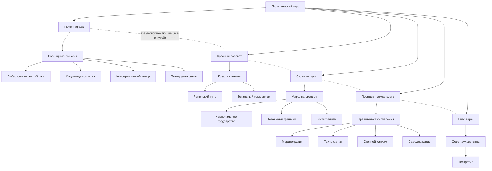

# Стандартное древо фокусов: ветка «Политический курс»

Часть стандартного древа (`focuses/Generic-Focus-Tree.md`; файл будет объединён с ним). **Статус:** только описание, в моде нет.

Есть только у стран со стандартным древом фокусов (пока это все). Недоступна Казуалии и странам, перешедшим в Казуальность. Путь к Казуальности идёт через ветку «Казуальность», а не здесь. Идеологии и их подтипы — `lore/Lore-Overview.md`, раздел 3. Всё в файле придумано (см. `lore/Invented-Lore.md`).

## Устройство
- Общий фокус «Политический курс», затем выбор **одного из пяти** взаимоисключающих путей: Демократия, Коммунизм, Фашизм, Порядок (нейтральные режимы), Теология.
- Каждый путь: рост популярности → приход идеологии к власти → **выбор подтипа**. Подтипы внутри пути взаимоисключающие; в каждом пути есть все подтипы группы, которые есть в моде.
- Если идеология уже правит, фокус прихода к власти выполняется без смены власти (стабильность +10 %).
- «Тотальный коммунизм» и «Тотальный фашизм» открывают побочный фокус «Трудовая повинность» в ветке «Казуальность».

Подтипы под одним фокусом прихода к власти взаимоисключающие (на схеме не соединены пунктиром, чтобы не загромождать).

## Общий фокус
| Фокус | Дни | Описание | Эффект | Условие |
|---|---|---|---|---|
| Политический курс | 70 | Страна устала от неопределённости: пора решить, по какому пути она пойдёт. | +75 ПВ | — |

## Демократия (`democratic`)
| Фокус | Дни | Описание | Эффект | Условие |
|---|---|---|---|---|
| Голос народа | 70 | Разрешены партии, газеты и собрания. | Популярность демократии +15 % | Политический курс |
| Свободные выборы | 70 | Страна идёт на честные выборы. | Правящая партия — демократы; если уже правят — стабильность +10 % | Голос народа; популярность демократии ≥ 40 % |
| Либеральная республика | 70 | Свобода рынка и слова прежде всего. | Подтип `liberalism`; товары народного потребления −5 % | Свободные выборы |
| Социал-демократия | 70 | Сильное государство заботится о каждом. | Подтип `socialism`; стабильность +10 % | Свободные выборы |
| Консервативный центр | 70 | Традиции и осторожные реформы. | Подтип `conservatism`; поддержка войны +5 %, стабильность +5 % | Свободные выборы |
| Технодемократия | 70 | Голосование через машины, решения по расчётам. | Подтип `technodemocracy`; скорость исследований +5 % | Свободные выборы |

## Коммунизм (`communism`)
| Фокус | Дни | Описание | Эффект | Условие |
|---|---|---|---|---|
| Красный рассвет | 70 | Рабочие кружки выходят из подполья. | Популярность коммунизма +15 % | Политический курс |
| Власть советов | 70 | Советы рабочих берут власть в столице. | Правящая партия — коммунисты; если уже правят — стабильность +10 % | Красный рассвет; популярность коммунизма ≥ 40 % |
| Ленинский путь | 70 | Умеренный путь: власть советов без чисток. | Подтип `leninism`; стабильность +10 %, фабрики +5 % | Власть советов |
| Тотальный коммунизм | 70 | Всё во имя партии, ничего вне партии. | Подтип `total_communism`; поддержка войны +10 %, стабильность −5 %; открывает «Трудовую повинность» | Власть советов |

## Фашизм (`fascism`)
| Фокус | Дни | Описание | Эффект | Условие |
|---|---|---|---|---|
| Сильная рука | 70 | Ветераны и националисты требуют порядка. | Популярность фашизма +15 % | Политический курс |
| Марш на столицу | 70 | Колонны сторонников входят в столицу, правительство уходит в отставку. | Правящая партия — фашисты; если уже правят — стабильность +10 % | Сильная рука; популярность фашизма ≥ 40 % |
| Национальное государство | 70 | Нация превыше всего, но без тотального контроля. | Подтип `fascism_ideology`; стабильность +10 %, военные фабрики +5 % | Марш на столицу |
| Тотальный фашизм | 70 | Государство контролирует каждую сторону жизни. | Подтип `total_fascism`; поддержка войны +15 %, стабильность −5 %; открывает «Трудовую повинность» | Марш на столицу |
| Интегрализм | 70 | Нация, вера и традиция как единое целое. | Подтип `integralism`; стабильность +5 %, поддержка войны +5 % | Марш на столицу |

## Порядок (`neutrality`)
| Фокус | Дни | Описание | Эффект | Условие |
|---|---|---|---|---|
| Порядок прежде всего | 70 | Страна устала от партий и лозунгов. | Популярность нейтральных +15 % | Политический курс |
| Правительство спасения | 70 | Власть переходит к беспартийному кабинету. | Правящая партия — нейтральные; если уже правят — стабильность +10 % | Порядок прежде всего; популярность нейтральных ≥ 40 % |
| Меритократия | 70 | Должности получают лучшие по экзаменам. | Подтип `meritocracy`; скорость исследований +5 % | Правительство спасения |
| Технократия | 70 | Страной управляют инженеры и учёные. | Подтип `technocracy`; строительство +5 % | Правительство спасения |
| Степной ханизм | 70 | Власть хана, совет родов и кочевая конница. | Подтип `steppe_khanate`; пополнение +5 % | Правительство спасения |
| Самодержавие | 70 | Вся власть в руках одного правителя. | Подтип `despotism`; стабильность +10 %, политическая власть −5 % | Правительство спасения |

## Теология (`theology`)
| Фокус | Дни | Описание | Эффект | Условие |
|---|---|---|---|---|
| Глас веры | 70 | Проповедники собирают площади. | Популярность теологии +15 % | Политический курс |
| Совет духовенства | 70 | Совет духовенства становится высшей властью. | Правящая партия — теология; если уже правит — стабильность +10 % | Глас веры; популярность теологии ≥ 40 % |
| Теократия | 70 | Закон и вера становятся одним. | Подтип `theology`; стабильность +15 %, шкала Казуальности −10 (вера против безделья) | Совет духовенства |

У теологии в моде один подтип, поэтому выбора нет.

## Связь с другими ветками
- «Тотальный коммунизм» и «Тотальный фашизм» — условие побочного фокуса «Трудовая повинность» (ветка «Казуальность»).
- Казуальность здесь не выбирается: к ней ведёт путь «Болото».
