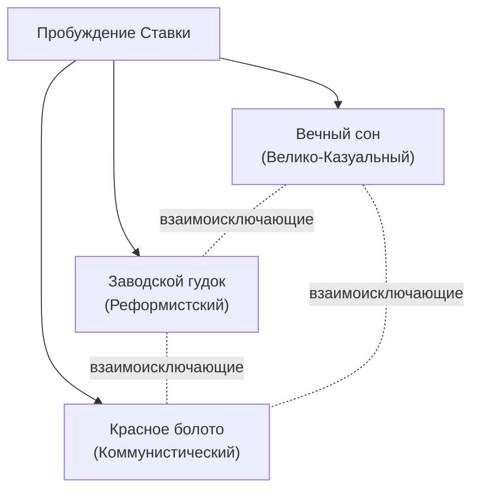
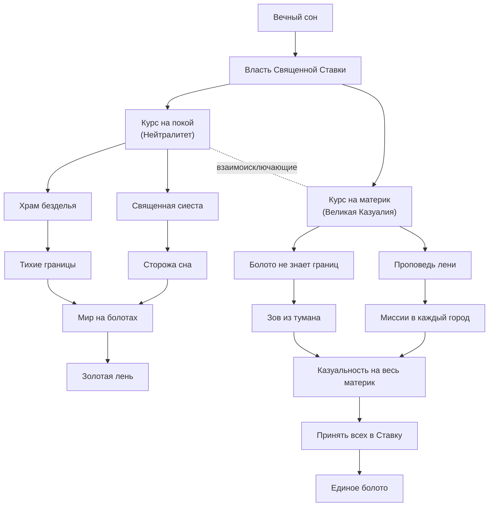
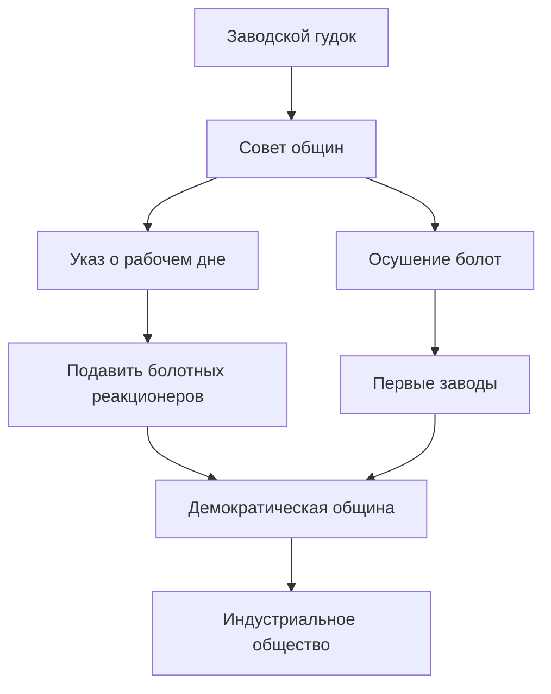
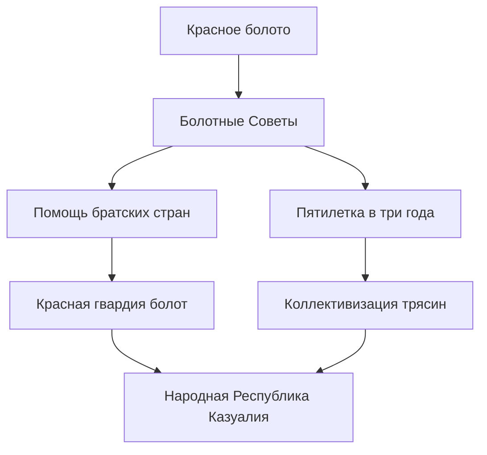
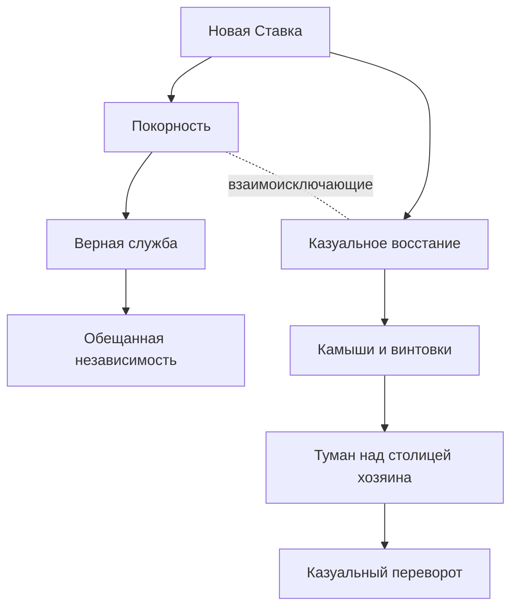
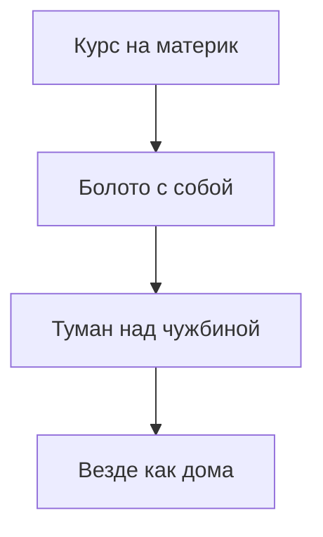
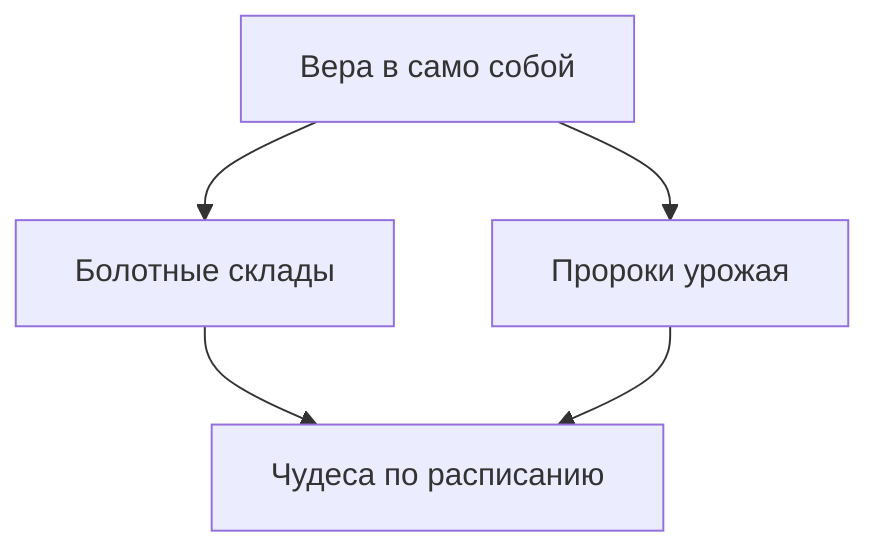
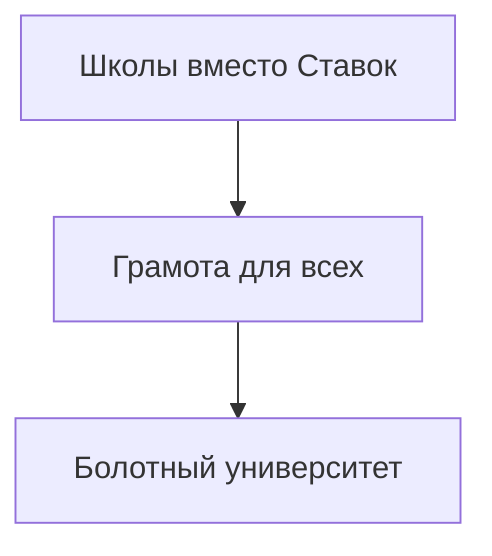
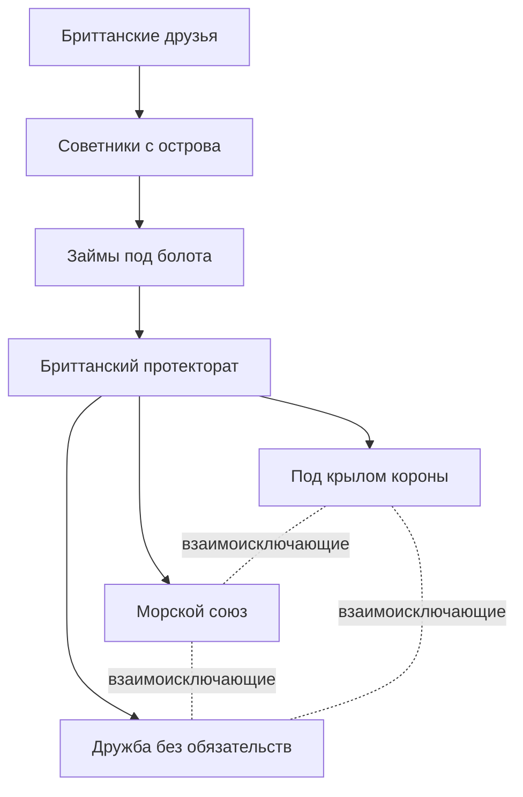
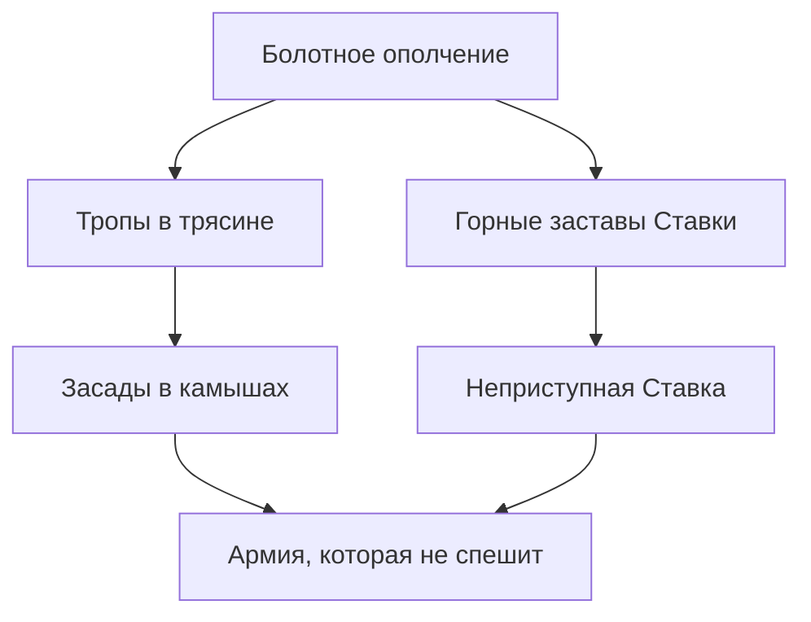

# Древо фокусов Казуалии

Своё древо Казуалии вместо стандартного (`Generic-Focus-Tree.md`). **Статус:** перенесено в мод (`tools/make_kazualia.py`, дерево `ktits_kazualia_focus`; в игре не проверено); часть эффектов — только флаги, см. «Реализация». Механики, на которые опираются фокусы, описаны в `mechanics/Kazualia.md` (разделы указаны в скобках). Правила автора отмечены, всё остальное придумано (названия, дни, эффекты, тексты), нужно подтверждение и перенос в `lore/Invented-Lore.md`. «Внутр. К.» — Внутренняя Казуальность (раздел 2), «Вера» — Казуальная Вера (раздел 4).

**Состав древа:**
| Ветка | Откуда | Кому доступна |
|---|---|---|
| Пути развития | лор (раздел 5) | Казуалии; выбор одного из трёх путей |
| Казуальный путь («Вечный сон») → «Власть Священной Ставки» | лор (раздел 5) | после выбора пути; дальше две **взаимоисключающие** ветки |
| Нейтралитет | автор: внутренняя Казуальность | после «Власти Священной Ставки», вместо «Великой Казуалии» |
| Великая Казуалия | лор (раздел 5): экспансия | после «Власти Священной Ставки», вместо «Нейтралитета» |
| Реформистский путь | лор (раздел 5, 5.1) | после выбора пути |
| Коммунистический путь | лор (раздел 5) | после выбора пути |
| Казуальная резервация | лор (раздел 5, правило автора: два подпути) | только Казуалии-марионетке после захвата |
| Дурманище | правило автора (раздел 1) | Великая Казуалия |
| Экономика «Дары болот» | раздел 4 | все пути, кроме Реформистского после завершения реформ |
| Образование | придумано | Реформистский и Коммунистический пути |
| Бриттанское влияние | правило автора (раздел 5.2) | все пути, кроме Коммунистического |
| Армия «Болотная война» | придумано | всем путям; ванильные ветки «Армия» и «Флот» стандартного древа тоже доступны (`Generic-Focus-Tree.md`, «Ветки „Армия“ и „Флот“») |

Ветки «Казуальность» и «Политический курс» стандартного древа Казуалии недоступны: шкалы Казуальности у неё нет, а идеологию задаёт выбор пути.

## Пути развития

Корень древа. Три пути взаимоисключающие (лор); «Вечный сон» ведёт в Казуальный путь, который после «Власти Священной Ставки» делится на «Нейтралитет» и «Великую Казуалию» (см. ниже). Резервация — не выбор, а отдельная ветка при захвате (см. ниже).

| Фокус | Дни | Описание | Эффект | Условие |
|---|---|---|---|---|
| Пробуждение Ставки | 35 | Священный-Архо-Казуал открыл один глаз. Придворные в панике: такого не было сто лет. Придётся что-то решать. | +50 ПВ; открывает выбор пути | — |
| Вечный сон | 70 | Ставка постановила: просыпаться было ошибкой. Казуалия остаётся собой и несёт покой всему материку. | Внутр. К. +10 %; открывает Казуальный путь (выбор Нейтралитета или Великой Казуалии) | Пробуждение Ставки |
| Заводской гудок | 70 | Молодые казуалы увидели за горами заводской дым и захотели такого же. | Правительство — демократия; открывает Реформистский путь и Реформы (5.1); дебаффы Внутр. К. усиливаются (раздел 2) | Пробуждение Ставки |
| Красное болото | 70 | Агитаторы объяснили казуалам, что лень — пережиток эксплуатации. Казуалы задумались. Надолго. | Правительство — коммунизм; открывает Коммунистический путь | Пробуждение Ставки |

## Казуальный путь: «Нейтралитет» и «Великая Казуалия»

Решение при сборке: после общего «Вечный сон» → «Власть Священной Ставки» игрок выбирает **одну из двух взаимоисключающих веток** (выбор необратим; Нейтралитет — Казуалия остаётся дома, Великая Казуалия — идёт на материк). «Дурманище» относится к экспансии и доступно только на Великой Казуалии.

Общий фокус:
| Фокус | Дни | Описание | Эффект | Условие |
|---|---|---|---|---|
| Власть Священной Ставки | 70 | Все решения теперь принимаются во сне правителя. Сны толкуют жрецы, жрецов назначает Ставка. | Стабильность +10 %; Внутр. К. +5 % | Вечный сон |

**Нейтралитет** (Внутренняя Казуальность, Вера, оборона, стабильность):
| Фокус | Дни | Описание | Эффект | Условие |
|---|---|---|---|---|
| Курс на покой | 70 | Ставка решила: болото — для казуалов. Соседи пусть живут как хотят, лишь бы не будили. | Внутр. К. +10 %; стабильность +5 %; закрывает Великую Казуалию | Власть Священной Ставки |
| Священная сиеста | 70 | Сиеста объявлена государственным делом. Опоздавшим на сон выдают справку, что они не опоздали. | Внутр. К. +10 %; дух: стабильность +5 %, прирост ПВ +10 % | Курс на покой |
| Храм безделья | 70 | Построили храм, куда никто не заходит. Паломники лежат у входа и считают это службой. | Вера +300; прирост Веры +10 % | Курс на покой |
| Сторожа сна | 70 | Вдоль границы выставлены посты. Их задача простая: стоять и никого не пускать будить. | +2 дивизии ополчения; дух: защита армии +10 %, макс. окапывание +10 % | Священная сиеста |
| Тихие границы | 70 | На границе тишина. Контрабандисты тоже спят, а пограничники делают вид, что это порядок. | Дух: стабильность +5 %, потребление товаров −5 % | Храм безделья |
| Мир на болотах | 105 | Все соседи заключили с Казуалией пакт о ненападении. Казуалия его не читала, но подписала. | +100 ПВ; Внутр. К. +10 % | Сторожа сна; Тихие границы |
| Золотая лень | 140 | Казуалия достигла того, к чему стремилась веками: ничего не происходит, и это прекрасно. | Внутр. К. +15 %; стабильность +10 %; Вера +200 | Мир на болотах |

**Великая Казуалия** (Внешняя Казуальность, восстания, цели войны, присоединение):
| Фокус | Дни | Описание | Эффект | Условие |
|---|---|---|---|---|
| Курс на материк | 70 | Ставка решила: болото слишком хорошо, чтобы держать его при себе. Пусть весь материк узнает, как это — ничего не делать. | +50 ПВ; закрывает Нейтралитет | Власть Священной Ставки |
| Проповедь лени | 70 | Казуальные проповедники уходят за границу с котомками и хорошим настроением. | Решение «Миссионеры лени» дешевле на 50 % Веры | Курс на материк |
| Болото не знает границ | 70 | Туман ползёт через границу, и пограничники засыпают на постах. | **Открывает категорию «Внешняя Казуальность»** (раздел 3); Внутр. К. +5 %; Вера +150; дух «Туман на границе»: поддержка войны +10 %, скорость армии +5 % | Курс на материк |
| Миссии в каждый город | 105 | В каждом городе материка есть хотя бы один казуал, который никуда не спешит. | Шкала Казуальности всех соседей +10 | Проповедь лени |
| Зов из тумана | 105 | Восстание — это просто очень много людей, которые разом перестали работать. | Казуальные восстания на 1 дивизию сильнее (раздел 3); Вера +100 | Болото не знает границ |
| Казуальность на весь материк | 140 | Ставка объявляет цель: весь материк должен отдохнуть. Это не война — это забота. | Цели войны (аннексия) против соседей со шкалой ≥ 50; дух «Поход ленивых»: поддержка войны +10 %, призыв +2 % | Миссии…; Зов… |
| Принять всех в Ставку | 70 | Новые болота — новые лентяи. Места в тумане хватит всем. | +50 ПВ; решение «Принять в Ставку» без перезарядки и дешевле на 50 ПВ (раздел 3) | Казуальность на весь материк |
| Единое болото | 105 | Над материком стелется туман. Границы остались на картах, но никто не помнит, зачем они нужны. | +100 ПВ; Внутр. К. +10 %; Вера +200 | Принять всех в Ставку |

## Реформистский путь

Лор: уничтожение Казуальности, переход к демократической общине. Правило автора: Реформы — переход к индустриальному обществу (5.1); на этом пути дебаффы Внутр. К. усиливаются и задевают армию (раздел 2). Гражданская война (раздел 6).

| Фокус | Дни | Описание | Эффект | Условие |
|---|---|---|---|---|
| Совет общин | 70 | Впервые в истории казуалы выбирают власть сами. Явка — 12 %: остальные проспали. | Популярность демократии +15 %; прогресс реформ +5 | Заводской гудок |
| Указ о рабочем дне | 70 | Работать с утра до вечера. Половина страны впервые узнала, что такое утро. | Прогресс реформ +10; Внутр. К. −10 %; стабильность −5 % | Совет общин |
| Осушение болот | 105 | Землемеры с лопатами уходят в трясину. Многие возвращаются, некоторые — даже с картой. | Прогресс реформ +10; +1 слот строительства в 3 болотных штатах | Совет общин |
| Подавить болотных реакционеров | 70 | Старые казуалы ушли в камыши с плакатами «Верните покой!». Их надо вернуть — или победить. | Риск «Болотного мятежа» −50 %; армия +2 дивизии | Указ о рабочем дне |
| Первые заводы | 105 | Над болотом впервые гудит завод. Казуалы приходят посмотреть и почему-то остаются. | +2 гражданские фабрики; прогресс реформ +10 | Осушение болот |
| Демократическая община | 70 | Казуалия больше не Ставка, а община свободных граждан. Священный-Архо-Казуал ушёл на покой — ему не привыкать. | Правящая партия — демократия 60 %; Внутр. К. −10 % | Подавить…; Первые заводы |
| Индустриальное общество | 140 | Гудок больше никого не удивляет. Туман рассеялся, страна проснулась. | Если прогресс реформ ≥ 80 — событие «Индустриальное общество» (5.1) | Демократическая община |

## Коммунистический путь

Лор: помощь от коммунистических стран и быстрая индустриализация; возможна гражданская война (раздел 6).

| Фокус | Дни | Описание | Эффект | Условие |
|---|---|---|---|---|
| Болотные Советы | 70 | В каждой деревне — совет. Заседания идут лёжа, но решения принимаются. | Популярность коммунизма +15 %; Внутр. К. −5 % | Красное болото |
| Помощь братских стран | 70 | Коммунистические страны шлют инструкторов, станки и брошюры. Брошюры казуалы читают охотнее всего. | +1 гражданская фабрика за каждую коммунистическую страну (до 3); отношения с ними +25 | Болотные Советы |
| Пятилетка в три года | 105 | План простой: за три года построить всё, чего не строили триста. | +3 гражданские фабрики; Внутр. К. −10 %; стабильность −10 % | Болотные Советы |
| Красная гвардия болот | 70 | Вчерашние лентяи получают винтовки и красные повязки. Ленятся теперь организованно. | +3 дивизии; риск гражданской войны −50 % | Помощь братских стран |
| Коллективизация трясин | 105 | Болота объявлены общими. Никто не понял, что изменилось, но работать стали больше. | +2 военные фабрики; Внутр. К. −10 % | Пятилетка в три года |
| Народная Республика Казуалия | 70 | Над Ставкой — красное знамя. Ставка переименована в Дом Советов, но все по привычке зовут её Ставкой. | Правящая партия — коммунизм 70 %; может вступить в коммунистический альянс | Красная гвардия…; Коллективизация… |

## Казуальная резервация

Лор: страна, захватившая или оккупировавшая Казуалию, создаёт марионетку и ставит удобную партию; столица — в любой из 5 провинций. Правило автора: **два подпути — «Покорность» и «Казуальное восстание»**. Ветка открыта только Казуалии-марионетке после захвата; остальные ветки при этом закрыты.

| Фокус | Дни | Описание | Эффект | Условие |
|---|---|---|---|---|
| Новая Ставка | 35 | Чужие флаги над старой Ставкой. Казуалам выделили болото и велели вести себя тихо. | +50 ПВ; дух «Тихая жизнь» на 180 дней (стабильность +10 %); открывает выбор подпути (перенос столицы в 5 провинций не реализован) | Казуалия — марионетка |
| Покорность | 70 | Будем служить. Будем полезны. А когда-нибудь хозяин сдержит слово. | Отношения сюзерена +50; +25 ПВ; стабильность +5 % | Новая Ставка |
| Верная служба | 105 | Казуальные полки воюют за хозяина. Не быстро, но стоят насмерть. | Сюзерен получает дух «Казуальные полки» (защита армии +5 %, призыв +2 %); автономия +20 % | Покорность |
| Обещанная независимость | 70 | Хозяин держит слово — или Казуалия напоминает ему об этом очень вежливо. | Событие сюзерену `ktits_kazualia.5`: дать независимость (`end_puppet`) или отказать (отношения −100, Внутр. К. +20 %) | Верная служба |
| Казуальное восстание | 70 | Хозяин думает, что казуалы спят. Хозяин ошибается. | Внутр. К. +10 %; шкала Казуальности сюзерена +10 | Новая Ставка |
| Камыши и винтовки | 105 | По ночам в камышах раздают оружие, которое хозяин сам сюда привёз. | +3000 пехотного снаряжения в скрытом запасе; партизаны в штатах сюзерена (сопротивление +20 %) | Казуальное восстание |
| Туман над столицей хозяина | 105 | Чиновники сюзерена всё чаще смотрят в окно вместо отчёта. | Шкала Казуальности сюзерена +20; стабильность сюзерена −10 % | Камыши и винтовки |
| Казуальный переворот | 70 | Вооружённое восстание: казуалы выходят из тумана, и власть хозяина рушится. | Конец марионетки, война с бывшим сюзереном (`annex_everything` [uncertain]); дух «Туман выходит из камышей» (поддержка войны +20 %, 180 дн.); при шкале сюзерена ≥ 75 — претензии на все его штаты | Туман над столицей хозяина |

## Дурманище

Правило автора (раздел 1): казуалам дебафф на чужой земле, который снимается фокусами. Фокусы и их описания — из раздела 1.

| Фокус | Дни | Описание | Эффект | Условие |
|---|---|---|---|---|
| Болото с собой | 70 | Солдаты набирают во фляги болотную воду. На чужой земле глоток — и снова как дома. | Штраф на чужой земле −1/3 | Курс на материк |
| Туман над чужбиной | 70 | Туман идёт впереди армии. Чужие поля становятся вязкими, а казуалы — спокойными. | Штраф на чужой земле −1/3 | Болото с собой |
| Везде как дома | 105 | Казуал засыпает на чужой земле так же крепко, как в своих камышах. Значит, это уже его земля. | Штраф на чужой земле снят | Туман над чужбиной |

## Экономика «Дары болот»

Опирается на Казуальную Веру (раздел 4). На Реформистском пути после события «Индустриальное общество» ветка закрывается (Вера исчезает).

| Фокус | Дни | Описание | Эффект | Условие |
|---|---|---|---|---|
| Вера в само собой | 70 | Казуалы не работают, но у них всё есть. Никто не знает откуда, и никто не спрашивает. | Вера +200; прирост Веры +10 % | — |
| Болотные склады | 70 | В тине находят ящики с припасами. Кто их туда положил — тайна. | Решения «Ружья из тины» и «Пушки сами приплыли» дешевле на 25 % | Вера в само собой |
| Пророки урожая | 70 | Пророки говорят, что урожай будет. Урожай слушается. | Прирост Веры +15 %; стабильность +5 % | Вера в само собой |
| Чудеса по расписанию | 105 | Чудеса случаются так часто, что к ним привыкли. | Вера +300; перезарядка всех «Даров болот» −25 % | Болотные склады; Пророки урожая |

## Образование

У Казуалии специалистов всегда 0 (`global_mechanics/Education.md`); ветка снимает это ограничение. Доступна на Реформистском и Коммунистическом путях.

| Фокус | Дни | Описание | Эффект | Условие |
|---|---|---|---|---|
| Школы вместо Ставок | 70 | Священные палаты отдают под классы. Учитель приходит раньше учеников — это уже прогресс. | Снимает правило «специалистов всегда 0»; специалисты +5 тыс. | Заводской гудок или Красное болото |
| Грамота для всех | 105 | Казуалы учатся читать. Первая прочитанная книга у всех одна — «Как перестать откладывать». | Специалисты +10 тыс.; Внутр. К. −5 % | Школы вместо Ставок |
| Болотный университет | 105 | Первый университет посреди болот. Лекции начинаются в полдень: компромисс с традицией. | Специалисты +15 тыс.; исследования +5 % | Грамота для всех |

## Бриттанское влияние

Правило автора (раздел 5.2): сотрудничество с Бриттами даёт баффы, но забирает независимость и внешнюю политику; в конце — выбор: стать марионеткой, создать альянс / вступить в альянс или продолжить сотрудничество без альянса. Фокусы, уровни духа и тексты — в разделах 5.2 и 7 `mechanics/Kazualia.md`; здесь только схема и дни. Недоступна на Коммунистическом пути (придумано). «Под крылом короны» — только на Реформистском (демократическом) пути. «Морской союз» — только при не-Казуальном правительстве (правило альянсов: Казуальность не входит в альянс, лидер которого не Казуальность, `global_mechanics/Alliances.md`): Казуалия вступает в альянс Бриттана; если у Бриттана альянса нет, он создаётся по шаблону `ktits_alliance_template` и в него входит Казуалия [uncertain].

| Фокус | Дни | Эффект (раздел 5.2) |
|---|---|---|
| Бриттанские друзья | 35 | дух «Бриттанское влияние» уровень 1 |
| Советники с острова | 70 | уровень 2 |
| Займы под болота | 70 | уровень 2, +2 гражданские фабрики |
| Бриттанский протекторат | 105 | уровень 3 |
| Под крылом короны | 70 | только на Реформистском пути; марионетка Бриттана; дух «Корона и болото» |
| Морской союз | 70 | только не-Казуальное правительство; вход в альянс Бриттана (или создание через шаблон альянсов) |
| Дружба без обязательств | 70 | дух остаётся на уровне 2, ограничения сняты |

## Армия «Болотная война»

Своя ветка Казуалии в дополнение к ванильным «Армии» и «Флоту». Опирается на баффы Внутр. К. в болоте и горах (раздел 2). Доступна на всех путях.

| Фокус | Дни | Описание | Эффект | Условие |
|---|---|---|---|---|
| Болотное ополчение | 70 | Каждый казуал умеет держать вилы и лежать в засаде. Второе — особенно. | +2 дивизии ополчения; призывное население +1 % | — |
| Тропы в трясине | 70 | Казуалы знают каждую кочку. Чужаки — ни одной. | Дух: скорость армии +10 %, атака +5 % (модификатора местности для страны в игре нет) | Болотное ополчение |
| Горные заставы Ставки | 70 | Горы стерегут столицу с трёх сторон. Теперь в горах ещё и сторожа. | Дух: защита армии +5 %, макс. окапывание +10 %; +2 форта в штате столицы | Болотное ополчение |
| Засады в камышах | 105 | Враг идёт по болоту и вдруг понимает, что болото на него смотрит. | Скорость окапывания +20 %; организация +5 % | Тропы в трясине |
| Неприступная Ставка | 105 | Южный проход к Ставке перекрыт. Остальные три закрыли горы. | Дух: защита армии +5 %, организация +5 %; ещё +2 форта в штате столицы | Горные заставы Ставки |
| Армия, которая не спешит | 105 | Казуальная армия не наступает быстро. Зато и не отступает никогда. | Восстановление организации +10 %; расход припасов −10 % | Засады…; Неприступная Ставка |

## Реализация (`tools/make_kazualia.py`) [uncertain: в игре не проверено]
Файл `common/national_focus/ktits_kazualia.txt`, 64 фокуса, дерево только для тега Казуалии (`factor = 0`, `add = 100`). Раскладка компактная (сетка x: соседи через 2, ветки разделены одним пустым местом; всё в пределах x 0–68, y 0–8), задана словарём `LAYOUT` в скрипте; `check_mod.py` проверяет отсутствие наложений. Колонки: Нейтралитет 0–4, Великая Казуалия 8–12 (Дурманище 15), Реформистский 20–24, Образование 28, Коммунистический 32–36, Экономика 40–44, Бриттанское влияние 48–52, Армия 56–60, Резервация 64–68.
- **Заглушки, получившие эффект:** «Болото не знает границ» (открывает «Внешнюю Казуальность» + Вера +150 + дух «Туман на границе»), «Зов из тумана» (Вера +100), «Казуальность на весь материк» (`create_wargoal` аннексии против соседей со шкалой ≥ 50 + дух), «Принять всех в Ставку» (+50 ПВ), «Чудеса по расписанию» (Вера +300), «Тропы в трясине», «Горные заставы», «Неприступная Ставка» (духи; форты), «Новая Ставка» (+50 ПВ, дух), «Покорность» (+25 ПВ, стабильность), «Верная служба» (дух сюзерену), «Обещанная независимость» (событие сюзерену), «Казуальный переворот» (конец марионетки, война, претензии).
- **Не реализовано:** перенос столицы Резервации, ускорение автономии, партизаны в штатах сюзерена («Камыши и винтовки» даёт только +3000 снаряжения), бонусы местности (в игре нет страновых модификаторов).
- **ИИ (`ai_will_do`):** «Пробуждение Ставки» 1000; «Вечный сон» 300 > «Заводской гудок» 120 > «Красное болото» 60; «Курс на материк» 150 > «Курс на покой» 100; остальные политические ветки (Нейтралитет, Великая Казуалия, Реформистский, Коммунистический, Резервация) по 100 (Резервация: «Покорность» 150 > «Восстание» 80); Дурманище 40, Образование 30, Экономика 20, Бриттанское влияние 15, Армия 3.
- Закрытие других веток при Резервации и «Экономики» на Реформистском пути после «Индустриального общества» сделано только для «Экономики» (`available`); остальное не закрывается.
