# Древо фокусов Казуалии

Своё древо Казуалии вместо стандартного (`Generic-Focus-Tree.md`). **Статус:** перенесено в мод (`tools/make_kazualia.py`, дерево `ktits_kazualia_focus`; в игре не проверено); часть эффектов — только флаги, см. «Реализация». Механики, на которые опираются фокусы, описаны в `mechanics/Kazualia.md` (разделы указаны в скобках). Правила автора отмечены, всё остальное придумано (названия, дни, эффекты, тексты), нужно подтверждение и перенос в `lore/Invented-Lore.md`. «Внутр. К.» — Внутренняя Казуальность (раздел 2), «Вера» — Казуальная Вера (раздел 4).

**Правило развилок (правило автора):** после каждой развилки (фокус, чьи дети — взаимоисключающие варианты) каждая альтернатива продолжается **минимум двумя фокусами**: развилка не должна вести в единственный тупиковый фокус. Проверено для всех развилок дерева (пути, Нейтралитет / Великая Казуалия, Коммунизм / Демократия, подпути коммунизма, итоговый выбор СССР, суверенная / бриттанская демократия, финал Бриттанской ветки, Резервация); короткие ветки дополнены.

**Состав древа:**
| Ветка | Откуда | Кому доступна |
|---|---|---|
| Пути развития | лор (раздел 5); перестройка: два верхних пути | Казуалии; выбор «Сохранение казуальности» или «Реформистский путь» |
| Казуальный путь («Сохранение казуальности») → «Власть Священной Ставки» | лор (раздел 5) | после выбора пути; дальше две **взаимоисключающие** ветки |
| Нейтралитет (исторический путь) | автор: внутренняя Казуальность | после «Власти Священной Ставки», вместо «Великой Казуалии» |
| Великая Казуалия | лор (раздел 5): экспансия | после «Власти Священной Ставки», вместо «Нейтралитета» |
| Реформистский путь | лор (раздел 5): два подпути (Коммунизм, Демократия) | после выбора пути; дальше две **взаимоисключающие** ветки; общие ветки «Модернизация» и «Экономика реформистского пути» доступны обоим подпутям |
| Модернизация (общая; новая) | автор: модернизация общая для коммунизма и демократии | после «Реформистского пути», параллельно выбору «Коммунизм» / «Демократия»; включает «Индустриальное общество» |
| Экономика реформистского пути (новая) | автор: экономическая ветка | после «Совета модернизации»: общая часть, затем часть демократии или коммунизма |
| Реформистский путь: Демократия (бывший Реформистский, 5.1) | лор (раздел 5, 5.1) | после «Реформистского пути» |
| Суверенная демократия посреди континента (новая; переделана) | автор: структура путей; клерков выгоняет только коммунизм | после «Демократической общины», вместо бриттанской подветки: договор о границах влияния Бриттов вместо изгнания |
| Бриттанское влияние («Демократия, опирающаяся на Бриттов») | правило автора (раздел 5.2) | после «Демократической общины», вместо суверенной; финал расширен (по два фокуса на каждый исход) |
| Реформистский путь: Коммунизм (бывший Коммунистический) | лор (раздел 5) | после «Реформистского пути»; два **взаимоисключающие** подпути: «Сотрудничество с СССР» (итоговый выбор из **трёх**: марионетка, союзник, «ни то ни другое») и «Казуальный коммунизм» (новый); «Красное болото» выгоняет бриттанских клерков |
| Казуальная резервация | лор (раздел 5, правило автора: два подпути) | только Казуалии-марионетке после захвата |
| Дурманище | правило автора (раздел 1) | Великая Казуалия |
| Экономика «Дары болот» | раздел 4 | все пути; на реформистском пути Вера исчезает после «Индустриального общества» (кроме «Казуального коммунизма») |
| Образование | придумано | Реформистский путь (демократия, коммунизм); условие — «Совет модернизации» |
| Армия «Болотная война» | придумано | всем путям; ванильные ветки «Армия» и «Флот» стандартного древа тоже доступны (`Generic-Focus-Tree.md`, «Ветки „Армия“ и „Флот“») |

Ветки «Казуальность» и «Политический курс» стандартного древа Казуалии недоступны: шкалы Казуальности у неё нет, а идеологию задаёт выбор пути. Пометки «новый», «переименован», «перенесён», «условие изменено» — перестройка путей (в игре не сделано). Названия «Заводской гудок» и «Красное болото» сохранены, в скобках — название по структуре автора.

## Пути развития

Корень древа. **Перестройка путей (правило автора):** два верхних пути, взаимоисключающие: **«Сохранение казуальности»** (Казуальный путь: подветки «Великая Казуалия» и «Нейтралитет», последний — исторический путь, опция правила `HISTORICAL`) и **«Реформистский путь»** (подпути «Коммунизм» и «Демократия»). Резервация — не выбор, а отдельная ветка при захвате (см. ниже). Все новые и изменённые фокусы: в игре не сделано. **Модернизация общая:** страна меняется независимо от идеологии, поэтому «Модернизация», «Экономика реформистского пути», Реформы (5.1) и «Индустриальное общество» доступны и коммунизму, и демократии; идеологию определяет выбор «Красное болото» / «Заводской гудок». **Клерков выгоняет только коммунизм** (фокус «Красное болото»); демократия оставляет Бриттов в стране (суверенная ветка — договор, бриттанская — зависимость).

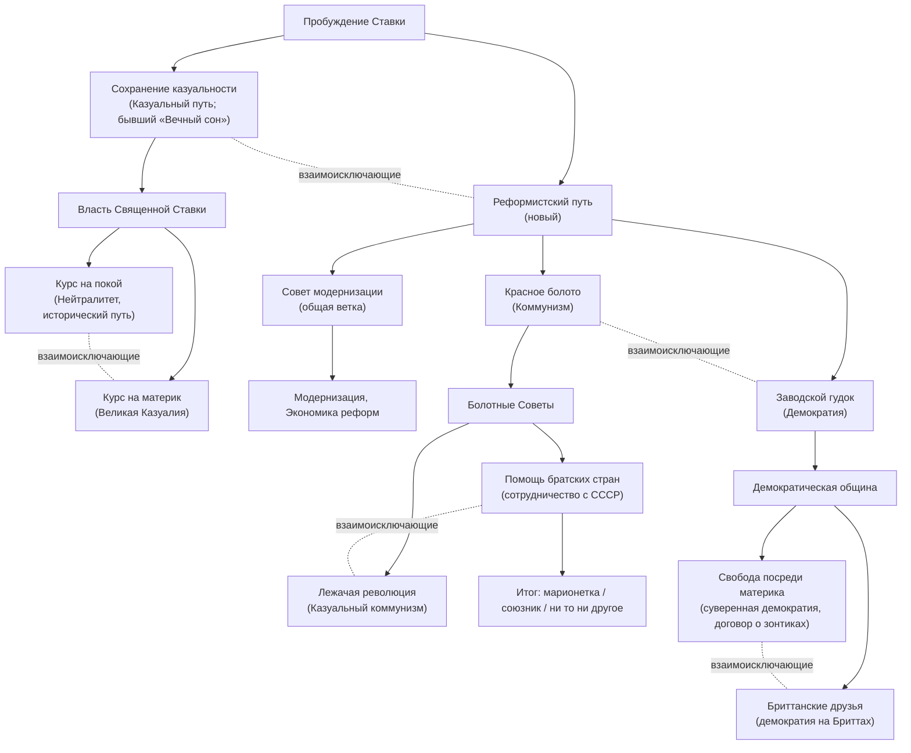

| Фокус | Дни | Описание | Эффект | Условие |
|---|---|---|---|---|
| Пробуждение Ставки | 35 | Священный-Архо-Казуал открыл один глаз. Придворные в панике: такого не было сто лет. Придётся что-то решать. | +50 ПВ; открывает выбор из двух путей | — |
| Сохранение казуальности (переименован; бывший «Вечный сон») | 70 | Ставка постановила: просыпаться было ошибкой. Казуалия остаётся собой и несёт покой всему материку. | Внутр. К. +10 %; открывает Казуальный путь (выбор Нейтралитета или Великой Казуалии); закрывает Реформистский путь | Пробуждение Ставки |
| Реформистский путь (новый) | 70 | За горами у соседей нашлось всё, чего не хватало: заводской дым, красные флаги и парламенты. Молодые казуалы решили, что хотят хотя бы чего-нибудь из этого. Спорят, чего именно, — сидя. | Возвращает обычные законы (`civilian_economy`, `volunteer_only`; перенесено с «Заводского гудка» и «Красного болота»); закрывает Казуальный путь; открывает выбор «Коммунизм» или «Демократия» и общую ветку «Модернизация» (с «Экономикой реформистского пути») | Пробуждение Ставки |

«Красное болото» (Коммунизм) и «Заводской гудок» (Демократия) описаны в разделах «Реформистский путь: Коммунизм» и «Реформистский путь: Демократия»; оба требуют «Реформистский путь» и взаимоисключающие.

## Казуальный путь: «Нейтралитет» и «Великая Казуалия»

Решение при сборке: после общего «Сохранение казуальности» → «Власть Священной Ставки» игрок выбирает **одну из двух взаимоисключающих веток** (выбор необратим; Нейтралитет — исторический путь, Казуалия остаётся дома; Великая Казуалия — идёт на материк). «Дурманище» относится к экспансии и доступно только на Великой Казуалии.

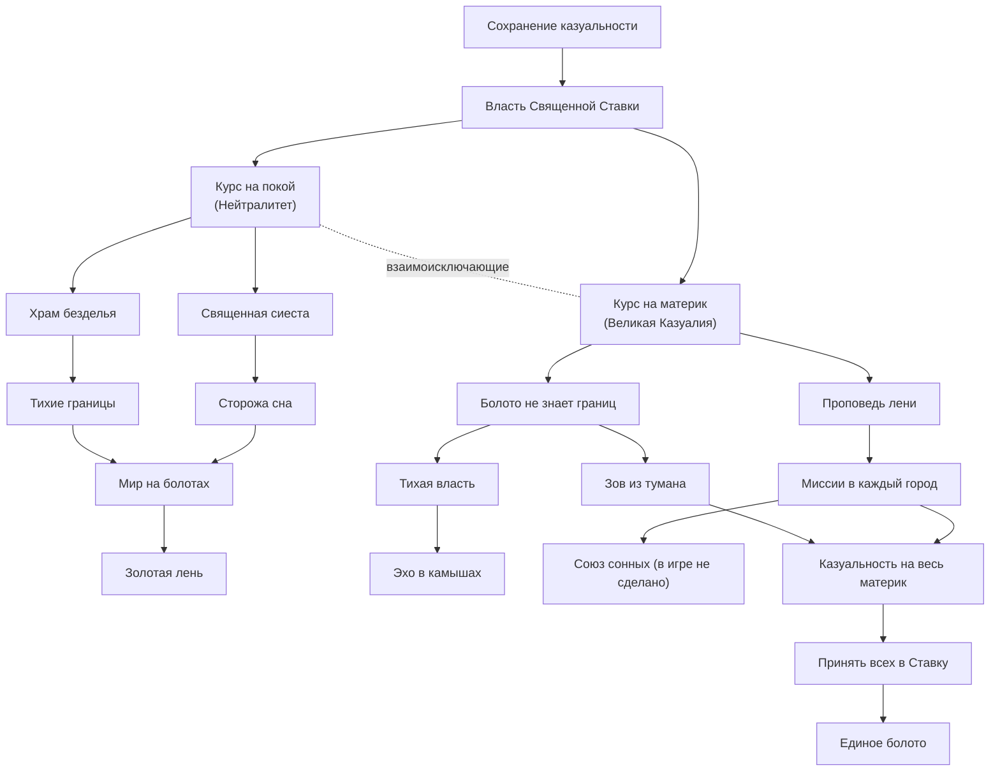

Общий фокус:
| Фокус | Дни | Описание | Эффект | Условие |
|---|---|---|---|---|
| Власть Священной Ставки | 70 | Все решения теперь принимаются во сне правителя. Сны толкуют жрецы, жрецов назначает Ставка. | Стабильность +10 %; Внутр. К. +5 % | Сохранение казуальности |

**Нейтралитет** (исторический путь: опция правила `HISTORICAL`; Внутренняя Казуальность, Вера, оборона, стабильность):
| Фокус | Дни | Описание | Эффект | Условие |
|---|---|---|---|---|
| Курс на покой | 70 | Ставка решила: болото — для казуалов. Соседи пусть живут как хотят, лишь бы не будили. | Внутр. К. +10 %; стабильность +5 %; закрывает Великую Казуалию | Власть Священной Ставки |
| Священная сиеста | 70 | Сиеста объявлена государственным делом. Опоздавшим на сон выдают справку, что они не опоздали. | Внутр. К. +10 %; дух: стабильность +5 %, прирост ПВ +10 % | Курс на покой |
| Храм безделья | 70 | Построили храм, куда никто не заходит. Паломники лежат у входа и считают это службой. | Вера +300; прирост Веры +10 % | Курс на покой |
| Сторожа сна | 70 | Вдоль границы выставлены посты. Их задача простая: стоять и никого не пускать будить. | +2 дивизии ополчения; дух: защита армии +10 %, макс. окапывание +10 % | Священная сиеста |
| Тихие границы | 70 | На границе тишина. Контрабандисты тоже спят, а пограничники делают вид, что это порядок. | Дух: стабильность +5 %, потребление товаров −5 % | Храм безделья |
| Мир на болотах | 105 | Все соседи заключили с Казуалией пакт о ненападении. Казуалия его не читала, но подписала. | +100 ПВ; Внутр. К. +10 % | Сторожа сна; Тихие границы |
| Золотая лень | 140 | Казуалия достигла того, к чему стремилась веками: ничего не происходит, и это прекрасно. | Внутр. К. +15 %; стабильность +10 %; Вера +200 | Мир на болотах |

**Великая Казуалия** (Внешняя Казуальность, восстания, цели войны, присоединение):
| Фокус | Дни | Описание | Эффект | Условие |
|---|---|---|---|---|
| Курс на материк | 70 | Ставка решила: болото слишком хорошо, чтобы держать его при себе. Пусть весь материк узнает, как это — ничего не делать. | +50 ПВ; закрывает Нейтралитет | Власть Священной Ставки |
| Проповедь лени | 70 | Казуальные проповедники уходят за границу с котомками и хорошим настроением. | Решение «Миссионеры лени» дешевле на 50 % Веры | Курс на материк |
| Болото не знает границ | 70 | Туман ползёт через границу, и пограничники засыпают на постах. | **Открывает категорию «Внешняя Казуальность»** (раздел 3); Внутр. К. +5 %; Вера +150; дух «Туман на границе»: поддержка войны +10 %, скорость армии +5 % | Курс на материк |
| Тихая власть | 70 | Приказы больше не пишут: их шепчут в тумане, и они почему-то исполняются. Канцелярия отдыхает, а власть работает. | Внутр. К. +5 %; дух: прирост ПВ +20 % | Болото не знает границ |
| Эхо в камышах | 70 | Шёпот из тумана доходит до самой дальней деревни. Деревня зевает и соглашается. | дух: прирост ПВ ещё +30 % | Тихая власть |
| Миссии в каждый город | 105 | В каждом городе материка есть хотя бы один казуал, который никуда не спешит. | Шкала Казуальности всех соседей +10 | Проповедь лени |
| Зов из тумана | 105 | Восстание — это просто очень много людей, которые разом перестали работать. | Казуальные восстания на 1 дивизию сильнее (раздел 3); Вера +100 | Болото не знает границ |
| Союз сонных (в игре не сделано) [придумано: название, дни, эффект] | 70 | Соседи, которым Ставка шепнула во сне, решили держаться вместе. Устав союза короткий: «Не будить. Не спешить. Не воевать без перерыва на сон». | Казуалия, если не состоит в альянсе, получает право основать альянс «Казуальная Идиллия» ванильной кнопкой «Создать фракцию» **без требования ≥ 30 фабрик** (исключение из правил `global_mechanics/Alliances.md`, «Создание и приглашение»); приглашения — по обычным правилам (группа идеологий «Казуальность» или общий враг); сотрудничество в альянсе всегда 100; Внутр. К. +5 % | Миссии в каждый город; доступна только на Великой Казуалии (при «Вечном нейтралитете» недоступна) |
| Казуальность на весь материк | 140 | Ставка объявляет цель: весь материк должен отдохнуть. Это не война — это забота. | Цели войны (аннексия) против соседей со шкалой ≥ 50; дух «Поход ленивых»: поддержка войны +10 %, призыв +2 % | Миссии…; Зов… |
| Принять всех в Ставку | 70 | Новые болота — новые лентяи. Места в тумане хватит всем. | +50 ПВ; решение «Принять в Ставку» без перезарядки и дешевле на 50 ПВ (раздел 3) | Казуальность на весь материк |
| Единое болото | 105 | Над материком стелется туман. Границы остались на картах, но никто не помнит, зачем они нужны. | +100 ПВ; Внутр. К. +10 %; Вера +200 | Принять всех в Ставку |

## Модернизация (общая ветка Реформистского пути; новая, в игре не сделано)

Правило автора: модернизация общества и страны общая для коммунизма и демократии. Ветка открывается «Реформистским путём» и **не зависит** от выбора «Красное болото» / «Заводской гудок»: её можно проходить до и после выбора. Реформы (5.1) и «Индустриальное общество» общие. Числа и названия придуманы. На «Казуальном коммунизме» Внутр. К. от фокусов этой ветки не снижается (раздел 2 `mechanics/Kazualia.md`), «Индустриальное общество» там не отнимает Веру.

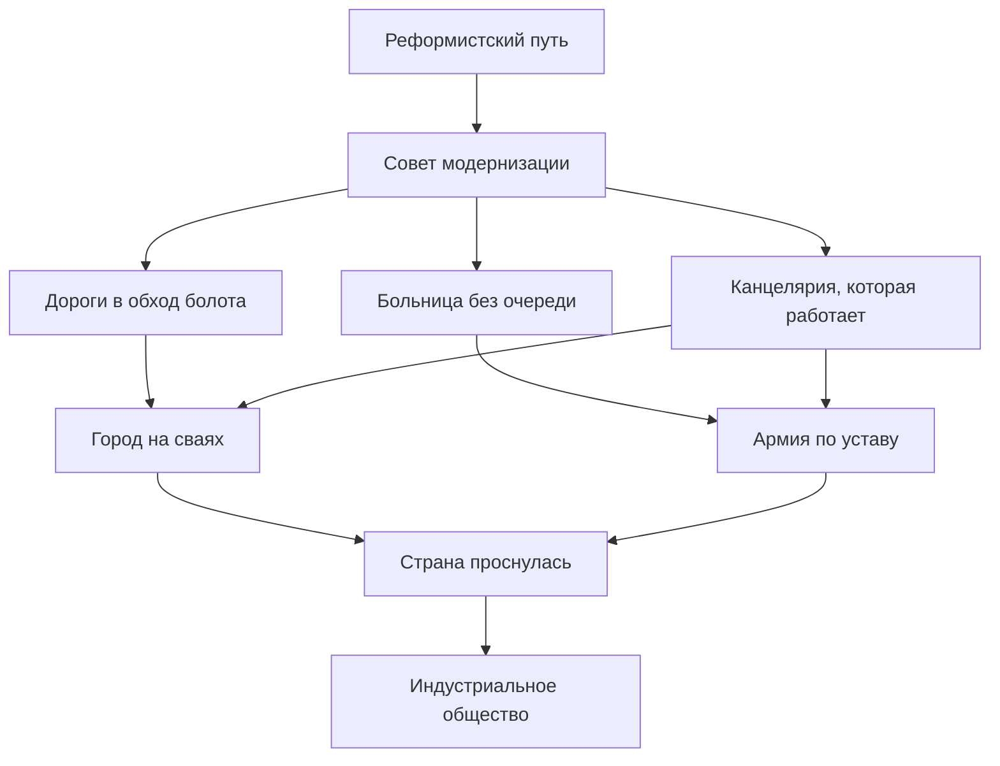

| Фокус | Дни | Описание | Эффект | Условие |
|---|---|---|---|---|
| Совет модернизации (`m_root`) | 70 | Заседание Совета назначили на утро, поэтому открыли его к обеду. Повестка короткая: что есть у соседей и чего нет у нас. Выяснилось, что нет почти всего. | Открывает категорию «Реформы» (5.1; раньше открывал «Заводской гудок») для обоих подпутей; прогресс реформ +5; открывает «Экономику реформистского пути» и «Образование» | Реформистский путь |
| Дороги в обход болота (`m_infra`) | 70 | Дорожники провели трассу прямо через трясину, потом перерисовали в обход: болото обиделось бы. Трасса вышла длиннее, зато сухая. | +1 уровень инфраструктуры в 3 штатах (придумано); прогресс реформ +5 | Совет модернизации |
| Больница без очереди (`m_health`) | 70 | Первая больница работает с девяти. Очереди нет: больные пока не проснулись. Главврач считает это успехом медицины. | Дух «Всеобщая больница»: стабильность +5 %, прирост населения +5 % [uncertain: модификатор]; прогресс реформ +5 | Совет модернизации |
| Канцелярия, которая работает (`m_admin`) | 70 | Чиновникам выдали часы. Часы шли, чиновники нет, но ведомости стали приходить в тот же год, что и запрос. Старожилы потрясены. | +50 ПВ; прирост ПВ +10 %; прогресс реформ +5 | Совет модернизации |
| Город на сваях (`m_city`) | 105 | Хутора сбиваются в города: так ближе до соседа, у которого можно полежать. Дома стоят на сваях, а сваи — на честном слове. | +2 слота строительства в 3 болотных штатах (придумано); Внутр. К. −5 % (кроме «Казуального коммунизма»); прогресс реформ +10 | Дороги в обход болота; Канцелярия, которая работает |
| Армия по уставу (`m_army`) | 105 | В казармы принесли устав. Читали по очереди, потом всем взводом спали на нём. Зато в строю теперь стоят ровно: так удобнее подпирать друг друга. | +2 дивизии; призывное население +1 %; прогресс реформ +5 | Больница без очереди; Канцелярия, которая работает |
| Страна проснулась (`m_final`) | 105 | К полудню выяснилось, что страна уже встала. Никто не помнил, когда именно. Подозревают, что сама. | Прогресс реформ +15; +1 гражданская фабрика | Город на сваях; Армия по уставу |
| Индустриальное общество (общий для обоих подпутей; перенесён из демократии) | 140 | Гудок больше никого не удивляет. Туман рассеялся, страна проснулась. | Если прогресс реформ ≥ 80 — событие «Индустриальное общество» (5.1). На «Казуальном коммунизме» вариант без потери Внутр. К., Веры и «Даров болот» (придумано) | Страна проснулась; Демократическая община или Народная Республика Казуалия или Республика лежачих Советов |

## Экономика реформистского пути (новая; в игре не сделано)

Правило автора: экономическая ветка реформистского пути. Общая часть (индустриализация и торговля) доступна обоим подпутям; затем часть по идеологии: демократия — банки и рынок, коммунизм — планирование. Часть демократии и часть коммунизма взаимоисключающие (по идеологии; доступна одна), в каждой после развилки по два и более фокуса. «Дары болот» остаются отдельной веткой: на реформистском пути Вера исчезает после «Индустриального общества» (кроме «Казуального коммунизма»). Числа придуманы.

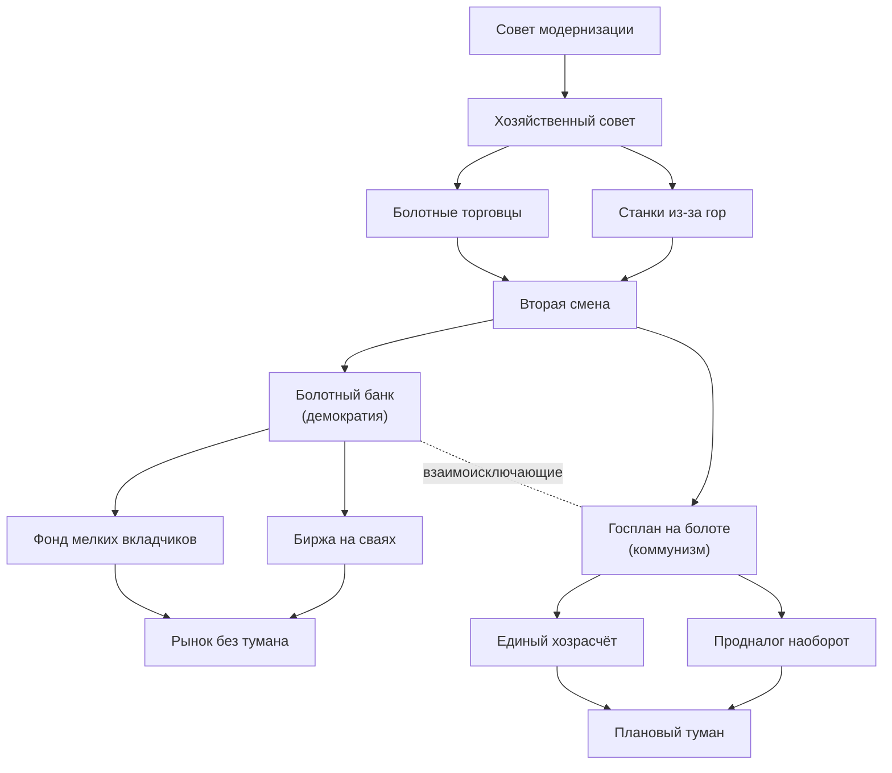

Общая часть:
| Фокус | Дни | Описание | Эффект | Условие |
|---|---|---|---|---|
| Хозяйственный совет (`x_root`) | 70 | Совет по хозяйству собрался в полном составе, то есть пришли двое. Постановили: хозяйство есть, осталось найти, где оно лежит. | +1 гражданская фабрика; прирост ПВ +5 % | Совет модернизации |
| Станки из-за гор (`x_machine`) | 70 | Станки привезли в ящиках с надписью «не кантовать». Казуалы и не кантовали: ящики стоят нетронутыми, но это уже промышленность. | +2 гражданские фабрики; прогресс реформ +5 | Хозяйственный совет |
| Болотные торговцы (`x_trade`) | 70 | Купцы поняли: болото не продаётся, зато продаётся всё, что в нём лежит. Торгуют, не вставая с лодок. | Потребление товаров −5 %; +50 ПВ | Хозяйственный совет |
| Вторая смена (`x_shift`) | 105 | Придумали вторую смену. Первая тоже была придумана, но на неё никто не пришёл. | +1 гражданская и +1 военная фабрика; Внутр. К. −5 % (кроме «Казуального коммунизма»); прогресс реформ +5 | Станки из-за гор; Болотные торговцы |

Часть демократии (требует «Заводской гудок»):
| Фокус | Дни | Описание | Эффект | Условие |
|---|---|---|---|---|
| Болотный банк (`xd_bank`) | 70 | Банк открыли в бывшем храме безделья: касса там, где была исповедальня. Вклады принимают лёжа, проценты начисляют, когда вспомнят. | +1 гражданская фабрика; популярность демократии +5 %; закрывает часть коммунизма | Вторая смена; Заводской гудок |
| Биржа на сваях (`xd_exch`) | 70 | Биржа стоит на сваях, как и всё в стране. Котировки пишут мелом, поэтому курс зависит от того, как давно вытирали доску. | Потребление товаров −10 %; +2 гражданские фабрики | Болотный банк |
| Фонд мелких вкладчиков (`xd_fund`) | 70 | Каждый казуал положил в фонд по копейке. Копейки лежат в мешке, мешок в тумане, фонд процветает. | Стабильность +5 %; +50 ПВ | Болотный банк |
| Рынок без тумана (`xd_market`) | 105 | Туман над рынком рассеялся, и выяснилось, что товары всё это время лежали на прилавках. Покупателей это удивило больше, чем продавцов. | +3 гражданские фабрики; прогресс реформ +10; торговый закон «Свободная торговля» [uncertain: ключ закона] | Биржа на сваях; Фонд мелких вкладчиков |

Часть коммунизма (требует «Красное болото»):
| Фокус | Дни | Описание | Эффект | Условие |
|---|---|---|---|---|
| Госплан на болоте (`xc_plan`) | 70 | План на пятилетку утвердили единогласно: проголосовали те, кто не спал. План лежит у председателя под подушкой, на случай проверки. | +2 гражданские фабрики; популярность коммунизма +5 %; закрывает часть демократии | Вторая смена; Красное болото |
| Продналог наоборот (`xc_gift`) | 70 | Крестьянам велели сдать излишки, а излишков нет. Тогда государство само раздало им излишки, и вышло, как у людей. | Стабильность +5 %; потребление товаров −5 % | Госплан на болоте |
| Единый хозрасчёт (`xc_cost`) | 70 | Каждой артели свой расчёт. Расчёт выполнили, не считая. | +1 гражданская и +1 военная фабрика; прогресс реформ +5 | Госплан на болоте |
| Плановый туман (`xc_fog`) | 105 | План выполнен на 100 %, туман объявлен стратегическим запасом. Статистика скромно молчит. | +3 гражданские фабрики (на «Казуальном коммунизме» +2 и Вера +100, «Дары болот» остаются) | Продналог наоборот; Единый хозрасчёт |

## Реформистский путь: Демократия

Лор: уничтожение Казуальности, переход к демократической общине. Правило автора: Реформы — переход к индустриальному обществу (5.1); дебаффы Внутр. К. усиливаются и задевают армию (раздел 2) — только на демократическом подпути (флаг `ktits_kaz_reformist`, ставит «Заводской гудок»). Гражданская война (раздел 6). **Перестройка путей:** бывший Реформистский путь теперь подпуть «Демократия» внутри Реформистского пути; после «Демократической общины» выбор из двух взаимоисключающих подветок: **«Суверенная демократия посреди континента»** (новая) и **«Демократия, опирающаяся на Бриттов»** (бывшая ветка «Бриттанское влияние», ниже). «Индустриальное общество» и Реформы теперь общие для обоих подпутей (раздел «Модернизация»); «Заводской гудок» оставляет за демократией усиление дебаффов Внутр. К. и открывает часть демократии «Экономики реформистского пути».

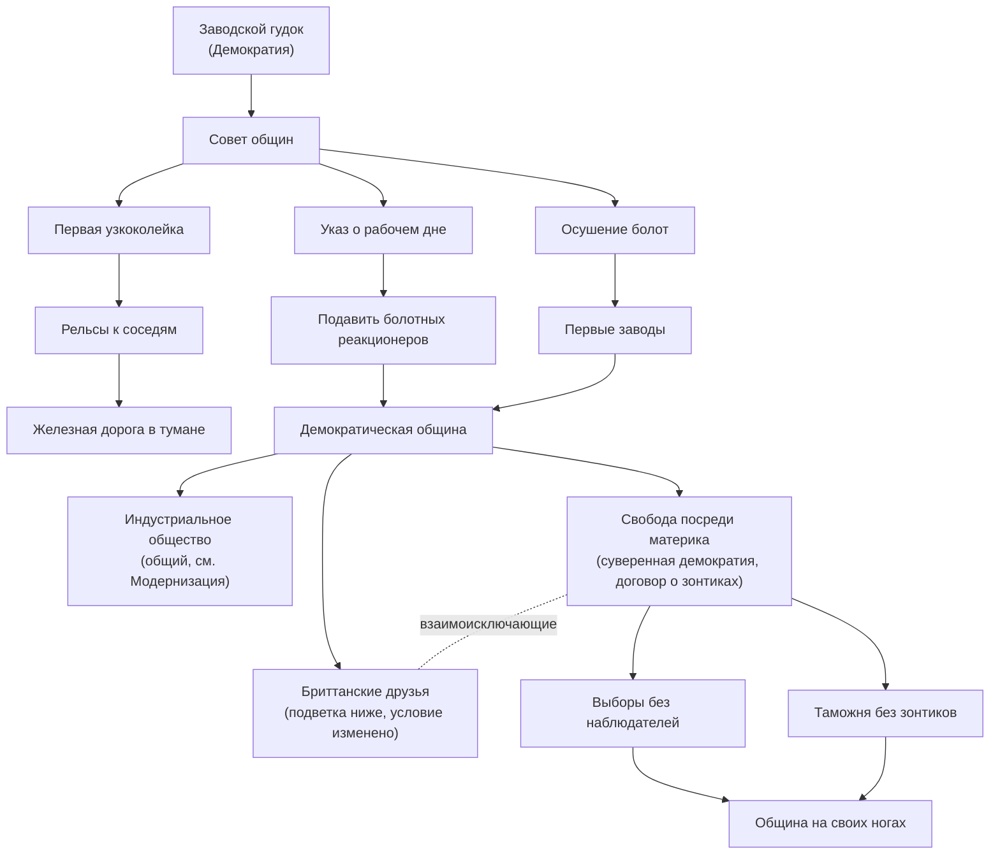

| Фокус | Дни | Описание | Эффект | Условие |
|---|---|---|---|---|
| Заводской гудок (Демократия; условие изменено) | 70 | Молодые казуалы увидели за горами заводской дым и захотели такого же. | Правительство — демократия; дебаффы Внутр. К. усиливаются (раздел 2); открывает часть демократии «Экономики реформистского пути». Реформы открывает теперь «Совет модернизации» (общий) | Реформистский путь |
| Совет общин | 70 | Впервые в истории казуалы выбирают власть сами. Явка — 12 %: остальные проспали. | Популярность демократии +15 %; прогресс реформ +5 | Заводской гудок |
| Указ о рабочем дне | 70 | Работать с утра до вечера. Половина страны впервые узнала, что такое утро. | Прогресс реформ +10; Внутр. К. −10 %; стабильность −5 % | Совет общин |
| Осушение болот | 105 | Землемеры с лопатами уходят в трясину. Многие возвращаются, некоторые — даже с картой. | Прогресс реформ +10; +1 слот строительства в 3 болотных штатах | Совет общин |
| Подавить болотных реакционеров | 70 | Старые казуалы ушли в камыши с плакатами «Верните покой!». Их надо вернуть — или победить. | Риск «Болотного мятежа» −50 %; армия +2 дивизии | Указ о рабочем дне |
| Первые заводы | 105 | Над болотом впервые гудит завод. Казуалы приходят посмотреть и почему-то остаются. | +2 гражданские фабрики; прогресс реформ +10 | Осушение болот |
| Первая узкоколейка | 70 | Землемеры нашли, где у страны выход: рельсы протянули до ближайшей границы. Поезд ходит раз в неделю, но уже ходит — и не опаздывает, потому что расписания нет. | `build_railway` ур. 1: столица Казуалии → ближайшая провинция соседа (придумано) | после «Совета общин» |
| Рельсы к соседям | 70 | Вторая ветка ушла к другому соседу. Казуалы смотрели, как её кладут, и предложили класть лёжа — получилось медленнее, зато основательно. | `build_railway` ур. 1: столица → провинция второго соседа | после «Первой узкоколейки» |
| Железная дорога в тумане | 105 | Узкоколейку расширили до настоящей дороги. Туман по-прежнему стелется над шпалами, но составы научились ходить и в нём. | `build_railway` ур. 2 по обеим веткам | после «Рельсов к соседям» |
| Демократическая община | 70 | Казуалия больше не Ставка, а община свободных граждан. Священный-Архо-Казуал ушёл на покой — ему не привыкать. | Правящая партия — демократия 60 %; Внутр. К. −10 %; открывает выбор: суверенная или бриттанская демократия; открывает «Индустриальное общество» (общий фокус) | Подавить…; Первые заводы |

**Суверенная демократия посреди континента** (подветка целиком новая; переделана по правилу автора: клерков выгоняет только коммунизм, демократия Бриттов оставляет; в игре не сделано):
| Фокус | Дни | Описание | Эффект | Условие |
|---|---|---|---|---|
| Свобода посреди материка (новый; переделан) | 70 | Казуалия лежит в центре материка, и все дороги ведут через неё. Решили: пусть ведут, но по договору. Бриттанским клеркам объяснили, докуда доходят их зонтики, и налили чаю на дорожку. Клерки остались, но на дверях у них теперь табличка «советник», а не «наместник». | Договор о границах влияния (придумано; вместо изгнания): дух «Бриттанское влияние» замораживается на уровне 1 (не растёт, ограничений нет); отношения с Бриттаном +25; решение «Выгнать клерков» на демократии недоступно; стабильность +5 %; закрывает «Бриттанские друзья» | Демократическая община |
| Выборы без наблюдателей (новый) | 70 | Впервые никто не смотрит, как казуалы голосуют. Результаты удивили всех, особенно самих казуалов: они, оказывается, умеют считать до миллиона. | Популярность демократии +10 %; стабильность +5 %; прогресс реформ +5 | Свобода посреди материка |
| Таможня без зонтиков (новый; придумано) | 70 | На границе встала таможня. Бриттанские товары досматривают с той же улыбкой, с какой бритты досматривали казуальные. Улыбки одинаково вежливые, а пошлины одинаково непонятные. | +1 гражданская фабрика; +50 ПВ; прогресс реформ +5 | Свобода посреди материка |
| Община на своих ногах (новый) | 105 | Страна стоит на собственных ногах, пусть и слегка пошатываясь. Опоры больше не нужно: если упадём — упадём сами. | +2 гражданские фабрики; +50 ПВ; право основать альянс ванильной кнопкой (`Alliances.md`: порог напряжённости демократии 40 %, ≥ 30 фабрик) | Выборы без наблюдателей; Таможня без зонтиков |

## Реформистский путь: Коммунизм

Лор: помощь от коммунистических стран и быстрая индустриализация; возможна гражданская война (раздел 6). **Перестройка путей:** бывший «Коммунистический путь» теперь часть Реформистского пути (после «Красного болота», бывшего корня). После общих «Болотных Советов» два взаимоисключающих подпути: **«Сотрудничество с СССР»** (бывшие фокусы с перестановкой) и **«Казуальный коммунизм»** (новый). Все изменения: в игре не сделано. **Клерков выгоняет «Красное болото»** (правило автора: только коммунизм; открытый вопрос 5 решён). Итоговый выбор «Сотрудничества с СССР» — из **трёх** вариантов (марионетка, союзник, «ни то ни другое»), у каждого не меньше двух фокусов (правило развилок). Усиленные дебаффы сотрудничества с СССР: дух «Красная зависимость» (три уровня).

**Связь с СССР** (`mechanics/Soviet-Union.md`, раздел 5): у СССР механика «Коммунизм на экспорт»: шкала Влияния, решения «Красная пресса» (+5 % популярности коммунизма цели), «Поддержать компартию», «Пригласить в Союз» (при популярности ≥ 50 %: событие цели — сменить идеологию и вступить в альянс Союза). Подпуть СССР — путь Казуалии по этому сценарию: сначала «Красная пресса», потом выбор «марионетка или союзник». «Казуальный коммунизм» от экспорта защищён только тем, что от него отказывается сама Казуалия; «Вечного нейтралитета» у него нет (решено автором): подпуть портит отношения с СССР, но позволяет основать собственный альянс или вступить в чужой (`global_mechanics/Alliances.md`).

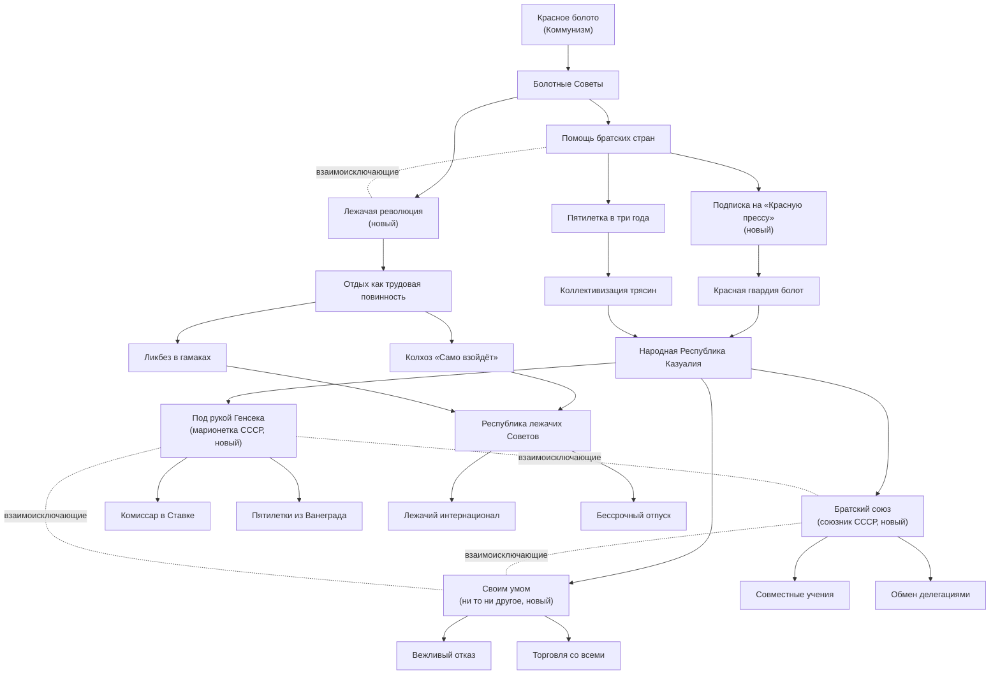

Общий фокус и подпуть «Сотрудничество с СССР»:
| Фокус | Дни | Описание | Эффект | Условие |
|---|---|---|---|---|
| Красное болото (Коммунизм; условие изменено) | 70 | Агитаторы объяснили казуалам, что лень — пережиток эксплуатации. Казуалы задумались. Надолго. Бриттанских клерков вывели из Ставки под красные флаги и проводили к пароходу: котелки несли в руках, потому что на голове было уже нельзя. | Правительство — коммунизм; открывает коммунистический подпуть и часть коммунизма «Экономики реформистского пути»; **выгоняет бриттанских клерков** как решение «Выгнать клерков» (дух «Бриттанское влияние» снят, отношения с Бриттаном −50, бриттанская ветка закрыта; флаг `ktits_kaz_expelled`) | Реформистский путь |
| Болотные Советы | 70 | В каждой деревне — совет. Заседания идут лёжа, но решения принимаются. | Популярность коммунизма +15 %; Внутр. К. −5 % | Красное болото |
| Помощь братских стран (подпуть СССР; перенесён) | 70 | Коммунистические страны шлют инструкторов, станки и брошюры. Брошюры казуалы читают охотнее всего. Инструкторы тем временем составляют опись: чем помогли, за что и сколько с кого. | +1 гражданская фабрика за каждую коммунистическую страну (до 3); отношения с ними +25; закрывает «Лежачую революцию»; **дух «Красная зависимость» ур. 1** (придумано): прирост ПВ −10 %, дебаффы Внутр. К. усиливаются как на демократии (флаг `ktits_kaz_reformist`) | Болотные Советы |
| Подписка на «Красную прессу» (новый) | 35 | Первый номер из Ванеграда пришёл на болота в трёх экземплярах. Один зачитали, во второй завернули селёдку, третий сохранили для истории. Со второго номера в газете появилась колонка «Что вы должны». | Популярность коммунизма +5 %; отношения с СССР +25; Казуалия учитывается в шкале Влияния СССР (`ktits_sov_export`) (придумано); **«Красная зависимость» ур. 2**: стабильность −5 %, выпуск гражданских фабрик −5 % (придумано) | Помощь братских стран |
| Пятилетка в три года (условие изменено) | 105 | План простой: за три года построить всё, чего не строили триста. | +3 гражданские фабрики; Внутр. К. −10 %; стабильность −10 % | Помощь братских стран |
| Красная гвардия болот (условие изменено) | 70 | Вчерашние лентяи получают винтовки и красные повязки. Ленятся теперь организованно. | +3 дивизии; риск гражданской войны −50 % | Подписка на «Красную прессу» |
| Коллективизация трясин | 105 | Болота объявлены общими. Никто не понял, что изменилось, но работать стали больше. | +2 военные фабрики; Внутр. К. −10 % | Пятилетка в три года |
| Народная Республика Казуалия (эффект изменён) | 70 | Над Ставкой — красное знамя. Ставка переименована в Дом Советов, но все по привычке зовут её Ставкой. | Правящая партия — коммунизм 70 %; **«Красная зависимость» ур. 3 «Красный надзор»** (придумано): стабильность −10 %, выпуск военных фабрик −10 %; открывает финальный выбор из трёх | Красная гвардия…; Коллективизация… |
| Под рукой Генсека (новый; «стать марионеткой СССР») | 70 | Священный-Архо-Казуал подписал бумагу, которую принесли из Ванеграда. Читать не стал: Генсек, говорят, человек основательный. Зато теперь за казуалов думают товарищи. | Казуалия — марионетка СССР; +100 ПВ; +2 гражданские фабрики; Внутр. К. −10 % (числа придуманы); по правилу альянсов (`global_mechanics/Alliances.md`, «Марионетки всегда в альянсе сюзерена») сразу в альянсе СССР и не может выйти; «Красный надзор» остаётся постоянным; закрывает «Братский союз» и «Своим умом». Условия: СССР существует, не марионетка Казуалии, не воюет с ней | Народная Республика Казуалия |
| Братский союз (новый; «стать союзником СССР») | 70 | Казуалия и Союз скрепили дружбу рукопожатием. Союз пожал энергично, Казуалия — через полчаса, но от души. | Казуалия вступает в альянс СССР (идеология коммунизм совпадает; порог напряжённости для фокуса не нужен [uncertain]); если у СССР альянса нет, он создаётся по шаблону и входит Казуалия [uncertain]; шкала сотрудничества +10 (придумано); остаётся независимой; «Красная зависимость» снижается до ур. 1; закрывает «Под рукой Генсека» и «Своим умом». Условия те же | Народная Республика Казуалия |
| Своим умом (новый; «ни то ни другое») | 70 | Священный-Архо-Казуал выслушал Ванеград, потом Лондон, потом заснул. Проснувшись, объявил: решать будем сами, когда-нибудь. Генсек просил передать, что подождёт. Недолго. | Казуалия остаётся независимой: не марионетка и не союзник; дух «Красная зависимость» снимается полностью; отношения с СССР −25; закрывает «Под рукой Генсека» и «Братский союз» (придумано) | Народная Республика Казуалия |
| Комиссар в Ставке (новый; после «Под рукой Генсека») | 70 | Комиссар прибыл из Ванеграда с портфелем и графиком. Ставка встретила его сном. Он принял это за гостеприимство и остался на пять лет. | Дух «Комиссар при Ставке» (придумано): прирост ПВ −10 %, Внутр. К. −5 %, стабильность +10 %; отношения с СССР +50 | Под рукой Генсека |
| Пятилетки из Ванеграда (новый) | 105 | План прислали из Ванеграда готовым. Его только переименовали из «пятилетки» в «пятилетку на болоте» и попросили выполнить к прошлому году. | +3 гражданские и +2 военные фабрики; Внутр. К. −10 %; часть выпуска идёт сюзерену (придумано; в игре — флаг) | Под рукой Генсека |
| Совместные учения (новый; после «Братского союза») | 70 | Казуальные и союзные полки маневрировали вместе. Союзные закончили манёвры за три дня; казуальные за три недели и с обедом. Оценки выставили одинаковые, из вежливости. | +2 дивизии; опыт армии +25 ед.; отношения с СССР +25; сотрудничество в альянсе +10 (придумано) | Братский союз |
| Обмен делегациями (новый) | 70 | Из Ванеграда выехала делегация, из Ставки — другая, и на вокзале они разминулись. Обе вернулись домой с подарками, не понимая, от кого они. | +1 гражданская фабрика; +50 ПВ; популярность коммунизма +5 % | Братский союз |
| Вежливый отказ (новый; после «Своим умом») | 70 | Отказ вручили на красивой бумаге: «С глубоким уважением и без всяких обязательств». Генсек прочитал дважды и подчеркнул слово «без». | Отношения с СССР −50 (всего −75); дух «Независимая республика» (придумано): стабильность +10 %, прирост ПВ +10 %; СССР получает событие о недовольстве | Своим умом |
| Торговля со всеми (новый) | 70 | С востока берут станки, с запада чай, и ни у кого ничего не просят. Купцы утверждают, что это и есть настоящая дипломатия. | +2 гражданские фабрики; право основать альянс ванильной кнопкой по правилам коммунизма (`Alliances.md`: ≥ 30 фабрик) или вступить в чужой | Своим умом |

Итоговый выбор после «Народной Республики Казуалии»: «Под рукой Генсека», «Братский союз», «Своим умом» взаимоисключающие, у каждого по два последующих фокуса (подборка выше).

Подпуть «Казуальный коммунизм» (весь новый; коммунизм с аспектами Казуальности: шкала Внутр. К. не падает от фокусов, Вера и «Дары болот» сохраняются, образование без потери Внутр. К.):
| Фокус | Дни | Описание | Эффект | Условие |
|---|---|---|---|---|
| Лежачая революция | 70 | Революция была назначена на понедельник, перенесена на вторник, потом на «как-нибудь». В итоге власть упала сама, и никто не успел увернуться. | Популярность коммунизма +10 %; Внутр. К. +5 %; закрывает «Помощь братских стран» (подпуть СССР); флаг `ktits_kaz_f_lazy` | Болотные Советы |
| Отдых как трудовая повинность | 70 | Съезд постановил: гражданин, лежащий в гамаке, восстанавливает силы для строительства коммунизма. Норма отдыха — восемь часов; сверх нормы — трудовой подвиг. | Дух «Казуальный коммунизм» (придумано): стабильность +5 %, прирост Веры +10 %; фокусы этого подпути не снижают Внутр. К. (раздел 2) | Лежачая революция |
| Колхоз «Само взойдёт» | 105 | Колхоз выполнил план, не сеяв: урожай взошёл сам, а председатель получил за это грамоту. Грамоту тоже никто не вручал, она сама пришла. | Вера +200; +1 гражданская фабрика; ветка «Экономика» остаётся доступной (Вера не исчезает) | Отдых как трудовая повинность |
| Ликбез в гамаках | 105 | Ликбез проводят прямо на месте: учитель читает вслух, ученики слушают лёжа. К концу лекции не спит каждый третий, и это считается рекордом. | Снимает правило «специалистов всегда 0» (`global_mechanics/Education.md`): специалисты +5 тыс.; Внутр. К. не снижается | Отдых как трудовая повинность |
| Республика лежачих Советов | 70 | Над Ставкой — красное знамя, под ним — гамак. Съезд Советов заседал неделю: три дня сидя, четыре лёжа. Решения приняты единогласно, потому что несогласные заснули. | Правящая партия — коммунизм 70 %; Внутр. К. +10 %; Вера +100; дух «Казуальный коммунизм» становится постоянным; **«Вечного нейтралитета» нет** (решено автором): подпуть портит отношения с СССР (событие об отказе от комиссаров, отношения −50; было −25), зато Казуалия может основать собственный альянс или вступить в чужой по правилам коммунизма (`Alliances.md`); сама в альянс не входит | Колхоз «Само взойдёт»; Ликбез в гамаках |
| Лежачий интернационал (новый; придумано) | 70 | Республика лежачих Советов разослала по миру приглашения. Приглашения месяц лежали на почте: почтальон тоже проникся. Дошли только те, что принесло ветром. | Право основать альянс ванильной кнопкой «Создать фракцию» **без требования ≥ 30 фабрик** (исключение, как у «Союза сонных»); приглашения по правилам коммунизма; сотрудничество +10 | Республика лежачих Советов |
| Бессрочный отпуск (новый; придумано) | 105 | Съезд постановил, что отпуск — не пауза, а форма правления. Первым указом назначены каникулы на неопределённый срок. Вторым — ещё одни. | Внутр. К. +10 %; Вера +200; дух «Бессрочный отпуск»: стабильность +5 %, прирост Веры +10 % | Республика лежачих Советов |

## Казуальная резервация

Лор: страна, захватившая или оккупировавшая Казуалию, создаёт марионетку и ставит удобную партию; столица — в любой из 5 провинций. Правило автора: **два подпути — «Покорность» и «Казуальное восстание»**. Ветка открыта только Казуалии-марионетке после захвата; остальные ветки при этом закрыты.

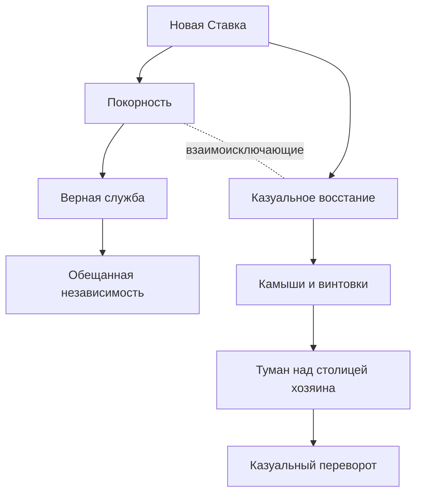

| Фокус | Дни | Описание | Эффект | Условие |
|---|---|---|---|---|
| Новая Ставка | 35 | Чужие флаги над старой Ставкой. Казуалам выделили болото и велели вести себя тихо. | +50 ПВ; дух «Тихая жизнь» на 180 дней (стабильность +10 %); открывает выбор подпути (перенос столицы в 5 провинций не реализован) | Казуалия — марионетка |
| Покорность | 70 | Будем служить. Будем полезны. А когда-нибудь хозяин сдержит слово. | Отношения сюзерена +50; +25 ПВ; стабильность +5 % | Новая Ставка |
| Верная служба | 105 | Казуальные полки воюют за хозяина. Не быстро, но стоят насмерть. | Сюзерен получает дух «Казуальные полки» (защита армии +5 %, призыв +2 %); автономия +20 % | Покорность |
| Обещанная независимость | 70 | Хозяин держит слово — или Казуалия напоминает ему об этом очень вежливо. | Событие сюзерену `ktits_kazualia.5`: дать независимость (`end_puppet`) или отказать (отношения −100, Внутр. К. +20 %) | Верная служба |
| Казуальное восстание | 70 | Хозяин думает, что казуалы спят. Хозяин ошибается. | Внутр. К. +10 %; шкала Казуальности сюзерена +10 | Новая Ставка |
| Камыши и винтовки | 105 | По ночам в камышах раздают оружие, которое хозяин сам сюда привёз. | +3000 пехотного снаряжения в скрытом запасе (в игре не сделано); дух сюзерену «Казуальные партизаны» (в игре не сделано): стабильность −5 %, выпуск на фабриках −5 % [числа придуманы]; дух снимается, когда Казуалия перестаёт быть его марионеткой (решено автором) (сопротивление движка в штатах сюзерена невозможно) | Казуальное восстание |
| Туман над столицей хозяина | 105 | Чиновники сюзерена всё чаще смотрят в окно вместо отчёта. Партизаны в камышах уже не прячутся. | Шкала Казуальности сюзерена +20; стабильность сюзерена −10 % | Камыши и винтовки |
| Казуальный переворот | 70 | Вооружённое восстание: казуалы выходят из тумана, и власть хозяина рушится. | Конец марионетки, война с бывшим сюзереном (`annex_everything` [uncertain]); дух «Туман выходит из камышей» (поддержка войны +20 %, 180 дн.); при шкале сюзерена ≥ 75 — претензии на все его штаты | Туман над столицей хозяина |

## Дурманище

Правило автора (раздел 1): казуалам дебафф на чужой земле, который снимается фокусами. Фокусы и их описания — из раздела 1.

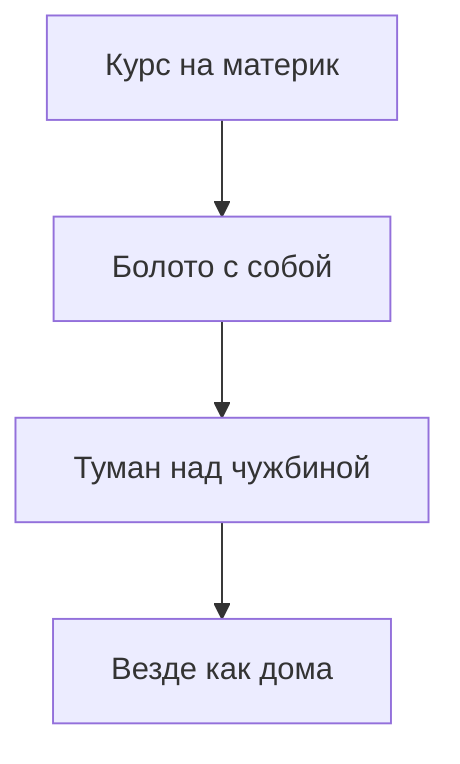

| Фокус | Дни | Описание | Эффект | Условие |
|---|---|---|---|---|
| Болото с собой | 70 | Солдаты набирают во фляги болотную воду. На чужой земле глоток — и снова как дома. | Штраф на чужой земле −1/3 | Курс на материк |
| Туман над чужбиной | 70 | Туман идёт впереди армии. Чужие поля становятся вязкими, а казуалы — спокойными. | Штраф на чужой земле −1/3 | Болото с собой |
| Везде как дома | 105 | Казуал засыпает на чужой земле так же крепко, как в своих камышах. Значит, это уже его земля. | Штраф на чужой земле снят | Туман над чужбиной |

## Экономика «Дары болот»

Опирается на Казуальную Веру (раздел 4). На реформистском пути (демократия и «Сотрудничество с СССР») после события «Индустриальное общество» ветка закрывается (Вера исчезает); на «Казуальном коммунизме» Вера сохраняется. Экономика реформистского пути — отдельная ветка выше.

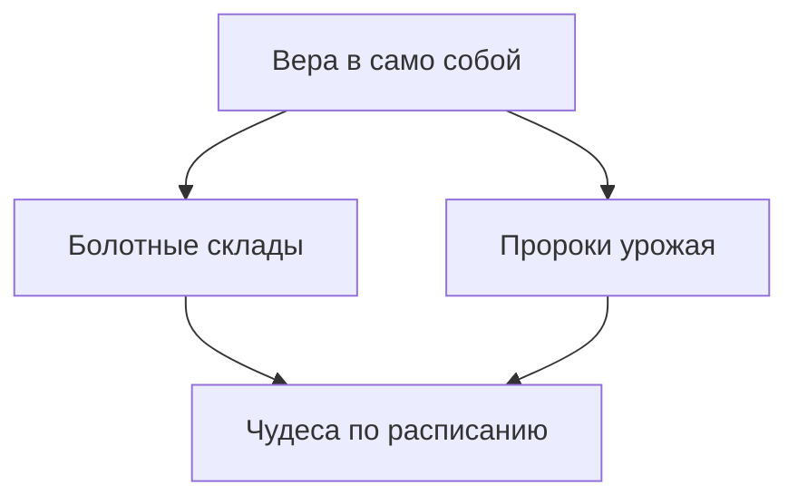

| Фокус | Дни | Описание | Эффект | Условие |
|---|---|---|---|---|
| Вера в само собой | 70 | Казуалы не работают, но у них всё есть. Никто не знает откуда, и никто не спрашивает. | Вера +200; прирост Веры +10 % | — |
| Болотные склады | 70 | В тине находят ящики с припасами. Кто их туда положил — тайна. | Решения «Ружья из тины» и «Пушки сами приплыли» дешевле на 25 % | Вера в само собой |
| Пророки урожая | 70 | Пророки говорят, что урожай будет. Урожай слушается. | Прирост Веры +15 %; стабильность +5 % | Вера в само собой |
| Чудеса по расписанию | 105 | Чудеса случаются так часто, что к ним привыкли. | Вера +300; перезарядка всех «Даров болот» −25 % | Болотные склады; Пророки урожая |

## Образование

У Казуалии специалистов всегда 0 (`global_mechanics/Education.md`); ветка снимает это ограничение. Доступна на Реформистском пути (демократия и коммунизм) после «Совета модернизации». На «Казуальном коммунизме» то же без потери Внутр. К. даёт «Ликбез в гамаках».

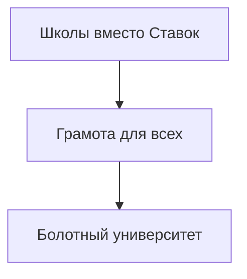

| Фокус | Дни | Описание | Эффект | Условие |
|---|---|---|---|---|
| Школы вместо Ставок | 70 | Священные палаты отдают под классы. Учитель приходит раньше учеников — это уже прогресс. | Снимает правило «специалистов всегда 0»; специалисты +5 тыс. | Совет модернизации (условие изменено) |
| Грамота для всех | 105 | Казуалы учатся читать. Первая прочитанная книга у всех одна — «Как перестать откладывать». | Специалисты +10 тыс.; Внутр. К. −5 % | Школы вместо Ставок |
| Болотный университет | 105 | Первый университет посреди болот. Лекции начинаются в полдень: компромисс с традицией. | Специалисты +15 тыс.; исследования +5 % | Грамота для всех |

## Бриттанское влияние (подветка «Демократия, опирающаяся на Бриттов»)

**Правило автора:** клерков выгоняет **только коммунизм** («Красное болото»); на демократии решение «Выгнать клерков» недоступно, бриттанская ветка не закрывается, а суверенная демократия не выгоняет клерков, а заключает договор (замороженный дух ур. 1). После решения «Выгнать клерков» (там, где оно возможно) все фокусы ветки недоступны (`available`: нет флага изгнания). ИИ Великой Казуалии выгоняет клерков, когда влияние невыгодно (`mechanics/Kazualia.md`, 5.2).

**Перестройка путей:** ветка больше не отдельная для всех путей, а подветка демократии: «Бриттанские друзья» открываются после «Демократической общины» (раздел «Реформистский путь: Демократия») и взаимоисключающие со «Свободой посреди материка» (суверенная демократия). Для Казуального и Коммунистического путей ветка недоступна (дух «Бриттанское влияние» 1 уровня на старте остаётся, пока не выгнаны клерки: при коммунизме их выгоняет «Красное болото»; Казуальный путь: см. открытые вопросы). Названия, дни и эффекты фокусов не менялись (в игре не сделано: только перенос и условие).

Правило автора (раздел 5.2): сотрудничество с Бриттами даёт баффы, но забирает независимость и внешнюю политику; в конце — выбор: стать марионеткой, создать альянс / вступить в альянс или продолжить сотрудничество без альянса. Фокусы, уровни духа и тексты — в разделах 5.2 и 7 `mechanics/Kazualia.md`; здесь схема и дни. «Морской союз» — альянс демократий: Казуалия при демократическом правительстве вступает в альянс Бриттана (порог напряжённости для фокуса не нужен [uncertain]); если у Бриттана альянса нет, он создаётся по шаблону `ktits_alliance_template` и в него входит Казуалия [uncertain]. Правило альянсов «Казуальность не входит в чужой альянс» (`global_mechanics/Alliances.md`) к демократии не относится.

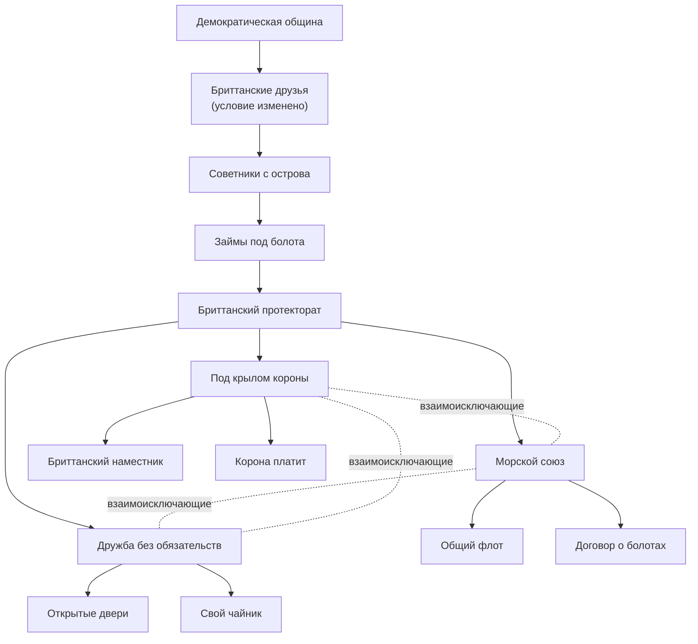

| Фокус | Дни | Эффект (раздел 5.2) |
|---|---|---|
| Бриттанские друзья | 35 | дух «Бриттанское влияние» уровень 1; условие: Демократическая община; закрывает «Свободу посреди материка» |
| Советники с острова | 70 | уровень 2 |
| Займы под болота | 70 | уровень 2, +2 гражданские фабрики |
| Бриттанский протекторат | 105 | уровень 3 |
| Под крылом короны | 70 | марионетка Бриттана; дух «Корона и болото» |
| Морской союз | 70 | вход в альянс Бриттана (или создание через шаблон альянсов) |
| Дружба без обязательств | 70 | дух остаётся на уровне 2, ограничения сняты |

Финал ветки по правилу развилок: у каждого из трёх исходов по два продолжения (новые фокусы; в игре не сделано):
| Фокус | Дни | Описание | Эффект | Условие |
|---|---|---|---|---|
| Бриттанский наместник (`b_gov`) | 70 | Наместник приехал с чемоданом и зонтиком, поселился в Ставке и первым делом переставил мебель. Так выглядит самоуправление под короной. | Дух «Корона и болото»: +10 % к выпуску гражданских фабрик; автономия −10 % (придумано) | Под крылом короны |
| Корона платит (`b_pay`) | 105 | Корона оплатила болотные счета: дороги, гарнизоны, чай. Взамен Казуалия подписала «согласие на всё, что потом придумается». | +2 гражданские фабрики; +100 ПВ; +1 слот строительства (придумано) | Под крылом короны |
| Общий флот (`b_fleet`) | 70 | Бриттанские корабли заходят в казуальный порт, а казуальные рыбаки машут им лодками. Адмиралтейство называет это «глубокой интеграцией». | +10 % атака флота; +1 доковая верфь (придумано) | Морской союз |
| Договор о болотах (`b_treaty`) | 105 | Союзный договор написан на двух языках. Казуальный текст короче: «Согласны». Бриттанский длиннее: «Согласны, но при условии…». | Сотрудничество в альянсе +10; отношения с участниками альянса Бриттана +25; +50 ПВ | Морской союз |
| Открытые двери (`b_open`) | 70 | Дверь для бриттов не закрыли, но и не придерживают. Входят — хорошо, уходят — тоже хорошо. | +1 торговый договор (придумано); стабильность +5 % | Дружба без обязательств |
| Свой чайник (`b_kettle`) | 105 | Казуалы завели свой чайник и пьют чай без бриттанских советов. Чай получается хуже, но своё. | Дух «Свой чайник»: ограничения духа снимаются полностью; прирост ПВ +10 %; +50 ПВ | Дружба без обязательств |

## Армия «Болотная война»

Своя ветка Казуалии в дополнение к ванильным «Армии» и «Флоту». Опирается на баффы Внутр. К. в болоте и горах (раздел 2). Доступна на всех путях.

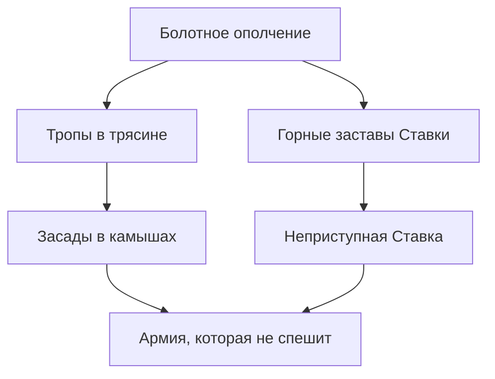

| Фокус | Дни | Описание | Эффект | Условие |
|---|---|---|---|---|
| Болотное ополчение | 70 | Каждый казуал умеет держать вилы и лежать в засаде. Второе — особенно. | +2 дивизии ополчения; призывное население +1 % | — |
| Тропы в трясине | 70 | Казуалы знают каждую кочку. Чужаки — ни одной. | Дух: скорость армии +10 %, атака +5 % (модификатора местности для страны в игре нет) | Болотное ополчение |
| Горные заставы Ставки | 70 | Горы стерегут столицу с трёх сторон. Теперь в горах ещё и сторожа. | Дух: защита армии +5 %, макс. окапывание +10 %; +2 форта в штате столицы | Болотное ополчение |
| Засады в камышах | 105 | Враг идёт по болоту и вдруг понимает, что болото на него смотрит. | Скорость окапывания +20 %; организация +5 % | Тропы в трясине |
| Неприступная Ставка | 105 | Южный проход к Ставке перекрыт. Остальные три закрыли горы. | Дух: защита армии +5 %, организация +5 %; ещё +2 форта в штате столицы | Горные заставы Ставки |
| Армия, которая не спешит | 105 | Казуальная армия не наступает быстро. Зато и не отступает никогда. | Восстановление организации +10 %; расход припасов −10 % | Засады…; Неприступная Ставка |

## Реализация (`tools/make_kazualia.py`) [uncertain: в игре не проверено]
Файл `common/national_focus/ktits_kazualia.txt`, 69 фокусов, дерево только для тега Казуалии (`factor = 0`, `add = 100`). Раскладка компактная (сетка x: соседи через 2, ветки разделены одним пустым местом; всё в пределах x 0–68, y 0–8; «Тихая власть» и «Эхо в камышах» в колонке 14, y 7–8), задана словарём `LAYOUT` в скрипте; `check_mod.py` проверяет отсутствие наложений. Колонки: Нейтралитет 0–4, Великая Казуалия 8–12 (Дурманище 15), Реформистский 20–24, Образование 28, Коммунистический 32–36, Экономика 40–44, Бриттанское влияние 48–52, Армия 56–60, Резервация 64–68.
- **Заглушки, получившие эффект:** «Болото не знает границ» (открывает «Внешнюю Казуальность» + Вера +150 + дух «Туман на границе»), «Зов из тумана» (Вера +100), «Казуальность на весь материк» (`create_wargoal` аннексии против соседей со шкалой ≥ 50 + дух), «Принять всех в Ставку» (+50 ПВ), «Чудеса по расписанию» (Вера +300), «Тропы в трясине», «Горные заставы», «Неприступная Ставка» (духи; форты), «Новая Ставка» (+50 ПВ, дух), «Покорность» (+25 ПВ, стабильность), «Верная служба» (дух сюзерену), «Обещанная независимость» (событие сюзерену), «Казуальный переворот» (конец марионетки, война, претензии).
- **Не реализовано:** перенос столицы Резервации, ускорение автономии, партизаны в штатах сюзерена (заменены духом сюзерена «Казуальные партизаны», см. «Камыши и винтовки»), бонусы местности (в игре нет страновых модификаторов).
- **«Курс на покой»** дополнительно даёт дух «Вечный нейтралитет» (`ktits_eternal_neutrality`, механика альянсов: нельзя основать альянс и вступить в альянс). **Панель «Непрерывные фокусы»** перекрывала левую ветку Нейтралитета: в дереве задано `continuous_focus_position = { x = 50 y = 1250 }` (под деревом; ключ и масштаб по ванильным деревьям, у Австралии `y = 1000` при высоте дерева 7 рядов) [uncertain: в игре не проверено]. Раскладка не менялась.
- **ИИ (`ai_will_do`):** «Пробуждение Ставки» 1000; «Вечный сон» 300 > «Заводской гудок» 120 > «Красное болото» 60; «Курс на материк» 150 > «Курс на покой» 100; остальные политические ветки (Нейтралитет, Великая Казуалия, Реформистский, Коммунистический, Резервация) по 100 (Резервация: «Покорность» 150 > «Восстание» 80); Дурманище 40, Образование 30, Экономика 20, Бриттанское влияние 15, Армия 3.
- Закрытие других веток при Резервации и «Экономики» на Реформистском пути после «Индустриального общества» сделано только для «Экономики» (`available`); остальное не закрывается.

Правки после второго прогона: Бриттанская ветка (`b_*`) закрывается после «Выгнать клерков» (`allow_branch` и `available` по флагу `ktits_kaz_expelled`); «Заводской гудок» и «Красное болото» возвращают обычные законы (`civilian_economy`, `volunteer_only`) вместо «Казуального общества» и `disarmed_nation`; цели войны «Курса на материк» — только слабые соседи (`strength_ratio`) со шкалой ≥ 50. Подробности — `mechanics/Kazualia.md`, «Реализация».
- Расхождение с модом: в доке «Проповедь лени» и «Болото не знает границ» идут после «Курса на материк», «Болото с собой» (Дурманище) тоже после «Курса на материк»; в моде они висят на «Власти Священной Ставки» / «Вечном сне» (исправить в скриптах после „в игру“).

**Перестройка путей (в игре не сделано, по правилу автора) — что переименовать и перенести при реализации** [uncertain: id сверить по `make_kazualia.py`]:
- `sleep` «Вечный сон» → «Сохранение казуальности» (только название; effects, `g_power` и ветки Нейтралитета и Великой Казуалии не меняются).
- Новый корневой фокус `reform` «Реформистский путь» (70 дн) после `wake`: `hum` и `red` теперь требуют `reform`; законы `civilian_economy` и `volunteer_only` (ставили оба, `hum` и `red`) переходят на `reform`. `mutually_exclusive`: было `sleep`/`hum`/`red` тройкой, станет `sleep`↔`reform` и `hum`↔`red`. `ai_will_do`: `reform` 150 (между `sleep` 300 и прежним `hum` 120).
- `hum` «Заводской гудок» = «Демократия»: остаётся флаг `ktits_kaz_reformist` (усиление дебаффов только на демократическом подпути, раздел 2 `mechanics/Kazualia.md`) и открытие Реформ. `red` «Красное болото» = «Коммунизм»: условие `reform` вместо `wake`.
- `b_friends` «Бриттанские друзья»: условие `r_comm` («Демократическая община») вместо «нет»; `mutually_exclusive` с новым `r_free`; из `allow_branch` убрать запрет для коммунистического пути (ветка теперь только на демократии). Остальные `b_*` без изменений; `b_crown` не требует проверки «только Реформистский путь» (она всегда выполнена).
- `c_help` «Помощь братских стран»: `mutually_exclusive` с новым `c_lazy`. `c_plan` «Пятилетка в три года»: условие `c_help` вместо `c_sov`. `c_guard` «Красная гвардия болот»: условие новый `c_press` вместо `c_help`. `c_rep` «Народная Республика Казуалия»: убрано «может вступить в коммунистический альянс», добавлен переход к `c_puppet` / `c_ally`.
- Новые id (первая часть перестройки): `reform`, `r_free`, `r_vote`, `r_own`, `c_press`, `c_puppet`, `c_ally`, `c_lazy`, `c_rest`, `c_artel`, `c_lik`, `c_lrep`. Иконки по префиксу (`r_`, `c_`) подхватятся `make_goals.py`; `reform` — корневой, на ванильной.
- `LAYOUT` (раскладка): коммунистический и бриттанский блоки перекладываются вплотную под демократический (бывший Реформистский), новые подпути получают свои колонки; перед правкой пересчитать `check_mod.py`.
- Гражданская война (`make_kazualia.py`): исключить подпуть «Казуальный коммунизм» (флаг `ktits_kaz_f_lazy` от `c_lazy`).
- Исторический путь: «Нейтралитет» (`n_root`) даёт опцию правила `HISTORICAL` (`global_mechanics/Game-Rules.md`).

**Вторая часть перестройки (новые фокусы по правилам автора; в игре не сделано; id придуманы, сверить по `make_kazualia.py`):**
- Общая «Модернизация»: `m_root`, `m_infra`, `m_health`, `m_admin`, `m_city`, `m_army`, `m_final` (префикс `m_` добавить в `make_goals.py`); «Индустриальное общество» (бывший `r_ind` в ветке демократии) требует `m_final` и `r_comm` / `c_rep` / `c_lrep`. «Реформы» открывает `m_root`, а не `hum`; `hum` оставляет флаг `ktits_kaz_reformist`. «Школы вместо Ставок» (`s_*`) требуют `m_root`.
- «Экономика реформистского пути»: `x_root`, `x_machine`, `x_trade`, `x_shift`; демократия `xd_bank`, `xd_exch`, `xd_fund`, `xd_market`; коммунизм `xc_plan`, `xc_gift`, `xc_cost`, `xc_fog`; `xd_bank` и `xc_plan` взаимоисключающие.
- Выбор СССР: `c_own` (3-й исход; взаимоисключающий с `c_puppet`, `c_ally`), `c_commis`, `c_five` (после `c_puppet`), `c_drill`, `c_deleg` (после `c_ally`), `c_polite`, `c_trade` (после `c_own`). Дух «Красная зависимость» (ур. 1 `c_help`, ур. 2 `c_press`, ур. 3 `c_rep`; снижается `c_ally`, снимается `c_own`); `c_help` ставит `ktits_kaz_reformist`.
- «Казуальный коммунизм»: `c_intl`, `c_leave` после `c_lrep`; `c_lrep` без `ktits_eternal_neutrality`.
- Суверенная демократия: `r_free` не вызывает «Выгнать клерков», а замораживает дух `ktits_kaz_britt_influence` на ур. 1; новый `r_tax` перед `r_own`. `red` вызывает «Выгнать клерков» (флаг `ktits_kaz_expelled`); для демократии решение `visible = no`.
- Бриттанский финал: `b_gov`, `b_pay` (после `b_crown`), `b_fleet`, `b_treaty` (после `b_sea`), `b_open`, `b_kettle` (после `b_free`).
- Число фокусов: в доке было ≈ 82, стало ≈ 117 (+35 новых: Модернизация 7, Экономика 12, СССР 7, Казуальный коммунизм 2, Бриттанский финал 6, суверенная демократия 1). В моде 69; `LAYOUT` расширить, `check_mod.py` пересчитать.
