# Древо фокусов Советского Союза

Своё древо Союза (`MAK`) вместо стандартного (`Generic-Focus-Tree.md`). **Статус:** только описание, в моде нет. Механики — `mechanics/Soviet-Union.md` (разделы в скобках). Правила автора отмечены, всё остальное придумано (названия, дни, эффекты, тексты), нужно подтверждение. «Целостность» — раздел 2, «Паранойя» — раздел 3, «Баланс» — Пименов — Партия, раздел 4.

Фокусы выделяемых стран («Судьба зоны», выход из зоны или остаться) — `mechanics/Soviet-Union.md`, раздел 14.

**Состав древа:**
| Ветка | Откуда | Кому доступна |
|---|---|---|
| Спасение экономики (Экономический блок) | идея автора | при Целостности ниже 50 % |
| Паранойя Пименова | правило автора | только пока правитель — Пименов |
| Политические пути (6: 5 + фашистский) | правило автора | выбор одного пути |
| Борьба с Казуальностью | правило автора | все пути, кроме Казуального |
| Внешняя политика (4 направления; «Рубежи Союза» — 5 подветок) | правило автора | после фокуса политической ветки |
| Экономика и Великие стройки | придумано (стройки — правило автора) | все |
| Армия, Флот, Авиация | придумано | все |

## Паранойя Пименова

**Правила (автор, 2026-11-20):** гражданская война была 10 лет назад, Ваня параноик насчёт врагов и соперников.
- Фокус «Бессонные ночи» обязателен и первый: без него нельзя взять ни один другой фокус дерева (он предпосылка каждого фокуса без других предпосылок).
- Выбор курса (шесть корневых фокусов путей: «Немыслимый вариант», «Политические реформы», «Мягкий коммунизм», «Тоталитарный коммунизм», «Казуальный путь», «Самодержавный курс») невозможен, пока не победит одна из личностей Генсека (флаг победы личности, в том числе «Баланс найден»); личности растут быстрее (раз в месяц одна случайная +8, было +3).
- ИИ: берёт «Бессонные ночи» первым (вес 5000), затем решениями «Усилить личность» усиливает личность, подходящую пути из правил игры (мягкий коммунизм, реформы и «по весам» — Мягкий коммунист; жёсткий коммунизм — Жёсткий; фашизм — Самодержец; Немыслимый вариант и Казуальный путь — Шиз), и только после победы личности выбирает курс.

Правило автора: открыта только пока правитель — Пименов; выбор между четырьмя личностями и балансом; решения на поднятие личности открываются после взятия первого фокуса.

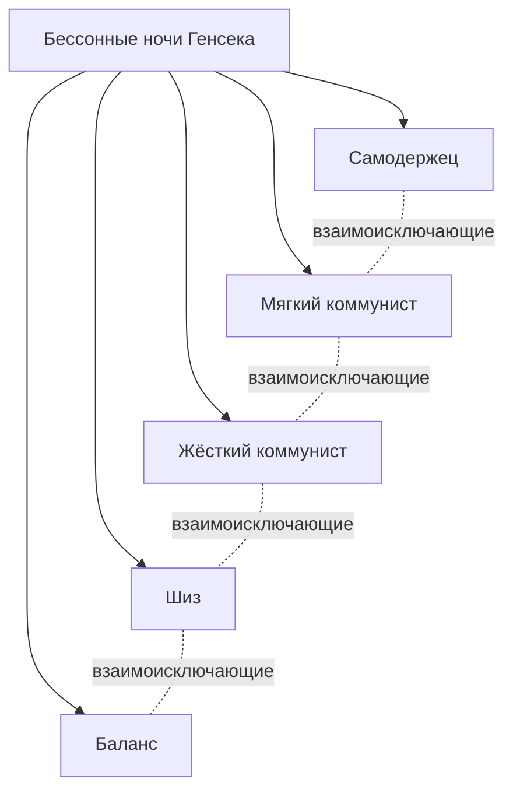

| Фокус | Дни | Описание | Эффект | Условие |
|---|---|---|---|---|
| Бессонные ночи Генсека | 35 | Гражданская война закончилась десять лет назад, но Ваня Пименов всё ещё видит врагов и соперников в каждом коридоре. Он перестал спать и начал проверять каждую подпись. | Запускает механику Паранойи; открывает решения на поднятие личностей | правитель — Пименов |
| Самодержец | 35 | «Государство — это я», — сказал Генсек и сам удивился, как хорошо это звучит. | Личность «Самодержец» +20; решения этой личности дешевле на 50 % | Бессонные ночи |
| Мягкий коммунист | 35 | Генсек вспомнил, что коммунизм — это про людей. Людям стало чуть легче дышать. | «Мягкий коммунист» +20; то же | Бессонные ночи |
| Жёсткий коммунист | 35 | Генсек вспомнил, что коммунизм — это дисциплина. Людям стало трудно дышать. | «Жёсткий коммунист» +20; то же | Бессонные ночи |
| Шиз | 35 | Генсек увидел заговор в узоре обоев. Обои сняли. Заговор остался. | «Шиз» +20; то же | Бессонные ночи |
| Баланс | 35 | Генсек решил не решать. Личности спорят между собой, и никто не перевешивает. | Все личности −10; Паранойя −10 | Бессонные ночи |

**Решения личностей (открываются фокусом):** по одному на личность — «Указ самодержца», «Отпустить политзаключённых», «Новый пятилетний план — за два года», «Ночной приказ» — каждое +10 к своей личности, 50 ПВ, 60 дн (придумано).

## Политические пути

Правило автора: пять путей. Корень и выбор:

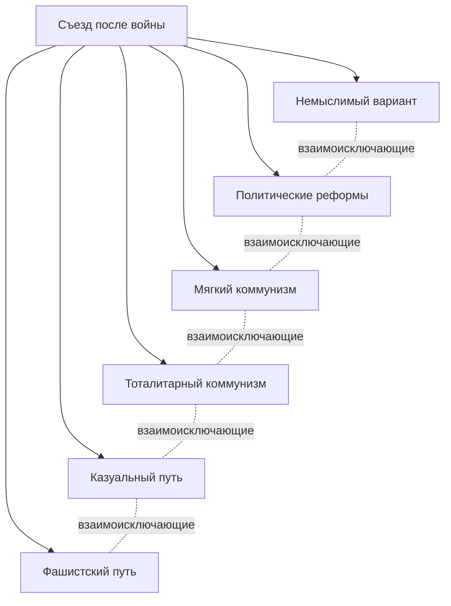

| Фокус | Дни | Описание | Эффект |
|---|---|---|---|
| Съезд после войны | 35 | Прошло десять лет после гражданской войны. Партия наконец решилась собраться и спросить Генсека, куда идти дальше, пока он не проверил подписи на повестке. | +50 ПВ; открывает выбор пути |

### 1. Немыслимый вариант (правило автора: курс на смену идеологии)
Две ветки, взаимоисключающие (правило автора): смена идеологии через гражданскую войну и Гласность.

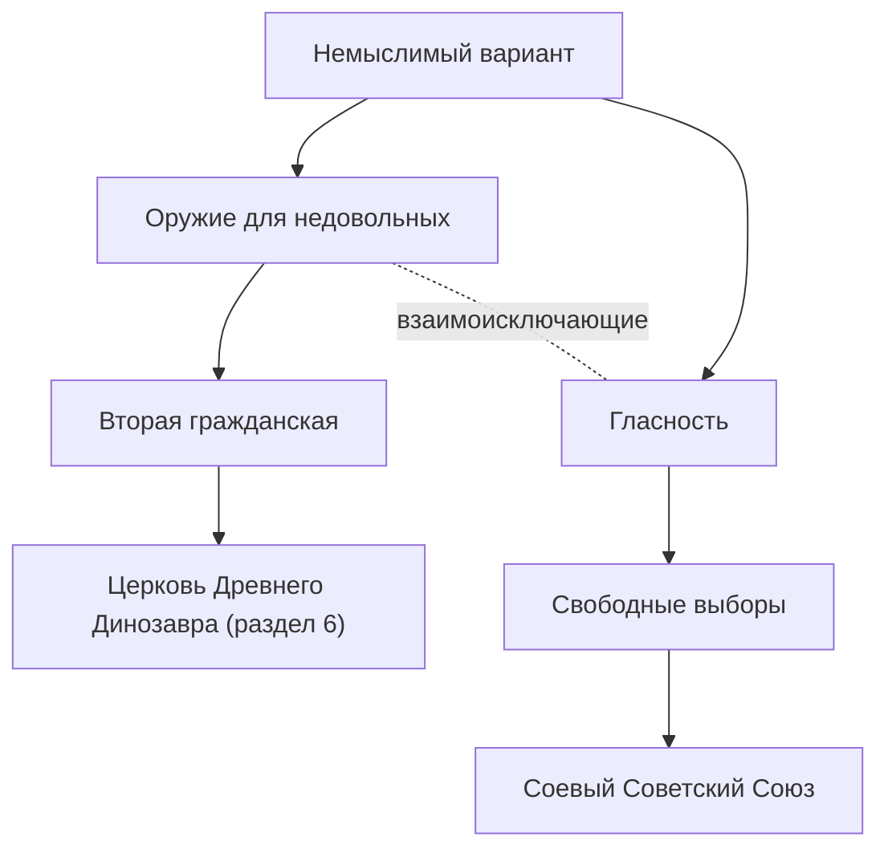

| Фокус | Дни | Описание | Эффект | Условие |
|---|---|---|---|---|
| Немыслимый вариант | 70 | То, о чём нельзя говорить вслух, обсуждают на кухнях всей страны. | Популярность теологии и демократии +5 %; Целостность −5 | Съезд |
| Оружие для недовольных | 70 | Склады в провинции открываются по ночам. Утром винтовок нет. | Популярность теологии +15 % | Немыслимый вариант |
| Вторая гражданская | 105 | Страна снова раскалывается — теперь по вере. | Гражданская война: Союз против теократов | Оружие… ; популярность теологии ≥ 30 % |
| Церковь Древнего Динозавра | — | вместо единственного фокуса «Святая Русь» | см. раздел 6 | Вторая гражданская |
| Гласность | 70 | Газеты впервые пишут правду. Читатели не верят своим глазам. | Популярность демократии +15 %; стабильность −5 % | Немыслимый вариант |
| Свободные выборы | 105 | На участки идут все, даже те, кто не знает, что такое бюллетень. | Популярность демократии +20 % | Гласность |
| Соевый Советский Союз | 70 | Союз мирно становится демократией и переходит на сою (правило автора: «Соевый Советский Союз»). | Идеология — демократия; переименование; отношения с Соевой Республикой +50 | Свободные выборы; популярность демократии ≥ 50 % |

### 2. Политические реформы (правило автора: мягкие реформы)
Две ветки (правило автора): федерализация и либерализация.

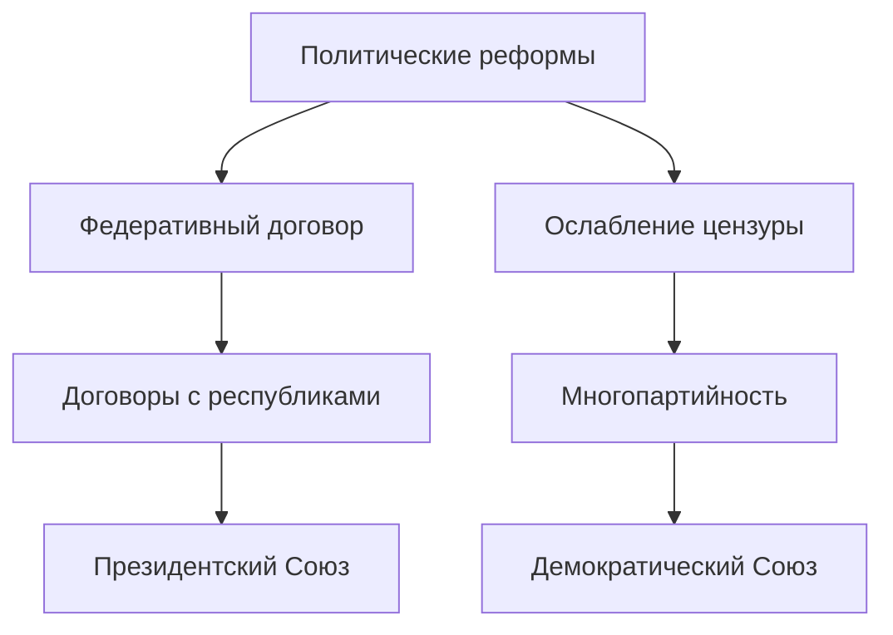

| Фокус | Дни | Описание | Эффект | Условие |
|---|---|---|---|---|
| Политические реформы | 70 | Партия решает: менять систему, но осторожно. | Целостность +5; стабильность −3 % | Съезд |
| Федеративный договор | 70 | Республикам обещают права. Пока на бумаге. | Целостность +5; решения связи с республиками дешевле | Политические реформы |
| Договоры с республиками | 105 | С каждой бывшей республикой Союза заключается федеративный договор (правило автора). | Событие каждой `K01`–`K06` (если существует): поддержать федерацию или нет | Федеративный договор |
| Президентский Союз | 70 | Если федерацию поддержала хоть одна страна, Союз переименовывается (правило автора). | Переименование [название — открытый вопрос 3]; согласившиеся — в альянс Союза | Договоры…; хотя бы одно согласие |
| Ослабление цензуры | 70 | Цензоры уходят в отпуск. Надолго. | Популярность демократии +10 % | Политические реформы |
| Многопартийность | 105 | В бюллетене больше одной фамилии. Избиратели в растерянности. | Популярность демократии +15 %; Баланс к Партии | Ослабление цензуры |
| Демократический Союз | 70 | Постепенный переход к демократии завершён (правило автора). | Идеология — демократия | Многопартийность; популярность ≥ 50 % |

### 3. Мягкий коммунизм (правило автора)
Коммунизм с элементами демократии, без репрессий, власть коллектива.

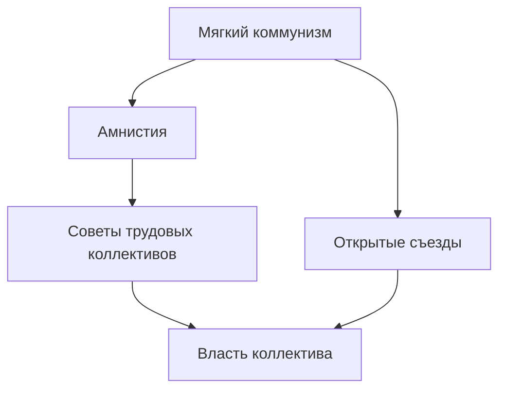

| Фокус | Дни | Описание | Эффект | Условие |
|---|---|---|---|---|
| Мягкий коммунизм | 70 | Коммунизм с человеческим лицом. Лицо пока неуверенное. | Стабильность +5 %; Баланс к Партии | Съезд |
| Амнистия | 70 | Ворота лагерей открываются. Вчерашние враги народа возвращаются к станкам. | Стабильность +5 %; призывное население +1 %; Паранойя −10 | Мягкий коммунизм |
| Открытые съезды | 70 | Делегаты спорят открыто, и никого не уводят после заседания. | Целостность +5; ПВ +0,1 в день | Мягкий коммунизм |
| Советы трудовых коллективов | 105 | Заводами управляют рабочие. Заводы работают — к удивлению многих. | Производительность заводов +10 % | Амнистия |
| Власть коллектива | 70 | Коллектив приходит к власти: Генсек — первый среди равных. | Дух «Коллективное руководство»: стабильность +10 %; Баланс зафиксирован в центре | Советы…; Открытые съезды |

### 4. Тоталитарный коммунизм (правило автора)

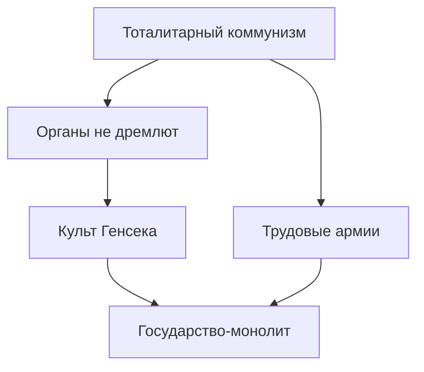

| Фокус | Дни | Описание | Эффект | Условие |
|---|---|---|---|---|
| Тоталитарный коммунизм | 70 | Государство берёт всё в свои руки, и руки эти железные. | Популярность коммунизма +10 %; Баланс к Пименову | Съезд |
| Органы не дремлют | 70 | В каждом подъезде есть кто-то, кто всё записывает. | Целостность +10; стабильность −5 %; Паранойя +5 | Тоталитарный коммунизм |
| Трудовые армии | 70 | Миллионы людей строят то, что прикажут. Не спрашивая. | +3 гражданские фабрики; стабильность −5 % | Тоталитарный коммунизм |
| Культ Генсека | 105 | Портреты Пименова в каждом окне. Некоторые смотрят прямо на тебя. | ПВ +0,3 в день; поддержка войны +10 % | Органы… |
| Государство-монолит | 70 | Тоталитарное государство построено. Внутри нет щелей. | Дух «Монолит»: Целостность не падает ниже 50 | Культ…; Трудовые армии |

### 5. Казуальный путь (правило автора)
Движение к Казуальности; сначала Союз становится марионеткой Казуалии; потом выбор: **покорность** (с возможностью разделить страну) или **перехват титула Архо-Казуала** (борьба за титул).

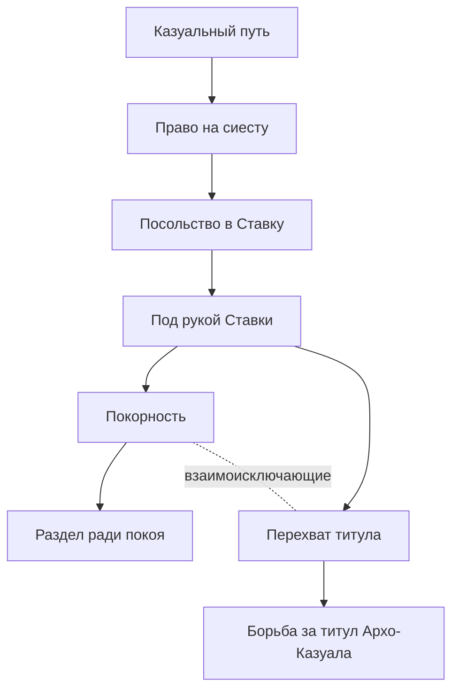

| Фокус | Дни | Описание | Эффект | Условие |
|---|---|---|---|---|
| Казуальный путь | 70 | Генсек долго смотрел на юг, на туман над болотами. И решил, что там хорошо. | Шкала Казуальности +15 | Съезд |
| Право на сиесту | 70 | Рабочий день сокращён. Потом ещё. Потом ещё. | Шкала +15; стабильность +5 % | Казуальный путь |
| Посольство в Ставку | 35 | Делегация везёт в Ставку подарки и просьбу о покровительстве. | Отношения с Казуалией +50 | Право на сиесту |
| Под рукой Ставки | 70 | Союз становится марионеткой Казуалии (правило автора). | Союз — марионетка Казуалии | Посольство…; Казуалия существует |
| Покорность | 70 | Великий Союз склоняется перед Ставкой. Тише, спокойнее, проще. | Решение «Раздел ради покоя» | Под рукой Ставки |
| Раздел ради покоя | 70 | Страну можно разделить: зачем большая, если и маленькой хватит (правило автора). | Выделение `K01`–`K06` марионетками Казуалии | Покорность |
| Перехват титула | 70 | Пименов решил: если уж спать, то на троне. | Шкала Внутренней Казуальности Казуалии −10; отношения −50 | Под рукой Ставки |
| Борьба за титул Архо-Казуала | 105 | Генсек вступает в борьбу за титул Священного-Архо-Казуала (правило автора). | Война за независимость; при победе Союз получает механики Казуалии [по образцу Соевой Республики, `mechanics/Kazualia.md` «Связи»] | Перехват титула |

### 6. Путь Теологии: Церковь Древнего Динозавра (идея автора; фокусы придуманы)
Продолжение «Немыслимого варианта» (ветка «Вторая гражданская»). Заменяет единственный фокус «Святая Русь». Смена идеологии на теологию — только при популярности теологии ≥ 50 %; перед ней фокусы усиления и решения церкви (`mechanics/Soviet-Union.md`, раздел 8).

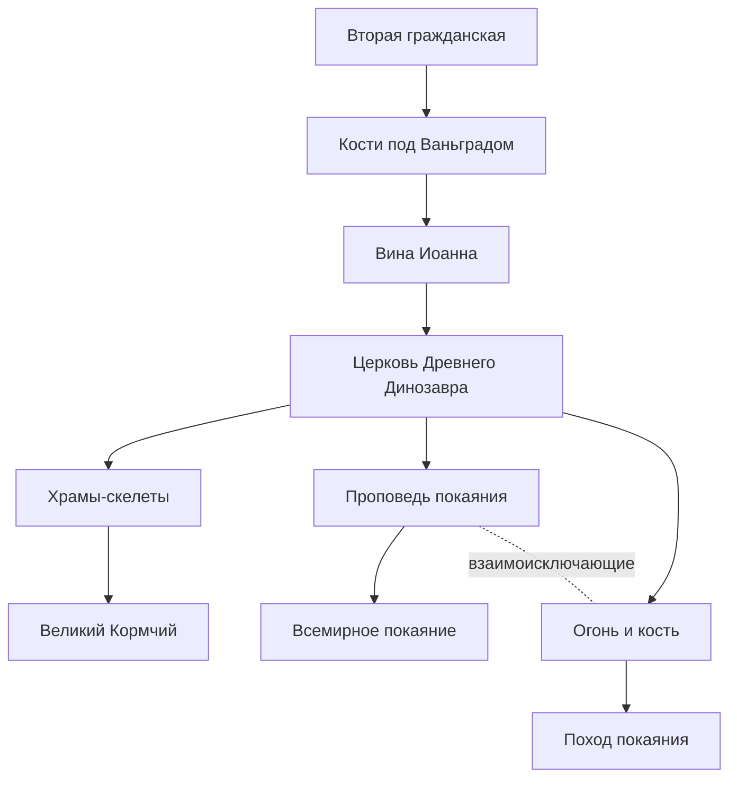

| Фокус | Дни | Описание | Эффект | Условие |
|---|---|---|---|---|
| Кости под Ваньградом | 35 | Землекопы нашли кости ящера размером с вокзал. Генсек приказал никому не говорить, и об этом узнали все. | Популярность теологии +5 %; решение «Раскопки для веры» | Вторая гражданская |
| Вина Иоанна | 70 | «Это я», — сказал Иоанн и сам удивился. Так вымерли динозавры, и больше некого в этом винить. | Популярность теологии +10 %; стабильность −5 % | Кости под Ваньградом |
| Церковь Древнего Динозавра | 70 | Первая служба прошла над костями. Прихожане молчали, потому что ящеры тоже не говорили. | Дух «Церковь Древнего Динозавра»; категория решений церкви; теология +10 % | Вина Иоанна |
| Храмы-скелеты | 105 | Храмы строят в форме рёбер: войдёшь — и ты внутри ящера. Так надёжнее каяться. | +3 гражданские фабрики (храмы); теология +10 % | Церковь |
| Великий Кормчий | 70 | Иоанн принял титул и новое имя: Ваня Пим, Великий Кормчий покаяния. | Правитель — Великий Кормчий Ваня Пим; идеология — теология | Храмы-скелеты; теология ≥ 50 % |
| Проповедь покаяния | 70 | Миссионеры едут в чужие столицы с костью в мешке и вопросом: «Каетесь?» | Решение «Письмо в чужие столицы»; Покаяние +10 | Церковь |
| Всемирное покаяние | 105 | Мир может покаяться добровольно. Многие уже каются и сами не знают за что. | Шкала Покаяния: при 100 — события цели (теология +, стабильность −) | Проповедь покаяния |
| Огонь и кость | 70 | Кто не кается мирно, покается по приказу. Армия получает полковых священников и по кости на брата. | Армия: организация +5 %, воля к войне +10 %; цель войны «Покаяние» | Церковь |
| Поход покаяния | 105 | Колонны идут под знаменем с костью. Враг сначала смеётся, потом задумывается. | Цели войны против стран с популярностью теологии < 10 % | Огонь и кость |

### 7. Фашистский путь (правило автора: добавить ветку; фокусы придуманы)
Шестой политический путь, взаимоисключающий с остальными. Правитель — Ванька Встанька Пиместров. Смена идеологии на фашизм — только при популярности фашизма ≥ 50 %; усиление — фокусы и решение «Митинг неваляшек» (+0,07, 50 ПВ, 20 дн). Итог пути открывает внешнюю политику «Великая Континентальная империя».

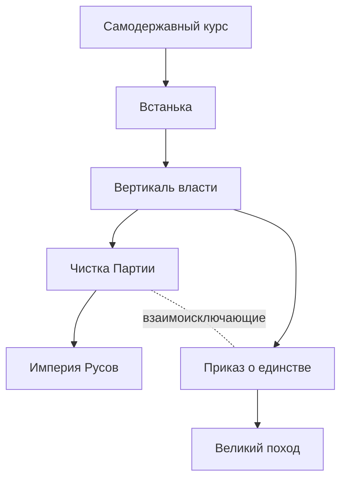

| Фокус | Дни | Описание | Эффект | Условие |
|---|---|---|---|---|
| Самодержавный курс | 70 | Генсек вспомнил, что цари были не так уж плохи, и обиделся на историю. | Популярность фашизма +10 %; Партия слабеет (баланс к Пименову +0,2) | Съезд после войны |
| Встанька | 70 | Его роняли в войну, на съезде и в газетах. Он каждый раз вставал и требовал аплодисментов. | Популярность фашизма +15 % | Самодержавный курс |
| Вертикаль власти | 70 | Все приказы идут сверху вниз; снизу идут только отчёты. | Стабильность +5 %; ПВ +0,3 в день | Встанька |
| Чистка Партии | 70 | Партия проверена, лишнее вынесено. Осталось то, что кричит «ура» вовремя. | Баланс к Пименову +0,3; фашизм +10 % | Вертикаль власти |
| Империя Русов | 105 | Союз объявлен империей, и все удивились, что это не больно. | Правитель — Ванька Встанька Пиместров; идеология — фашизм; Целостность +10 | Чистка Партии; фашизм ≥ 50 % |
| Приказ о единстве | 70 | Республики получили приказ любить друг друга. Любовь проверяется на местах. | Целостность +15; призыв +2 % | Вертикаль власти |
| Великий поход | 105 | Единство, которое не пускают наружу, застаивается. Пусть идёт на соседей. | Армия: атака +10 %; открывает «Великую Континентальную империю» | Приказ о единстве; фашизм ≥ 50 % |

### Историческая ветка
Исторический путь автора — **Мягкий коммунизм** (путь 3). В игре его выбирает ИИ по умолчанию (вес 300; `mechanics/Soviet-Union.md`, раздел 13).

## Борьба с Казуальностью (правило автора: Наши Болота, агентура, реформы)

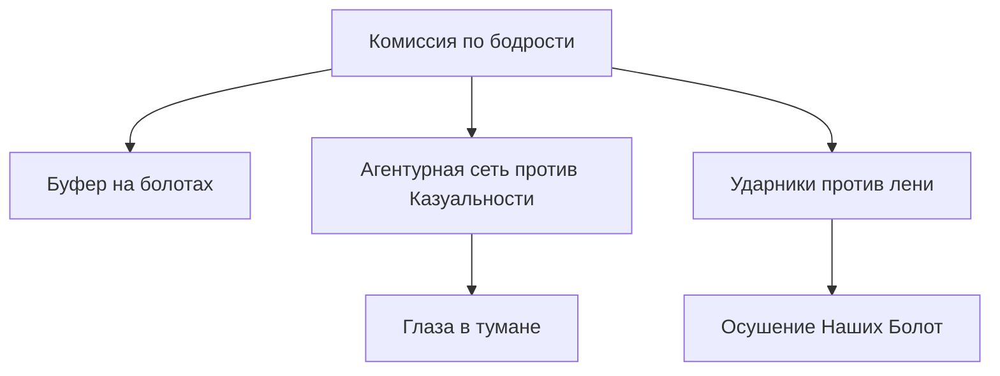

| Фокус | Дни | Описание | Эффект | Условие |
|---|---|---|---|---|
| Комиссия по бодрости | 70 | Комиссия проверяет, не заснул ли кто на рабочем месте. Проверки внезапные. | Шкала Казуальности −10 | не Казуальный путь |
| Буфер на болотах | 70 | Наши Болота выделяются в марионетку (правило автора); граница с Казуалией исчезает. | Решение «Буфер на болотах» бесплатно; рост шкалы от соседства с Казуалией = 0 | Комиссия |
| Агентурная сеть против Казуальности | 70 | Агенты идут в туман. Возвращаются не все — некоторые засыпают по дороге (правило автора: агентура). | Агентство +1 оперативник; восстания Казуалии в Союзе слабее на 50 % | Комиссия |
| Глаза в тумане | 105 | Союз знает, что делают в Ставке. Иногда — раньше самой Ставки. | Внутренняя Казуальность Казуалии −5 % в год (событием); раскрытие её решений | Агентурная сеть |
| Ударники против лени | 70 | Лучшим работникам — ордена, лентяям — общественное порицание. | Шкала −10; производство +5 % | Комиссия |
| Осушение Наших Болот | 105 | Болото отступает перед экскаватором. | Открывает стройку «Осушение Наших Болот» (раздел 6) | Ударники… |

## Внешняя политика

Правило автора: открывается после определённого фокуса политической ветки; четыре направления. Предложение: открывается фокусом завершения пути (Власть коллектива / Государство-монолит / Демократический Союз / Соевый Советский Союз).

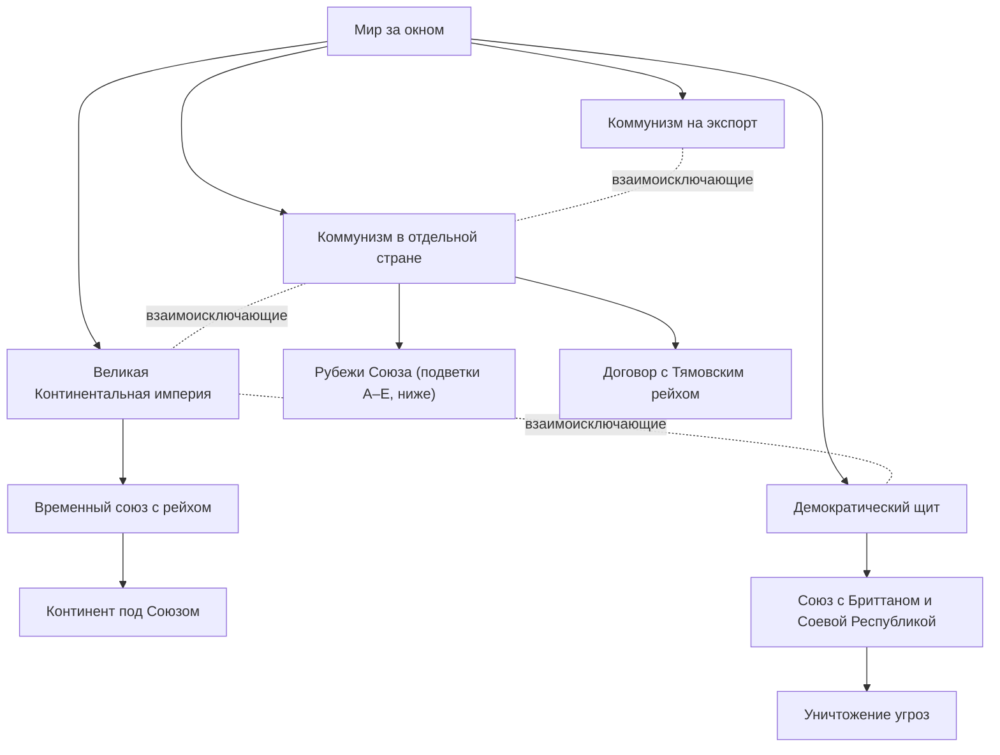

| Фокус | Дни | Описание | Эффект | Условие |
|---|---|---|---|---|
| Мир за окном | 35 | Союз окреп и смотрит за границу. | Открывает направления | финал любого пути, кроме Казуального и Немыслимого-теологии |
| Коммунизм на экспорт | 70 | Мягкая сила: книги, кино и комиссары с улыбкой (правило автора). | Включает механику «Коммунизм на экспорт» (раздел 5) | коммунизм |
| Коммунизм в отдельной стране | 70 | Строить социализм — значит расширять его границы (правило автора: военная экспансия за счёт соседей). | Поддержка войны +10 % | коммунизм |
| Договор с Тямовским рейхом | 70 | Технологии в обмен на сырьё и раздел Федерации Депутатов (правило автора). | Событие рейху: договор; при согласии — тех. бонусы, торговля, претензии на половину Федерации Депутатов | там же |
| Великая Континентальная империя | 70 | Фашистский захват всех соседей (правило автора). | Цели войны против всех соседей [условие открытия — открытый вопрос 4] | фашизм |
| Временный союз с рейхом | 70 | Возможность временного союза с Тямовским рейхом (правило автора). | Событие рейху: альянс на 2 года | Великая Континентальная империя |
| Континент под Союзом | 140 | Все соседи — под одним знаменем. | Претензии на все соседние штаты | Временный союз… |
| Демократический щит | 70 | Союз с Бриттами и Соевыми, уничтожение угроз (правило автора). | Отношения с Бриттаном и Соевой Республикой +50 | демократия |
| Союз с Бриттаном и Соевой Республикой | 70 | Три державы против общих угроз. | Вступление в альянс Бриттана или Соевой Республики / приглашение их | Демократический щит |
| Уничтожение угроз | 105 | Кто угрожает миру — тот враг щита. | Цели войны против фашистских и казуальных соседей | Союз с… |

### Рубежи Союза: расширенная внешняя политика (правило автора, 2026-11-20; фокусы придуманы)
Подветки «Коммунизма в отдельной стране» (`X2`) и открываются после фокуса «Мир за окном». Заменяют прежние одиночные фокусы «Приграничье Ассамблеи», «Ультиматум Казачьей Земле», «Восточный поход»; «Договор с Тямовским рейхом» и «Конец Ставки» остаются (последний — в подветке «Казуалия»). Союз-марионетка Казуалии (казуальный путь) эти фокусы не получает.

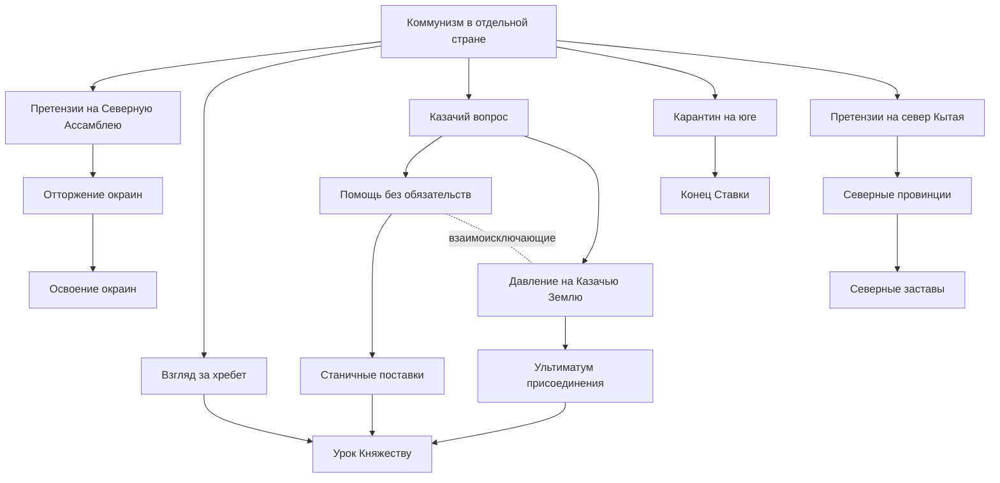

| Фокус | Дни | Описание | Эффект | Условие |
|---|---|---|---|---|
| Претензии на Северную Ассамблею | 70 | В Ваньграде достали старые карты. На них граница с Ассамблеей проведена карандашом, и карандаш стёрли. | Претензии на 5 штатов Северной Ассамблеи, ближайших к границе Союза; отношения −30 | Коммунизм в отдельной стране |
| Отторжение окраин | 105 | Союз не просит чужого — только то, что лежало ближе к Ваньграду, чем к Ассамблее. | Цель войны «отторжение»: взять только претензионные штаты, без полной аннексии (в лоре фокус на отторжение части территории) | Претензии на Северную Ассамблею |
| Освоение окраин | 70 | Новые штаты получили комиссаров, школы и расписание поездов. Расписание пока красивее поездов. | 1 гражданская фабрика и инфраструктура +1 в присоединённых штатах; сопротивление −30 % | Отторжение окраин |
| Взгляд за хребет | 35 | За Куштунским хребтом живёт Княжество. Оно большое, и это беспокоит. | Разведданные о Димитровском Княжестве; отношения −20; армия: организация +3 % | Коммунизм в отдельной стране |
| Урок Княжеству | 105 | Княжеству объяснят, что хребет — не стена, а лестница. | Цель войны против Димитровского Княжества (по образцу ограниченной войны: взять прикуштунскую полосу); если Казачья Земля — союзник или марионетка Союза, её армия присоединяется; открывается «Подготовка» (Победа над Княжеством → +50 ПВ) | Взгляд за хребет; Станичные поставки или Ультиматум присоединения |
| Казачий вопрос | 35 | Казачья Земля — барьер между Русами и Княжеством. Хорошо иметь барьер своим. | Отношения с Казачьей Землёй +10; открывает развилку | Коммунизм в отдельной стране; Казачья Земля существует |
| Помощь без обязательств | 70 | Ваньград присылает патроны, а не приказы. Станичники сначала подозревают подвох, потом берут патроны. | Решение механики Казачьей Земли «Запрос помощи» (`mechanics/` её документа): передаётся снаряжение и 2 добровольческие дивизии; отношения +40; **без альянса и гарантий** | Казачий вопрос |
| Станичные поставки | 70 | Хлеб и сталь идут по станичным дорогам в обе стороны, и никто не называет это протекторатом. | Торговый договор, снабжение Казачьей Земли +15 %; Княжество воюет против союзника Союза [проверка при реализации] | Помощь без обязательств |
| Давление на Казачью Землю | 70 | Войска встали у границы. Говорят, учения. Станичники считают дивизии и отвечают: «учения». | Отношения −40; Казачья Земля получает «Угрозу с севера» (стабильность −5 %); возможность ультиматума | Казачий вопрос |
| Ультиматум присоединения | 70 | Атаману предложили на выбор: стать частью Союза или остаться сама по себе, но уже без Союза рядом. | Событие Казачьей Земли: принять (марионетка Союза) или отказать (цель войны на присоединение); ИИ принимает при слабости | Давление на Казачью Землю |
| Карантин на юге | 70 | На границе с Казуалией поставили шлагбаум и табличку: «Не спать». Табличку украли на второй день. | Укрепления на границе +1 уровень; рост шкалы Казуальности у Союза −1; поддерживает «Борьбу с Казуальностью» | Коммунизм в отдельной стране |
| Конец Ставки | 105 | Уничтожение Казуалии (правило автора). | Цель войны `annex_everything` против Казуалии | Карантин на юге |
| Претензии на север Кытая | 70 | Кытай далеко, а его северные штаты ближе, чем кажется. Карта не врёт, она просто не извиняется. | Претензии на 4 самых северных штата Кытая; отношения −30 | Коммунизм в отдельной стране |
| Северные провинции | 105 | Присоединить то, что и так почти своё: холодные земли, зимние дороги и добрые соседи. | Цель войны на претензионные северные штаты Кытая (ограниченная, без полной аннексии) | Претензии на север Кытая |
| Северные заставы | 70 | Новые границы — новые заставы. Заставы пока пустые, но флаг уже есть. | Укрепления +1 в присоединённых штатах; снабжение +10 % | Северные провинции |
- **Какие штаты (при реализации, придумано):** Ассамблея — 5 штатов, ближайших к границе Союза (по карте); Кытай — 4 самых северных штата (наименьший y). Список — скриптом по картографическим данным.
- **Казачья Земля:** её механика «Запрос помощи» (лор) связана с фокусом «Помощь без обязательств»: игрок Союза отвечает на запрос решением, а не фокусом; без ответа Казачья Земля получает штраф.
- **Взаимоисключающие:** «Помощь без обязательств» и «Давление на Казачью Землю»; после каждой развилки по 2 фокуса (поставки; ультиматум).
- **Лор-тег и теги:** лор-теги `AHA` (Северная Ассамблея), `AFR` (Кытай), `FIU` (Дмитровское Княжество); теги в моде — через таблицу соответствия.

### Спасение экономики: Экономический блок (идея автора, 2026-11-20; фокусы придуманы)
Ветка Союза на случай распада. Открывается, когда Целостность упала ниже 50 %. «Создать Экономический Блок» нужно успеть до распада: тогда республики могут остаться в зоне даже вышедшими из-под Союза (фокус «Остаться в зоне» у республики доступен только если она марионетка Союза или Союз завершил этот фокус).

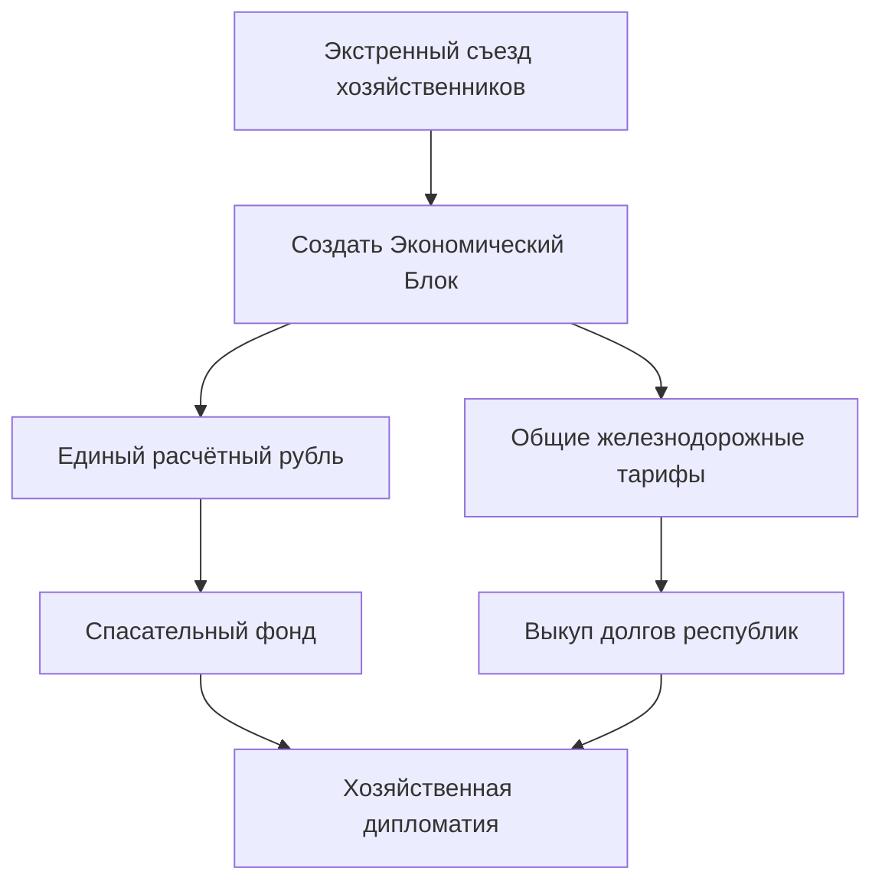
| Фокус | Дни | Описание | Эффект | Условие |
|---|---|---|---|---|
| Экстренный съезд хозяйственников | 35 | Хозяйственники собрались без комиссаров и впервые сказали, что думают. Думали они об одном: что станет, если республики уйдут с печатями. | +40 ПВ; открывает ветку | Целостность ниже 50 |
| Создать Экономический Блок | 70 | Союз предлагает республикам договор: политика врозь, рубль и рельсы вместе. Договор лежит на столе, и ручки почему-то привязаны к нему верёвочкой. | Флаг блока; дух «Экономический блок» (производство +5 %, потребительские товары −3 %); все существующие республики получают дух зоны | Экстренный съезд хозяйственников |
| Единый расчётный рубль | 70 | Республики расплачиваются одним рублём и ворчат на одном языке. | Стабильность +3 %; потребительские товары −3 % | Создать Экономический Блок |
| Общие железнодорожные тарифы | 70 | Тариф на перегон один, и никто не просит скидку за национальность. | Скорость строительства +10 % | Создать Экономический Блок |
| Спасательный фонд | 70 | Фонд собрали из того, что нашлось в кассах. Нашлось мало, зато от души. | +50 ПВ; +3 гражданские фабрики | Единый расчётный рубль |
| Выкуп долгов республик | 70 | Союз выкупает долги республик по номиналу. Республики кланяются и просят не напоминать. | Отношения со всеми республиками +25 | Общие железнодорожные тарифы |
| Хозяйственная дипломатия | 70 | Послы едут не с ультиматумами, а с накладными. Накладные действуют лучше. | Отношения со всеми республиками +40 | Спасательный фонд или Выкуп долгов республик |

## Экономика и Великие стройки (придумано; стройки — правило автора)

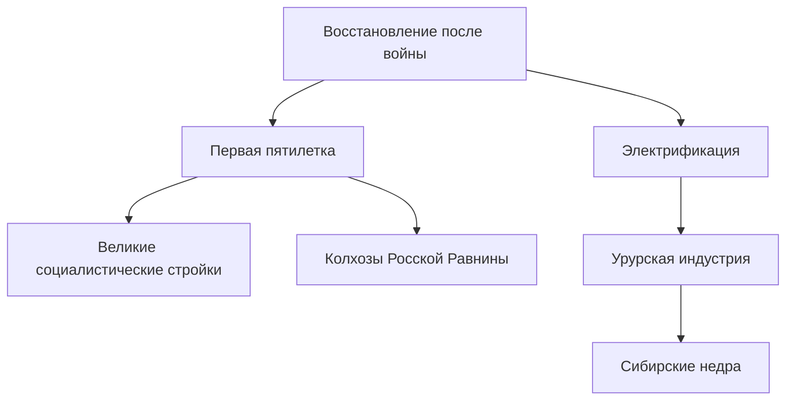

| Фокус | Дни | Описание | Эффект | Условие |
|---|---|---|---|---|
| Восстановление после войны | 70 | Разрушенные заводы оживают. Война кончилась, работа — нет. | +2 гражданские фабрики | — |
| Первая пятилетка | 105 | План на пять лет. Выполнить — за четыре. | Строительство +10 % на 2 года | Восстановление |
| Великие социалистические стройки | 70 | Страна берётся за проекты, которые видно из космоса (правило автора). | Включает механику строек и интерактивную карту (раздел 6) | Первая пятилетка |
| Электрификация | 70 | Лампочка в каждой избе. Кое-где — первая. | Производительность заводов +5 %; специалисты +3 тыс. | Восстановление |
| Урурская индустрия | 105 | В Урурских горах вырастают заводы. | +2 военные фабрики; сталь +4 | Электрификация |
| Колхозы Росской Равнины | 70 | Поля объединены. Урожай — общий, споры — тоже. | Потребительские товары −5 %; призыв +1 % | Первая пятилетка |
| Сибирские недра | 105 | Геологи нашли в Сибири всё, что искали, и немного лишнего. | Ресурсы: нефть, хром, вольфрам +4 каждого | Урурская индустрия |

## Армия, Флот, Авиация (придумано)

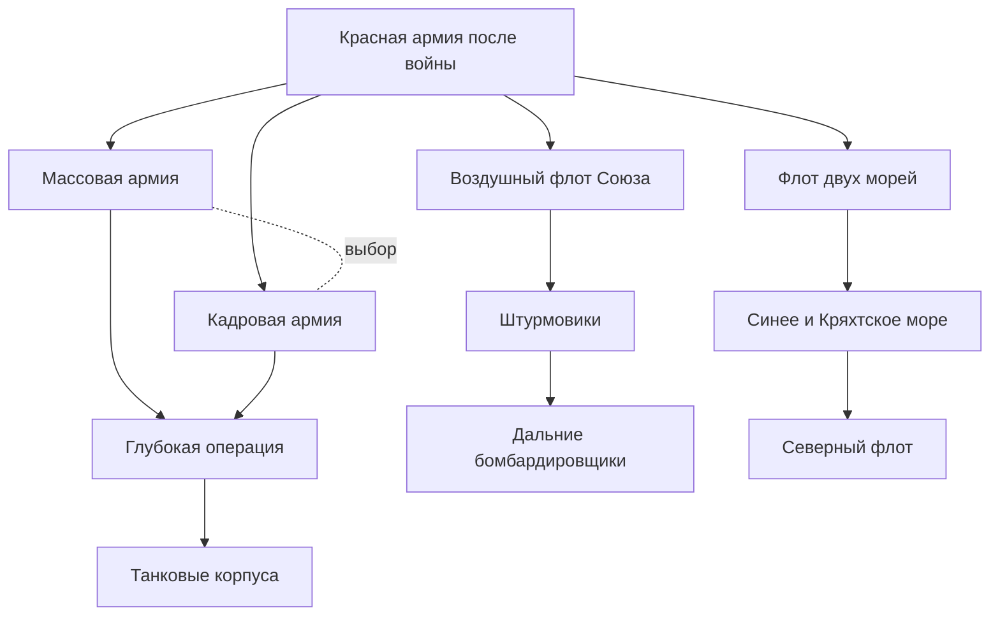

| Фокус | Дни | Описание | Эффект | Условие |
|---|---|---|---|---|
| Красная армия после войны | 70 | Армия победила царистов, но устала. Пора её перестроить. | Опыт армии +25 | — |
| Массовая армия | 70 | Солдат много — значит, и победа будет. | Призыв +2 %; пехота дешевле | Красная армия… |
| Кадровая армия | 70 | Меньше, но лучше: офицеры, учения, дисциплина. | Опыт +25; организация +5 % | Красная армия… |
| Глубокая операция | 105 | Удар на всю глубину обороны врага. | Бонус к доктрине сухопутных войск | Массовая или Кадровая |
| Танковые корпуса | 105 | Стальные клинья для глубокой операции. | Бонус исследований танков 2 × 50 % | Глубокая операция |
| Воздушный флот Союза | 70 | Небо над Союзом должно быть своим. | Опыт авиации +25; +1 авиазавод (военная фабрика) | Красная армия… |
| Штурмовики | 70 | Летающие танки над полем боя. | Бонус исследований штурмовиков | Воздушный флот |
| Дальние бомбардировщики | 105 | Достать врага в его тылу. | Бонус исследований тяжёлых бомбардировщиков | Штурмовики |
| Флот двух морей | 70 | У Союза два моря на западе и океан на севере. | +1 верфь | Красная армия… |
| Синее и Кряхтское море | 70 | Лёгкие силы для внутренних морей. | Бонус исследований эсминцев и подлодок | Флот двух морей |
| Северный флот | 105 | Льды и океан — тоже граница Союза. | +2 военно-морские базы на севере; бонус крейсеров | Синее и Кряхтское… |
