# Древо фокусов Советского Союза

Своё древо Союза (`MAK`) вместо стандартного (`Generic-Focus-Tree.md`). **Статус:** только описание, в моде нет. Механики — `mechanics/Soviet-Union.md` (разделы в скобках). Правила автора отмечены, всё остальное придумано (названия, дни, эффекты, тексты), нужно подтверждение. «Целостность» — раздел 2, «Паранойя» — раздел 3, «Баланс» — Пименов — Партия, раздел 4.

**Состав древа:**
| Ветка | Откуда | Кому доступна |
|---|---|---|
| Паранойя Пименова | правило автора | только пока правитель — Пименов |
| Политические пути (5) | правило автора | выбор одного пути |
| Борьба с Казуальностью | правило автора | все пути, кроме Казуального |
| Внешняя политика (4) | правило автора | после фокуса политической ветки |
| Экономика и Великие стройки | придумано (стройки — правило автора) | все |
| Армия, Флот, Авиация | придумано | все |

## Паранойя Пименова

Правило автора: открыта только пока правитель — Пименов; выбор между четырьмя личностями и балансом; решения на поднятие личности открываются после взятия первого фокуса.

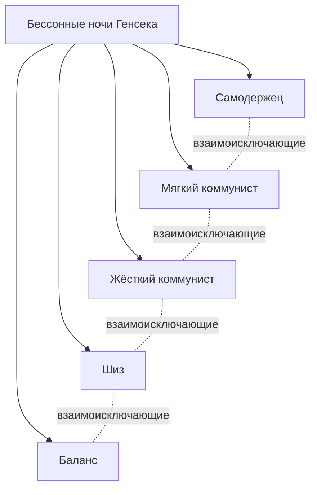

| Фокус | Дни | Описание | Эффект | Условие |
|---|---|---|---|---|
| Бессонные ночи Генсека | 35 | Ваня Пименов перестал спать. В Кремле Ваньграда горит свет до утра, и все боятся звонка. | Запускает механику Паранойи; открывает решения на поднятие личностей | правитель — Пименов |
| Самодержец | 35 | «Государство — это я», — сказал Генсек и сам удивился, как хорошо это звучит. | Личность «Самодержец» +20; решения этой личности дешевле на 50 % | Бессонные ночи |
| Мягкий коммунист | 35 | Генсек вспомнил, что коммунизм — это про людей. Людям стало чуть легче дышать. | «Мягкий коммунист» +20; то же | Бессонные ночи |
| Жёсткий коммунист | 35 | Генсек вспомнил, что коммунизм — это дисциплина. Людям стало трудно дышать. | «Жёсткий коммунист» +20; то же | Бессонные ночи |
| Шиз | 35 | Генсек увидел заговор в узоре обоев. Обои сняли. Заговор остался. | «Шиз» +20; то же | Бессонные ночи |
| Баланс | 35 | Генсек решил не решать. Личности спорят между собой, и никто не перевешивает. | Все личности −10; Паранойя −10 | Бессонные ночи |

**Решения личностей (открываются фокусом):** по одному на личность — «Указ самодержца», «Отпустить политзаключённых», «Новый пятилетний план — за два года», «Ночной приказ» — каждое +10 к своей личности, 50 ПВ, 60 дн (придумано).

## Политические пути

Правило автора: пять путей. Корень и выбор:

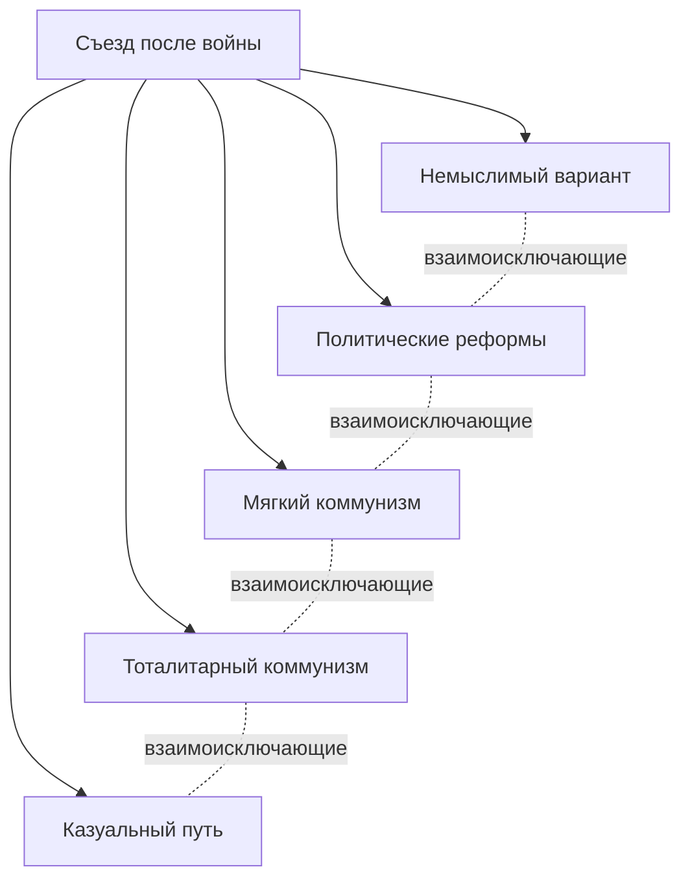

| Фокус | Дни | Описание | Эффект |
|---|---|---|---|
| Съезд после войны | 35 | Гражданская война окончена, царисты разбиты. Партия собирается решать, каким будет Союз. | +50 ПВ; открывает выбор пути |

### 1. Немыслимый вариант (правило автора: курс на смену идеологии)
Две ветки, взаимоисключающие (правило автора): смена идеологии через гражданскую войну и Гласность.

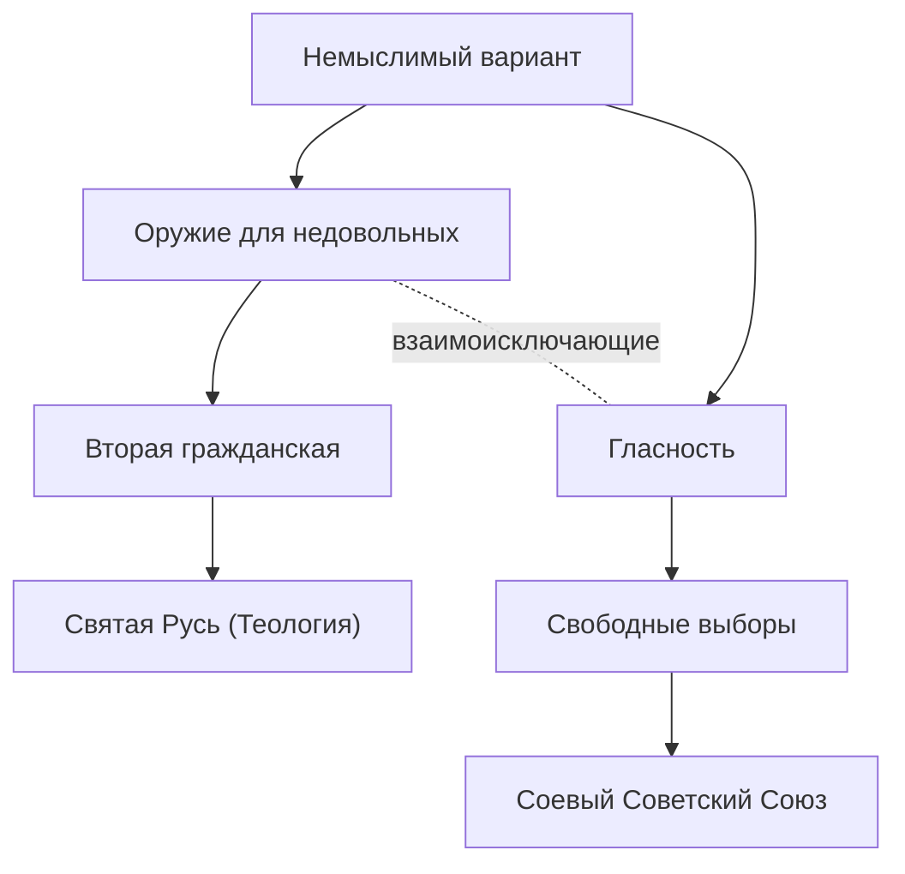

| Фокус | Дни | Описание | Эффект | Условие |
|---|---|---|---|---|
| Немыслимый вариант | 70 | То, о чём нельзя говорить вслух, обсуждают на кухнях всей страны. | Популярность теологии и демократии +5 %; Целостность −5 | Съезд |
| Оружие для недовольных | 70 | Склады в провинции открываются по ночам. Утром винтовок нет. | Популярность теологии +15 % | Немыслимый вариант |
| Вторая гражданская | 105 | Страна снова раскалывается — теперь по вере. | Гражданская война: Союз против теократов | Оружие… ; популярность теологии ≥ 30 % |
| Святая Русь | 70 | Колокола над Ваньградом. Новая власть клянётся на иконах. | Идеология — теология [путь не уточнён автором, открытый вопрос 2] | победа в гражданской войне |
| Гласность | 70 | Газеты впервые пишут правду. Читатели не верят своим глазам. | Популярность демократии +15 %; стабильность −5 % | Немыслимый вариант |
| Свободные выборы | 105 | На участки идут все, даже те, кто не знает, что такое бюллетень. | Популярность демократии +20 % | Гласность |
| Соевый Советский Союз | 70 | Союз мирно становится демократией и переходит на сою (правило автора: «Соевый Советский Союз»). | Идеология — демократия; переименование; отношения с Соевой Республикой +50 | Свободные выборы; популярность демократии ≥ 50 % |

### 2. Политические реформы (правило автора: мягкие реформы)
Две ветки (правило автора): федерализация и либерализация.

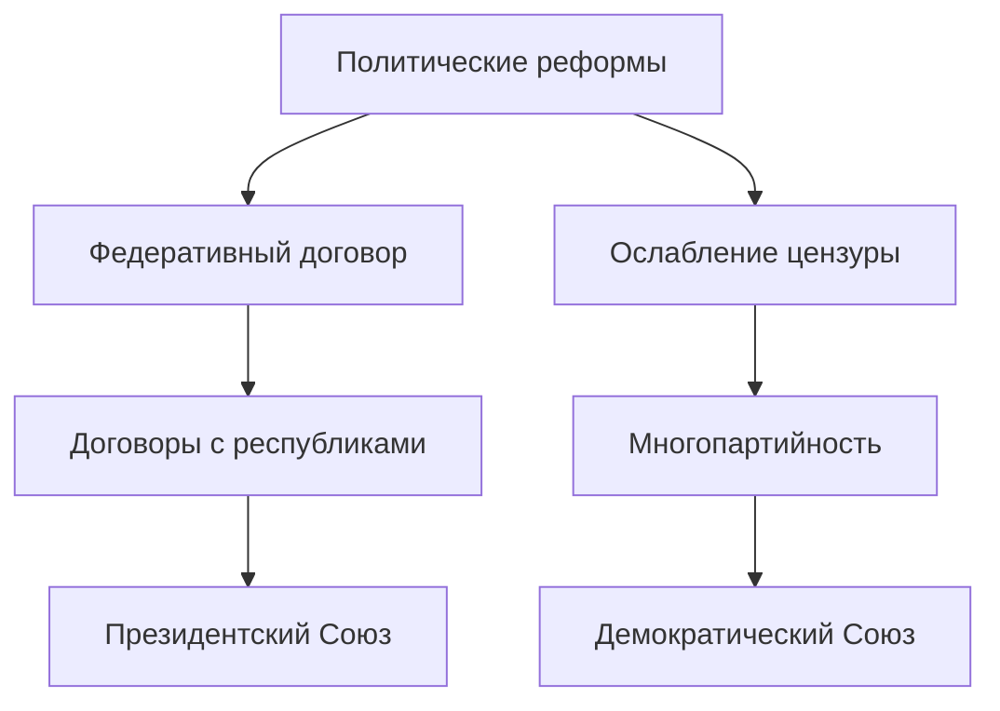

| Фокус | Дни | Описание | Эффект | Условие |
|---|---|---|---|---|
| Политические реформы | 70 | Партия решает: менять систему, но осторожно. | Целостность +5; стабильность −3 % | Съезд |
| Федеративный договор | 70 | Республикам обещают права. Пока на бумаге. | Целостность +5; решения связи с республиками дешевле | Политические реформы |
| Договоры с республиками | 105 | С каждой бывшей республикой Союза заключается федеративный договор (правило автора). | Событие каждой `K01`–`K06` (если существует): поддержать федерацию или нет | Федеративный договор |
| Президентский Союз | 70 | Если федерацию поддержала хоть одна страна, Союз переименовывается (правило автора). | Переименование [название — открытый вопрос 3]; согласившиеся — в альянс Союза | Договоры…; хотя бы одно согласие |
| Ослабление цензуры | 70 | Цензоры уходят в отпуск. Надолго. | Популярность демократии +10 % | Политические реформы |
| Многопартийность | 105 | В бюллетене больше одной фамилии. Избиратели в растерянности. | Популярность демократии +15 %; Баланс к Партии | Ослабление цензуры |
| Демократический Союз | 70 | Постепенный переход к демократии завершён (правило автора). | Идеология — демократия | Многопартийность; популярность ≥ 50 % |

### 3. Мягкий коммунизм (правило автора)
Коммунизм с элементами демократии, без репрессий, власть коллектива.

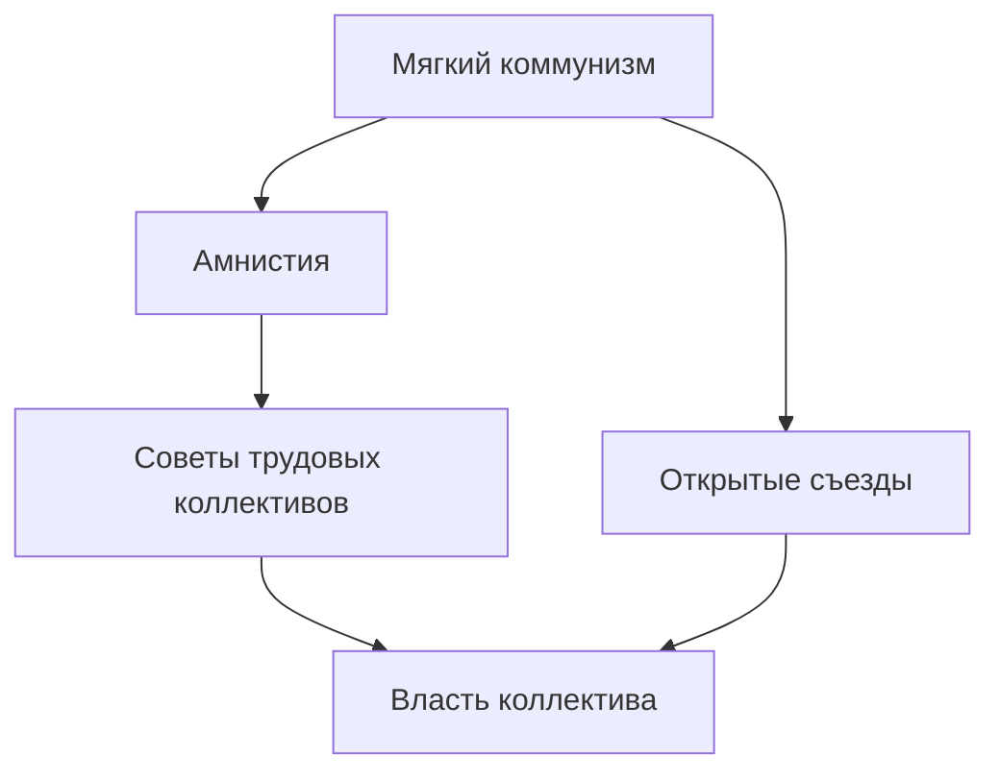

| Фокус | Дни | Описание | Эффект | Условие |
|---|---|---|---|---|
| Мягкий коммунизм | 70 | Коммунизм с человеческим лицом. Лицо пока неуверенное. | Стабильность +5 %; Баланс к Партии | Съезд |
| Амнистия | 70 | Ворота лагерей открываются. Вчерашние враги народа возвращаются к станкам. | Стабильность +5 %; призывное население +1 %; Паранойя −10 | Мягкий коммунизм |
| Открытые съезды | 70 | Делегаты спорят открыто, и никого не уводят после заседания. | Целостность +5; ПВ +0,1 в день | Мягкий коммунизм |
| Советы трудовых коллективов | 105 | Заводами управляют рабочие. Заводы работают — к удивлению многих. | Производительность заводов +10 % | Амнистия |
| Власть коллектива | 70 | Коллектив приходит к власти: Генсек — первый среди равных. | Дух «Коллективное руководство»: стабильность +10 %; Баланс зафиксирован в центре | Советы…; Открытые съезды |

### 4. Тоталитарный коммунизм (правило автора)

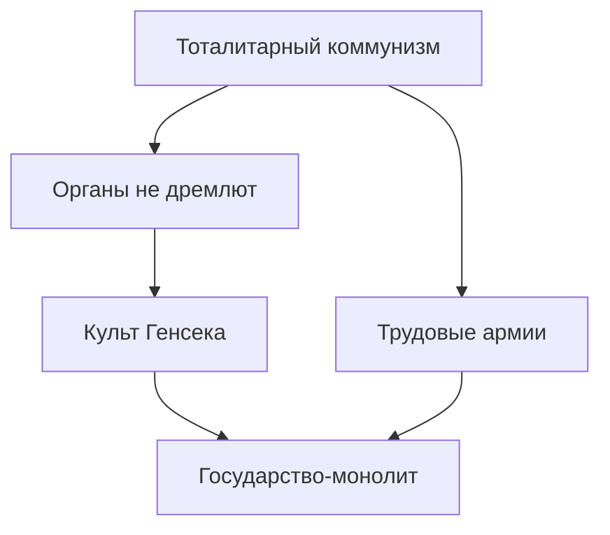

| Фокус | Дни | Описание | Эффект | Условие |
|---|---|---|---|---|
| Тоталитарный коммунизм | 70 | Государство берёт всё в свои руки, и руки эти железные. | Популярность коммунизма +10 %; Баланс к Пименову | Съезд |
| Органы не дремлют | 70 | В каждом подъезде есть кто-то, кто всё записывает. | Целостность +10; стабильность −5 %; Паранойя +5 | Тоталитарный коммунизм |
| Трудовые армии | 70 | Миллионы людей строят то, что прикажут. Не спрашивая. | +3 гражданские фабрики; стабильность −5 % | Тоталитарный коммунизм |
| Культ Генсека | 105 | Портреты Пименова в каждом окне. Некоторые смотрят прямо на тебя. | ПВ +0,3 в день; поддержка войны +10 % | Органы… |
| Государство-монолит | 70 | Тоталитарное государство построено. Внутри нет щелей. | Дух «Монолит»: Целостность не падает ниже 50 | Культ…; Трудовые армии |

### 5. Казуальный путь (правило автора)
Движение к Казуальности; сначала Союз становится марионеткой Казуалии; потом выбор: **покорность** (с возможностью разделить страну) или **перехват титула Архо-Казуала** (борьба за титул).

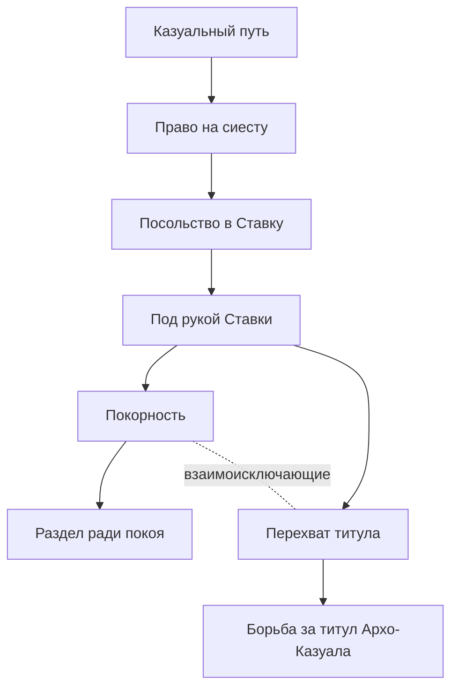

| Фокус | Дни | Описание | Эффект | Условие |
|---|---|---|---|---|
| Казуальный путь | 70 | Генсек долго смотрел на юг, на туман над болотами. И решил, что там хорошо. | Шкала Казуальности +15 | Съезд |
| Право на сиесту | 70 | Рабочий день сокращён. Потом ещё. Потом ещё. | Шкала +15; стабильность +5 % | Казуальный путь |
| Посольство в Ставку | 35 | Делегация везёт в Ставку подарки и просьбу о покровительстве. | Отношения с Казуалией +50 | Право на сиесту |
| Под рукой Ставки | 70 | Союз становится марионеткой Казуалии (правило автора). | Союз — марионетка Казуалии | Посольство…; Казуалия существует |
| Покорность | 70 | Великий Союз склоняется перед Ставкой. Тише, спокойнее, проще. | Решение «Раздел ради покоя» | Под рукой Ставки |
| Раздел ради покоя | 70 | Страну можно разделить: зачем большая, если и маленькой хватит (правило автора). | Выделение `K01`–`K06` марионетками Казуалии | Покорность |
| Перехват титула | 70 | Пименов решил: если уж спать, то на троне. | Шкала Внутренней Казуальности Казуалии −10; отношения −50 | Под рукой Ставки |
| Борьба за титул Архо-Казуала | 105 | Генсек вступает в борьбу за титул Священного-Архо-Казуала (правило автора). | Война за независимость; при победе Союз получает механики Казуалии [по образцу Соевой Республики, `mechanics/Kazualia.md` «Связи»] | Перехват титула |

## Борьба с Казуальностью (правило автора: Наши Болота, агентура, реформы)

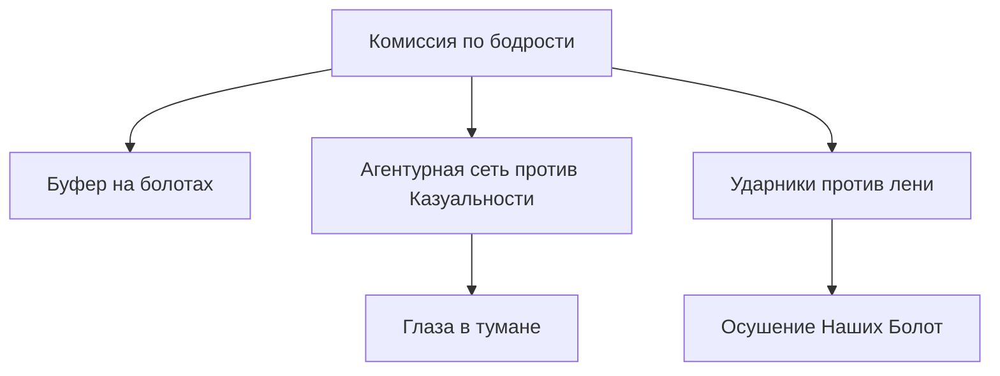

| Фокус | Дни | Описание | Эффект | Условие |
|---|---|---|---|---|
| Комиссия по бодрости | 70 | Комиссия проверяет, не заснул ли кто на рабочем месте. Проверки внезапные. | Шкала Казуальности −10 | не Казуальный путь |
| Буфер на болотах | 70 | Наши Болота выделяются в марионетку (правило автора); граница с Казуалией исчезает. | Решение «Буфер на болотах» бесплатно; рост шкалы от соседства с Казуалией = 0 | Комиссия |
| Агентурная сеть против Казуальности | 70 | Агенты идут в туман. Возвращаются не все — некоторые засыпают по дороге (правило автора: агентура). | Агентство +1 оперативник; восстания Казуалии в Союзе слабее на 50 % | Комиссия |
| Глаза в тумане | 105 | Союз знает, что делают в Ставке. Иногда — раньше самой Ставки. | Внутренняя Казуальность Казуалии −5 % в год (событием); раскрытие её решений | Агентурная сеть |
| Ударники против лени | 70 | Лучшим работникам — ордена, лентяям — общественное порицание. | Шкала −10; производство +5 % | Комиссия |
| Осушение Наших Болот | 105 | Болото отступает перед экскаватором. | Открывает стройку «Осушение Наших Болот» (раздел 6) | Ударники… |

## Внешняя политика

Правило автора: открывается после определённого фокуса политической ветки; четыре направления. Предложение: открывается фокусом завершения пути (Власть коллектива / Государство-монолит / Демократический Союз / Соевый Советский Союз).

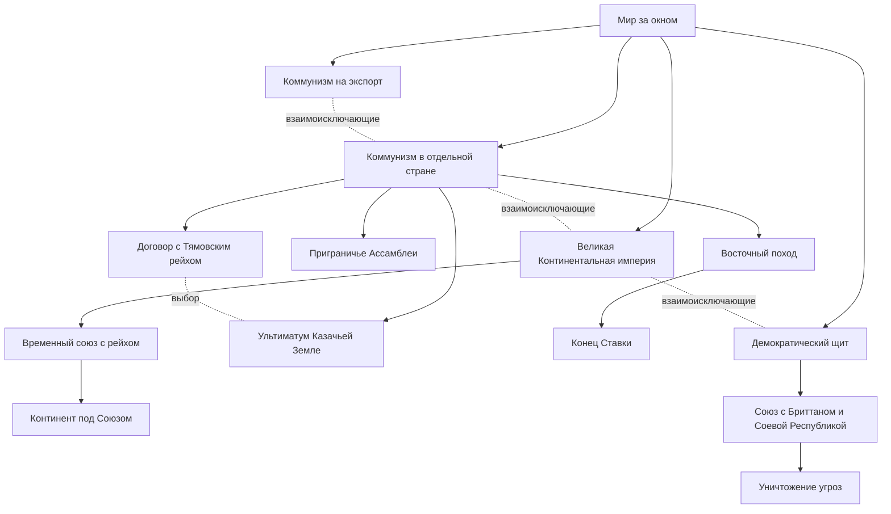

| Фокус | Дни | Описание | Эффект | Условие |
|---|---|---|---|---|
| Мир за окном | 35 | Союз окреп и смотрит за границу. | Открывает направления | финал любого пути, кроме Казуального и Немыслимого-теологии |
| Коммунизм на экспорт | 70 | Мягкая сила: книги, кино и комиссары с улыбкой (правило автора). | Включает механику «Коммунизм на экспорт» (раздел 5) | коммунизм |
| Коммунизм в отдельной стране | 70 | Строить социализм — значит расширять его границы (правило автора: военная экспансия за счёт соседей). | Поддержка войны +10 % | коммунизм |
| Приграничье Ассамблеи | 70 | Захват приграничных регионов Северной Ассамблеи (правило автора). | Цель войны на приграничные штаты Северной Ассамблеи | Коммунизм в отдельной стране |
| Договор с Тямовским рейхом | 70 | Технологии в обмен на сырьё и раздел Федерации Депутатов (правило автора). | Событие рейху: договор; при согласии — тех. бонусы, торговля, претензии на половину Федерации Депутатов | там же |
| Ультиматум Казачьей Земле | 70 | Ультиматум государству, занимающему территорию «Казачьей Земли», — не обязательно изначальной стране (правило автора). | Событие владельцу этих штатов: отдать или война | там же |
| Восточный поход | 70 | Захват приграничных территорий Кытая (правило автора). | Цель войны на приграничные штаты Кытая | там же |
| Конец Ставки | 105 | Уничтожение Казуалии (правило автора). | Цель войны `annex_everything` против Казуалии | Восточный поход |
| Великая Континентальная империя | 70 | Фашистский захват всех соседей (правило автора). | Цели войны против всех соседей [условие открытия — открытый вопрос 4] | фашизм |
| Временный союз с рейхом | 70 | Возможность временного союза с Тямовским рейхом (правило автора). | Событие рейху: альянс на 2 года | Великая Континентальная империя |
| Континент под Союзом | 140 | Все соседи — под одним знаменем. | Претензии на все соседние штаты | Временный союз… |
| Демократический щит | 70 | Союз с Бриттами и Соевыми, уничтожение угроз (правило автора). | Отношения с Бриттаном и Соевой Республикой +50 | демократия |
| Союз с Бриттаном и Соевой Республикой | 70 | Три державы против общих угроз. | Вступление в альянс Бриттана или Соевой Республики / приглашение их | Демократический щит |
| Уничтожение угроз | 105 | Кто угрожает миру — тот враг щита. | Цели войны против фашистских и казуальных соседей | Союз с… |

## Экономика и Великие стройки (придумано; стройки — правило автора)

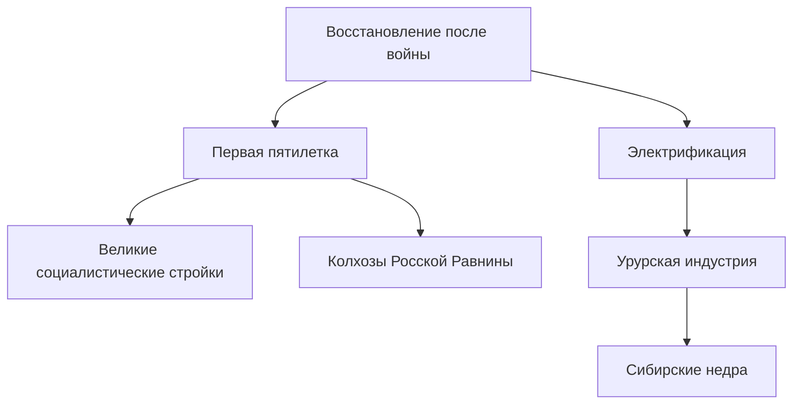

| Фокус | Дни | Описание | Эффект | Условие |
|---|---|---|---|---|
| Восстановление после войны | 70 | Разрушенные заводы оживают. Война кончилась, работа — нет. | +2 гражданские фабрики | — |
| Первая пятилетка | 105 | План на пять лет. Выполнить — за четыре. | Строительство +10 % на 2 года | Восстановление |
| Великие социалистические стройки | 70 | Страна берётся за проекты, которые видно из космоса (правило автора). | Включает механику строек и интерактивную карту (раздел 6) | Первая пятилетка |
| Электрификация | 70 | Лампочка в каждой избе. Кое-где — первая. | Производительность заводов +5 %; специалисты +3 тыс. | Восстановление |
| Урурская индустрия | 105 | В Урурских горах вырастают заводы. | +2 военные фабрики; сталь +4 | Электрификация |
| Колхозы Росской Равнины | 70 | Поля объединены. Урожай — общий, споры — тоже. | Потребительские товары −5 %; призыв +1 % | Первая пятилетка |
| Сибирские недра | 105 | Геологи нашли в Сибири всё, что искали, и немного лишнего. | Ресурсы: нефть, хром, вольфрам +4 каждого | Урурская индустрия |

## Армия, Флот, Авиация (придумано)

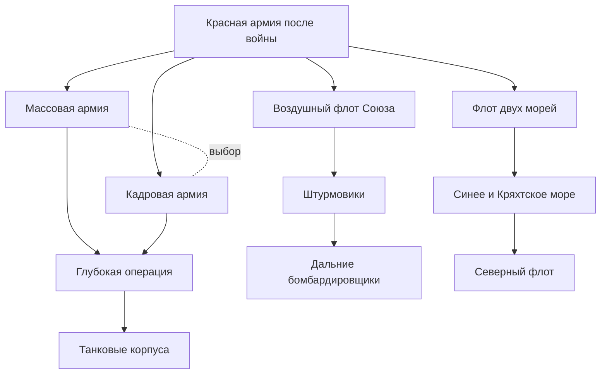

| Фокус | Дни | Описание | Эффект | Условие |
|---|---|---|---|---|
| Красная армия после войны | 70 | Армия победила царистов, но устала. Пора её перестроить. | Опыт армии +25 | — |
| Массовая армия | 70 | Солдат много — значит, и победа будет. | Призыв +2 %; пехота дешевле | Красная армия… |
| Кадровая армия | 70 | Меньше, но лучше: офицеры, учения, дисциплина. | Опыт +25; организация +5 % | Красная армия… |
| Глубокая операция | 105 | Удар на всю глубину обороны врага. | Бонус к доктрине сухопутных войск | Массовая или Кадровая |
| Танковые корпуса | 105 | Стальные клинья для глубокой операции. | Бонус исследований танков 2 × 50 % | Глубокая операция |
| Воздушный флот Союза | 70 | Небо над Союзом должно быть своим. | Опыт авиации +25; +1 авиазавод (военная фабрика) | Красная армия… |
| Штурмовики | 70 | Летающие танки над полем боя. | Бонус исследований штурмовиков | Воздушный флот |
| Дальние бомбардировщики | 105 | Достать врага в его тылу. | Бонус исследований тяжёлых бомбардировщиков | Штурмовики |
| Флот двух морей | 70 | У Союза два моря на западе и океан на севере. | +1 верфь | Красная армия… |
| Синее и Кряхтское море | 70 | Лёгкие силы для внутренних морей. | Бонус исследований эсминцев и подлодок | Флот двух морей |
| Северный флот | 105 | Льды и океан — тоже граница Союза. | +2 военно-морские базы на севере; бонус крейсеров | Синее и Кряхтское… |
