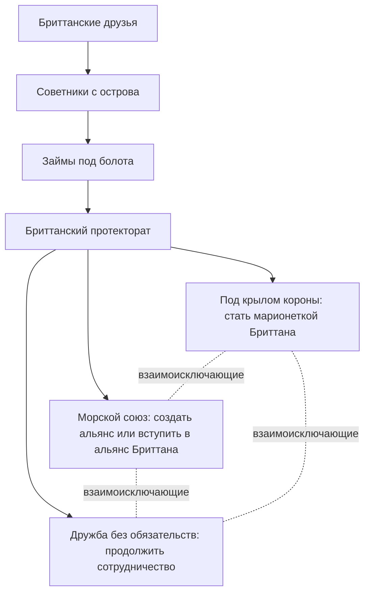

# Механики Казуалии

Выписка из главного документа лора `lore/Contries-Description.md`, раздел «Казуалия» (при расхождениях прав он). **Статус:** частично перенесено в мод (`tools/make_kazualia.py`, см. раздел «Реализация»; в игре не проверено); Внешняя Казуальность, страна «Наши Болота» и гражданская война сделаны в `tools/make_kazualia_outer.py` (в игре не проверено); не сделаны бонусы по местности и защита столицы / партизан. Придуманные предложения явно помечены «Предложение (придумано)»; остальные пробелы вынесены в «Открытые вопросы».

Связанная глобальная механика (шкала Казуальности у остальных стран) — `global_mechanics/Casuality-Mechanic.md`.

## Кратко о стране
- Центр материка, большая часть клеток — болота, немного гор, равнины по краям; столица Ставка Казуала окружена горами с трёх сторон (кроме южной).
- Население 30 млн, образованность — «Необразованное стадо» (в моде у Казуалии специалистов всегда 0, см. `global_mechanics/Education.md`).
- Правитель — Священный-Архо-Казуал. Идеология — Казуальность.
- Страна находится под Бриттанским влиянием.

## 1. Дурманище Казуальности
**Правило автора (новая версия):** Дурманище — не дебафф врагам, а сила и слабость самих казуалов.
1. **Бафф атаки на национальных территориях** — для стран с идеологией Казуальность.
2. **Национальные территории Казуалии на Наших Болотах** — Казуалия получает ядра на болотных штатах Советского Союза (Наши Болота, `map/Geography.md`).
3. **Страна «Наши Болота»** — выделяемое государство на этих штатах; позже его сможет создать Советский Союз как буфер против Казуалии.
4. **Дебафф казуалам на территории противника**, который снимается фокусами.

Предложение (придумано, нужно подтвердить):
- Дух «Дурманище» `ktits_durmanische` у стран с идеологией Казуальность, два модификатора:
  - на своих ядерных землях: `army_core_attack_factor` +0,40 (только атака, как сказал автор);
  - снабжение (компенсация отсутствия железных дорог в Казуалии, придумано): `supply_consumption_factor` −0,15, `attrition` −0,10 (оба в категории army, `modifiers_documentation.md`), во всех вариантах `_1.._3`;
  - на чужих землях: `army_non_core_attack_factor` −0,20, `army_non_core_defence_factor` −0,10.
- Почему так: модификаторы атаки и защиты нельзя повесить на штат (в `documentation/modifiers_documentation.md` игры 1.19 у них нет категории `state`). Зато `army_core_*` и `army_non_core_*` действуют на армии страны в зависимости от того, чья под ней земля.
- **Снятие дебаффа фокусами** (в ветке Казуалии, на Велико-Казуальном пути): три фокуса по очереди, каждый ослабляет чужеземный дебафф на треть; после третьего его нет.
  - «Болото с собой» — −0,07 / −0,03;
  - «Туман над чужбиной» — ещё −0,07 / −0,03;
  - «Везде как дома» — дебафф снят.
  - [uncertain] Технически: дух заменяется версией без части штрафа (`swap_ideas`).
- **Ядра на Наших Болотах:** при старте игры Казуалия получает `add_core_of` на всех штатах Советского Союза с болотом на Наших Болотах. Список штатов — после выбора по карте (болото по `Invented-Lore.md`: x 2750–3450, y 850–1200).
- **Страна «Наши Болота»:** новый выделяемый тег (номер `K35`, `countries/Splits.md`), штаты — те же болотные штаты. Советский Союз выделяет её решением «Буфер на болотах» (после фокуса, ПВ 100) как марионетку. Идеология при создании — не Казуальность (иначе она сама получит Дурманище и ядра станут спорными); диаспора казуалов даёт ей стартовую шкалу Казуальности 25.

**Описание страны «Наши Болота» (придумано):** Здесь кончаются советские дороги и начинается туман. Казуалы-переселенцы живут тут веками, говорят по-русски и по-казуальски и не очень понимают, чья это земля. Союз решил: пусть лучше будет их собственная — и стоит между ним и Ставкой.

**Описание фокусов (придумано):**
- «Болото с собой»: Солдаты набирают в фляги болотную воду. На чужой земле глоток — и снова как дома.
- «Туман над чужбиной»: Туман идёт впереди армии. Чужие поля становятся вязкими, а казуалы — спокойными.
- «Везде как дома»: Казуал ложится на чужой земле и засыпает так же крепко, как у себя в камышах. Значит, это уже его земля.

**Описание (придумано):** Над болотами стоит сладкий туман. Солдаты, вошедшие в него, сначала замедляют шаг, потом садятся «на минутку», а потом забывают, зачем пришли. Офицеры кричат, но и их голоса вязнут в тумане. Казуалам он не мешает: для них это просто воздух родины.

## 2. Внутренняя Казуальность (в решениях)
- Шкала, в начале игры 50 %.
- **Правило автора:** дебаффает производство и строительство, но даёт баффы армии.
- **Правило автора:** дебаффы на производство и строительство действуют **всегда**. На **Реформистском пути** (во время реформ, раздел 5.1) они **усиливаются**, и дебафф получает **армия**: общество ломают, казуалы сопротивляются переменам.
- **Правило автора:** Внутренняя Казуальность Казуалии **не связана с механиками других стран**, кроме Внешней Казуальности самой Казуалии (раздел 3). На шкалу Казуальности других стран, их образование и альянсы напрямую не влияет.
- Баффы на войну в болоте всегда в 2 раза больше, в горах — в 1,25 раза (лор).
- Растёт от случайных решений и от постоянно доступных решений (лор).
- Во время войны (или при поддержке войны > 95 %) появляются экстренные решения (лор).

Предложение (придумано, нужно подтвердить), при шкале N %. Первые четыре строки — прежние, остальные добавлены по просьбе автора (больше баффов и дебаффов):

| Эффект | Значение | Когда действует |
|---|---|---|
| Атака и защита дивизий | +N/5 % (при 50 % — +10 %) | всегда |
| Атака и защита в болоте / в горах | ×2 / ×1,25 от общего баффа | всегда |
| Промышленность (`industrial_capacity_factory`) | −N/4 %; на Реформистском пути −N/2 % | всегда |
| Строительство (`production_speed_buildings_factor`) | −N/4 %; на Реформистском пути −N/2 % | всегда |
| Восстановление организации (`army_org_regain`) | +N/5 % | всегда |
| Потребление припасов дивизиями | −N/5 % («казуалу много не надо») | всегда |
| Скорость окапывания (`dig_in_speed_factor`) | +N/2 % | всегда |
| Защита от партизан на своей земле (`resistance_target` для оккупанта) | +N/5 % | всегда |
| Призывное население (`conscription_factor`) | +N/10 % | всегда |
| Боевой дух при обороне столицы (Ставки) | +N/5 % к защите в штате столицы | всегда |
| Скорость наступления (`army_speed_factor`) | −N/10 % («ленятся идти вперёд») | всегда |
| Скорость исследований (`research_speed_factor`) | −3N/10 % (придумано) | −N/5 % на Реформистском пути (слабее) |

**Правило автора (после прогона):** дебафф на исследования у Казуалии должен быть **намного больше**. Предложение (придумано): −0,6 % за 1 % Внутр. К. (до −60 % при 100 %); на Реформистском пути — половина; после «Индустриального общества» снимается.
| Стабильность (`stability_factor`) | −N/10 % («реформы раздражают») | только на Реформистском пути |
| Потребительские товары (`consumer_goods_factor`) | +N/20 % | только на Реформистском пути |
| Производительность заводов (`production_factory_efficiency_gain_factor`) | −N/10 %; на Реформистском пути −N/5 % | всегда |
| Атака и защита дивизий (дебафф армии) | −N/10 % (вычитается из армейского баффа) | только на Реформистском пути |
| Организация дивизий (`army_org_factor`) | −N/10 % | только на Реформистском пути |

[uncertain: точные имена модификаторов `army_org_regain`, `dig_in_speed_factor`, `resistance_target`, потребление припасов — сверить с ванилью 1.19.]

### 2.0. Стартовые законы (правило автора)
- **Экономический закон «Казуальное общество»** — новый закон мода: фабрики народного потребления 100 % (`consumer_goods_factor` такой, чтобы все гражданские фабрики уходили на потребление). Ставится автоматически Казуалии на старте и **каждой стране при переходе в Казуальность**.
- **Закон призыва «Обезоруженная нация»** — ставится так же (Казуалии на старте и странам при переходе в Казуальность). Используется ванильный закон `disarmed_nation` (решено автором).
- Предложение (придумано): пока действует «Казуальное общество», закон нельзя сменить (кроме Реформистского и Коммунистического путей — фокусом «Заводской гудок» / «Красное болото»).
- **Стартовые популярности идеологий (правило автора, в игру не перенесено):** Казуальность 90 %, Демократия 5 %, Нейтралитет 5 %, остальные группы 0 %.
- **Описание «Казуального общества» (придумано):** Всё, что производится, сразу потребляется. Заводы делают гамаки, подушки и чай; на пушки не остаётся ни станка, ни желания.

### 2.1. Опоздания (правило автора)
**Опоздание — черта казуалов.** Казуал никогда не приходит вовремя и не считает это недостатком. Когда Внутренняя Казуальность **выше 80 %**, эта черта проявляется в делах государства: фокусы и решения Казуалии начинают опаздывать — **риск опоздания 50 %**, **опоздание от 7 до 30 дней**.

Детали (придуманы, подтверждены автором):
- Опаздывает **эффект**, а не само завершение: фокус или решение завершается как обычно, но с шансом 50 % награда приходит через случайные 7–30 дней. До этого в окне фокуса или решения висит подсказка «Опаздывает…».
- Реализация [uncertain: в игре не проверено]: в `completion_reward` / `complete_effect` проверка `ktits_kaz_inner > 80` и `random_list { 50 = { эффект сразу } 50 = { отложенное событие через случайные 7–30 дней с тем же эффектом } }`. Задержка — через `country_event = { id = … days = 7 random_days = 23 }`; событие скрытое, с новостью «Наконец-то!».
- Не опаздывают: экстренные военные решения (раздел 2), решения Реформ (5.1) и фокусы выбора пути (иначе путь можно не успеть выбрать).
- Если Внутренняя Казуальность падает до 80 % и ниже, уже отложенные эффекты не отменяются, новые не откладываются.
- Подсказка в описании категории «Внутренняя Казуальность»: «Опоздания: риск 50 %, 7–30 дней» при шкале > 80 %.

**Описание (придумано):** В Ставке никто не спешит. Приказ подписан — значит, когда-нибудь исполнится. Гонец выехал, но по дороге присел у болота отдохнуть. Через неделю, а может через месяц, он обязательно доедет.

**Описание события «Наконец-то!» (придумано):** Запыхавшийся гонец стоит в дверях Ставки. Он даже не извиняется: в Казуалии все опаздывают, и он уверен, что пришёл вовремя.

## 3. Внешняя Казуальность (в решениях)
- Распространение эффекта Казуальности на другие страны и создание там **Казуальных восстаний** (у восставших нет дебаффа на атаку).
- После победы над государством можно присоединить Казуальные восстания.
- Чем выше Внутренняя Казуальность, тем легче поднимать восстания в других странах.
- Другие страны могут противостоять подрывным действиям: чем выше их стабильность, тем легче отбиться. При этом Казуальность в стране снижает её стабильность.

**Правило автора (после прогона):** Казуалия должна **видеть, как изменяется Казуальность в странах, на которые она воздействует**. В категории «Внешняя Казуальность» — список стран-целей (соседи, страны с шкалой ≥ 25, страны, где действуют решения Казуалии) со шкалой, ступенью и изменением за месяц (например «Челяба: 42 (+3)»). Предложение (придумано): до 8 строк, сортировка по шкале.

### Выбор Казуалии по каждой стране (правило автора)
Для каждой страны, где растёт Казуальность, у Казуалии два варианта:
1. **Начать Казуальное восстание.** Доступно, когда шкала Казуальности в этой стране достигла порога. Быстро, но это открытый конфликт: восстание нужно поддерживать, а страна-цель может его подавить.
2. **Ничего не делать и ждать.** Когда шкала в стране дойдёт до 100, она сама перейдёт в Казуальность и станет марионеткой Казуалии (механика перехода — `global_mechanics/Casuality-Mechanic.md`). Медленно, зато без войны и затрат.

Предложение (придумано, нужно подтвердить): порог восстания — шкала ≥ 75 (ступень «Дурманище»). Ниже порога Казуалия может только ждать.

### Где поднимается Казуальное восстание (правило автора; числа придуманы)
Восстание — отделение части штатов страны-цели в новую страну с идеологией Казуальность (по образцу распада, `countries/Splits.md`), которая сразу воюет со страной-целью; Казуалия может её поддерживать.

**Какие штаты (правило автора):**
1. Если страна-цель **граничит** с Казуалией или страной её альянса — штаты, **ближайшие к Казуалии** (к её территории или альянсу).
2. Если **не граничит** — штаты с **хотя бы одним портом** (восстание приходит с моря).
3. Среди подходящих **приоритет** — штаты с **болотом** и с **меньшим развитием**.

Предложение (придумано): вес штата = болотные провинции ×3 + (10 − число фабрик и инфраструктуры) + (близость к границе Казуалии: соседний штат +5); берутся штаты с наибольшим весом, связные между собой; не берётся столица страны-цели.

**Сила восстания (правило автора):** к восставшим переходит половина армии исходной стороны и ещё 2 дивизии сверху (п. 3 «Пожеланий автора к восстанию» ниже). Прежняя таблица «шкала → штаты и дивизии ополчения» и поправка на стабильность цели убраны по решению автора; число штатов восстания открыто (вопрос 12).

- **Проигранное восстание (правило автора):** шкала Казуальности страны-цели падает **до 0**; страна-цель получает национальный дух на **1 год**, который **запрещает новое Казуальное восстание** в ней. Штаты возвращаются стране-цели.
  - Дух «Отрезвление» `ktits_sobering` (название и описание придуманы); кроме запрета, предложено (придумано): стабильность +5 %. Внутренняя Казуальность Казуалии −5 % (придумано, нужно подтвердить).
  - **Описание (придумано):** Восстание подавлено, туман рассеялся. Люди протирают глаза и с удивлением смотрят на заросшие поля и брошенные станки. Ещё долго никто не захочет даже слышать о том, чтобы прилечь «на минутку».
- Победа восстания: Казуалия может присоединить его (лор) или принять как марионетку.

**Пожелания автора к восстанию (в игре, не проверено):**
1. **Дух повстанцев.** Вместо «Дурманища» у восставших национальный дух «Болото Кипит» `ktits_kaz_boil` (название от автора, описание придумано): временные баффы, пока идёт война. Предложение (придумано): +15 % к скорости организации и восстановления, +10 % к атаке на болоте, +5 % к стабильности и поддержке войны, штраф к дальности снабжения −10 %. Описание (придумано): «Болото кипит, пузырится и не собирается остывать. Пока длится война, ленивые забывают, что ленивы».
2. **После победы** в гражданской войне (или восстании) «Болото Кипит» заменяется постоянным национальным духом Казуалии (предложение, придумано: `ktits_kaz_boil_done` «Болото Утихло»): +0,10 к бонусу Дурманища на своей земле, +10 % к росту Казуальной Веры, −5 % к стабильности. Числа придуманы.
3. **Перебежчики.** К восставшим переходит **половина армии** исходной стороны (округляя вверх, любые дивизии, поровну по типам) **и ещё 2 дивизии сверху** (придумано: ополчение). Это единственное правило силы восстания (решено автором).
4. **Марионетка сразу.** Восстание в момент создания становится марионеткой Казуалии, входит в её войны и в войну с целью на стороне Казуалии (в игре Казуалия получает её только после победы).
5. **Решение «Передумать» убирается,** когда страна-цель перешла в Казуальность (шкала 100); пока перехода нет, остаётся.
6. **Случайное событие для цели влияния** (в игре, не проверено): раз в месяц с шансом (придумано) 10 % при шкале цели ≥ 25 и воздействии Казуалии цель узнаёт о нём. Событие «Туман над границей» (придумано), текст: «Из приграничных болот тянет сыростью и странной истомой. В газетах пишут о «модных отпусках», на заводах — о массовых «минутках на отдых», а в канцелярии находят листовки без подписи с призывом прилечь. Министры спорят, откуда это, и никто не может толком вспомнить, когда начал спорить». Кнопки (придумано): «Усилить границу» (стабильность +2 %, шкала −3), «Не обращать внимания».

### ИИ Внешней Казуальности (правило автора)
- На Велико-Казуальном пути ИИ **сначала действует на слабые страны, которые с ним граничат** (решения, восстания, цели войны).
- Предложение (придумано): вес цели = граничит ×3; слабость — меньше дивизий/фабрик, чем у Казуалии ×2; шкала цели ≥ 50 ×2; дальние и сильные — ×0,2.

### Присоединение марионеток (правило автора)
Касается марионеток, которые Казуалия получила:
- при распаде большой страны (её части `Kxx`, `countries/Splits.md`);
- при «аказуаливании» — переходе страны в Казуальность на шкале 100.

Предложение (придумано, нужно подтвердить):
- Решение Казуалии «Принять в Ставку» (целевое, на свою марионетку) — марионетка аннексируется, её земли становятся землями Казуалии.
- Условия: марионетка не воюет отдельно от Казуалии; прошло не меньше 182 дней (полгода) с момента перехода (запланировано: было 365; в игре, не проверено); Внутренняя Казуальность Казуалии не ниже 50 %.
- Цена: 100 ПВ; после присоединения Внутренняя Казуальность Казуалии +5 % («новые болота — новые лентяи»).
- Части большой страны (`Kxx`) можно присоединять только все вместе или по одной — вопрос к автору.
- ИИ Казуалии на Велико-Казуальном пути присоединяет марионеток, на остальных путях — нет.
- **После присоединения территории марионетки становятся национальными (ядерными) территориями Казуалии** (правило автора): Казуалия получает ядра на всех её штатах. Значит, население этих штатов идёт в расчёт «Казуальной Веры» (раздел 4).

## 4. Экономическая Казуальность (в решениях; правило автора)
У Казуалии нет обычной экономики усердия — её хозяйство держится на вере людей в то, что всё случится само. Эта вера — ресурс **«Казуальная Вера»**, который Казуалия тратит в решениях на дивизии, снаряжение, технологии и другие «плюшки», возникающие будто из ниоткуда.

**Рост Веры (правило автора):** чем больше национального населения у Казуалии, тем быстрее растёт Вера.

Предложение (придумано, нужно подтвердить):
- Переменная `ktits_kaz_faith`, 0–1000, старт 100.
- Прирост в месяц = 1 за каждый 1 млн населения в национальных (ядерных) штатах Казуалии, которыми она владеет. Старт: 30 млн → +30 в месяц.
- Множитель от Внутренней Казуальности: ×(0,5 + Внутренняя Казуальность / 100). При 50 % — ×1, при 100 % — ×1,5.
- Присоединённые марионетки (раздел 3) увеличивают национальное население → Вера растёт быстрее. Это главная причина присоединять.

Решения «Дары болот» (цена — Вера, не ПВ):

| Решение | Описание (лор) | Эффект | Цена Веры | Перезарядка |
|---|---|---|---|---|
| Болотное ополчение | Из тумана выходят люди с вилами и сетями: никто их не звал, они пришли сами. | 2 дивизии ополчения в столице | 150 | 90 дн |
| Казуальная гвардия | Лучшие из ленивых: те, кто ленится даже отступать. | 1 пехотная дивизия (шаблон «Казуальная гвардия») | 250 | 120 дн |
| Ружья из тины | Склады наполняются оружием, которого никто не заказывал. | +2000 пехотного снаряжения | 100 | 60 дн |
| Пушки сами приплыли | По реке Казуахии приплыла баржа с артиллерией. Хозяина не нашли. | +200 артиллерии | 150 | 90 дн |
| Грузовики из топи | Из трясины с чавканьем выезжают грузовики. Они стоят в колонне и ждут, когда кто-нибудь догадается сесть за руль. | +300 грузовиков (`motorized_equipment_1`) | 120 | 75 дн |
| Походные кухни и палатки | Над болотом поднимается дымок: кто-то уже варит кашу. Походные кухни пришли раньше, чем армия проголодалась. | +300 вспомогательной техники (`support_equipment_1`) | 100 | 60 дн |
| Трофейные стволы | В камышах находят орудия, которые никто не заказывал и никто не терял. Для верности прилагаются и зенитки. | +150 ПТ (`anti_tank_equipment_1`) и +150 ПВО (`anti_air_equipment_1`) | 150 | 90 дн |
| Болотный газ и руда | Торф горит, болотный газ шипит, а в тине находят ржавые жилы. | +15 000 топлива; +10 стали в случайном штате на 365 дн | 130 | 120 дн |
| Откровение Архо-Казуала | Правитель засыпает и во сне видит чертёж. Утром чертёж лежит на столе. | +1 случайная технология текущего года (скидка 100 % на одну исследуемую) | 300 | 180 дн |
| Само построилось | Утром на пустыре стоит завод. Строителей никто не видел. | +1 гражданская фабрика в случайном штате | 200 | 120 дн |
| Благодать Ставки | Священный-Архо-Казуал благословляет народ, и всем становится хорошо. | +100 ПВ, стабильность +5 % на 180 дн | 120 | 90 дн |
| Миссионеры лени | Проповедники Казуальности уходят в соседние страны. | Шкала Казуальности в выбранной соседней стране +10 (связь с Внешней Казуальностью; в игре это решение лежит в категории «Внешняя Казуальность») | 100 | 60 дн |

**Группы решений** (иконка и цвет названия, придумано): §RАрмия: (ополчение, гвардия), §YСнаряжение: (ружья, пушки, грузовики, кухни, ПТ/ПВО), §GЭкономика: (Само построилось, Болотный газ), §BНаука: (Откровение), §OПолитика: (Благодать, Миссионеры; §P и §M в ваниле нет, §O есть). Названия вида «§RАрмия:§! …» без квадратных скобок: `[...]` в HOI4 — скриптовое выражение. Старт: Вера 100, прирост считается сразу при старте (`ktits_kaz_faith_calc`). Иконки: `generic_military`, `generic_army_support` (грузовики `generic_trucks`), `generic_construction`, `generic_research`, `generic_political_address`. Вера вынесена в первую строку описания категории крупно (§Y).

**Известная проблема (в игре не исправлено):** «Ружья из тины» (а возможно и другие решения «Даров болот») после нажатия не дают снаряжения. В скрипте цепочка выглядит верной: решение → при Внутренней > 80 % 50 % сразу `ktits_kaz_rw_guns`, иначе скрытое событие `ktits_kazualia.160` (7–30 дн) → `add_equipment_to_stockpile = { type = infantry_equipment_1 amount = 2000 }` → событие 503. Вероятные причины [uncertain: не проверено в игре]: (а) `add_equipment_to_stockpile` без `producer` (или со страной Казуалии без заводов) складывает снаряжение, но оно сразу уходит в дивизии с недобором (шаблоны ополчения и гвардии, `start_equipment_factor 0.7`), так что запас остаётся нулевым; (б) при задержке (> 80 %) награда приходит через 7–30 дней, и игрок не видит связи; (в) тип `infantry_equipment_1` нужен, но у страны с `disarmed_nation` и без технологий может не отображаться в запасе. Предложение: выдавать с `producer = <тег Казуалии>`, проверять запас в отладочном журнале (`ktits_debug`) до и после, добавить в событие 503 переменную «запас после» и при необходимости выдавать снаряжение сразу в дивизии (`add_equipment_to_stockpile` + перераспределение) или поднять сумму. Сверить с остальными решениями-снаряжением (пушки, грузовики, кухни, ПТ/ПВО), они устроены так же.

**Новые решения (в игре, не проверено):**

| Решение | Описание (придумано) | Эффект | Цена | Перезарядка |
|---|---|---|---|---|
| Густой туман | Туман над болотами становится гуще и ползёт через границу дальше обычного. | Усиление влияния через Внешнюю Казуальность на n = 60 дн (придумано): весь прирост шкалы цели от решений и соседства ×1,5 | 200 Веры (придумано) | 120 дн (придумано) |
| Подремать до срока | Все решили, что торопиться некуда, и срок отложили сам собой. | Перезарядки всех решений Казуалии (Дары болот, Внешняя и Внутренняя Казуальность и др.) сокращаются на 25 % на 90 дн (придумано; по образцу `ktits_kaz_cd_fast`, сейчас −25 %) | 250 Веры (придумано) | 180 дн (придумано) |

Перезарядки сейчас — флаги `ktits_kaz_cd_*` на заданные дни; «быстрые» (`ktits_kaz_cd_fast`) ставят 75 % срока. Новое решение «Подремать до срока» должно давать/продлевать этот флаг.

- ИИ Казуалии: копит Веру в мирное время, в войну тратит на дивизии и снаряжение.
- **Правило автора (после прогона):** получение снаряжения и других «плюшек» должно быть понятно игроку: каждое решение «Дары болот» сопровождается **событием** с художественным текстом и перечнем полученного (например «На складе: +2000 пехотного снаряжения»). Предложение (придумано): одно событие на решение, кнопка «Само пришло».
- Где видно: описание категории решений «Экономическая Казуальность» — «Казуальная Вера: N (+M в месяц)».

## 5. Пути развития (фокусы)
**Перестройка путей (правило автора; в игре, не проверено):** корневой выбор теперь из двух путей (вместо трёх), дерево — `focuses/Kazualia-Focus-Tree.md`:
```
-> Сохранение казуальности (Казуальный путь; бывший «Вечный сон»)
   -> Великая Казуалия (бывший Велико-Казуальный)
   -> Нейтралитет (исторический путь; опция правила HISTORICAL)
-> Реформистский путь
   -> Общие ветки: Модернизация (Реформы 5.1, «Индустриальное общество») и Экономика реформистского пути
   -> Коммунизм (бывший Коммунистический; выгоняет бриттанских клерков)
      -> Сотрудничество с СССР (усиленные дебаффы; в конце выбор из трёх: марионетка СССР, союзник СССР, «ни то ни другое»)
      -> Казуальный коммунизм (без Вечного нейтралитета; портит отношения с СССР)
   -> Демократия (бывший Реформистский)
      -> Суверенная демократия посреди континента (договор с Бриттами, клерки остаются)
      -> Демократия, опирающаяся на Бриттов (бывшее Бриттанское влияние, 5.2)
```
**Правило развилок (правило автора):** после каждой развилки каждая альтернатива продолжается минимум двумя фокусами (`focuses/Kazualia-Focus-Tree.md`).
**Порог 50 % (правило автора; придумано, в игре, не проверено):** фокус, меняющий идеологию (правящую партию), доступен только при популярности этой идеологии не ниже 50 % (`democratic > 0.499` / `communism > 0.499`): «Заводской гудок», «Демократическая община» (демократия), «Красное болото», «Народная Республика Казуалия», «Республика лежачих Советов» (коммунизм). Казуальный путь идеологию не меняет и порогом не закрыт. Старт Казуалии: Казуальность 90 / демократия 5 / нейтралитет 5 / коммунизм 0, поэтому после «Реформистского пути» идут два взаимоисключающих движения: «Клубы вольнодумцев» > «Собрание в камышах» (демократия, +12 % и +15 %) или «Ячейка в гамаке» > «Кружок „Капитал“ вслух» (коммунизм, +14 % и +16 %), потом «Заводской гудок» / «Красное болото». Дополнительно категория решений «Реформистское движение»: «Вольные чтения в камышах» и «Агитпоход по хуторам» (по 50 ПВ, перезарядка 20 дн, +7 % популярности; ≈ 3 использования до порога). Описания и числа: `focuses/Kazualia-Focus-Tree.md`, раздел «Движение до смены идеологии».
Верхние пути, подпути коммунизма и подветки демократии взаимоисключающие. **Исторический путь** — «Нейтралитет» (даёт опцию правила `HISTORICAL`, `global_mechanics/Game-Rules.md`). В остальных разделах «Реформистский путь» (дебаффы) = демократический подпуть и «Сотрудничество с СССР» (флаг `ktits_kaz_reformist`, фокусы «Заводской гудок» и «Помощь братских стран»); Реформы (5.1) общие для всех подпутей; «Коммунистический путь» = подпуть «Коммунизм».
1. **Велико-Казуальный (Великая Казуалия):** консолидация власти, рост Внутренней Казуальности и распространение Внешней. Цель — Казуальность на весь материк. **Нейтралитет:** Казуальность внутри, изоляция от соседей (Вечный нейтралитет, запрет альянсов).
2. **Реформистский:** уничтожение Казуальности везде, переход к демократической общине (подпуть «Демократия»). На нём дебаффы Внутренней Казуальности усиливаются и задевают армию (раздел 2), и открываются Реформы (раздел 5.1).
3. **Коммунизм:** помощь от коммунистических стран и быстрая индустриализация. Два подпути (придумано, лор не уточняет):
   - **Сотрудничество с СССР:** помощь и «Красная пресса» СССР (`mechanics/Soviet-Union.md`, раздел 5 «Коммунизм на экспорт»), в конце выбор из трёх: стать марионеткой СССР (по правилам альянсов сразу в его альянсе), союзником (вступить в альянс СССР) или «ни то ни другое» (остаться независимой; решено автором). **Усиленные дебаффы (решено автором; числа придуманы):** дух «Красная зависимость» растёт с фокусами: ур. 1 («Помощь братских стран») — прирост ПВ −10 %, дебаффы Внутр. К. усилены как на демократии; ур. 2 («Подписка на „Красную прессу“») — стабильность −5 %, выпуск гражданских фабрик −5 %; ур. 3 «Красный надзор» («Народная Республика Казуалия») — стабильность −10 %, выпуск военных фабрик −10 %. Марионетка: ур. 3 постоянный; союзник: падает до ур. 1; «ни то ни другое»: снимается, но отношения с СССР −25 и −50;
   - **Казуальный коммунизм:** коммунизм с аспектами Казуальности: Внутренняя Казуальность не падает от фокусов, «Казуальная Вера» и «Дары болот» сохраняются, образование без потери Внутр. К. («Ликбез в гамаках»); гражданская война против Казуалов на нём не начинается (придумано). **Решено автором:** «Вечного нейтралитета» нет; подпуть ухудшает отношения с СССР (−50, придумано), но может создать свой альянс или вступить в чужой (`global_mechanics/Alliances.md`; фокус «Лежачий интернационал» даёт право основать альянс без порога ≥ 30 фабрик, придумано).
4. **Казуальная резервация:**
   - любая страна, захватившая или оккупировавшая Казуалию, может создать марионетку и привести к власти удобную партию;
   - столицу можно поставить в любой из 5 провинций;
   - **правило автора: два подпути**:
     - **Покорность** — помощь сюзерену в обмен на обещание независимости;
     - **Казуальное восстание** — разрушение страны сюзерена и захват власти над ним через Казуальность: подготовка и снабжение партизан, вооружённое восстание.

### 5.1. Реформы: переход к индустриальному обществу (правило автора; детали придуманы)
**Правило автора:** механика перехода Казуалии от болотного хозяйства к обычному индустриальному обществу.

Предложение (придумано, нужно подтвердить):
- **Решено автором:** модернизация общая: Реформы доступны обоим подпутям Реформистского пути (демократии и коммунизму), открывает их общий фокус «Совет модернизации». Категория решений «Реформы». Общие фокусы «Модернизация» и «Экономика реформистского пути» дают прогресс реформ (в сумме по общей части ≈ +50, плюс идеологические фокусы). «Казуальный коммунизм»: Внутр. К. от решений Реформ и фокусов не снижается (придумано).
- Шкала прогресса реформ `ktits_kaz_reform`, 0–100. Растёт от решений реформ, падает от высокой Внутренней Казуальности (−1 в месяц при шкале ≥ 75 %).
- Каждое решение реформ: прогресс +15–20, Внутренняя Казуальность −5…−10 %, цена 50–75 ПВ, стабильность −3 % на 90 дн (народ сопротивляется).

| Решение | Описание (лор, придумано) | Эффект |
|---|---|---|
| Осушение болот | Землемеры с лопатами идут в трясину. Многие возвращаются, некоторые — даже с картой. | прогресс +15, Внутр. Казуальность −5 %, +1 слот строительства в 2 болотных штатах |
| Рабочий день | Указ: работать с утра до вечера. Половина страны впервые узнала, что такое утро. | прогресс +20, Внутр. Казуальность −10 %, стабильность −5 % на 90 дн |
| Школы вместо Ставок | Священные палаты отдают под классы. Учитель приходит раньше учеников — это уже прогресс. | прогресс +15, специалисты +5 тыс. (снимает запрет «всегда 0», `global_mechanics/Education.md`) |
| Фабричный гудок | Над болотом впервые гудит завод. Казуалы приходят посмотреть и почему-то остаются. | прогресс +20, +1 гражданская фабрика |

- Риск: при прогрессе 30–70 — событие «Болотный мятеж» (шанс растёт с Внутренней Казуальностью); связь с гражданской войной (раздел 6).
- Итог при прогрессе 100 (фокус «Индустриальное общество» — общий, условие прогресс ≥ 80): событие «Индустриальное общество»; **вариант «Казуального коммунизма» (придумано):** шкала, Вера и «Дары болот» остаются, снимаются только армейские дебаффы и ограничения на специалистов; **основной вариант (демократия, «Сотрудничество с СССР»):** Казуалия теряет Внутреннюю Казуальность, «Казуальную Веру» и решения «Дары болот», Дурманище на её земле перестаёт действовать; армейские баффы снимаются; получает обычную экономику и шкалу Казуальности как у остальных стран (старт 25).

### 5.2. Бриттанское влияние (правило автора; детали придуманы)
**Правило автора:** национальный дух «Бриттанское влияние» и выбор в ветке фокусов — сотрудничество с Бриттами: даёт баффы, но уменьшает независимость, внешняя политика постепенно переходит под Бриттов. Последние фокусы — выбор: стать марионеткой, создать альянс / вступить в альянс или продолжить сотрудничество без альянса. **Перестройка путей:** ветка — подветка демократии «Демократия, опирающаяся на Бриттов» (после «Демократической общины», взаимоисключающая с «Суверенной демократией»); на Казуальном и Коммунистическом путях её нет. **Решено автором:** клерков выгоняет **только коммунизм** (фокус «Красное болото»); при демократии бриттанское влияние остаётся. Финал ветки расширен: у «Под крылом короны», «Морского союза» и «Дружбы без обязательств» по два продолжения (правило развилок).

Предложение (придумано, нужно подтвердить):
- Дух `ktits_kaz_britt_influence` на старте, 3 уровня (с каждым фокусом ветки уровень растёт):

| Уровень | Баффы | Плата |
|---|---|---|
| 1 Бриттанские советники | +5 % скорость исследований, +1 торговый договор с Бриттаном | Бриттан: отношения +25 |
| 2 Бриттанские займы | +10 % скорость строительства, +5 % промышленность | нельзя объявлять войну странам с отношениями к Бриттану ≥ 50 |
| 3 Бриттанский протекторат | +15 % строительство, +10 % промышленность, +10 % атака флота | без согласия Бриттана нельзя заключать договоры и вступать в альянсы; ИИ Бриттана может запрашивать войска |

- **Описание (придумано):** Бриттанские клерки в котелках давно ходят по коридорам Ставки. Они ничего не требуют — только советуют. Советы почему-то всегда выполняются.

Ветка фокусов (придумано, кроме финального выбора):



- «Под крылом короны»: Казуалия становится марионеткой Бриттана, дух уровня 3 заменяется постоянным «Корона и болото» (баффы +50 %).
- «Морской союз»: Казуалия создаёт альянс с Бриттаном или вступает в его альянс (по правилам `global_mechanics/Alliances.md`; [uncertain] — исключение из правила «только своя идеология»).
- «Дружба без обязательств»: дух остаётся на уровне 2, ограничения уровня 3 снимаются.
- Отказ от ветки: решение «Выгнать клерков» — дух снимается, отношения с Бриттаном −50.
- **Правило автора (после прогона):** после «Выгнать клерков» бриттанская ветка фокусов **закрывается** (все её фокусы недоступны), повторно открыть нельзя (придумано: кроме демократического подпути — фокусом, если автор захочет). «Свобода посреди материка» (суверенная демократия) клерков **не выгоняет** (решено автором): это договор о границах влияния (придумано): дух «Бриттанское влияние» замораживается на уровне 1 без ограничений, отношения с Бриттаном +25; решение «Выгнать клерков» на демократии недоступно. Выгоняет клерков «Красное болото» (коммунизм).
- **Правило автора:** ИИ на пути Великой Казуалии **выгоняет клерков, когда влияние Бриттов становится невыгодным** — предложение (придумано): после фокуса «Курс на материк» или при уровне духа 2+ и войне с союзником Бриттана.

## 6. Гражданская война против Казуалов
- На демократическом и коммунистическом путях в стране может начаться гражданская война против реакционных сил Казуалов (кроме подпути «Казуальный коммунизм», придумано).
- **Пожелания автора (в игре, не проверено):** повстанцы получают дух «Болото Кипит» вместо «Дурманища» (баффы на время войны), после победы Казуалов он заменяется постоянным духом Казуалии (числа — раздел 3); к повстанцам переходит половина армии исходной стороны и ещё 2 дивизии сверху; восстание сразу становится марионеткой Казуалии и воюет на её стороне (входит в её войны).
- **Откат реформ при победе Казуалов (правило автора; в игре, не проверено):** если мятеж побеждает (повстанцы живы, а война с ними окончена), реформистская ветка откатывается, а Казуальный путь открывается заново.
  - Эффект `ktits_kz_civ_rollback`: ванильный `uncomplete_national_focus = { focus = ktits_kaz_reform uncomplete_children = yes refund_political_power = no }` (есть в 1.19, `effects_documentation.md`) снимает «Реформистский путь» и все фокусы-потомки (Заводской гудок / Красное болото, Модернизация, Экономика реформистского пути, Образование «Школы вместо Ставок», коммунистический и демократический подпути, Бриттанская ветка). Потому что `reform` и `sleep` взаимоисключающие, а исключение проверяется по списку пройденных фокусов, снятие `reform` освобождает «Сохранение казуальности» (`sleep`); дальше обычная цепочка: `sleep` → «Власть Священной Ставки» → выбор «Нейтралитет» / «Великая Казуалия». Фокусы, не стоящие под `reform` (Дурманище, Дары болот, Армия, Резервация), не трогаются.
  - Страховка: фокус `reform` получил `available = NOT has_country_flag ktits_kaz_rolled_back` (флаг ставится при откате), поэтому вернуться на реформистский путь нельзя; вместо `mutually_exclusive` ничего менять не пришлось. Если `uncomplete_national_focus` в игре не освободит `sleep` [uncertain], останется только заменить исключение флагами в `available` обоих корней.
  - Сбрасывается: флаги `ktits_kaz_reformist`, `ktits_kaz_comm`, `ktits_kaz_reform_path`, `ktits_kaz_reform_open` (категория «Реформы» скрывается), `ktits_kaz_f_lazy`, `ktits_kaz_f_civwar_half`; прогресс реформ = 0; духи «Красная зависимость» 1–3, `civilian_economy`, `volunteer_only` снимаются, возвращаются `ktits_eco_casual_society` и `disarmed_nation` (как на старте); правительство — Казуальность (+0,5 популярности); Внутренняя Казуальность +15 %; дух «Болото Утихло» остаётся. Не откатывается: выгон бриттанских клерков (флаг `ktits_kaz_expelled`), построенное и выданное наградами; после «Индустриального общества» (флаг `ktits_kaz_industrial`) гражданской войны нет [uncertain].
  - Событие игроку «Победа Казуалов» (`ktits_kz_out.22`): художественный текст ниже, кнопка «Всё как раньше».
- **Усиление реформаторов (числа придуманы, умеренно: казуалы всё ещё могут победить):** итог по-прежнему решает механика результата (мятежники живы после конца войны — побеждают Казуалы; исчезли — правительство). Баффы правительства: дух `ktits_kaz_gov_war` «Власть бодрствует» на время войны (организация +15 %, атака +15 %, защита +10 %, стабильность +10 %, поддержка войны +10 %; снимается при любом исходе) и 3 дивизии «Верные бодрствующие» (шаблон «Болотное ополчение», опыт 0,3, снаряжение 100 %) в столице. Ослабление мятежников: 4 отделяемых штата вместо 6, +1 дивизия ополчения вместо +2 (половина армии переходит как раньше), дух «Болото Кипит» и снаряжение 70 % остаются.

| Параметр гражданской войны | Было | Стало |
|---|---|---|
| Штатов у повстанцев | 6 | 4 |
| Дивизий ополчения сверху | 2 | 1 |
| Дивизий правительству | 0 | +3 в столице |
| Дух правительства | нет | «Власть бодрствует» (орг. +15 %, атака +15 %, защита +10 %, стаб. +10 %, ПВ +10 %) |
| Победа Казуалов | реформы остаются частично | откат реформ, открыт Казуальный путь |

## 7. Художественные описания (придумано, нужно подтвердить)
Тексты для `_desc` / `desc` локализации. Дурманище и дух «Бриттанское влияние» описаны в разделах 1 и 5.2, решения «Дары болот» — в таблице раздела 4.

### Стартовый ивент
Показывается Казуалии при начале игры (правило: у каждой проработанной страны — свой стартовый ивент). Название, текст и кнопка придуманы.

- **Название:** «Утро в Ставке»
- **Описание:** Над болотами встаёт солнце, но в Ставке Казуала никто не спешит просыпаться. Тридцать миллионов казуалов живут среди трясин и туманов, не зная ни заводов, ни школ, — и не чувствуют в этом нужды: всё, что нужно, рано или поздно появляется само. Священный-Архо-Казуал дремлет на троне, горы стерегут столицу с трёх сторон, а бриттанские клерки в котелках уже ждут в приёмной. Соседи боятся болотного дурмана и тянущейся из-за границы лени. Куда пойдёт Казуалия — дальше в туман, к заводскому гудку или под чужие знамёна, — решит тот, кто первым проснётся.
- **Кнопка:** «Ещё пять минут…»

### Механики
| Что | Описание |
|---|---|
| Внутренняя Казуальность | Казуал не ленится — он ждёт. Ждёт урожая, приказа, конца света. Пока он ждёт, ружьё у него всегда под рукой, а болото за спиной знает каждую его тропу. |
| Внешняя Казуальность | Лень не знает границ. Она переходит реки вместе с туманом, просачивается в газеты и кабаки, и вот уже соседний чиновник смотрит в окно вместо отчёта. |
| Казуальное восстание | Однажды утром целый уезд не вышел на работу. К обеду вышел — но уже с вилами и под зелёным болотным знаменем. |
| Выбор «Ничего не делать и ждать» | Зачем воевать, если можно подождать? Соседи сами придут. Рано или поздно все приходят. |
| Принять в Ставку | Ещё одна страна легла в болото и не захотела вставать. Ставка раскрывает объятия: места в тумане хватит всем. |
| Экономическая Казуальность | Казуалы не работают, но у них всё есть. Никто не знает, откуда. Казуалы и не спрашивают. |
| Казуальная Вера | Вера в то, что всё случится само. Чем больше казуалов верят, тем чаще оно действительно случается. |

### Пути развития
| Путь | Описание |
|---|---|
| Сохранение казуальности: Великая Казуалия | Священный-Архо-Казуал проснулся и объявил: болото должно быть везде. Это не завоевание — это забота. Весь материк заслужил отдых. |
| Нейтралитет (исторический путь) | Ставка решила: болото — для казуалов. Соседи пусть живут как хотят, лишь бы не будили. Граница на замке, замок — открыт, ключ потерян. |
| Реформистский путь | За горами нашлось всё, чего не хватало: дым, красные флаги и парламенты. Молодые казуалы хотят хоть чего-нибудь из этого и спорят чего, сидя. |
| Реформистский: Демократия | Молодые казуалы впервые увидели заводской дым за горами и захотели такого же. Старики ворчат, Ставка гудит, но перемены уже не остановить. Наверное. |
| Реформистский: Коммунизм | Красные агитаторы объяснили казуалам, что лень — это пережиток эксплуатации. Казуалы задумались. Надолго. Но потом взялись за лопаты. |
| Коммунизм: сотрудничество с СССР | Из Ванеграда идут брошюры, станки и инструкторы. Казуалы читают брошюры, ломают станки и вежливо кивают инструкторам. В конце придётся решить: подчиниться или подружиться. |
| Коммунизм: Казуальный коммунизм | Революция была назначена на понедельник, потом на «как-нибудь». Съезд Советов заседал лёжа, и красное знамя висит над гамаком. |
| Демократия: суверенная | Казуалия в центре материка, все дороги ведут через неё. Пусть ведут, но по своим законам и без бриттанских зонтиков. |
| Демократия: на Бриттах | Бриттанский чай, бриттанские займы, бриттанский наместник. Свобода, но с оглядкой на остров. |
| Казуальная резервация | Чужие флаги над Ставкой. Казуалам выделили болото, назначили правительство и велели вести себя тихо. Казуалы пока ведут себя тихо. |
| Резервация: Покорность | Будем служить. Будем полезны. А когда-нибудь хозяин сдержит слово — и болото снова станет нашим. |
| Резервация: Казуальное восстание | Хозяин думает, что казуалы спят. Хозяин ошибается: по ночам в камышах раздают винтовки, а туман уже стоит над его столицей. |

### Реформы (5.1)
| Что | Описание |
|---|---|
| Категория «Реформы» | Переделать казуала в рабочего — всё равно что осушить болото чайной ложкой. Но ложки уже розданы. |
| Шкала прогресса реформ | Сколько страны уже вытащено из трясины. Отпустишь — и она медленно сползёт обратно. |
| Событие «Болотный мятеж» | Старые казуалы вышли из камышей с плакатами «Верните покой!». Их много, они злы и, что хуже всего, впервые за век торопятся. |
| Событие «Индустриальное общество» | Гудок над болотом больше никого не удивляет. Туман рассеялся, казуалы ходят на смену, а о Священном-Архо-Казуале вспоминают только в анекдотах. Страна проснулась. |

### Новые фокусы и духи (придумано)
| Что | Описание |
|---|---|
| Дух «Красная зависимость» | Из Ванеграда идут станки и инструкторы. Инструкторы ведут опись: чем помогли, за что и сколько с кого. Опись растёт быстрее, чем болото сохнет. |
| Дух «Красный надзор» (ур. 3) | Комиссары в каждом отделе. Они ничего не делают, но следят, чтобы так же ничего не делали подотчётные. |
| Фокус «Своим умом» | Священный-Архо-Казуал выслушал Ванеград, потом Лондон, потом заснул. Проснувшись, объявил: решать будем сами, когда-нибудь. |
| Дух «Независимая республика» | Ни хозяина, ни опекуна. Одни казуалы, которым вполне хватает друг друга. |
| Дух «Всеобщая больница» | Больных лечат с девяти до обеда. Остальные болеют самостоятельно. |
| Дух «Бессрочный отпуск» | Съезд постановил, что отпуск — не пауза, а форма правления. |
| Дух «Комиссар при Ставке» | Комиссар из Ванеграда стоит за спиной Священного-Архо-Казуала и терпеливо ждёт, когда тот проснётся. |

### Бриттанская ветка (5.2)
| Что | Описание |
|---|---|
| Уровень 1 «Бриттанские советники» | Вежливые люди с острова учат казуалов считать и писать отчёты. Отчёты получаются короткими, но бриттам этого хватает. |
| Уровень 2 «Бриттанские займы» | Бриттанские банки дают деньги под залог болот. Болота никому не нужны, поэтому и деньги дают охотно. Пока. |
| Уровень 3 «Бриттанский протекторат» | Ставка подписывает бумаги, которые ей приносят из посольства. Читать их не обязательно: бритты всё уже прочитали за неё. |
| Фокус «Бриттанские друзья» | На пристани Казуахии встречают первый бриттанский пароход. Казуалы машут, бритты записывают. |
| Фокус «Советники с острова» | В каждом министерстве теперь сидит бритт. Он пьёт чай и молча смотрит, как работает министр. Министр работает. |
| Фокус «Займы под болота» | Бриттанский фунт пришёл на болота. Строятся дороги, гудят машины, и все вдруг стали должны. |
| Фокус «Бриттанский протекторат» | Флаг Ставки по-прежнему над дворцом. Просто рядом теперь висит ещё один — побольше. |
| Фокус «Под крылом короны» | Священный-Архо-Казуал преклоняет колено перед бриттанским наместником. Зато теперь можно больше ни о чём не думать — за казуалов думает корона. |
| Фокус «Морской союз» | Не слуги, а союзники. Бриттанский флот и казуальное болото: никто не пройдёт ни по морю, ни по суше. |
| Фокус «Дружба без обязательств» | Чай вместе пьём, а дом у каждого свой. Бриттам вежливо указали на дверь, оставив её приоткрытой. |
| Дух «Корона и болото» | Казуалия — жемчужина бриттанской короны. Немного мутная, зато своя. |
| Решение «Выгнать клерков» (только коммунизм) | Котелки летят в болото, клерки бегут к пароходу. Ставка снова принадлежит казуалам — и долги, кажется, тоже. |
| Фокус «Свобода посреди материка» (договор о зонтиках) | Клеркам объяснили, докуда доходят их зонтики. Клерки остались, но на дверях теперь табличка «советник». |

### Гражданская война (6)
| Что | Описание |
|---|---|
| Начало гражданской войны | Старая Казуалия не захотела просыпаться. Реакционные казуалы ушли в болота, подняли зелёное знамя и объявили новую власть ересью беспокойства. |
| Победа правительства | Последние реакционеры вышли из тумана сдаваться. Многие честно признались, что просто устали прятаться. |
| Победа Казуалов (придумано) | Болото поглотило реформы. Заводские гудки смолкли, красные флаги выцвели до цвета тины, парламент разошёлся «на минутку» и не вернулся. Ставка снова спит, и всем снова хорошо. Но старая дорога открыта: Священный-Архо-Казуал может заново решить, как именно лежать. |
| Дух «Власть бодрствует» (придумано) | Впервые за сто лет в Ставке никто не спит: правительство держит глаза открытыми силой воли и крепким чаем, а за спиной у него и заводской гудок, и красные знамёна, и всё, ради чего стоило проснуться. Пока идёт война, бодрствовать не лень. |


## Технологии (правило автора, 2026-11-20; в игре не сделано)
**Правило автора:** у Казуалии минимум стартовых технологий.
Предложение (придумано, нужно подтвердить):
- Стартовый набор: только `infantry_weapons` (простое стрелковое оружие). Сейчас в истории страны ещё `basic_train` из экспорта; его убрать: в Казуалии нет железных дорог (раздел «Реализация»), поезда не нужны.
- Не даются: поддержка (`tech_support`, `tech_engineers`, `tech_recon`), грузовики, артиллерия, ПВО, броня, авиация, флот, топливо; всё это Казуалия исследует сама, а её исследования замедляют Внутренняя Казуальность и образованность (разделы 2 и «Связи»).
- Лор (придумано): «Казуалы не изобретают: изобретение требует вставать с гамака. Единственное, что они умеют стрелять, потому что стрелять можно лёжа.»
- Реализация позже: `history/countries/SCU - *.txt`, блок `set_technology` скриптом `tools/make_kazualia.py`; `check_mod.py` проверяет, что в блоке нет технологий, кроме `infantry_weapons`.

## Реализация (`tools/make_kazualia.py`) [uncertain: в игре не проверено]
Шаг `kazualia` в `tools/post_export.py` (после `terrain`). Числа и тексты взяты из этого документа и `focuses/Kazualia-Focus-Tree.md`.
- **Старт** (`ktits_kaz_start`, `on_startup`): событие `ktits_kazualia.1` «Утро в Ставке»; шаблоны дивизий «Болотное ополчение» и «Казуальная гвардия»; ядра Казуалии на 23 болотных штатах Наших Болот (СССР-тег `MAK`: болотные провинции в рамке из `Invented-Lore.md`, штаты 5, 61, 71, 84, 102, 125, 147, 148, 161, 177, 184, 197, 204, 256, 277, 297, 321, 387, 423, 449, 462, 493, 494).
- **Внутренняя Казуальность:** переменная `ktits_kaz_inner` (старт 50), динамический модификатор `ktits_kaz_inner_dm` по таблице раздела 2 (14 модификаторов, значения из переменных; на Реформистском пути флаг `ktits_kaz_reformist` усиливает дебаффы и включает армейский дебафф). Не сделано: бонусы в болоте ×2 / горах ×1,25 (в 1.19 нет страновых модификаторов местности), защита от партизан и защита столицы (нужны модификаторы штата), экстренные решения.
- **Опоздания (2.1):** при шкале > 80 % награда фокусов и «Даров болот» с шансом 50 % приходит через скрытое событие (`days = 7 random_days = 23`), потом событие «Наконец-то!». Не опаздывают: выбор пути, Дурманище, решения Реформ.
- **Дурманище:** духи `ktits_durmanische` (+ `_1`, `_2`, `_3` после фокусов) у стран с идеологией Казуальность (`ktits_durm_check`, ежемесячно). Бафф на своей земле **+0,40** (по разделу 1); на чужой −0,20 / −0,10, после фокусов −0,13 / −0,07, −0,06 / −0,04, 0 / 0 (по «третям» −0,07 / −0,03 из раздела 1).
- **Казуальная Вера и «Дары болот»:** `ktits_kaz_faith` (0–1000, старт 100), прирост = население национальных штатов (млн) × (0,5 + шкала/100) × множитель; 8 решений, перезарядка флагами (`ktits_kaz_cd_*`), цены переменными; категория «Экономическая Казуальность» показывает Веру и прирост.
- **Реформы (5.1):** категория и 4 решения (цены ПВ 50/75/60/75 — придуманы внутри диапазона 50–75), `ktits_kaz_reform`, спад −1 в месяц при шкале ≥ 75 %, события «Болотный мятеж» (придумано: шанс 5/10/20 % в месяц по шкале, стабильность −5 % на 90 дн) и «Индустриальное общество» (снимает шкалу, Веру, Дурманище; `ktits_casuality` = 25; осыпание остальных механик обычной страны не проверено).
- **Бриттанское влияние (5.2):** духи `ktits_kaz_britt_influence` (уровень 1, на старте), `ktits_kaz_britt_2`, `ktits_kaz_britt_3`, «Корона и болото»; решение «Выгнать клерков». Не сделаны ограничения уровней 2–3 (войны, договоры), +1 торговый договор.
- **«Принять в Ставку»:** целевое решение на свою марионетку (100 ПВ, шкала ≥ 50 %, ожидание 365 дней по флагу ежемесячной проверки (запланировано: 182 дня, в игре, не проверено), +5 % шкалы, ядра на землях); дух «Отрезвление» описан в идеях, но не подключён (восстаний нет).
- **Древо фокусов:** см. `focuses/Kazualia-Focus-Tree.md`, раздел «Реализация». **Перестройка (в игре, не проверено); сделано:** общие Реформы и «Индустриальное общество» для коммунизма (сейчас `ktits_kaz_reformist` включает категорию), вариант события для «Казуального коммунизма», дух «Красная зависимость», выгон клерков фокусом «Красное болото», замороженный дух Бриттов у суверенной демократии, `visible = no` решения «Выгнать клерков» при демократии.
- **Порог 50 % и Реформистское движение (в игре, не проверено):** фокусы `r_club`, `r_assembly`, `c_cell`, `c_circle` (+4, всего 121 фокус); `available` фокусов смены идеологии (`hum`, `r_comm`, `red`, `c_rep`, `c_lrep`) через `custom_trigger_tooltip`; категория `ktits_kaz_move_category` и решения `ktits_kaz_move_dem` / `ktits_kaz_move_com` (`add_popularity` +0.07, 50 ПВ, перезарядка 20 дн) в `tools/make_kazualia.py`; ИИ берёт решения с весом 10 при пройденном первом фокусе цепочки.
- **Внутренняя и Внешняя Казуальность в решениях** (`tools/make_kazualia_outer.py`, шаг `kazouter`): две категории со своими графическими шкалами (scripted GUI по образцу шкалы остальных стран, 20 делений по 5 %). Внутренняя: шкала `ktits_kaz_inner`, решения «Тихий час» и «Праздник безделья», экстренные решения при войне или поддержке войны > 95 % («Лечь в засаду», «Туман на фронт», «Крик из камышей»). Внешняя (открывается фокусом «Болото не знает границ», флаг `ktits_kaz_f_outer`): шкала `ktits_kaz_outer` (придумано: доля остальных стран, где шкала ≥ 50, страна пала или правит Казуальность; считается ежемесячно). Экономическая Казуальность (Вера), Реформы, Бриттанское влияние остались своими категориями.
- **Правки после прогона в игре:** (1) «Курс на покой» даёт дух `ktits_eternal_neutrality` (запрет альянсов). (2) Рост Веры был ×100 (3080 в месяц вместо ~30): множитель `kz_m` делился через `divide_variable`, который не трогает временную переменную; теперь `divide_temp_variable`. (3) Решения «Внутренней» и «Внешней» Казуальности исчезали: перезарядки на `days_re_enable` и условия `has_war` / шкалы в `visible` заменены флагами в `available` (серым вместо пропажи); целевые решения показываются по широкому списку целей (соседи, шкала цели ≥ 25, «ждёт»), условия — в `available` с `custom_trigger_tooltip`; ИИ берёт «Тихий час» и «Праздник безделья» только при шкале < 60 (раньше шкала упиралась в 100 за год). (4) Внешняя Казуальность: «Начать Казуальное восстание», «Ничего не делать и ждать», «Передумать», «Снабдить повстанцев», «Миссионеры лени» (перенесено из Экономической, Вера 100, шкала цели +10) и новые (придумано): «Пропаганда лени» (шкала цели +5, 40 ПВ, 45 дн), «Поддержка казуальной партии» (популярность Казуальности цели +5 %, 50 ПВ, 90 дн), «Убаюкать власть» (стабильность и поддержка войны цели −5 %, 60 ПВ, 90 дн). (5) Появление дивизий (`create_unit`, ошибка «invalid scope state») и столичные форты брали провинцию чужой страны (пиксель столицы устарел после переэкспорта карты); теперь провинция с наибольшими очками победы столичного штата. Снаряжение выдаётся как `infantry_equipment_1` / `artillery_equipment_1` (архетип без запаса давал ошибку).
- **Казуальное восстание:** целевое решение «Начать Казуальное восстание» (шкала цели от 75 до 99, нет духа «Отрезвление», 75 ПВ). Восставшие — новая страна из слотов `K36`–`K41` (до шести одновременно). Штаты выбирает `ktits_kz_pick` по правилу автора: если цель граничит с Казуалией, её альянсом или марионетками, берутся соседние штаты, иначе портовые; приоритет болото (список болотных штатов считан из карты) и малое развитие (`wasteland` / `pastoral` / `rural` / `town`); столица не берётся. Сила — таблица раздела 3 (+1 дивизия за каждые 10 % Внутренней Казуальности выше 50, +1 от фокуса «Зов из тумана», −1 штат и −2 дивизии при стабильности цели > 60 %). Повстанцы: идеология Казуальность, дух Дурманища без дебаффа, ядра на штатах, война с целью. Решения «Ничего не делать и ждать» (+1 к шкале цели в месяц, закрывает восстание), «Передумать», «Снабдить повстанцев». Исход проверяется ежемесячно: повстанцы исчезли — шкала цели 0, дух «Отрезвление» на 365 дней, Внутренняя Казуальность −5 %; повстанцы живы и война кончилась — событие с выбором «принять в Ставку» или «оставить марионеткой».
- **Наши Болота:** тег `K35` (в `04_ktits_kazualia.txt`; `check_mod` больше не требует отсутствия `K35.txt`) и решение СССР «Буфер на болотах» (100 ПВ, фокуса нет — у СССР нет древа): половина болотных штатов СССР (10: 12 ближайших и самых болотистых, без штатов 102 и 125, оставленных СССР по указанию автора; ближайшие к Казуалии и самые болотистые, ранг по расстоянию и доле болота; столица K35 — ближайший к Казуалии) переходит к марионетке `K35`, шкала Казуальности 25; ядра Казуалии остаются на всех 23. Железные дороги и узлы снабжения на территории Казуалии удаляются шагом `make_kazualia.py` (`map/railways.txt`: участки через провинции Казуалии вырезаны, внешние куски сохранены; `map/supply_nodes.txt`); Реформистская ветка строит дороги заново (фокусы «Первая узкоколейка», «Рельсы к соседям», «Железная дорога в тумане»). Правители K35: Фрол Тинников (Председатель Временного Совета, коммунизм, правит при создании), Ерёма Камышов (Старейшина, Казуальность), Василиса Гатина (Агроном, демократия); стартовая популярность коммунизм 60 / Казуальность 20 / демократия 20 (придумано), все трое наняты (`recruit_character`), портреты пока общие.
- **Гражданская война (6):** шанс 4 % в месяц (2 % после «Красной гвардии болот») на Реформистском или Коммунистическом пути при Внутренней Казуальности ≥ 40 % — повстанцы-казуалы из слота `K36`–`K41` (до 6 штатов, 10 дивизий) воюют с правительством. Стандартный `start_civil_war` не используется: он создал бы новый тег, и тег Казуалии пропал бы вместе со всеми её механиками. Победа правительства — стабильность +10 %, шкала −10 %; победа Казуалов — повстанцы присоединяются, Казуальность возвращается, шкала +15 %, прогресс реформ −30. В моде у Казуалии всего 2 штата, поэтому отделится один не-столичный штат. **Усиление и откат (по правилу автора):** правительство получает дух `ktits_kaz_gov_war` и 3 дивизии, мятежники слабее (4 штата, +1 дивизия); победа Казуалов вызывает `ktits_kz_civ_rollback` (`uncomplete_national_focus` на `reform` с потомками, сброс флагов и законов, флаг `ktits_kaz_rolled_back`), см. раздел 6.
- **Дыры:** (а) «Школы вместо Ставок» (фокус и реформа) ставит флаг `ktits_kaz_edu_open`, и `ktits_education_update` больше не обнуляет специалистов Казуалии; (б) после «Индустриального общества» триггер `ktits_is_kazualia` ложен (флаг `ktits_kaz_industrial`), так что Казуалия входит в шкалу остальных стран (стоимости и старт ИИ задаёт событие).
- **Пожелания автора, сделано (в игре, не проверено; отклонения ниже):** дух «Болото Кипит» вместо «Дурманища» у повстанцев и его постоянная замена после победы; переход половины армии и +2 дивизий; мгновенная марионетка Казуалии; удаление «Передумать» после перехода цели; событие «Туман над границей»; решения «Густой туман» и «Подремать до срока»; ожидание «Принять в Ставку» 182 дня; исправление «Ружей из тины» (см. раздел 4).
- **Не сделано:** бонусы в болоте ×2 / горах ×1,25 (в `modifiers_documentation.md` нет страновых модификаторов по местности, есть только недокументированный `terrain_penalty_reduction`, его эффект неизвестен) [uncertain]; защита столицы и от партизан (в области состояния есть `resistance_target`, но динамические модификаторы состояния в моде не отлажены) [uncertain]; ограничения Бриттанского духа уровней 2–3 (запрет войн, согласие на договоры) и +1 торговый договор: способа запретить объявление войны или договор в скрипте нет; случайные решения роста Внутренней Казуальности.

- **Правки после второго прогона** (`make_kazualia.py`, `make_kazualia_outer.py`, `make_casuality.py`) [uncertain: в игре не проверено]:
  - Исследования: `research_speed_factor` −0,6 % за 1 % Внутр. К. (до −60 %), на Реформистском пути −0,3 %; снимается вместе с динамическим модификатором после «Индустриального общества».
  - Закон «Казуальное общество» `ktits_eco_casual_society` (файл `ktits_kaz_laws.txt`, категория `economy`, `consumer_goods_expected_value = 1.0`: ключ как у ванильных законов `_economic.txt`, значение 1,0 придумано [uncertain: упирается ли в потолок]). Выдаётся Казуалии в `ktits_kaz_start` и при переходе страны в Казуальность (`make_casuality.py`). Смена закона закрыта: во все ванильные экономические законы копии `_economic.txt` в моде вставлено условие `NOT = { has_idea = ktits_eco_casual_society }` (шаг `make_kazualia.py`, идемпотентно; после переэкспорта карты копию вернёт RandomParadox, шаг вставит условие снова). Фокусы «Заводской гудок» и «Красное болото» ставят `civilian_economy` и `volunteer_only` (`add_ideas` обходит `available`) [uncertain]. Закон не снимается, если страна вышла из Казуальности (механики возврата нет).
  - Призыв: `disarmed_nation` (ванилла) — старт Казуалии и переход в Казуальность.
  - «Дары болот»: каждое решение (кроме «Миссионеров лени» во Внешней Казуальности) заканчивается событием `ktits_kazualia.501`–`511` с лором, перечнем полученного и кнопкой «Само пришло»; событие вызывается из `ktits_kaz_rw_<ключ>`, поэтому приходит и при опоздании награды.
  - «Выгнать клерков» ставит флаг `ktits_kaz_expelled`; у всех фокусов Бриттанской ветки `allow_branch` и `available` с этим флагом.
  - ИИ «Выгнать клерков»: +100 после «Курса на материк»; ещё +100 после «Власти Священной Ставки» при духе 2+ и войне с союзником Бриттана.
  - ИИ Внешней Казуальности на Велико-Казуальном пути: цели ×3 если граничат, ×2 если слабее по `strength_ratio` (сила армии, не дивизии и фабрики напрямую: сравнить фабрики с Казуалией нельзя без переменной), ×2 при шкале ≥ 50, ×0,2 если не граничат или сильнее вдвое [uncertain: направление `strength_ratio`]. Цели войны фокуса «Курс на материк» — только слабые соседи со шкалой ≥ 50.
  - Список целей во Внешней Казуальности: до 8 строк «Страна: шкала (ст. N, ±M)», `ktits_kaz_ol_calc` раз в месяц (глобальные переменные `ktits_kaz_ol_{c,v,t,d}N`, прошлая шкала в `ktits_kaz_ol_prev` страны), вывод через scripted localisation `GetKtitsKazOl1..8` и `[?global.ktits_kaz_ol_cN.GetName]` [uncertain: синтаксис имени страны из глобальной переменной взят по ванили; сортировка — по максимуму выбором 8 раз].
- **Иконки** (`tools/make_goals.py`, [uncertain: в игре не проверено]): PNG 65×67 из `gfx_src/goals/` → `gfx/interface/goals/`, `interface/ktits_goals.gfx` (`GFX_goal_ktits_*` и `_shine`). Фокусы по префиксу id: `g_` великая, `r_` реформа, `c_` коммунизм, `z_` резервация, `d_` Дурманище, `e_` дары, `s_` образование, `b_` Бриттан, `a_` армия; корневые, `n_*` остались на ванильных. Решения политической группы — `ktits_kaz_decision`; значок группы идеологий `casuality` заменён.

## Связи с другими странами (из лора)
- **Тямовский рейх, путь «Империум союз»:** Ахтямов делает брачное предложение правителю Казуалии. Отказ — оправдание войны; согласие — общее государство с механикой борьбы за власть; появляется Империумский союз, распространяющий Казуальность и НПТ.
- **Соевая Республика, «Императорский Казуальный путь»:** присяга на вассальство Казуалии, затем убийство Священного-Архо-Казуала и занятие престола (страна получает механики Казуалии).
- **Советский Союз:** на юге, на Наших Болотах у границы с Казуалией, живёт диаспора Казуалов.
- **Глобальная механика:** в лоре повышение полоски Казуальности у других стран — только у Казуалии (в моде по решению автора сделано иначе: решения поддержки есть у всех после фокуса «Право на отдых»).

## Как это связано с уже сделанным в моде
- Шкала Казуальности у остальных стран, переход в Казуальность и марионетки Казуалии — сделаны (`global_mechanics/Casuality-Mechanic.md`).
- В «Не сделано» механики Казуальности ждут Внешнюю Казуальность: рост шкалы от соседства с Казуалией уже есть, рост от Казуальных восстаний — нет.
- Решение Казуалии «Позвать с болот» и дух «Зов болот» — придуманы, по смыслу близки к Внешней Казуальности.

## Открытые вопросы (лор не уточняет)
1. ~~Что считать «страной с Казуальностью»~~ — решено автором: идеология Казуальность. Открыто: числа дебаффа.
2. Внутренняя Казуальность: подтвердить числа таблицы (раздел 2); какие решения поднимают и есть ли способы её снижать, кроме Реформ; что за «экстренные решения»?
3. ~~Связь Внутренней Казуальности с другими странами~~ — решено автором: только через Внешнюю Казуальность Казуалии.
4. Внешняя Казуальность: место и сила восстания решены автором (раздел 3). Открыто: цена решения восстания и подтверждение предложений (отдельная страна, веса штатов, таблица силы).
5. Бриттанское влияние: числа духа и сама ветка (предложение в 5.2); может ли Казуалия вступить в альянс Бриттана при другой идеологии. ~~Что делать с духом на старте при коммунизме~~ — решено автором: клерков выгоняет «Красное болото», при демократии влияние остаётся. Открыто: дух на Казуальном пути (оставить, или решение «Выгнать клерков» остаётся для Великой Казуалии и ИИ, как в правиле 5.2 выше?).
6. ~~Резервация: три варианта~~ — решено автором: два подпути, «Покорность» и «Казуальное восстание».
6а. Реформы: шкала, решения и итог (предложение в 5.1); что делает Велико-Казуальный путь с Внутренней Казуальностью.
7. Гражданская война: условия начала и кто участвует?
8. Порог Казуального восстания в другой стране (предложено ≥ 75). ~~Что происходит при проигрыше~~ — решено автором (раздел 3).
9. Присоединение марионеток: условия, цена, части `Kxx` — по одной или все вместе (предложения выше).
10. Экономическая Казуальность: формула роста Веры, список решений и цены (предложения выше); есть ли у Казуалии обычные фабрики и ПВ параллельно с Верой.
11. ~~Закон призыва «Обезоруженная нация»~~ — решено автором: ванильный `disarmed_nation`.
12. ~~Перебежчики~~ — решено автором: таблица силы убрана, остаётся «половина армии + 2 дивизии». Открыто: сколько штатов занимает восстание (раньше задавалось таблицей 2/4/6).
13. ~~«Густой туман», «Подремать до срока»~~ — решено автором: «Густой туман» усиливает прирост шкалы цели (×1,5 на 60 дн); «Подремать до срока» сокращает перезарядки всех решений.
14. Событие «Туман над границей»: нужна ли игроку-цели возможность ответа и какие последствия?
15. Постоянный дух Казуалии после победы: какие именно баффы (предложены придуманные)?
16. Перестройка путей: (а) ~~Реформы и «Индустриальное общество» только на демократии?~~ — решено автором: модернизация общая. Открыто: вариант события «Индустриальное общество» для «Казуального коммунизма» (придумано). (б) ~~Усиление дебаффов у СССР~~ — решено автором: нужно, дух «Красная зависимость» (числа придуманы). (в) ~~Третья опция~~ — решено автором: «ни то ни другое». Числа и условия придуманы. (г) ~~«Вечный нейтралитет» для «Казуального коммунизма»~~ — решено автором: нет, отношения с СССР портятся, альянсы возможны. (д) «Суверенная демократия» переделана (договор вместо изгнания клерков); четыре фокуса придуманы. (е) «Реформистский путь» как отдельный корневой фокус (придумано). (ж) Гражданская война: исключение для «Казуального коммунизма» придумано. (з) Общие «Модернизация» и «Экономика реформистского пути»: названия, числа и 35 новых фокусов придуманы.

**Отклонения реализации от замысла (в игре, не проверено):**
- Повстанцы: «Болото Кипит» даёт `army_core_attack_factor` вместо атаки на болоте; Вера +10 % добавляется в ежемесячном эффекте (может отстать на месяц). Переход армии через `transfer_units_fraction`: округление вверх и равное деление по типам не гарантированы [uncertain]. Повстанцы ВНЕШНЕГО восстания сразу становятся марионеткой Казуалии и входят в её войны; повстанцы ГРАЖДАНСКОЙ войны марионеткой не становятся (воюют с Казуалией; решить автору). Число штатов повстанцев не менялось.
- «Красная зависимость»: уровни кумулятивные, штраф производства — `production_speed_buildings_factor` (скорость строительства). `monthly_population`, отрицательный `add_autonomy_ratio`, вступление в альянс фокусом (`c_ally`, `b_sea`), верфь от `b_fleet` не проверены [uncertain].
- Фокусы: `b_open` только стабильность +5 %; `c_five` только флаг `ktits_kaz_f_tribute`; `c_press` ставит `ktits_sov_export_member`, шкала Влияния СССР его не читает; `m_army`, `c_drill` используют шаблон «Казуальная гвардия».
- «Ружья из тины»: к подаркам техники добавлен производитель; реальная причина бага не подтверждена, запас до и после не логируется.
- Стартовые популярности Скуоколо 90/5/5 заданы в `make_rulers.py` (`START_POPS`).
- Веса ИИ: см. `focuses/Kazualia-Focus-Tree.md`, «Реализация»; правило `ktits_kaz_paths` — `global_mechanics/Game-Rules.md`, раздел 4.
