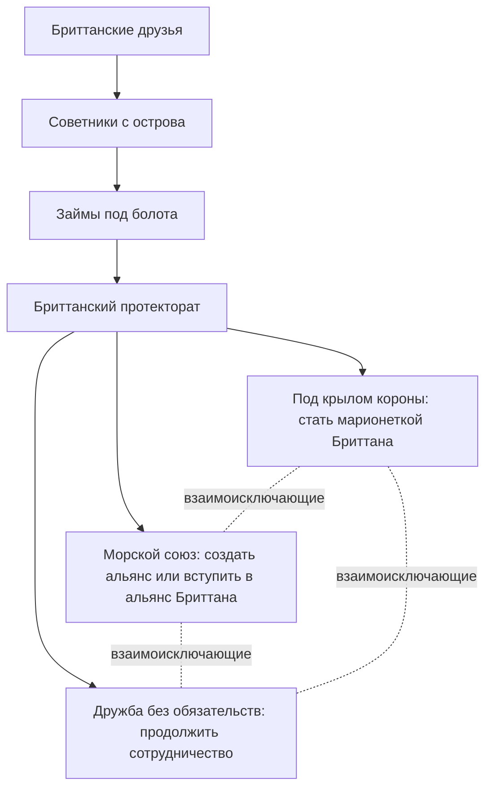

# Механики Казуалии

Выписка из главного документа лора `lore/Contries-Description.md`, раздел «Казуалия» (при расхождениях прав он). **Статус:** только лор и правила автора, в моде ничего из этого нет. Придуманные предложения явно помечены «Предложение (придумано)»; остальные пробелы вынесены в «Открытые вопросы».

Связанная глобальная механика (шкала Казуальности у остальных стран) — `global_mechanics/Casuality-Mechanic.md`.

## Кратко о стране
- Центр материка, большая часть клеток — болота, немного гор, равнины по краям; столица Ставка Казуала окружена горами с трёх сторон (кроме южной).
- Население 30 млн, образованность — «Необразованное стадо» (в моде у Казуалии специалистов всегда 0, см. `global_mechanics/Education.md`).
- Правитель — Священный-Архо-Казуал. Идеология — Казуальность.
- Страна находится под Бриттанским влиянием.

## 1. Дурманище Казуальности
**Правило автора (новая версия):** Дурманище — не дебафф врагам, а сила и слабость самих казуалов.
1. **Бафф атаки на национальных территориях** — для стран с идеологией Казуальность.
2. **Национальные территории Казуалии на Наших Болотах** — Казуалия получает ядра на болотных штатах Советского Союза (Наши Болота, `map/Geography.md`).
3. **Страна «Наши Болота»** — выделяемое государство на этих штатах; позже его сможет создать Советский Союз как буфер против Казуалии.
4. **Дебафф казуалам на территории противника**, который снимается фокусами.

Предложение (придумано, нужно подтвердить):
- Дух «Дурманище» `ktits_durmanische` у стран с идеологией Казуальность, два модификатора:
  - на своих ядерных землях: `army_core_attack_factor` +0,40 (только атака, как сказал автор);
  - на чужих землях: `army_non_core_attack_factor` −0,20, `army_non_core_defence_factor` −0,10.
- Почему так: модификаторы атаки и защиты нельзя повесить на штат (в `documentation/modifiers_documentation.md` игры 1.19 у них нет категории `state`). Зато `army_core_*` и `army_non_core_*` действуют на армии страны в зависимости от того, чья под ней земля.
- **Снятие дебаффа фокусами** (в ветке Казуалии, на Велико-Казуальном пути): три фокуса по очереди, каждый ослабляет чужеземный дебафф на треть; после третьего его нет.
  - «Болото с собой» — −0,07 / −0,03;
  - «Туман над чужбиной» — ещё −0,07 / −0,03;
  - «Везде как дома» — дебафф снят.
  - [uncertain] Технически: дух заменяется версией без части штрафа (`swap_ideas`).
- **Ядра на Наших Болотах:** при старте игры Казуалия получает `add_core_of` на всех штатах Советского Союза с болотом на Наших Болотах. Список штатов — после выбора по карте (болото по `Invented-Lore.md`: x 2750–3450, y 850–1200).
- **Страна «Наши Болота»:** новый выделяемый тег (номер `K35`, `countries/Splits.md`), штаты — те же болотные штаты. Советский Союз выделяет её решением «Буфер на болотах» (после фокуса, ПВ 100) как марионетку. Идеология при создании — не Казуальность (иначе она сама получит Дурманище и ядра станут спорными); диаспора казуалов даёт ей стартовую шкалу Казуальности 25.

**Описание страны «Наши Болота» (придумано):** Здесь кончаются советские дороги и начинается туман. Казуалы-переселенцы живут тут веками, говорят по-русски и по-казуальски и не очень понимают, чья это земля. Союз решил: пусть лучше будет их собственная — и стоит между ним и Ставкой.

**Описание фокусов (придумано):**
- «Болото с собой»: Солдаты набирают в фляги болотную воду. На чужой земле глоток — и снова как дома.
- «Туман над чужбиной»: Туман идёт впереди армии. Чужие поля становятся вязкими, а казуалы — спокойными.
- «Везде как дома»: Казуал ложится на чужой земле и засыпает так же крепко, как у себя в камышах. Значит, это уже его земля.

**Описание (придумано):** Над болотами стоит сладкий туман. Солдаты, вошедшие в него, сначала замедляют шаг, потом садятся «на минутку», а потом забывают, зачем пришли. Офицеры кричат, но и их голоса вязнут в тумане. Казуалам он не мешает: для них это просто воздух родины.

## 2. Внутренняя Казуальность (в решениях)
- Шкала, в начале игры 50 %.
- **Правило автора:** дебаффает производство и строительство, но даёт баффы армии.
- **Правило автора:** дебаффы на производство и строительство действуют **всегда**. На **Реформистском пути** (во время реформ, раздел 5.1) они **усиливаются**, и дебафф получает **армия**: общество ломают, казуалы сопротивляются переменам.
- **Правило автора:** Внутренняя Казуальность Казуалии **не связана с механиками других стран**, кроме Внешней Казуальности самой Казуалии (раздел 3). На шкалу Казуальности других стран, их образование и альянсы напрямую не влияет.
- Баффы на войну в болоте всегда в 2 раза больше, в горах — в 1,25 раза (лор).
- Растёт от случайных решений и от постоянно доступных решений (лор).
- Во время войны (или при поддержке войны > 95 %) появляются экстренные решения (лор).

Предложение (придумано, нужно подтвердить), при шкале N %. Первые четыре строки — прежние, остальные добавлены по просьбе автора (больше баффов и дебаффов):

| Эффект | Значение | Когда действует |
|---|---|---|
| Атака и защита дивизий | +N/5 % (при 50 % — +10 %) | всегда |
| Атака и защита в болоте / в горах | ×2 / ×1,25 от общего баффа | всегда |
| Промышленность (`industrial_capacity_factory`) | −N/4 %; на Реформистском пути −N/2 % | всегда |
| Строительство (`production_speed_buildings_factor`) | −N/4 %; на Реформистском пути −N/2 % | всегда |
| Восстановление организации (`army_org_regain`) | +N/5 % | всегда |
| Потребление припасов дивизиями | −N/5 % («казуалу много не надо») | всегда |
| Скорость окапывания (`dig_in_speed_factor`) | +N/2 % | всегда |
| Защита от партизан на своей земле (`resistance_target` для оккупанта) | +N/5 % | всегда |
| Призывное население (`conscription_factor`) | +N/10 % | всегда |
| Боевой дух при обороне столицы (Ставки) | +N/5 % к защите в штате столицы | всегда |
| Скорость наступления (`army_speed_factor`) | −N/10 % («ленятся идти вперёд») | всегда |
| Скорость исследований (`research_speed_factor`) | −N/5 % | только на Реформистском пути |
| Стабильность (`stability_factor`) | −N/10 % («реформы раздражают») | только на Реформистском пути |
| Потребительские товары (`consumer_goods_factor`) | +N/20 % | только на Реформистском пути |
| Производительность заводов (`production_factory_efficiency_gain_factor`) | −N/10 %; на Реформистском пути −N/5 % | всегда |
| Атака и защита дивизий (дебафф армии) | −N/10 % (вычитается из армейского баффа) | только на Реформистском пути |
| Организация дивизий (`army_org_factor`) | −N/10 % | только на Реформистском пути |

[uncertain: точные имена модификаторов `army_org_regain`, `dig_in_speed_factor`, `resistance_target`, потребление припасов — сверить с ванилью 1.19.]

### 2.1. Опоздания (правило автора)
**Опоздание — черта казуалов.** Казуал никогда не приходит вовремя и не считает это недостатком. Когда Внутренняя Казуальность **выше 80 %**, эта черта проявляется в делах государства: фокусы и решения Казуалии начинают опаздывать — **риск опоздания 50 %**, **опоздание от 7 до 30 дней**.

Детали (придуманы, подтверждены автором):
- Опаздывает **эффект**, а не само завершение: фокус или решение завершается как обычно, но с шансом 50 % награда приходит через случайные 7–30 дней. До этого в окне фокуса или решения висит подсказка «Опаздывает…».
- Реализация [uncertain: в игре не проверено]: в `completion_reward` / `complete_effect` проверка `ktits_kaz_inner > 80` и `random_list { 50 = { эффект сразу } 50 = { отложенное событие через случайные 7–30 дней с тем же эффектом } }`. Задержка — через `country_event = { id = … days = 7 random_days = 23 }`; событие скрытое, с новостью «Наконец-то!».
- Не опаздывают: экстренные военные решения (раздел 2), решения Реформ (5.1) и фокусы выбора пути (иначе путь можно не успеть выбрать).
- Если Внутренняя Казуальность падает до 80 % и ниже, уже отложенные эффекты не отменяются, новые не откладываются.
- Подсказка в описании категории «Внутренняя Казуальность»: «Опоздания: риск 50 %, 7–30 дней» при шкале > 80 %.

**Описание (придумано):** В Ставке никто не спешит. Приказ подписан — значит, когда-нибудь исполнится. Гонец выехал, но по дороге присел у болота отдохнуть. Через неделю, а может через месяц, он обязательно доедет.

**Описание события «Наконец-то!» (придумано):** Запыхавшийся гонец стоит в дверях Ставки. Он даже не извиняется: в Казуалии все опаздывают, и он уверен, что пришёл вовремя.

## 3. Внешняя Казуальность (в решениях)
- Распространение эффекта Казуальности на другие страны и создание там **Казуальных восстаний** (у восставших нет дебаффа на атаку).
- После победы над государством можно присоединить Казуальные восстания.
- Чем выше Внутренняя Казуальность, тем легче поднимать восстания в других странах.
- Другие страны могут противостоять подрывным действиям: чем выше их стабильность, тем легче отбиться. При этом Казуальность в стране снижает её стабильность.

### Выбор Казуалии по каждой стране (правило автора)
Для каждой страны, где растёт Казуальность, у Казуалии два варианта:
1. **Начать Казуальное восстание.** Доступно, когда шкала Казуальности в этой стране достигла порога. Быстро, но это открытый конфликт: восстание нужно поддерживать, а страна-цель может его подавить.
2. **Ничего не делать и ждать.** Когда шкала в стране дойдёт до 100, она сама перейдёт в Казуальность и станет марионеткой Казуалии (механика перехода — `global_mechanics/Casuality-Mechanic.md`). Медленно, зато без войны и затрат.

Предложение (придумано, нужно подтвердить): порог восстания — шкала ≥ 75 (ступень «Дурманище»). Ниже порога Казуалия может только ждать.

### Где поднимается Казуальное восстание (правило автора; числа придуманы)
Восстание — отделение части штатов страны-цели в новую страну с идеологией Казуальность (по образцу распада, `countries/Splits.md`), которая сразу воюет со страной-целью; Казуалия может её поддерживать.

**Какие штаты (правило автора):**
1. Если страна-цель **граничит** с Казуалией или страной её альянса — штаты, **ближайшие к Казуалии** (к её территории или альянсу).
2. Если **не граничит** — штаты с **хотя бы одним портом** (восстание приходит с моря).
3. Среди подходящих **приоритет** — штаты с **болотом** и с **меньшим развитием**.

Предложение (придумано): вес штата = болотные провинции ×3 + (10 − число фабрик и инфраструктуры) + (близость к границе Казуалии: соседний штат +5); берутся штаты с наибольшим весом, связные между собой; не берётся столица страны-цели.

**Сила восстания (правило автора):** число восставших зависит от ситуации с Казуальностью в стране-цели.

Предложение (придумано), по шкале Казуальности страны-цели:

| Шкала страны-цели | Штатов | Дивизий ополчения | Доп. |
|---|---|---|---|
| 75–84 | 2 | 3 | — |
| 85–94 | 4 | 6 | +1 дивизия за каждые 10 % Внутренней Казуальности Казуалии выше 50 % |
| 95–99 | 6 | 10 | то же; страна-цель теряет 10 % стабильности |

- Стабильность страны-цели > 60 % — восстание на 1 штат и 2 дивизии меньше (лор: «чем выше стабильность, тем легче отбиться»).
- **Проигранное восстание (правило автора):** шкала Казуальности страны-цели падает **до 0**; страна-цель получает национальный дух на **1 год**, который **запрещает новое Казуальное восстание** в ней. Штаты возвращаются стране-цели.
  - Дух «Отрезвление» `ktits_sobering` (название и описание придуманы); кроме запрета, предложено (придумано): стабильность +5 %. Внутренняя Казуальность Казуалии −5 % (придумано, нужно подтвердить).
  - **Описание (придумано):** Восстание подавлено, туман рассеялся. Люди протирают глаза и с удивлением смотрят на заросшие поля и брошенные станки. Ещё долго никто не захочет даже слышать о том, чтобы прилечь «на минутку».
- Победа восстания: Казуалия может присоединить его (лор) или принять как марионетку.

### Присоединение марионеток (правило автора)
Касается марионеток, которые Казуалия получила:
- при распаде большой страны (её части `Kxx`, `countries/Splits.md`);
- при «аказуаливании» — переходе страны в Казуальность на шкале 100.

Предложение (придумано, нужно подтвердить):
- Решение Казуалии «Принять в Ставку» (целевое, на свою марионетку) — марионетка аннексируется, её земли становятся землями Казуалии.
- Условия: марионетка не воюет отдельно от Казуалии; прошло не меньше 365 дней с момента перехода; Внутренняя Казуальность Казуалии не ниже 50 %.
- Цена: 100 ПВ; после присоединения Внутренняя Казуальность Казуалии +5 % («новые болота — новые лентяи»).
- Части большой страны (`Kxx`) можно присоединять только все вместе или по одной — вопрос к автору.
- ИИ Казуалии на Велико-Казуальном пути присоединяет марионеток, на остальных путях — нет.
- **После присоединения территории марионетки становятся национальными (ядерными) территориями Казуалии** (правило автора): Казуалия получает ядра на всех её штатах. Значит, население этих штатов идёт в расчёт «Казуальной Веры» (раздел 4).

## 4. Экономическая Казуальность (в решениях; правило автора)
У Казуалии нет обычной экономики усердия — её хозяйство держится на вере людей в то, что всё случится само. Эта вера — ресурс **«Казуальная Вера»**, который Казуалия тратит в решениях на дивизии, снаряжение, технологии и другие «плюшки», возникающие будто из ниоткуда.

**Рост Веры (правило автора):** чем больше национального населения у Казуалии, тем быстрее растёт Вера.

Предложение (придумано, нужно подтвердить):
- Переменная `ktits_kaz_faith`, 0–1000, старт 100.
- Прирост в месяц = 1 за каждый 1 млн населения в национальных (ядерных) штатах Казуалии, которыми она владеет. Старт: 30 млн → +30 в месяц.
- Множитель от Внутренней Казуальности: ×(0,5 + Внутренняя Казуальность / 100). При 50 % — ×1, при 100 % — ×1,5.
- Присоединённые марионетки (раздел 3) увеличивают национальное население → Вера растёт быстрее. Это главная причина присоединять.

Решения «Дары болот» (цена — Вера, не ПВ):

| Решение | Описание (лор) | Эффект | Цена Веры | Перезарядка |
|---|---|---|---|---|
| Болотное ополчение | Из тумана выходят люди с вилами и сетями: никто их не звал, они пришли сами. | 2 дивизии ополчения в столице | 150 | 90 дн |
| Казуальная гвардия | Лучшие из ленивых: те, кто ленится даже отступать. | 1 пехотная дивизия (шаблон «Казуальная гвардия») | 250 | 120 дн |
| Ружья из тины | Склады наполняются оружием, которого никто не заказывал. | +2000 пехотного снаряжения | 100 | 60 дн |
| Пушки сами приплыли | По реке Казуахии приплыла баржа с артиллерией. Хозяина не нашли. | +200 артиллерии | 150 | 90 дн |
| Откровение Архо-Казуала | Правитель засыпает и во сне видит чертёж. Утром чертёж лежит на столе. | +1 случайная технология текущего года (скидка 100 % на одну исследуемую) | 300 | 180 дн |
| Само построилось | Утром на пустыре стоит завод. Строителей никто не видел. | +1 гражданская фабрика в случайном штате | 200 | 120 дн |
| Благодать Ставки | Священный-Архо-Казуал благословляет народ, и всем становится хорошо. | +100 ПВ, стабильность +5 % на 180 дн | 120 | 90 дн |
| Миссионеры лени | Проповедники Казуальности уходят в соседние страны. | Шкала Казуальности в выбранной соседней стране +10 (связь с Внешней Казуальностью) | 100 | 60 дн |

- ИИ Казуалии: копит Веру в мирное время, в войну тратит на дивизии и снаряжение.
- Где видно: описание категории решений «Экономическая Казуальность» — «Казуальная Вера: N (+M в месяц)».

## 5. Пути развития (фокусы)
1. **Велико-Казуальный:** консолидация власти, рост Внутренней Казуальности и распространение Внешней. Цель — Казуальность на весь материк.
2. **Реформистский:** уничтожение Казуальности везде, переход к демократической общине. На этом пути дебаффы Внутренней Казуальности усиливаются и задевают армию (раздел 2), и открываются Реформы (раздел 5.1).
3. **Коммунистический:** помощь от коммунистических стран и быстрая индустриализация.
4. **Казуальная резервация:**
   - любая страна, захватившая или оккупировавшая Казуалию, может создать марионетку и привести к власти удобную партию;
   - столицу можно поставить в любой из 5 провинций;
   - **правило автора: два подпути**:
     - **Покорность** — помощь сюзерену в обмен на обещание независимости;
     - **Казуальное восстание** — разрушение страны сюзерена и захват власти над ним через Казуальность: подготовка и снабжение партизан, вооружённое восстание.

### 5.1. Реформы: переход к индустриальному обществу (правило автора; детали придуманы)
**Правило автора:** механика перехода Казуалии от болотного хозяйства к обычному индустриальному обществу.

Предложение (придумано, нужно подтвердить):
- Доступна только на Реформистском пути. Категория решений «Реформы».
- Шкала прогресса реформ `ktits_kaz_reform`, 0–100. Растёт от решений реформ, падает от высокой Внутренней Казуальности (−1 в месяц при шкале ≥ 75 %).
- Каждое решение реформ: прогресс +15–20, Внутренняя Казуальность −5…−10 %, цена 50–75 ПВ, стабильность −3 % на 90 дн (народ сопротивляется).

| Решение | Описание (лор, придумано) | Эффект |
|---|---|---|
| Осушение болот | Землемеры с лопатами идут в трясину. Многие возвращаются, некоторые — даже с картой. | прогресс +15, Внутр. Казуальность −5 %, +1 слот строительства в 2 болотных штатах |
| Рабочий день | Указ: работать с утра до вечера. Половина страны впервые узнала, что такое утро. | прогресс +20, Внутр. Казуальность −10 %, стабильность −5 % на 90 дн |
| Школы вместо Ставок | Священные палаты отдают под классы. Учитель приходит раньше учеников — это уже прогресс. | прогресс +15, специалисты +5 тыс. (снимает запрет «всегда 0», `global_mechanics/Education.md`) |
| Фабричный гудок | Над болотом впервые гудит завод. Казуалы приходят посмотреть и почему-то остаются. | прогресс +20, +1 гражданская фабрика |

- Риск: при прогрессе 30–70 — событие «Болотный мятеж» (шанс растёт с Внутренней Казуальностью); связь с гражданской войной (раздел 6).
- Итог при прогрессе 100: событие «Индустриальное общество» — Казуалия теряет Внутреннюю Казуальность, «Казуальную Веру» и решения «Дары болот», Дурманище на её земле перестаёт действовать; армейские баффы снимаются; получает обычную экономику и шкалу Казуальности как у остальных стран (старт 25).

### 5.2. Бриттанское влияние (правило автора; детали придуманы)
**Правило автора:** национальный дух «Бриттанское влияние» и выбор в ветке фокусов — сотрудничество с Бриттами: даёт баффы, но уменьшает независимость, внешняя политика постепенно переходит под Бриттов. Последние фокусы — выбор: стать марионеткой, создать альянс / вступить в альянс или продолжить сотрудничество без альянса.

Предложение (придумано, нужно подтвердить):
- Дух `ktits_kaz_britt_influence` на старте, 3 уровня (с каждым фокусом ветки уровень растёт):

| Уровень | Баффы | Плата |
|---|---|---|
| 1 Бриттанские советники | +5 % скорость исследований, +1 торговый договор с Бриттаном | Бриттан: отношения +25 |
| 2 Бриттанские займы | +10 % скорость строительства, +5 % промышленность | нельзя объявлять войну странам с отношениями к Бриттану ≥ 50 |
| 3 Бриттанский протекторат | +15 % строительство, +10 % промышленность, +10 % атака флота | без согласия Бриттана нельзя заключать договоры и вступать в альянсы; ИИ Бриттана может запрашивать войска |

- **Описание (придумано):** Бриттанские клерки в котелках давно ходят по коридорам Ставки. Они ничего не требуют — только советуют. Советы почему-то всегда выполняются.

Ветка фокусов (придумано, кроме финального выбора):

- «Под крылом короны»: Казуалия становится марионеткой Бриттана, дух уровня 3 заменяется постоянным «Корона и болото» (баффы +50 %).
- «Морской союз»: Казуалия создаёт альянс с Бриттаном или вступает в его альянс (по правилам `global_mechanics/Alliances.md`; [uncertain] — исключение из правила «только своя идеология»).
- «Дружба без обязательств»: дух остаётся на уровне 2, ограничения уровня 3 снимаются.
- Отказ от ветки: решение «Выгнать клерков» — дух снимается, отношения с Бриттаном −50.

## 6. Гражданская война против Казуалов
- На демократическом и коммунистическом путях в стране может начаться гражданская война против реакционных сил Казуалов.

## 7. Художественные описания (придумано, нужно подтвердить)
Тексты для `_desc` / `desc` локализации. Дурманище и дух «Бриттанское влияние» описаны в разделах 1 и 5.2, решения «Дары болот» — в таблице раздела 4.

### Механики
| Что | Описание |
|---|---|
| Внутренняя Казуальность | Казуал не ленится — он ждёт. Ждёт урожая, приказа, конца света. Пока он ждёт, ружьё у него всегда под рукой, а болото за спиной знает каждую его тропу. |
| Внешняя Казуальность | Лень не знает границ. Она переходит реки вместе с туманом, просачивается в газеты и кабаки, и вот уже соседний чиновник смотрит в окно вместо отчёта. |
| Казуальное восстание | Однажды утром целый уезд не вышел на работу. К обеду вышел — но уже с вилами и под зелёным болотным знаменем. |
| Выбор «Ничего не делать и ждать» | Зачем воевать, если можно подождать? Соседи сами придут. Рано или поздно все приходят. |
| Принять в Ставку | Ещё одна страна легла в болото и не захотела вставать. Ставка раскрывает объятия: места в тумане хватит всем. |
| Экономическая Казуальность | Казуалы не работают, но у них всё есть. Никто не знает, откуда. Казуалы и не спрашивают. |
| Казуальная Вера | Вера в то, что всё случится само. Чем больше казуалов верят, тем чаще оно действительно случается. |

### Пути развития
| Путь | Описание |
|---|---|
| Велико-Казуальный | Священный-Архо-Казуал проснулся и объявил: болото должно быть везде. Это не завоевание — это забота. Весь материк заслужил отдых. |
| Реформистский | Молодые казуалы впервые увидели заводской дым за горами и захотели такого же. Старики ворчат, Ставка гудит, но перемены уже не остановить. Наверное. |
| Коммунистический | Красные агитаторы объяснили казуалам, что лень — это пережиток эксплуатации. Казуалы задумались. Надолго. Но потом взялись за лопаты. |
| Казуальная резервация | Чужие флаги над Ставкой. Казуалам выделили болото, назначили правительство и велели вести себя тихо. Казуалы пока ведут себя тихо. |
| Резервация: Покорность | Будем служить. Будем полезны. А когда-нибудь хозяин сдержит слово — и болото снова станет нашим. |
| Резервация: Казуальное восстание | Хозяин думает, что казуалы спят. Хозяин ошибается: по ночам в камышах раздают винтовки, а туман уже стоит над его столицей. |

### Реформы (5.1)
| Что | Описание |
|---|---|
| Категория «Реформы» | Переделать казуала в рабочего — всё равно что осушить болото чайной ложкой. Но ложки уже розданы. |
| Шкала прогресса реформ | Сколько страны уже вытащено из трясины. Отпустишь — и она медленно сползёт обратно. |
| Событие «Болотный мятеж» | Старые казуалы вышли из камышей с плакатами «Верните покой!». Их много, они злы и, что хуже всего, впервые за век торопятся. |
| Событие «Индустриальное общество» | Гудок над болотом больше никого не удивляет. Туман рассеялся, казуалы ходят на смену, а о Священном-Архо-Казуале вспоминают только в анекдотах. Страна проснулась. |

### Бриттанская ветка (5.2)
| Что | Описание |
|---|---|
| Уровень 1 «Бриттанские советники» | Вежливые люди с острова учат казуалов считать и писать отчёты. Отчёты получаются короткими, но бриттам этого хватает. |
| Уровень 2 «Бриттанские займы» | Бриттанские банки дают деньги под залог болот. Болота никому не нужны, поэтому и деньги дают охотно. Пока. |
| Уровень 3 «Бриттанский протекторат» | Ставка подписывает бумаги, которые ей приносят из посольства. Читать их не обязательно: бритты всё уже прочитали за неё. |
| Фокус «Бриттанские друзья» | На пристани Казуахии встречают первый бриттанский пароход. Казуалы машут, бритты записывают. |
| Фокус «Советники с острова» | В каждом министерстве теперь сидит бритт. Он пьёт чай и молча смотрит, как работает министр. Министр работает. |
| Фокус «Займы под болота» | Бриттанский фунт пришёл на болота. Строятся дороги, гудят машины, и все вдруг стали должны. |
| Фокус «Бриттанский протекторат» | Флаг Ставки по-прежнему над дворцом. Просто рядом теперь висит ещё один — побольше. |
| Фокус «Под крылом короны» | Священный-Архо-Казуал преклоняет колено перед бриттанским наместником. Зато теперь можно больше ни о чём не думать — за казуалов думает корона. |
| Фокус «Морской союз» | Не слуги, а союзники. Бриттанский флот и казуальное болото: никто не пройдёт ни по морю, ни по суше. |
| Фокус «Дружба без обязательств» | Чай вместе пьём, а дом у каждого свой. Бриттам вежливо указали на дверь, оставив её приоткрытой. |
| Дух «Корона и болото» | Казуалия — жемчужина бриттанской короны. Немного мутная, зато своя. |
| Решение «Выгнать клерков» | Котелки летят в болото, клерки бегут к пароходу. Ставка снова принадлежит казуалам — и долги, кажется, тоже. |

### Гражданская война (6)
| Что | Описание |
|---|---|
| Начало гражданской войны | Старая Казуалия не захотела просыпаться. Реакционные казуалы ушли в болота, подняли зелёное знамя и объявили новую власть ересью беспокойства. |
| Победа правительства | Последние реакционеры вышли из тумана сдаваться. Многие честно признались, что просто устали прятаться. |
| Победа Казуалов | Болото поглотило реформы. Ставка снова спит, и всем снова хорошо. |

## Связи с другими странами (из лора)
- **Тямовский рейх, путь «Империум союз»:** Ахтямов делает брачное предложение правителю Казуалии. Отказ — оправдание войны; согласие — общее государство с механикой борьбы за власть; появляется Империумский союз, распространяющий Казуальность и НПТ.
- **Соевая Республика, «Императорский Казуальный путь»:** присяга на вассальство Казуалии, затем убийство Священного-Архо-Казуала и занятие престола (страна получает механики Казуалии).
- **Советский Союз:** на юге, на Наших Болотах у границы с Казуалией, живёт диаспора Казуалов.
- **Глобальная механика:** в лоре повышение полоски Казуальности у других стран — только у Казуалии (в моде по решению автора сделано иначе: решения поддержки есть у всех после фокуса «Право на отдых»).

## Как это связано с уже сделанным в моде
- Шкала Казуальности у остальных стран, переход в Казуальность и марионетки Казуалии — сделаны (`global_mechanics/Casuality-Mechanic.md`).
- В «Не сделано» механики Казуальности ждут Внешнюю Казуальность: рост шкалы от соседства с Казуалией уже есть, рост от Казуальных восстаний — нет.
- Решение Казуалии «Позвать с болот» и дух «Зов болот» — придуманы, по смыслу близки к Внешней Казуальности.

## Открытые вопросы (лор не уточняет)
1. ~~Что считать «страной с Казуальностью»~~ — решено автором: идеология Казуальность. Открыто: числа дебаффа.
2. Внутренняя Казуальность: подтвердить числа таблицы (раздел 2); какие решения поднимают и есть ли способы её снижать, кроме Реформ; что за «экстренные решения»?
3. ~~Связь Внутренней Казуальности с другими странами~~ — решено автором: только через Внешнюю Казуальность Казуалии.
4. Внешняя Казуальность: место и сила восстания решены автором (раздел 3). Открыто: цена решения восстания и подтверждение предложений (отдельная страна, веса штатов, таблица силы).
5. Бриттанское влияние: числа духа и сама ветка (предложение в 5.2); может ли Казуалия вступить в альянс Бриттана при другой идеологии; доступна ли ветка на всех путях.
6. ~~Резервация: три варианта~~ — решено автором: два подпути, «Покорность» и «Казуальное восстание».
6а. Реформы: шкала, решения и итог (предложение в 5.1); что делает Велико-Казуальный путь с Внутренней Казуальностью.
7. Гражданская война: условия начала и кто участвует?
8. Порог Казуального восстания в другой стране (предложено ≥ 75). ~~Что происходит при проигрыше~~ — решено автором (раздел 3).
9. Присоединение марионеток: условия, цена, части `Kxx` — по одной или все вместе (предложения выше).
10. Экономическая Казуальность: формула роста Веры, список решений и цены (предложения выше); есть ли у Казуалии обычные фабрики и ПВ параллельно с Верой.
