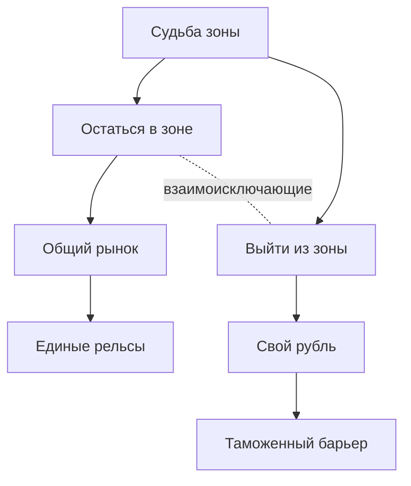

# Механики Советского Союза

Лор страны — `lore/Contries-Description.md`, раздел «Советский Союз» (при расхождениях прав он). **Статус:** только описание, в моде ничего нет. Правила автора отмечены «(правило автора)»; всё остальное придумано, помечено «Предложение (придумано)» и требует подтверждения. Древо фокусов — `focuses/Soviet-Union-Focus-Tree.md`.

## Кратко о стране
- Тег в моде `MAK`, 99 штатов, население 120 млн, образование «Крестьянское образование».
- Правитель — Генсек Ваня Пименов. Столица — Ваньград-на-Окре.
- Недавно вышел из гражданской войны со сторонниками Царской власти.
- Многонациональный: Русы (титульная нация), Кряхты, Тунгусы, Казуалы (диаспора на Наших Болотах), татары, башкиры, Желтороссы.
- Части при распаде — `K01`–`K06` и `K42` (Идель-Кама; перестройка 2026-11-20, раздел 9) (`countries/Splits.md`): Белорубежье, Заозёрная Республика, Урало-Сибирская Республика, Северо-Полярный Край, Степная Федерация, Приморье-Тихоокеанск. Ниже они называются **Советскими республиками**.
- Соседи: Казуалия (юг), Федерация Депутатов (юго-запад), Северная Ассамблея (северо-запад), Казачья Земля (юго-запад), Челяба, Кытай.

У каждой механики со шкалой — графическая шкала в своей категории решений, как у образования и Казуальности (правило автора: «должны иметь свои шкалы, когда уместно»).

## 1. Распад и «Страна Русов» (правило автора)
- Если Советский Союз распадается (из-за Казуальности или из-за падения Целостности до 0), **через год после распада** бывшие территории других республик перестают быть национальными (ядрами) Союза.
- Страна переименовывается в **«Страна Русов»**; при коммунизме — **«Социалистическая Страна Русов»**.

Предложение (придумано): названия при других идеологиях:

| Идеология | Название |
|---|---|
| Коммунизм | Социалистическая Страна Русов (правило автора) |
| Демократия | Республика Русов |
| Фашизм | Держава Русов |
| Нейтралитет | Страна Русов (правило автора) |
| Казуальность | Сонная Страна Русов |
| Теология | Святая Русь Русов |

- Год считается с момента распада флагом-таймером; затем `remove_core_of` на штатах, которыми владеют бывшие республики [uncertain: ключ сверить].

## 2. Целостность Союза (правило автора; детали придуманы)
**Правило автора:** шкала, старт 70 %. Шесть решений на повышение Целостности. Здесь же управление связью с Советскими республиками. При 10 % Советские республики становятся марионетками Союза; при 0 % — полный распад страны.

Предложение (придумано):
- Переменная `ktits_sov_unity`, 0–100, старт 70. Категория решений «Целостность Союза» со шкалой.
- Ежемесячно: −1 базово (центробежные силы после гражданской войны); −1 при ступени Казуальности ≥ 2; −1 при стабильности < 40 %; +1 при стабильности > 70 %.
- Модификаторы по уровням:

| Целостность | Эффект |
|---|---|
| 70–100 | стабильность +5 %, призыв +1 % |
| 40–69 | — |
| 11–39 | стабильность −10 %, ПВ −0,2 в день |
| ≤ 10 | Советские республики `K01`–`K06` выделяются марионетками Союза (правило автора) |
| 0 | полный распад: марионетки получают независимость, далее раздел 1 (правило автора) |

**Шесть решений Целостности (придумано):**

| Решение | Описание (лор) | Эффект | Цена | Перезарядка |
|---|---|---|---|---|
| Съезд народов Союза | В Ваньграде собираются делегаты всех республик. Спорят до хрипоты, но расходятся друзьями. | Целостность +8 | 75 ПВ | 120 дн |
| Единый рубль | Деньги республик сводят в одну валюту. Бухгалтеры плачут, экономисты радуются. | Целостность +5; потребительские товары −2 % на 180 дн | 50 ПВ | 180 дн |
| Железная дорога дружбы | Рельсы связывают окраины с центром. По ним везут хлеб, газеты и комиссаров. | Целостность +6; инфраструктура +1 в 2 штатах республик | 60 ПВ | 180 дн |
| Национальные школы | В каждой республике учат на родном языке и на языке Русов. | Целостность +5; специалисты +2 тыс. | 50 ПВ | 120 дн |
| Праздник Союза | Парады, песни и пироги. Всем ясно: вместе веселее. | Целостность +4; стабильность +3 % на 90 дн | 40 ПВ | 90 дн |
| Чистка сепаратистов | Органы ищут тех, кто мечтает о своей стране. Находят многих — и не всегда тех. | Целостность +10; стабильность −5 %; Паранойя +5 | 30 ПВ | 120 дн |

**Связь с Советскими республиками (придумано):** целевые решения на каждую из `K01`–`K06` (пока они в составе — на её штаты; после выделения — на марионетку):
- «Дать автономию» — Целостность +3, республика лояльнее (её шанс отделиться при распаде −50 %), ПВ −25.
- «Прислать наместника» — Целостность +2, стабильность в её штатах +, Паранойя +2.
- «Вложиться в республику» — 1 гражданская фабрика в её штате, Целостность +2, 100 ПВ.

## 3. Паранойя Пименова (правило автора; детали придуманы)
**Правило автора:** Генсек с каждым днём становится всё более параноидальным, его личности (в наброске — «подлинности») тянут власть на себя. Личностей пять: **самодержец, мягкий коммунист, жёсткий коммунист, шиз, баланс**. Механика отключается, когда побеждает одна из четырёх личностей, или через год после старта — тогда побеждает баланс, если ни одна из личностей не слишком сильна.

Предложение (придумано):
- Переменная `ktits_sov_paranoia`, 0–100, старт 20, +2 в месяц (≈ +24 за год). Шкала в категории «Паранойя Пименова». Чем выше — тем сильнее штрафы: стабильность −Паранойя/10 %, но поддержка войны +Паранойя/20 %.
- Четыре переменные силы личностей `ktits_sov_p_autocrat`, `_soft`, `_hard`, `_schizo`, старт 20 каждая; баланс — не переменная, а «никто не перевесил». Показываются четырьмя мини-шкалами.
- Каждый месяц случайная личность получает +2…+5 (вес зависит от Паранойи и баланса Пименов–Партия, раздел 4).
- **Победа личности:** одна из четырёх достигает 100 → событие, Пименов получает черту (дух) этой личности до конца правления, механика выключена.
- **Победа баланса:** прошёл год (365 дней) и ни одна личность не выше 70 → дух «Баланс».
- Если через год есть личность > 70 — механика продолжается до победы.
- Решения на поднятие личностей открываются фокусами паранойи (см. древо фокусов).

| Личность | Дух-победитель (придумано) | Эффект |
|---|---|---|
| Самодержец | «Генсек-самодержец» | ПВ +0,5 в день, популярность фашизма +, стабильность −5 % |
| Мягкий коммунист | «Добрый Генсек» | стабильность +10 %, производство −5 % |
| Жёсткий коммунист | «Железный Генсек» | производство +10 %, стабильность −10 %, призыв +2 % |
| Шиз | «Генсек видит заговоры» | случайные события каждые 30–90 дней (чистки, озарения, приказы в 3 часа ночи) |
| Баланс | «Генсек в равновесии» | стабильность +5 %, ПВ +0,15 в день |

**Описание механики (придумано):** Ваня Пименов не спит третью ночь. Ему кажется, что за дверью шепчутся. Утром он подписывает три противоречащих друг другу указа, и каждый — своей рукой.

## 4. Баланс Пименов — Партия (правило автора; детали придуманы)
**Правило автора:** баланс между властью Пименова и Партией, реализовать как у ванильной Италии. От значения зависит влияние Паранойи на страну. Отключается, когда Пименов не у власти.

Предложение (придумано):
- Ванильная механика «баланс сил» (Balance of Power, у Италии в 1.19) [uncertain: сверить папку `common/bop/` и эффекты `add_power_balance` / `set_power_balance` в документации 1.19].
- Стороны: слева **Партия**, справа **Пименов**. Старт — 0,2 в сторону Пименова.
- Диапазоны:

| Диапазон | Эффект |
|---|---|
| Сильно к Партии | Паранойя растёт вдвое медленнее; ПВ −10 %; стабильность +5 % |
| Умеренно к Партии | Паранойя ×0,75 |
| Центр | — |
| Умеренно к Пименову | Паранойя ×1,25; ПВ +10 % |
| Сильно к Пименову | Паранойя ×1,5; ПВ +20 %; личности растут быстрее |

- Решения сдвига: «Пленум ЦК» (к Партии), «Личный приказ Генсека» (к Пименову), «Обновить Политбюро» (к Партии, Паранойя +3).
- Когда Пименов не у власти (смерть, переворот, смена идеологии) — `remove_power_balance` [uncertain].

## 5. Коммунизм на экспорт (правило автора; детали придуманы)
**Правило автора:** активируется фокусом; Союз агитирует за коммунизм в других странах.

Предложение (придумано):
- Категория «Коммунизм на экспорт» со шкалой **Влияния** (`ktits_sov_export`, 0–100: доля стран с популярностью коммунизма ≥ 30 %).
- Целевые решения на любую страну:
  - «Красная пресса» — популярность коммунизма в стране-цели +5 % (50 ПВ, 60 дн);
  - «Поддержать компартию» — +10 % и стабильность цели −5 % (100 ПВ, 120 дн);
  - «Пригласить в Союз» — при популярности коммунизма у цели ≥ 50 %: событие цели — сменить идеологию на коммунизм и стать союзником (вступить в альянс Союза).
- Противодействие: страны с духом «Вечный нейтралитет» иммунны.

## 6. Великие социалистические стройки (правило автора; детали придуманы)
**Правило автора:** активируется фокусом; нужна интерактивная карта, на которой отображены стройки.

Предложение (придумано):
- Стройки — проекты на конкретных штатах; каждая идёт N дней и тратит гражданские фабрики (как ванильные мегапроекты через решения с `days_remove`).
- Список строек:

| Стройка | Где | Срок | Итог |
|---|---|---|---|
| Окринская ГЭС | штат на Окре | 365 дн | +3 гражданские фабрики, +10 % строительство в штате |
| Магистраль до Желтой Реки | дальневосточные штаты | 540 дн | инфраструктура +2 на пути, снабжение +20 % |
| Осушение Наших Болот | болотные штаты Наших Болот | 450 дн | ядра Казуалии там −, Казуальность Союза −10, +2 слота строительства |
| Ваньград-на-Устое: город-завод | штат Ваньград-на-Устое | 365 дн | +3 военные фабрики |
| Урурский металлургический комбинат | штат у Урурских гор | 400 дн | +ресурсы стали, +2 военные фабрики |
| Северный морской путь | Северо-Полярный Край | 400 дн | военно-морская база +2, верфь +1 |

- **Интерактивная карта:** `scripted_gui` с картой Союза и иконками строек: серая — не начата, жёлтая — идёт (с процентом), зелёная — завершена; клик по иконке — начать стройку (вызывает решение). [uncertain: исполнение на scripted_gui с фоновой картинкой карты Союза; нужна отдельная картинка карты.]
- Шкала «Прогресс строек»: число завершённых / всего.

## 7. Связи с Казуальностью
- На Наших Болотах живёт диаспора Казуалов; Казуалия имеет там ядра (`mechanics/Kazualia.md`, раздел 1). Решение «Буфер на болотах» создаёт марионетку «Наши Болота» (K35).
- Распад из-за Казуальности — переход в Казуальность на шкале 100 (`global_mechanics/Casuality-Mechanic.md`); после него действует раздел 1.

## Решения автора по открытым вопросам (2026-11-20)
| № | Вопрос | Решение |
|---|---|---|
| 1 | «Подлинности» Генсека | «личности» (правило автора) |
| 2 | Путь Теологии | Церковь Древнего Динозавра, раздел 8 (идея автора; фокусы придуманы, `focuses/Soviet-Union-Focus-Tree.md`, раздел 6) |
| 3 | Название при федерализации | «Президентский Союз Советских Республик» (принято) |
| 4 | Фашистская ветка | добавлена: «Фашистский путь», фокусы в разделе 7 дерева; её итог открывает внешнюю политику «Великая Континентальная империя» |
| 5 | Что входит в Раздел | **все государства, которые можно выделить из Советского государства**: изначальные части (`K01`–`K06` и `K42`, раздел 9) и **захваченные** (любая страна, чьими штатами владеет Союз, например Казачья Земля; выделяется с её штатами) |
| 6 | Края шкалы баланса | раздел 4а ниже (придумано) |
| 7 | Придуманные числа и названия | подтверждены автором |
| 8 | Стартовые популярности | раздел 10 (придумано) |
| 9 | Исторический путь | **Мягкий коммунизм** (путь 3); в правиле игры опция `HISTORICAL` |
| 10 | Правители по идеологиям | раздел 11; портреты позже |
| 11 | Стартовые законы | «частичная мобилизация» = закон `early_war_economy` (решено мной: это ближайший к «частичной» закон экономики; русское название в игре не сверено) и ограниченный призыв `limited_conscription` |
| 12 | Стартовый ивент | раздел 12 (придумано) |
| 13 | Веса ИИ | раздел 13 (придумано) |
| 14 | Выделяемые страны | перестроены, раздел 9 и `countries/Splits.md` |

## 4а. Края шкалы «Баланс Пименов — Партия» (придумано)
| Край | Условие | Эффект |
|---|---|---|
| Партийная диктатура | к Партии ≤ −0,9 | Паранойя замирает на текущем значении, ПВ −20 %, стабильность +10 %; событие «Пленум без Генсека» (Пименов теряет личные решения 180 дн) |
| Культ личности | к Пименову ≥ +0,9 | Паранойя +1 в месяц сверх обычного, ПВ +30 %, стабильность −10 %; открывается решение «Объявить себя Кормчим» (путь Теологии, если выбран) |
- Лор: «На пленуме спорят уже не о политике, а о том, кто будет подписывать повестку. Побеждает тот, кто громче читает вслух.»

## 8. Церковь Древнего Динозавра (идея автора; детали придуманы)
**Идея автора:** Иоанн (Ваня Пименов) начинает поклоняться динозаврам, давно вымершим по его вине, и желает, чтобы весь мир покаялся. Путь Теологии: правитель — Великий Кормчий Ваня Пим (раздел 11).
- Переменная `ktits_sov_repent` (0–100, шкала «Покаяние мира»): растёт от решений церкви, от каждой страны с популярностью теологии ≥ 25 % (+1 в месяц), падает от военных поражений. Видна в категории «Церковь Древнего Динозавра».
- Дух «Церковь Древнего Динозавра» `ktits_sov_church`: стабильность +10 %, популярность теологии +0,05 в день, ПВ −10 % (десятина идёт на кости).
- Решения категории (придумано): «Проповедь у костей» (+0,07 теологии, 50 ПВ, 20 дн), «Раскопки для веры» (+2 Покаяния, 1 гражданская фабрика, 60 ПВ), «Письмо в чужие столицы» (цель — любая страна: теология +5 %, 100 ПВ, 60 дн), «Исповедь Кормчего» (событие: +10 Покаяния, стабильность −5 % на 90 дн).
- Условие смены идеологии на теологию — популярность теологии ≥ 50 % (общее правило); до этого — фокусы усиления и решения выше.
- **Лор (придумано):** Под Ваньградом нашли кости ящера. Иоанн долго смотрел на них, потом тихо сказал: «Это я». Если вымерли по его вине, то спасать нужно не ящеров, а мир: пусть весь мир придёт к костям и покается.

## 9. Выделяемые страны (правило автора, перестройка 2026-11-20)
Новые названия — без реальных названий и сторон света (правило автора). Штаты — в `countries/Splits.md`.
| Тег | Было | Стало | Заметки |
|---|---|---|---|
| K01 | Белорубежье | Староградская Республика | 10 штатов (8 ушли в `K42`) |
| K02 | Заозёрная Республика | **Дальне-Ладожская Республика** (автор) | Дальний Восток (по карте крайний восточный блок), столица **Ладожь** (штат 490), 10 штатов; страна холодных долин с китайским культурным влиянием |
| K03 | Урало-Сибирская Республика | **Сибиртатская Республика** (автор) | столица **Радогощь**; получает долину реки (штаты 449, 217, 190, 431), 20 штатов |
| K04 | Северо-Полярный Край | **Калинтопская Республика** (автор) | севернее остальных; Ваньград на Устое (штат 178) отдан `K05`, столица — по очкам победы штатов |
| K05 | Степная Федерация | Раздольская Федерация | 13 штатов (4 отданы `K03`; Ваньград на Устое (178) получен от `K04`; Ак-Тау остаётся здесь) |
| K06 | Приморье-Тихоокеанск | Заводьская Республика | 14 штатов (название отдано от `K02`) |
| K42 | — | **Идель-Кама** (автор, новая) | татарское государство вокруг Идель-Калы (штат 310): 13 165 310 326 424 425 661 670, 8 штатов |
- **Идель-Кама, дух «Союз двух рек» `ktits_idel_two_rivers` (придумано):** стабильность +5 %, скорость строительства +10 %, потребительские товары −5 %; лор: «Две реки сливаются, и никто уже не спорит, какая из них главнее. Татарин и башкир делят один паром и один самовар.»
- **Решено мной по карте** (координаты штатов из карты): Идель-Кала (центр штата 310, x 2691, y 487) и Ак-Тау (69, x 3547) разнесены на 850 px и несмежны, поэтому Идель-Кама — компактная татарская часть вокруг 310 (6 штатов), а Ак-Тау остаётся в `K05`. Ладожь (490) лежит в самом восточном блоке (x 3447), поэтому Дальне-Ладожская — это бывшая `K02`, а название «Заводьская» перешло к `K06`. Ваньград на Устое (178, y 427) — самый северный штат `K04`, севернее остальных частей: подходит. Остаток `K01` может быть несвязным [uncertain: проверить `make_splits.py`].

## 10. Стартовые популярности (придумано)
Коммунизм 74, Демократия 8, Теология 6, Фашизм 6, Нейтралитет 4, Казуальность 2 (сумма 100). Правитель — коммунист (Генсек). Достижимость 50 % для смены курса: у Теологии с 6 % — Немыслимый вариант +5, Оружие для недовольных +15, решения церкви +0,07 за раз и фокусы усиления (раздел 6 дерева); у Фашизма — фокусы усиления фашистской ветки (раздел 7).

## 11. Правители по идеологиям
| Идеология | Правитель | Описание (придумано) |
|---|---|---|
| Коммунизм | Генсек Ваня Пименов (лор) | Не спит третью ночь. За дверью шепчутся, а в протоколе всё сходится. |
| Теология | Великий Кормчий Ваня Пим | Тот же Ваня, но с костью вместо перьевой ручки. Ведёт страну к покаянию и сам первым кается вслух. |
| Фашизм | Ванька Встанька Пиместров | Неваляшка в погонах: сколько ни роняй, встаёт и объявляет это победой. |
| Демократия | Президент Иоанн Пименов | Снял френч, надел галстук и впервые узнал, что бюллетень нужно считать. |
Портреты — позже (строки в `image_generator/images-list.md` добавить при переносе).

## 12. Стартовый ивент (придумано)
**«Победа в стране без победителей»** (кнопка: «Созвать съезд»). Текст: «Гражданская война закончилась тихо: царисты сдались не врагам, а усталости. Ваньград украсили флагами, которые вчера были тряпками. Генсек Ваня Пименов вышел на балкон, но слов не нашёл, потому что слов больше не было. Республики шепчутся на своих языках, Партия считает потери, а Казуалия на юге зевает так, что слышно на границе. Надо созывать съезд и решать, каким будет Союз.»
Эффекты: открывает фокус «Съезд после войны», +20 ПВ.

## 13. ИИ (придумано)
| Что | Вес |
|---|---|
| Корень «Съезд после войны» | ~1000 |
| Мягкий коммунизм (исторический путь) | 300 |
| Политические реформы | 120 |
| Тоталитарный коммунизм | 100 |
| Немыслимый вариант (Теология и Гласность) | 40 |
| Фашистский путь | 40 |
| Казуальный путь | 30 |
| Внешняя политика, экономика | 20–60 |
| Армия | ~3 |
- Правило игры `ktits_mak_paths`: опции `DEFAULT` (по весам), `HISTORICAL` (мягкий коммунизм), `REFORMS`, `HARD_COMM`, `UNTHINKABLE`, `FASCISM`, `CASUAL`; дефолт `DEFAULT`. В игре не сделано.
- ИИ не берёт церковь, пока Теология < 30 %; без повода не начинает Раздел.

## Раздел и захваченные страны (правило автора, пункт 5)
Решение «Раздел» (фокус «Раздел ради покоя» казуального пути и любое событие распада) выделяет: `K01`–`K06`, `K42` и все страны, чьими штатами владеет Союз (по списку ядер). Правитель и идеология при выделении — по правилам `countries/Splits.md`.

## 14. Единая хозяйственная зона и быстрый распад (придумано по просьбе автора)
**Зона** («Союзная хозяйственная зона»): при выделении `K01`–`K06`, `K42` и захваченных стран каждая получает флаг `ktits_sez_member` и дух «Союзная хозяйственная зона» `ktits_sez_member`: скорость строительства +10 %, потребительские товары −5 %, отношения с Союзом +25. Союз (или его наследник «Страна Русов») получает дух «Хозяйственный центр» `ktits_sez_centre`: производство +5 % за каждого члена зоны, максимум +20 %. Выход любого члена снимает его бонус и уменьшает бонус центра.

**Быстрый распад** (придумано): распад считается быстрым, если Целостность падает от 40 и выше до 10 и ниже не больше чем за 180 дней (флаг-таймер `ktits_sov_fall_timer` ставится при Целостности < 40) или Союз распадается на втором году после начала игры. Иначе распад медленный.
| Что | Быстрый распад | Медленный распад |
|---|---|---|
| Дух всем выделенным странам и Союзу | «Хозяйственный обвал» `ktits_sov_crash` на 730 дн (через 365 дн заменяется половинной версией) | «Распад по плану» `ktits_sov_crash_soft` на 365 дн |
| Производство (фабрики) | −15 % | −5 % |
| Стабильность | −10 % | −3 % |
| Скорость строительства | −15 % | — |
| Потребительские товары | +10 % | +3 % |
| Для члена зоны | дебафф **вдвое слабее**, пока страна в зоне (смысл фокусов «Остаться в зоне») | — |
- **Лор (придумано):** «Республики разошлись за неделю. Рубль остался в одной, станки в другой, паспорта в третьей. Заводы встали не от войны, а от того, что никто не знал, чья теперь печать.»

### Фокусы выделяемых стран: выйти из зоны или остаться (идея автора; фокусы придуманы)
Общий набор для `K01`–`K06`, `K42` и захваченных стран: ветка «Зона» **в стандартном дереве фокусов** (республики сохраняют и стандартные фокусы, и фокусы зоны); в каждой стране первый фокус имеет своё лорное описание (таблица ниже). Выбор взаимоисключающий, после развилки у каждой альтернативы минимум два фокуса.

| Фокус | Дни | Описание | Эффект | Условие |
|---|---|---|---|---|
| Судьба зоны | 35 | Страна получила печать, а вместе с ней вопрос: торговать с бывшими своими или считать их соседями. | +30 ПВ; открывает развилку | страна выделена из Советского государства |
| Остаться в зоне | 70 | Рубль общий, рельсы общие, обиды тоже общие. Зато хлеб привозят вовремя. | Дух «Союзная хозяйственная зона» остаётся; дебафф быстрого распада вдвое слабее; отношения с Союзом +25 | Судьба зоны |
| Общий рынок | 70 | Купцы возят товар через границы без печатей. Печати отдыхают. | Потребительские товары −5 %; доход в ПВ +0,2 в день; торговля с зоной +15 % | Остаться в зоне |
| Единые рельсы | 105 | Поезда идут из конца в конец, и никто не спрашивает, чей это перегон. | Инфраструктура +1 в штатах; скорость строительства +10 % | Общий рынок |
| Выйти из зоны | 70 | Страна решила жить на свои. Бывшие соседи обиделись, зато сами себе хозяева. | Дух зоны снимается; дух «Хозяйственный разрыв» `ktits_sez_exit` на 365 дн (производство −10 %, стабильность −5 %); отношения с Союзом −50; дебафф быстрого распада в полной силе | Судьба зоны |
| Свой рубль | 70 | Новая валюта пахнет типографской краской и надеждой. Курс определяют на глаз. | Стабильность +5 %; потребительские товары +5 %; снимает «Хозяйственный разрыв» через 180 дн | Выйти из зоны |
| Таможенный барьер | 105 | На границе встали будки с шлагбаумами. Будочники важнее генералов. | Производство +10 %; торговля с зоной −50 %; можно создавать альянс и вступать в чужие (идея автора: выход открывает самостоятельную политику) | Свой рубль |
Фокус «Остаться в зоне» недоступен стране, которая воюет с бывшим членом зоны (проверка при реализации).

| Страна | Лорное описание первого фокуса («Судьба зоны», придумано) |
|---|---|
| Староградская Республика (`K01`) | Старые города помнят, чей хлеб кормил Ваньград. Теперь спрашивают цену. |
| Дальне-Ладожская Республика (`K02`) | У холодных долин Ладожь с видом на мёрзлую даль: сюда проще привезти шёлк из-за моря, чем масло из Ваньграда. |
| Сибиртатская Республика (`K03`) | Татары и сибиряки привыкли считать вместе: ярмарка в Радогощи не знает границ, пока не придёт таможня. |
| Калинтопская Республика (`K04`) | Железо и лес идут на юг по Устою. Если закрыть реку, замёрзнут и те, и другие. |
| Заводьская Республика (`K06`) | Заводы здесь стоят на болоте и на привычке; без общих поставок они встанут первыми. |
| Раздольская Федерация (`K05`) | Раздолье не любит печатей: что выращено, то и продаётся, куда повезут. |
| Идель-Кама (`K42`) | Две реки сходятся в один торговый путь; чужим таможням на нём нечего делать. |

## Реализация (`tools/make_soviet.py`, шаг `soviet`) [uncertain: в игре не проверено]
**Сделано (фаза 1):**
- Страна `MAK`: стартовые популярности 74/8/6/6/4/2 и правители Ваня Пим, Пиместров, Иоанн Пименов (`make_rulers.py`); законы старта `early_war_economy` и `limited_conscription`, переменные шкал (Целостность 70, Паранойя 20, Баланс +20, личности 20 каждая) в `ktits_sov_start`; стартовый ивент `ktits_soviet.1`.
- Древо фокусов `ktits_soviet_focus` (103 фокуса: паранойя, 6 политических путей, Церковь Древнего Динозавра, фашистская ветка, борьба с Казуальностью, внешняя политика с «Рубежами Союза», экономика, армия); названия, дни и описания читаются из таблиц документа древа; эффекты — готовые (популярности, переменные шкал, духи, фабрики, претензии, цели войны, отношения, события Казачьей Земли и рейха).
- 25 духов-наград фокусов, 5 духов зоны (`ktits_sez_*`), 4 события, правило игры `ktits_mak_paths` (ИИ по весам и 6 путей), 7 деревьев зоны (`ktits_zone_<tag>_*`) для `K01`–`K06`, `K42`.
- Выделяемые страны: `make_splits.py` с фиксированными списками штатов, `K42` Идель-Кама.
**Сделано (фаза 2, `tools/make_soviet_mech.py`, шаг `sovietmech`):**
- Ежемесячный эффект Союза: Паранойя (+1…3 в месяц по Балансу), четыре личности (случайная +3, победа при 100 событием со своим духом, «Баланс» через год при всех ≤ 70), Баланс с ступенями духов и краями («Партийная диктатура», «Культ личности»), Целостность (дрейф −1 при Казуальности > 50 и Паранойе ≥ 70, пол «Монолита»), ступени «Единый Союз» и «Союз трещит».
- Распад: при Целостности ≤ 10 `ktits_sov_collapse` выделяет `K01`–`K06`, `K42` марионетками Союза (армия делится по населению, как в `make_splits.py`), быстрый распад (Целостность упала с 40 за 180 дней или до 1938 года) даёт Союзу «Хозяйственный обвал» на 730 дней, республикам смягчённый; медленный — «Распад по плану»; все выделенные получают дух зоны; Идель-Кама — дух «Союз двух рек»; при Целостности 0 марионетки получают свободу (`set_autonomy` [uncertain]).
- 24 решения в 5 категориях: Целостность (6 + 3 целевых на республики), Паранойя (4 личности и «Бессонная ночь»), Баланс (3), Церковь (4), Коммунизм на экспорт (3). Значение шкалы показано в описании категории (графической шкалы нет).
**Сделано дополнительно:** графические шкалы 20 делений у категорий Целостность, Паранойя, Баланс (от −100, шаг 10) и Церковь (Покаяние); Великие стройки как 6 решений со сроками (карты нет: прогресс в описании категории); счёт стран с коммунизмом ≥ 30 % для «Коммунизма на экспорт»; косметические названия («Президентский Союз Советских Республик», «Соевый Советский Союз», «Страна Русов» по идеологии через год после распада; файл `common/countries/cosmetic.txt` [uncertain: формат и ключи]); снаряжение Казачьей Земле (2000 пехотного) в фокусе «Помощь без обязательств».
**Сделано ещё:** две добровольческие дивизии «Добровольцы Союза» в столице Казачьей Земли (шаблон создаётся в её области) и дух «Союзные добровольцы» (`rule = { can_send_volunteers = yes }`, `send_volunteer_size` +3): Союз может отправлять свои дивизии добровольцами ванильным действием дипломатии; снятие ядер `K01`–`K06`, `K42` со штатов, которыми владеет Союз, через год после распада.
**Не сделано:** интерактивная карта строек (рекомендация исследования: собственное здание с лимитом 1 на штат + `scripted_gui` + `scripted_map_modes`), целевые решения Целостности на штаты республик до распада (`state_target = any_owned_state`, `is_core_of`); [uncertain]: `create_unit` без шаблона у владельца (шаблон создаётся перед ним), `is_core_of` для тега без страны, `set_cosmetic_tag`, `set_autonomy`, `take_claimed_state`, `start_civil_war`. Отчёты исследования: `no_commit/temp/research/r1…r5`.

**Условие «Остаться в зоне» (правило автора, 2026-11-20):** фокус доступен республике, только если она осталась марионеткой Союза или Союз успел завершить фокус «Создать Экономический Блок» (ветка «Спасение экономики», `focuses/Soviet-Union-Focus-Tree.md`).

## 15. Технологии (правило автора, 2026-11-20; в игре не сделано)
**Правило автора:** Советский Союз получает технологии Советского Союза из ванильной игры. Источник: `history/countries/SOV - Soviet union.txt` игры (блоки `set_technology`, включая варианты по DLC «No Step Back» и «Man the Guns»). Перенос — как есть, блоками, с теми же условиями DLC, без правки состава.
Состав ванильного набора по сферам:
| Сфера | Технологии |
|---|---|
| Пехота и поддержка | `infantry_weapons`, `infantry_weapons1`, `tech_recon`, `tech_support`, `tech_engineers`, `tech_military_police`, `tech_mountaineers`, `tech_trucks`, `motorised_infantry`, `paratroopers`, `gw_artillery`, `interwar_antiair`, `fuel_silos`, `fuel_refining`, `basic_train` |
| Броня | без «No Step Back»: `gwtank`, `basic_light_tank`; с ним: `gwtank_chassis`, `basic_light_tank_chassis`, `improved_light_tank_chassis`, `engine_tech_1`, `engine_tech_2`; `armored_car1` |
| Авиация | без «No Step Back»: `early_fighter`, `fighter1`, `early_bomber`, `strategic_bomber1`, `naval_bomber1`, `early_transport_plane`, `CAS1`, `tactical_bomber1`; с ним: `iw_small_airframe`, `iw_medium_airframe`, `iw_large_airframe`, `basic_small_airframe`, `basic_medium_airframe`, `basic_large_airframe`, `aircraft_construction`, `engines_1`, `engines_2`, `aa_lmg`, `aa_cannon_1`, `early_bombs`, `air_torpedoe_1`, `bba_early_transport_plane` |
| Флот | без «Man the Guns»: `early_submarine`, `basic_submarine`, `early_destroyer`, `early_light_cruiser`, `early_heavy_cruiser`, `early_battleship`, `early_battlecruiser`, `transport`; с ним: `basic_naval_mines`, `submarine_mine_laying`, `early_ship_hull_light`, `basic_ship_hull_light`, `early_ship_hull_submarine`, `basic_ship_hull_submarine`, `early_ship_hull_cruiser`, `basic_ship_hull_cruiser`, `early_ship_hull_heavy`, `basic_battery`, `basic_light_battery`, `basic_torpedo`, `basic_depth_charges`, `mtg_transport` |
| Промышленность | `synth_oil_experiments` |
- Открытый вопрос (ванильный файл имеет блоки для сценариев 1936 и 1939; в моде сценарий один): брать блок 1936, а технологии 1939 добавлять фокусами армии и экономики, или взять 1939 целиком. Предложение (придумано): блок 1936 + «Красная армия после войны» даёт то, что отличает 1939.
- Связь с фокусами: фокусы армии (`focuses/Soviet-Union-Focus-Tree.md`, «Армия, Флот, Авиация») дают бонусы исследований на следующие ступени; стартовый набор их не заменяет.

## 4б. Реализация баланса через ванильный Balance of Power (2026-11-20; в игре не проверено)
Баланс Пименов — Партия сделан ванильной механикой «Баланс сил» (как у Италии, `common/bop/ITA.txt`): файл `common/bop/ktits_sov.txt` (`tools/make_soviet_mech.py`), блок `ktits_sov_power_balance`, стороны `ktits_sov_party_side` (минус) и `ktits_sov_pimenov_side` (плюс), старт +0,2 (`set_power_balance` в `ktits_sov_start`), 7 диапазонов: равновесие −0,2…+0,2; Партия: влияние (−0,5…−0,2), власть (−0,9…−0,5: ПВ −10 %, стабильность +5 %), диктатура (−1…−0,9: дух «Партийная диктатура»); Пименов: рука (0,2…0,5: ПВ +10 %), личная власть (0,5…0,9: ПВ +20 %), культ (0,9…1: дух «Культ личности»). Сдвиги фокусов и решений — `add_power_balance_value` (процент → доля), скорость Паранойи читает `power_balance_value`. Прежние переменная и графическая шкала баланса, ступени духов удалены. Иконки сторон временно ванильные (`GFX_bop_ITA_*`) [uncertain: панель для чужого тега]; категория решений «Баланс Пименов — Партия» видна всегда.
